<!-- source: DeepWiki mcp.deepwiki.com · repo makenotion/notion-cookbook · page 5.1 MCP Client Integration · fetched 2026-10-26 -->

# MCP Client Integration

<details>
<summary>Relevant source files</summary>

The following files were used as context for generating this wiki page:

- [docs/mcp-client-integration.md](docs/mcp-client-integration.md)

</details>


## Purpose and Scope

This document provides comprehensive technical documentation for integrating MCP (Model Context Protocol) clients with Notion's hosted MCP server using OAuth 2.0 Authorization Code flow with PKCE (Proof Key for Code Exchange). The integration enables AI tools and applications to securely access Notion workspaces through the standardized MCP protocol.

**Scope covered:**
- OAuth 2.0 discovery using RFC 9470 and RFC 8414
- PKCE parameter generation and validation
- Dynamic client registration (RFC 7591)
- Authorization flow and callback handling
- Token exchange and refresh mechanisms
- MCP transport protocol selection (Streamable HTTP and SSE)
- Security best practices and error handling

**Related documentation:** For information about AI-powered automation workflows using MCP, see [Skills](#4). For general Notion API examples, see [Examples](#3).

Sources: [docs/mcp-client-integration.md:1-89]()

---

## System Architecture

The MCP client integration system consists of four main components: OAuth discovery and authentication, PKCE security implementation, MCP transport layer, and token lifecycle management.

### High-Level Integration Architecture

```mermaid
graph TB
    subgraph "MCP Client Application"
        NotionMcpClient["NotionMcpClient class"]
        initialize["initialize()"]
        startAuthFlow["startAuthFlow()"]
        handleCallback["handleCallback()"]
        connect["connect()"]
        ensureValidToken["ensureValidToken()"]
    end
    
    subgraph "OAuth Discovery Layer"
        discoverOAuthMetadata["discoverOAuthMetadata()"]
        RFC9470["RFC 9470: /.well-known/oauth-protected-resource"]
        RFC8414["RFC 8414: /.well-known/oauth-authorization-server"]
        OAuthMetadata["OAuthMetadata type"]
    end
    
    subgraph "PKCE Security Layer"
        generateCodeVerifier["generateCodeVerifier()"]
        generateCodeChallenge["generateCodeChallenge()"]
        base64URLEncode["base64URLEncode()"]
        codeVerifier["codeVerifier: 32 bytes"]
        codeChallenge["codeChallenge: SHA256"]
    end
    
    subgraph "Client Registration"
        registerClient["registerClient()"]
        ClientRegistration["ClientRegistration type"]
        ClientCredentials["ClientCredentials type"]
    end
    
    subgraph "Authorization Flow"
        buildAuthorizationUrl["buildAuthorizationUrl()"]
        parseCallback["parseCallback()"]
        exchangeCodeForTokens["exchangeCodeForTokens()"]
        TokenResponse["TokenResponse type"]
    end
    
    subgraph "MCP Transport Layer"
        createMcpClient["createMcpClient()"]
        StreamableHTTPClientTransport["StreamableHTTPClientTransport"]
        SSEClientTransport["SSEClientTransport"]
        MCPClient["Client from @modelcontextprotocol/sdk"]
    end
    
    subgraph "Token Management"
        refreshAccessToken["refreshAccessToken()"]
        storeSecurely["storeSecurely()"]
        retrieveSecurely["retrieveSecurely()"]
    end
    
    subgraph "External Services"
        NotionMCPServer["mcp.notion.com/mcp"]
        NotionSSEServer["mcp.notion.com/sse"]
        AuthServer["Authorization Server"]
        TokenEndpoint["Token Endpoint"]
    end
    
    initialize --> discoverOAuthMetadata
    initialize --> registerClient
    discoverOAuthMetadata --> RFC9470
    RFC9470 --> RFC8414
    RFC8414 --> OAuthMetadata
    
    startAuthFlow --> generateCodeVerifier
    startAuthFlow --> generateCodeChallenge
    generateCodeVerifier --> base64URLEncode
    generateCodeChallenge --> base64URLEncode
    generateCodeVerifier --> codeVerifier
    generateCodeChallenge --> codeChallenge
    startAuthFlow --> buildAuthorizationUrl
    buildAuthorizationUrl --> AuthServer
    
    registerClient --> ClientRegistration
    registerClient --> ClientCredentials
    
    handleCallback --> parseCallback
    handleCallback --> exchangeCodeForTokens
    exchangeCodeForTokens --> TokenEndpoint
    exchangeCodeForTokens --> TokenResponse
    
    connect --> createMcpClient
    createMcpClient --> StreamableHTTPClientTransport
    createMcpClient --> SSEClientTransport
    StreamableHTTPClientTransport --> NotionMCPServer
    SSEClientTransport --> NotionSSEServer
    createMcpClient --> MCPClient
    
    ensureValidToken --> refreshAccessToken
    refreshAccessToken --> TokenEndpoint
    
    TokenResponse --> storeSecurely
    storeSecurely --> retrieveSecurely
```

**Key Components:**

| Component | Code Entity | Purpose |
|-----------|-------------|---------|
| **OAuth Discovery** | `discoverOAuthMetadata()` | Discovers authorization server endpoints using RFC 9470 → RFC 8414 |
| **PKCE Generator** | `generateCodeVerifier()`, `generateCodeChallenge()` | Creates cryptographically secure PKCE parameters |
| **Client Registration** | `registerClient()` | Dynamically registers OAuth client with authorization server |
| **Authorization Builder** | `buildAuthorizationUrl()` | Constructs authorization URL with PKCE challenge |
| **Token Exchange** | `exchangeCodeForTokens()` | Exchanges authorization code for access/refresh tokens |
| **MCP Transport** | `createMcpClient()` | Creates MCP client with Streamable HTTP or SSE transport |
| **Token Refresh** | `refreshAccessToken()` | Refreshes expired access tokens |
| **Complete Client** | `NotionMcpClient` class | Orchestrates entire OAuth + MCP integration flow |

Sources: [docs/mcp-client-integration.md:1-14](), [docs/mcp-client-integration.md:582-713](), [docs/mcp-client-integration.md:462-523]()

---

## OAuth Discovery Flow

The OAuth discovery process uses a two-step approach following RFC 9470 and RFC 8414 standards to locate and retrieve authorization server metadata.

### Discovery Process Flow

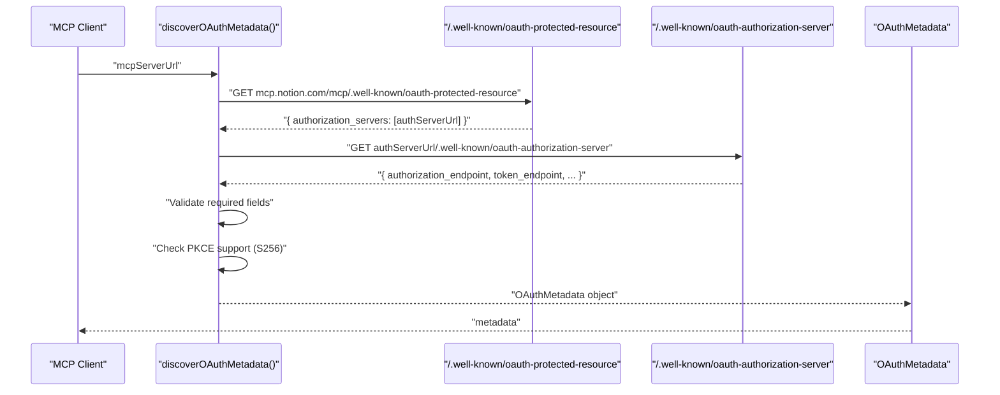

**Discovery Implementation:**

The `discoverOAuthMetadata()` function implements the complete RFC 9470 → RFC 8414 flow at [docs/mcp-client-integration.md:108-181](). Key steps:

1. **Protected Resource Metadata (RFC 9470)**: Fetches `/.well-known/oauth-protected-resource` from the MCP server URL to discover which authorization server(s) protect the resource
2. **Authorization Server Metadata (RFC 8414)**: Fetches `/.well-known/oauth-authorization-server` from the discovered authorization server URL
3. **Validation**: Ensures `authorization_endpoint` and `token_endpoint` are present
4. **PKCE Check**: Warns if `S256` method is not advertised in `code_challenge_methods_supported`

**OAuthMetadata Type:**

The discovery process returns an `OAuthMetadata` object containing:
- `issuer`: Authorization server identifier
- `authorization_endpoint`: URL for authorization requests
- `token_endpoint`: URL for token exchange/refresh
- `registration_endpoint`: URL for dynamic client registration (optional)
- `code_challenge_methods_supported`: PKCE methods supported
- `grant_types_supported`: OAuth grant types available
- `response_types_supported`: Response types supported
- `scopes_supported`: Available OAuth scopes

Sources: [docs/mcp-client-integration.md:91-194]()

---

## PKCE Implementation

PKCE (Proof Key for Code Exchange) prevents authorization code interception attacks by requiring the client to prove possession of a secret that never leaves the client.

### PKCE Parameter Generation

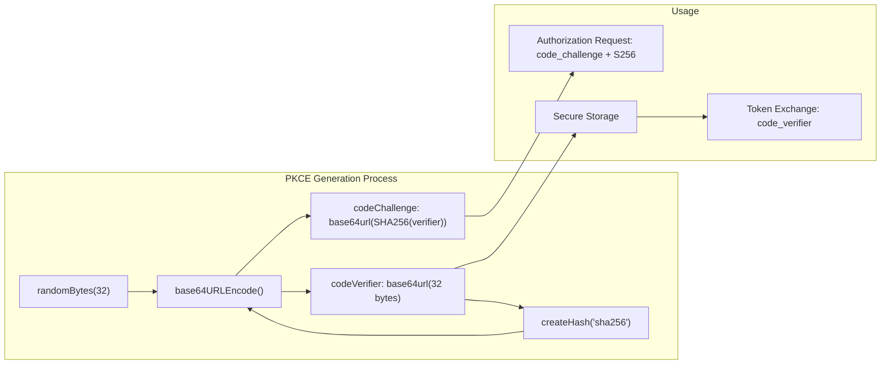

**PKCE Functions:**

| Function | Location | Purpose |
|----------|----------|---------|
| `generateCodeVerifier()` | [docs/mcp-client-integration.md:210-215]() | Generates 32 random bytes, encodes as base64url (~43 chars) |
| `generateCodeChallenge()` | [docs/mcp-client-integration.md:217-220]() | Creates SHA-256 hash of verifier, encodes as base64url |
| `base64URLEncode()` | [docs/mcp-client-integration.md:202-208]() | Converts Buffer to base64url format (replaces +/= with -_) |

**Security Requirements:**

1. **Verifier Generation**: Uses `randomBytes(32)` from Node.js crypto module to generate 256 bits of entropy
2. **Challenge Method**: Always uses `S256` (SHA-256), never plain text
3. **Storage Security**: `codeVerifier` must be stored securely until token exchange
4. **Single Use**: Each authorization flow requires new PKCE parameters
5. **Validation**: Server verifies `SHA256(codeVerifier) === codeChallenge` during token exchange

Sources: [docs/mcp-client-integration.md:195-231]()

---

## Client Registration

Notion MCP server supports dynamic client registration following RFC 7591, allowing clients to register programmatically without pre-registration.

### Client Registration Flow

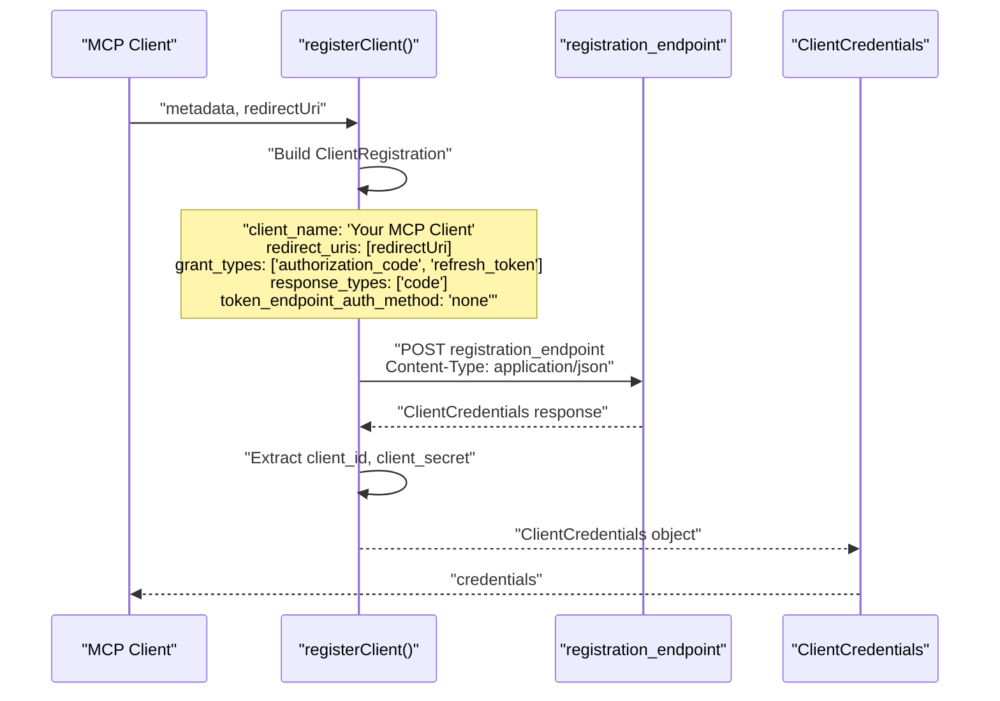

**Registration Types:**

| Type | Location | Fields |
|------|----------|--------|
| `ClientRegistration` | [docs/mcp-client-integration.md:237-245]() | `client_name`, `client_uri`, `redirect_uris`, `grant_types`, `response_types`, `token_endpoint_auth_method`, `scope` |
| `ClientCredentials` | [docs/mcp-client-integration.md:247-252]() | `client_id`, `client_secret`, `client_id_issued_at`, `client_secret_expires_at` |

**Registration Configuration:**

The `registerClient()` function at [docs/mcp-client-integration.md:254-292]() registers with these parameters:
- `grant_types`: `["authorization_code", "refresh_token"]` for OAuth code flow with refresh capability
- `response_types`: `["code"]` for authorization code response
- `token_endpoint_auth_method`: `"none"` for public clients (PKCE provides security)
- `redirect_uris`: Array containing the callback URL where authorization codes are received

**Credential Storage:**

The returned `ClientCredentials` must be stored securely:
- `client_id`: Public identifier for the client application
- `client_secret`: Confidential secret (may be undefined for public clients)
- Credentials persist across multiple authorization flows
- Should be encrypted at rest in production environments

Sources: [docs/mcp-client-integration.md:233-292]()

---

## Authorization Flow

The authorization flow redirects users to Notion's authorization server to grant access, then captures the authorization code via callback.

### Authorization Request Construction

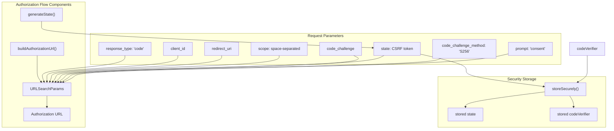

**Authorization Functions:**

| Function | Location | Purpose |
|----------|----------|---------|
| `buildAuthorizationUrl()` | [docs/mcp-client-integration.md:299-319]() | Constructs authorization URL with all required parameters |
| `generateState()` | [docs/mcp-client-integration.md:321-323]() | Generates random 32-byte CSRF protection token |

**URL Parameters:**

The authorization URL constructed at [docs/mcp-client-integration.md:307-316]() includes:
- `response_type=code`: Request authorization code
- `client_id`: Client identifier from registration
- `redirect_uri`: Callback URL for authorization code delivery
- `scope`: Space-separated list of requested permissions
- `state`: CSRF protection token (must be validated on callback)
- `code_challenge`: PKCE challenge from `generateCodeChallenge()`
- `code_challenge_method=S256`: SHA-256 challenge method
- `prompt=consent`: Force consent screen display

**Security Considerations:**

1. **State Parameter**: Generated with `randomBytes(32)` and stored securely; validated on callback to prevent CSRF attacks
2. **PKCE Challenge**: Sent in authorization request; verifier kept secret until token exchange
3. **Redirect URI**: Must use HTTPS in production (localhost HTTP allowed for development)
4. **Storage**: Both `state` and `codeVerifier` stored with 10-minute expiry

Sources: [docs/mcp-client-integration.md:294-347]()

---

## OAuth Callback Handling

After user authorization, the authorization server redirects back to the client's redirect URI with an authorization code or error.

### Callback Processing Flow

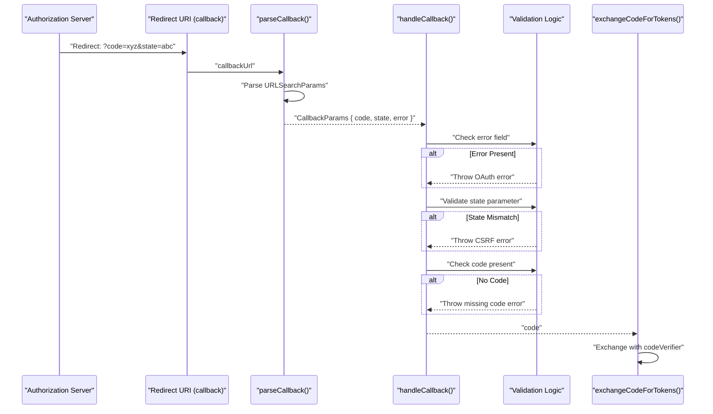

**Callback Types:**

| Type | Location | Fields |
|------|----------|--------|
| `CallbackParams` | [docs/mcp-client-integration.md:353-358]() | `code`, `state`, `error`, `error_description` |

**Callback Functions:**

| Function | Location | Purpose |
|----------|----------|---------|
| `parseCallback()` | [docs/mcp-client-integration.md:360-369]() | Extracts query parameters from callback URL |
| `handleCallback()` | [docs/mcp-client-integration.md:371-394]() | Validates state and error parameters, returns authorization code |

**Validation Steps:**

The `handleCallback()` function performs three critical validations:

1. **Error Detection** ([docs/mcp-client-integration.md:378-382]()):
   - Checks for `error` parameter in callback
   - Throws exception with `error` and `error_description` if present
   - Common errors: `access_denied`, `invalid_request`, `server_error`

2. **State Validation** ([docs/mcp-client-integration.md:384-386]()):
   - Compares callback `state` with stored `storedState`
   - Throws "Invalid state parameter - possible CSRF attack" if mismatch
   - Critical for preventing cross-site request forgery

3. **Code Presence** ([docs/mcp-client-integration.md:388-390]()):
   - Ensures `code` parameter exists in callback
   - Throws "Missing authorization code" if absent

Sources: [docs/mcp-client-integration.md:349-394]()

---

## Token Exchange and Management

The token exchange process converts the authorization code into access and refresh tokens, which are then used for API authentication.

### Token Lifecycle Management

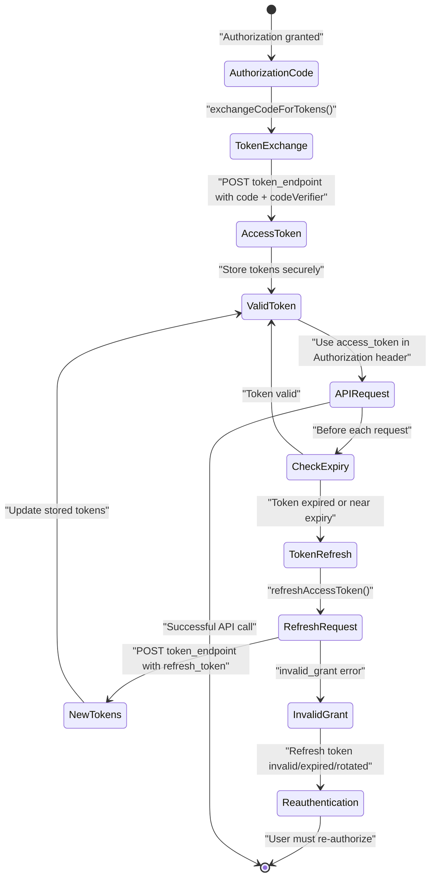

**Token Exchange Function:**

The `exchangeCodeForTokens()` function at [docs/mcp-client-integration.md:409-451]() performs these operations:

1. **Request Construction**:
   - `grant_type=authorization_code`: Specifies authorization code exchange
   - `code`: Authorization code from callback
   - `client_id`: Client identifier
   - `redirect_uri`: Must match authorization request
   - `code_verifier`: PKCE verifier (proves code ownership)
   - `client_secret`: Optional, for confidential clients

2. **HTTP Request**:
   - Method: `POST`
   - Content-Type: `application/x-www-form-urlencoded`
   - User-Agent: Custom identifier for tracking

3. **Response Validation**:
   - Checks HTTP status code
   - Validates `access_token` presence
   - Returns `TokenResponse` object

**TokenResponse Type:**

The response at [docs/mcp-client-integration.md:401-407]() contains:
- `access_token`: Bearer token for API authentication (required)
- `token_type`: Always `"Bearer"` for OAuth 2.0
- `expires_in`: Seconds until access token expiration (typically 3600 for 1 hour)
- `refresh_token`: Token for obtaining new access tokens (optional)
- `scope`: Granted scopes (may differ from requested)

**Token Refresh Function:**

The `refreshAccessToken()` function at [docs/mcp-client-integration.md:530-577]() handles token renewal:

1. **Refresh Request**:
   - `grant_type=refresh_token`
   - `refresh_token`: Previously issued refresh token
   - `client_id`: Client identifier
   - `client_secret`: Optional, for confidential clients

2. **Error Handling**:
   - `invalid_grant`: Refresh token invalid/expired → triggers re-authentication
   - `invalid_client`: Client credentials invalid
   - Network errors: Retry with exponential backoff

3. **Token Rotation**:
   - Many servers issue new refresh token and invalidate old one
   - New `refresh_token` must be stored if present in response
   - Cloudflare's `workers-oauth-provider` (used by Notion) maintains two valid refresh tokens during rotation

**Refresh Token Rotation Details:**

As documented at [docs/mcp-client-integration.md:758-768](), Notion's implementation has specific characteristics:
- Access tokens expire after 1 hour
- At any time, a grant may have two valid refresh tokens
- When client uses one refresh token, the other is invalidated and a new token is issued
- Concurrent refresh attempts may result in `invalid_grant` for all but the first
- Failed token updates allow one retry with previously stored token

Sources: [docs/mcp-client-integration.md:396-451](), [docs/mcp-client-integration.md:528-577](), [docs/mcp-client-integration.md:757-799]()

---

## MCP Transport Protocols

Notion MCP server supports two transport protocols for different client capabilities and network environments.

### Transport Protocol Architecture

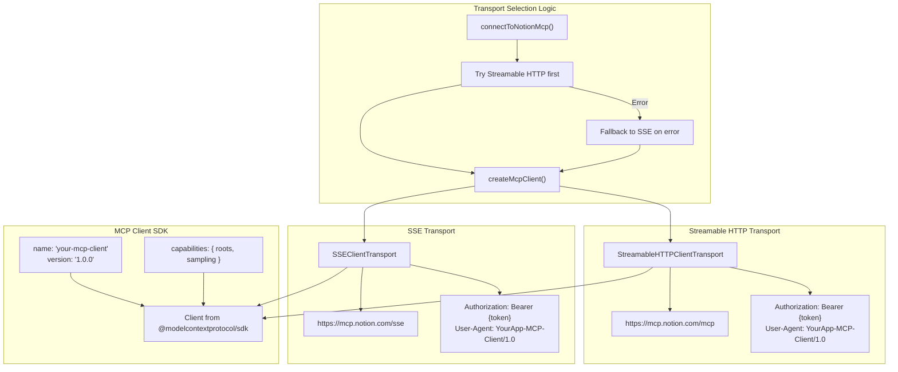

**Transport Comparison:**

| Protocol | Endpoint | Advantages | Use Case |
|----------|----------|------------|----------|
| **Streamable HTTP** | `/mcp` | More efficient, better connection management, preferred by Notion | Default choice for all clients |
| **SSE** | `/sse` | Broader compatibility, works through some proxies | Fallback when HTTP transport fails |

**Transport Implementation:**

The `createMcpClient()` function at [docs/mcp-client-integration.md:471-510]() creates MCP clients with transport-specific configuration:

1. **Client Initialization**:
   - Creates `Client` instance from `@modelcontextprotocol/sdk/client/index.js`
   - Sets client metadata: `name` and `version`
   - Declares capabilities: `roots` and `sampling`

2. **Streamable HTTP** ([docs/mcp-client-integration.md:499-505]()):
   - Uses `StreamableHTTPClientTransport` from `@modelcontextprotocol/sdk/client/streamableHttp.js`
   - Endpoint: `{serverUrl}/mcp`
   - Headers: `Authorization: Bearer {accessToken}`, `User-Agent`

3. **SSE Fallback** ([docs/mcp-client-integration.md:492-497]()):
   - Uses `SSEClientTransport` from `@modelcontextprotocol/sdk/client/sse.js`
   - Endpoint: `{serverUrl}/sse`
   - Same authentication headers

**Automatic Fallback:**

The `connectToNotionMcp()` function at [docs/mcp-client-integration.md:513-522]() implements automatic transport selection:
1. Attempts Streamable HTTP first
2. Catches connection errors
3. Logs fallback warning
4. Retries with SSE transport
5. Returns connected client regardless of transport used

**Connection Lifecycle:**

```typescript
// Client connection established
await client.connect(transport)

// Client is ready for MCP protocol operations
// - List available tools
// - Execute tool calls
// - Access Notion workspace data
```

Sources: [docs/mcp-client-integration.md:462-523]()

---

## Complete Integration Example

The `NotionMcpClient` class provides a complete, production-ready implementation of the OAuth + MCP integration flow.

### NotionMcpClient Class Structure

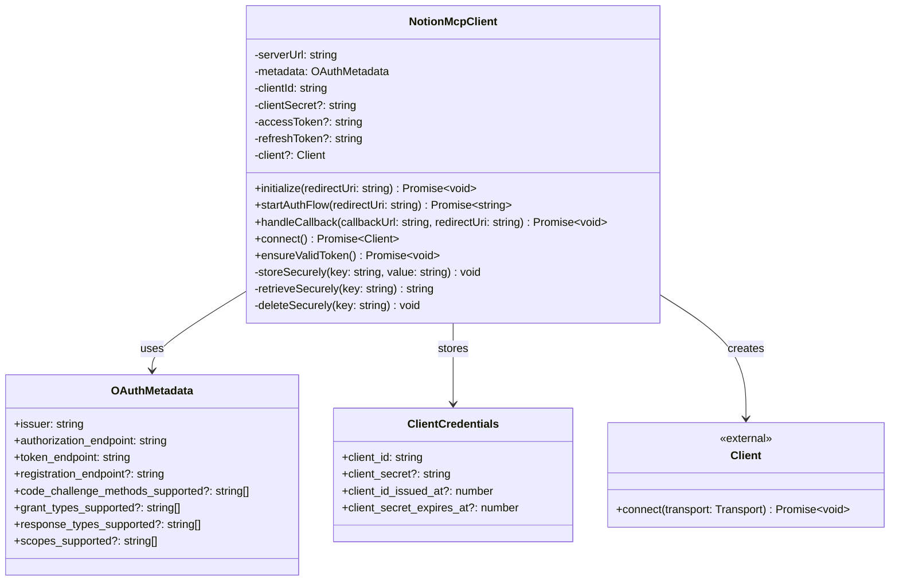

**Integration Workflow:**

The `NotionMcpClient` class at [docs/mcp-client-integration.md:592-713]() orchestrates the complete integration:

1. **Initialization Phase** ([docs/mcp-client-integration.md:601-606]()):
   ```typescript
   async initialize(redirectUri: string)
   ```
   - Calls `discoverOAuthMetadata()` to fetch OAuth endpoints
   - Calls `registerClient()` to obtain client credentials
   - Stores `clientId` and optional `clientSecret`

2. **Authorization Phase** ([docs/mcp-client-integration.md:608-624]()):
   ```typescript
   async startAuthFlow(redirectUri: string): Promise<string>
   ```
   - Generates PKCE parameters (`codeVerifier`, `codeChallenge`)
   - Generates CSRF `state` token
   - Stores parameters securely with `storeSecurely()`
   - Returns authorization URL for user redirect

3. **Callback Phase** ([docs/mcp-client-integration.md:626-650]()):
   ```typescript
   async handleCallback(callbackUrl: string, redirectUri: string)
   ```
   - Retrieves stored `state` and `codeVerifier` with `retrieveSecurely()`
   - Validates callback with `handleCallback()`
   - Exchanges code for tokens with `exchangeCodeForTokens()`
   - Stores `accessToken` and `refreshToken`
   - Cleans up temporary storage with `deleteSecurely()`

4. **Connection Phase** ([docs/mcp-client-integration.md:652-673]()):
   ```typescript
   async connect(): Promise<Client>
   ```
   - Validates authentication state
   - Attempts Streamable HTTP connection
   - Falls back to SSE on failure
   - Returns connected MCP `Client` instance

5. **Token Refresh Phase** ([docs/mcp-client-integration.md:675-698]()):
   ```typescript
   async ensureValidToken(): Promise<void>
   ```
   - Checks `refreshToken` availability
   - Calls `refreshAccessToken()`
   - Updates `accessToken` and `refreshToken` if rotated
   - Throws "Re-authentication required" on `invalid_grant`

**Secure Storage Interface:**

The class defines three abstract methods for secure credential storage ([docs/mcp-client-integration.md:700-711]()):

| Method | Purpose | Implementation Requirements |
|--------|---------|---------------------------|
| `storeSecurely(key, value)` | Store sensitive data | Encrypt at rest, use secure keychain/credential manager |
| `retrieveSecurely(key)` | Retrieve sensitive data | Decrypt and return, handle missing keys gracefully |
| `deleteSecurely(key)` | Remove sensitive data | Securely wipe, not just delete reference |

**Usage Example:**

```typescript
const mcpClient = new NotionMcpClient()

// 1. Initialize
await mcpClient.initialize("http://localhost:3000/callback")

// 2. Get authorization URL and redirect user
const authUrl = await mcpClient.startAuthFlow("http://localhost:3000/callback")
// Redirect user to authUrl...

// 3. Handle callback after user authorization
await mcpClient.handleCallback(callbackUrl, "http://localhost:3000/callback")

// 4. Connect to MCP server
const client = await mcpClient.connect()

// 5. Ensure token is valid before operations
await mcpClient.ensureValidToken()
```

Sources: [docs/mcp-client-integration.md:582-713]()

---

## Security Best Practices

The integration implements multiple security layers following OAuth 2.0 and MCP security standards.

### Security Architecture

```mermaid
graph TB
    subgraph "Transport Security"
        HTTPS["HTTPS/TLS 1.2+"]
        HTTPSValidation["SSL Certificate Validation"]
        LocalhostException["HTTP allowed for localhost only"]
    end
    
    subgraph "PKCE Security"
        CodeVerifier["codeVerifier: 32 random bytes"]
        SHA256Challenge["code_challenge: SHA256(verifier)"]
        S256Method["code_challenge_method: S256"]
        SingleUse["Single use per authorization"]
    end
    
    subgraph "CSRF Protection"
        StateParameter["state: 32 random bytes"]
        StateValidation["Validate state on callback"]
        ShortExpiry["10 minute expiry"]
    end
    
    subgraph "Token Security"
        SecureStorage["Encrypted at-rest storage"]
        ServerSideOnly["Server-side storage for web apps"]
        KeychainAPI["OS keychain for desktop/mobile"]
        TokenRotation["Refresh token rotation"]
        ProactiveRefresh["Refresh 5-10 min before expiry"]
    end
    
    subgraph "Error Handling"
        InvalidGrant["invalid_grant → Re-authenticate"]
        RetryLogic["Network errors → Exponential backoff"]
        RateLimit["Rate limiting on token refresh"]
        AuditLog["Audit logging for OAuth operations"]
    end
    
    HTTPS --> HTTPSValidation
    HTTPS --> LocalhostException
    
    CodeVerifier --> SHA256Challenge
    SHA256Challenge --> S256Method
    S256Method --> SingleUse
    
    StateParameter --> StateValidation
    StateValidation --> ShortExpiry
    
    SecureStorage --> ServerSideOnly
    SecureStorage --> KeychainAPI
    SecureStorage --> TokenRotation
    TokenRotation --> ProactiveRefresh
    
    InvalidGrant --> AuditLog
    RetryLogic --> RateLimit
```

**Security Requirements:**

The documentation at [docs/mcp-client-integration.md:715-727]() mandates these practices:

| Practice | Implementation | Rationale |
|----------|----------------|-----------|
| **HTTPS Only** | All OAuth and MCP endpoints must use HTTPS (except localhost) | Prevents token interception |
| **State Validation** | Always verify `state` matches stored value | Prevents CSRF attacks |
| **Secure Token Storage** | Encrypt tokens at rest, never in localStorage/cookies for web | Prevents token theft |
| **PKCE Mandatory** | Use PKCE even if server doesn't advertise support | Prevents authorization code interception |
| **Token Expiry** | Check and refresh proactively (5-10 min before expiry) | Prevents failed requests |
| **Error Handling** | Handle `invalid_grant` gracefully | Enables proper re-authentication flow |
| **Certificate Validation** | Validate SSL certificates in production | Prevents MITM attacks |
| **Rate Limiting** | Limit token refresh requests | Prevents abuse and DoS |
| **Scope Minimization** | Only request necessary scopes | Principle of least privilege |
| **Audit Logging** | Log all OAuth operations | Security monitoring and forensics |

**Token Storage Security:**

As documented at [docs/mcp-client-integration.md:454-461]():

- **Web applications**: Store tokens server-side only, never in localStorage or client-side cookies
- **Desktop applications**: Use OS-specific secure storage (macOS Keychain, Windows Credential Manager)
- **Mobile applications**: Use platform keychain/keystore APIs (iOS Keychain, Android Keystore)
- **All platforms**: Always encrypt tokens at rest

**Authorization Security:**

The authorization flow at [docs/mcp-client-integration.md:340-347]() implements these safeguards:

- HTTPS-only redirect URIs in production (HTTP allowed for `localhost` development)
- Encrypted session storage for `state` and `codeVerifier`
- Short expiry (10 minutes) for stored values to limit exposure window
- State validation on callback to detect and reject CSRF attempts

**Refresh Token Security:**

Token refresh at [docs/mcp-client-integration.md:770-799]() requires careful handling:

1. **Refresh Token Rotation**: Always store new `refresh_token` if provided (RFC 6749 Section 10.4)
2. **Concurrent Request Protection**: Use mutex/lock to prevent multiple simultaneous refresh attempts
3. **Proactive Refresh**: Refresh 5-10 minutes before expiry to avoid race conditions
4. **Token Caching**: Cache access tokens with accurate expiry to minimize refresh requests
5. **Error Classification**: Distinguish `invalid_grant` (re-auth required) from transient errors (retry with backoff)

Sources: [docs/mcp-client-integration.md:715-727](), [docs/mcp-client-integration.md:454-461](), [docs/mcp-client-integration.md:770-799]()

---

## Error Handling and Troubleshooting

The integration must handle various error conditions across OAuth discovery, authorization, token exchange, and MCP connection.

### Common Error Scenarios

```mermaid
graph TB
    subgraph "Discovery Errors"
        DiscoveryFail["Discovery Failure"]
        Check9470["Check RFC 9470 endpoint"]
        Check8414["Check RFC 8414 endpoint"]
        ValidateURL["Validate server URL"]
    end
    
    subgraph "Authorization Errors"
        InvalidState["Invalid State Parameter"]
        ExpiredState["State expired (>10 min)"]
        StoreState["Verify secure storage"]
        
        InvalidVerifier["Invalid code_verifier"]
        VerifierMismatch["Verifier != challenge source"]
        Base64Encoding["Check base64url encoding"]
    end
    
    subgraph "Token Errors"
        InvalidGrant["invalid_grant"]
        RefreshRotation["Refresh token rotated"]
        TokenExpired["Refresh token expired"]
        Concurrent["Concurrent refresh attempts"]
        
        InvalidClient["invalid_client"]
        ClientMismatch["Client credentials mismatch"]
    end
    
    subgraph "Connection Errors"
        ConnectionTimeout["Connection Timeout"]
        TryHTTP["Try Streamable HTTP"]
        FallbackSSE["Fallback to SSE"]
        CheckProxy["Check proxy/firewall"]
        
        CORSError["CORS in Browser"]
        ServerSide["Do token exchange server-side"]
    end
    
    DiscoveryFail --> Check9470
    DiscoveryFail --> Check8414
    DiscoveryFail --> ValidateURL
    
    InvalidState --> ExpiredState
    InvalidState --> StoreState
    
    InvalidVerifier --> VerifierMismatch
    InvalidVerifier --> Base64Encoding
    
    InvalidGrant --> RefreshRotation
    InvalidGrant --> TokenExpired
    InvalidGrant --> Concurrent
    
    InvalidClient --> ClientMismatch
    
    ConnectionTimeout --> TryHTTP
    TryHTTP --> FallbackSSE
    ConnectionTimeout --> CheckProxy
    
    CORSError --> ServerSide
```

**Common Issues:**

The troubleshooting section at [docs/mcp-client-integration.md:728-756]() documents these issues:

| Error | Cause | Solution |
|-------|-------|----------|
| "Invalid state parameter" | State not stored or expired | Store state securely, expire after ~10 minutes |
| "Invalid code_verifier" | Wrong verifier or encoding error | Use exact verifier that produced code_challenge, ensure base64url encoding (no +, /, =) |
| Discovery fails | Wrong endpoint or unsupported OAuth | Use RFC 9470 then RFC 8414, confirm server supports OAuth |
| Connection timeout | Network issues or wrong transport | Prefer Streamable HTTP, fallback to SSE, check proxy/firewall |
| CORS in browser | Token exchange from browser | Perform token exchange server-side only |

**Invalid Grant Error Handling:**

The `invalid_grant` error ([docs/mcp-client-integration.md:757-799]()) is the most complex error scenario:

**Notion MCP Specifics:**
- Access tokens expire after 1 hour
- Refresh token rotation: Up to 2 valid tokens at any time
- When one token is used, the other is invalidated and new token issued
- Concurrent refreshes result in `invalid_grant` for all but first request

**Root Causes:**

1. **Rotation on Use** ([docs/mcp-client-integration.md:773-775]()):
   - OAuth provider rotates refresh tokens on use and revokes old one
   - Fix: Atomically persist new `refresh_token` with access token

2. **Expired Refresh Token** ([docs/mcp-client-integration.md:777-779]()):
   - Refresh tokens typically expire after 30-90 days
   - Fix: Initiate re-authentication, monitor for early expirations

3. **Client Credential Mismatch** ([docs/mcp-client-integration.md:781-783]()):
   - `client_id` or `client_secret` differs from initial authorization
   - Fix: Keep credentials consistent throughout token lifetime

4. **Explicit Revocation** ([docs/mcp-client-integration.md:785-787]()):
   - User revoked access, password change, or security policy
   - Fix: Show clear reconnection UI with explanation

5. **Concurrent Refreshes** ([docs/mcp-client-integration.md:789-791]()):
   - Multiple refresh requests in flight cause losers to fail
   - Fix: Use mutex or distributed lock around refresh operation

**Operational Guidance:**

The minimal refresh helper at [docs/mcp-client-integration.md:802-837]() demonstrates proper error handling:

```typescript
// Error classification
if (err.error === "invalid_grant") {
    throw new Error("REAUTH_REQUIRED")  // User must re-authorize
}

// Retry strategy
// - invalid_grant → Don't retry, re-authenticate
// - temporarily_unavailable or network errors → Retry with exponential backoff
// - Refresh 5-10 minutes before expiry to avoid races
// - Cache access tokens with accurate expiry tracking
```

**Retry Strategy:**

| Error Type | Action | Rationale |
|------------|--------|-----------|
| `invalid_grant` | Re-authenticate, don't retry | Refresh token is permanently invalid |
| `temporarily_unavailable` | Retry with exponential backoff | Transient server issue |
| Network timeout | Retry with exponential backoff | Transient network issue |
| `invalid_client` | Check client credentials | Configuration error |
| Rate limit | Back off, reduce refresh frequency | Prevent abuse |

Sources: [docs/mcp-client-integration.md:728-837]()

---

## External Dependencies and Resources

The MCP client integration relies on external packages, RFCs, and documentation resources.

### Required Libraries

**TypeScript/JavaScript:**
- `@modelcontextprotocol/sdk`: Official MCP SDK for client implementation
- `oauth` or `openid-client`: OAuth 2.0 client libraries
- `crypto`: Built-in Node.js module for PKCE generation

**Alternative Language Support:**

The documentation at [docs/mcp-client-integration.md:42-79]() provides library recommendations for multiple languages:

| Language | MCP SDK | OAuth Library | PKCE Support |
|----------|---------|---------------|--------------|
| **Python** | [mcp-python-sdk](https://github.com/modelcontextprotocol/python-sdk) | `authlib` or `requests-oauthlib` | Built into `authlib` or `pkce` package |
| **Go** | [mcp-go-sdk](https://github.com/modelcontextprotocol/go-sdk) | `golang.org/x/oauth2` | Built into `oauth2` package |
| **Rust** | [mcp-rust-sdk](https://github.com/modelcontextprotocol/rust-sdk) | `oauth2` crate | Built into `oauth2` crate |
| **Java** | Apache HttpClient / OkHttp | ScribeJava or Spring Security OAuth2 | Built into ScribeJava or `nimbus-jose-jwt` |
| **C# / .NET** | HttpClient / RestSharp | IdentityModel.OidcClient or OAuth.NET | Built into IdentityModel.OidcClient |
| **Ruby** | Net::HTTP or Faraday | `oauth2` gem | Built into `oauth2` gem |

### Key RFC References

The integration implements these OAuth and MCP specifications:

| RFC | Title | Purpose |
|-----|-------|---------|
| [RFC 6749](https://datatracker.ietf.org/doc/html/rfc6749) | OAuth 2.0 Authorization Framework | Core OAuth 2.0 protocol |
| [RFC 7636](https://datatracker.ietf.org/doc/html/rfc7636) | PKCE | Security enhancement for OAuth code flow |
| [RFC 8414](https://datatracker.ietf.org/doc/html/rfc8414) | OAuth 2.0 Authorization Server Metadata | Authorization server discovery |
| [RFC 9470](https://datatracker.ietf.org/doc/html/rfc9470) | OAuth 2.0 Protected Resource Metadata | Protected resource discovery |
| [RFC 7591](https://www.rfc-editor.org/rfc/rfc7591.html) | OAuth 2.0 Dynamic Client Registration | Dynamic client registration |

### External Documentation

| Resource | URL | Purpose |
|----------|-----|---------|
| **MCP Specification** | [spec.modelcontextprotocol.io](https://spec.modelcontextprotocol.io) | Model Context Protocol standard |
| **MCP Client Guide** | [Building an MCP client](https://modelcontextprotocol.io/docs/develop/build-client) | Client development guide |
| **Notion MCP Docs** | [developers.notion.com](https://developers.notion.com) | Notion-specific MCP documentation |
| **MCP Registry** | [github.com/modelcontextprotocol/registry](https://github.com/modelcontextprotocol/registry/tree/main/docs) | Anthropic's MCP server registry |
| **Notion MCP Server** | [github.com/makenotion/notion-mcp-server](https://github.com/makenotion/notion-mcp-server) | Notion MCP server implementation |
| **MCP SDK Docs** | [github.com/modelcontextprotocol/sdk](https://github.com/modelcontextprotocol/sdk) | MCP SDK documentation |

### Notion MCP Implementation Details

The Notion remote MCP server ([docs/mcp-client-integration.md:758-768]()):
- Built with [Cloudflare's `workers-oauth-provider`](https://github.com/cloudflare/workers-oauth-provider)
- Access token expiry: 1 hour
- Refresh token rotation: Up to 2 valid tokens during rotation period
- Supports both Streamable HTTP (`/mcp`) and SSE (`/sse`) transports
- Requires OAuth 2.0 Authorization Code flow with PKCE

Sources: [docs/mcp-client-integration.md:23-89](), [docs/mcp-client-integration.md:839-845]()

---

