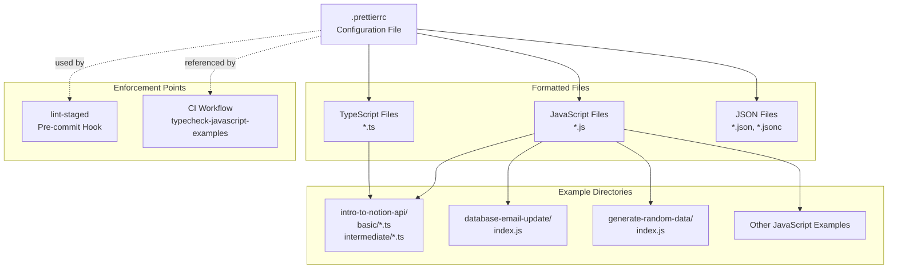
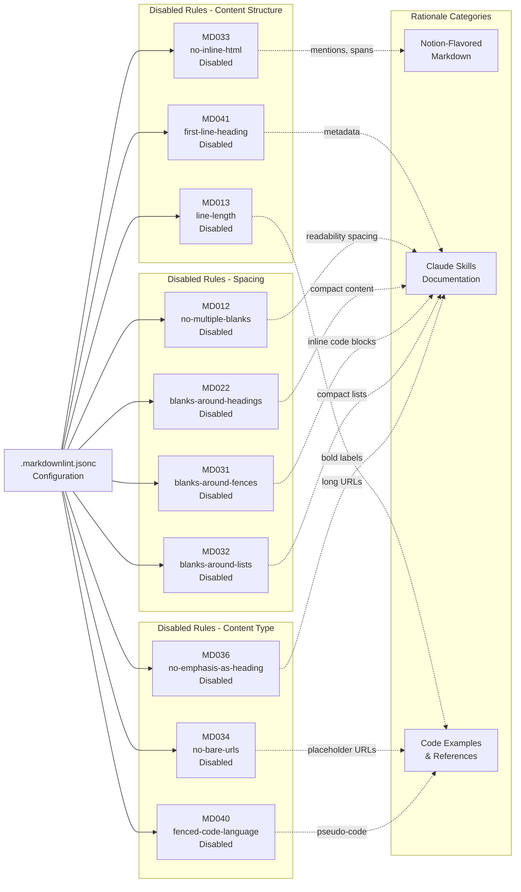
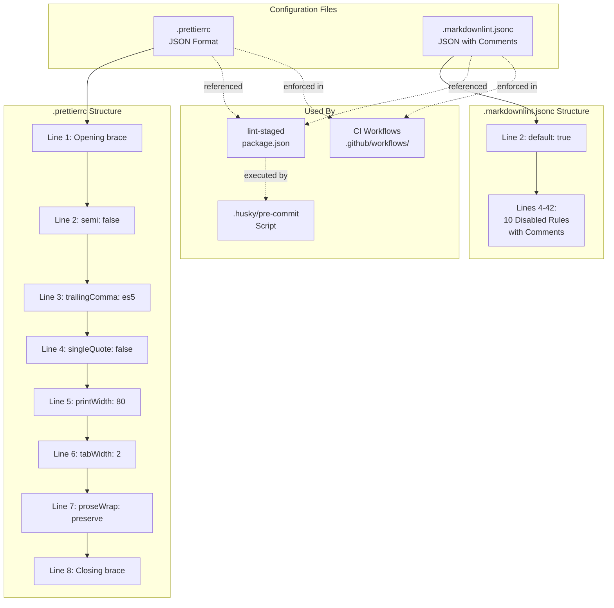

<!-- source: DeepWiki mcp.deepwiki.com · repo makenotion/notion-cookbook · page 6.1 Code Style Standards · fetched 2026-10-26 -->

# Code Style Standards

<details>
<summary>Relevant source files</summary>

The following files were used as context for generating this wiki page:

- [.markdownlint.jsonc](.markdownlint.jsonc)
- [.prettierrc](.prettierrc)

</details>


## Purpose and Scope

This page documents the code style and documentation formatting standards enforced in the Notion Cookbook repository. It covers:

- **Code Formatting**: Prettier configuration for JavaScript and TypeScript files
- **Markdown Linting**: Markdownlint rules for documentation consistency
- **Rationale**: Why certain rules are disabled for Notion-flavored content

For information about how these standards are enforced through automation, see [CI/CD Pipeline](#7.1) and [Pre-commit Hooks](#7.2). For information about the overall contribution workflow, see [Contributing](#6).

---

## Code Formatting with Prettier

The repository uses Prettier for automatic code formatting of JavaScript and TypeScript files. The configuration is defined in `.prettierrc` and enforces consistent formatting across all examples.

### Prettier Configuration

| Setting | Value | Purpose |
|---------|-------|---------|
| `semi` | `false` | Omit semicolons at the end of statements |
| `trailingComma` | `"es5"` | Add trailing commas where valid in ES5 (objects, arrays) |
| `singleQuote` | `false` | Use double quotes for strings |
| `printWidth` | `80` | Wrap lines at 80 characters |
| `tabWidth` | `2` | Use 2 spaces for indentation |
| `proseWrap` | `"preserve"` | Do not wrap prose in markdown files |

**Sources:** [.prettierrc:1-8]()

### Code Formatting Scope



**Diagram: Prettier Configuration and Application Scope**

**Sources:** [.prettierrc:1-8]()

### Key Formatting Rules

The Prettier configuration prioritizes readability and consistency:

- **No Semicolons**: Following modern JavaScript conventions, semicolons are omitted where automatic semicolon insertion applies
- **Double Quotes**: String literals use double quotes for consistency with JSON and HTML attributes
- **80 Character Line Width**: Keeps code readable without horizontal scrolling
- **ES5 Trailing Commas**: Reduces diff noise when adding items to arrays or objects

**Sources:** [.prettierrc:2-7]()

---

## Markdown Linting with Markdownlint

The repository uses Markdownlint to enforce documentation quality standards. However, **10 rules are intentionally disabled** to accommodate Notion-flavored markdown and Claude skills documentation patterns.

### Disabled Rules and Rationales



**Diagram: Markdownlint Disabled Rules and Their Rationales**

**Sources:** [.markdownlint.jsonc:1-43]()

### Detailed Rule Exemptions

| Rule | Name | Disabled Because |
|------|------|------------------|
| **MD013** | line-length | Code examples and URLs often exceed 80 characters |
| **MD033** | no-inline-html | Notion-flavored markdown uses HTML for mentions, spans, underlines |
| **MD041** | first-line-heading | Some files start with metadata or front matter |
| **MD012** | no-multiple-blanks | Claude skills use spacing for readability in structured content |
| **MD022** | blanks-around-headings | Tightly packed content in skills and examples for conciseness |
| **MD031** | blanks-around-fences | Skills documentation uses inline code blocks in workflows |
| **MD032** | blanks-around-lists | Compact list formatting in skills and reference documentation |
| **MD034** | no-bare-urls | Examples and skills contain placeholder URLs and references |
| **MD036** | no-emphasis-as-heading | Skills use bold text for labels and inline emphasis |
| **MD040** | fenced-code-language | Many code blocks are pseudo-code or generic examples without specific language |

**Sources:** [.markdownlint.jsonc:4-42]()

### Rule Categories

The disabled rules fall into three functional categories:

#### 1. Notion-Flavored Markdown Support

Notion's markdown flavor extends standard markdown with HTML elements:

- **MD033 (no-inline-html)**: Allows `<span>`, mentions, and semantic elements
- **MD036 (no-emphasis-as-heading)**: Supports bold text for inline labels

**Sources:** [.markdownlint.jsonc:8-10](), [.markdownlint.jsonc:36-38]()

#### 2. Claude Skills Documentation Patterns

AI skills documentation prioritizes structured, compact content:

- **MD012 (no-multiple-blanks)**: Allows spacing for visual grouping
- **MD022 (blanks-around-headings)**: Enables tight section packing
- **MD031 (blanks-around-fences)**: Supports inline code in workflows
- **MD032 (blanks-around-lists)**: Permits compact list formatting

**Sources:** [.markdownlint.jsonc:16-32]()

#### 3. Code Examples and Technical Content

Technical documentation often has special formatting needs:

- **MD013 (line-length)**: Accommodates long URLs and code snippets
- **MD040 (fenced-code-language)**: Allows pseudo-code and generic examples
- **MD034 (no-bare-urls)**: Permits placeholder URLs in examples
- **MD041 (first-line-heading)**: Supports metadata and front matter

**Sources:** [.markdownlint.jsonc:4-6](), [.markdownlint.jsonc:12-14](), [.markdownlint.jsonc:32-34](), [.markdownlint.jsonc:40-42]()

---

## Configuration File Structure



**Diagram: Configuration File Structure and Usage**

**Sources:** [.prettierrc:1-8](), [.markdownlint.jsonc:1-43]()

---

## Enforcement Mechanism

These style standards are enforced at two levels:

### 1. Local Enforcement (Pre-commit)

When developers commit code, `lint-staged` automatically:

- Runs Prettier on staged JavaScript/TypeScript files
- Checks markdown files against `.markdownlint.jsonc` rules
- Blocks commits that fail formatting checks

See [Pre-commit Hooks](#7.2) for detailed implementation.

### 2. CI Enforcement (GitHub Actions)

The CI pipeline validates code quality on every push:

- **typecheck-javascript-examples**: Type checks all examples (implicitly validates Prettier formatting)
- **markdown-lint**: Validates all markdown files against `.markdownlint.jsonc`

See [CI/CD Pipeline](#7.1) for workflow details.

---

## Working with Style Standards

### Applying Code Formatting

To format JavaScript/TypeScript files manually:

```bash
# Format a specific file
npx prettier --write path/to/file.js

# Format all JavaScript files
npx prettier --write "examples/**/*.{js,ts}"
```

The pre-commit hook will automatically format staged files, so manual formatting is rarely needed.

### Checking Markdown Compliance

To check markdown files manually:

```bash
# Install markdownlint-cli if not already installed
npm install -g markdownlint-cli

# Check specific file
markdownlint path/to/file.md

# Check all markdown files
markdownlint "**/*.md"
```

### Handling Formatting Conflicts

If you encounter formatting issues:

1. **Pre-commit failures**: Run `npx prettier --write` on the affected files
2. **Markdown lint failures**: Review the error against disabled rules in `.markdownlint.jsonc`
3. **Legitimate exceptions**: Document the reason in the PR description

### When Rules Don't Apply

The disabled rules are intentionally broad to support:

- Notion-specific markdown features
- Claude AI skills documentation
- Technical content with special formatting needs

If a rule conflict arises that these exemptions don't cover, discuss it in the PR review process.

---

## Configuration Reference

### Complete Prettier Settings

All settings from [.prettierrc:1-8]():

```json
{
  "semi": false,
  "trailingComma": "es5",
  "singleQuote": false,
  "printWidth": 80,
  "tabWidth": 2,
  "proseWrap": "preserve"
}
```

### Complete Markdownlint Configuration

Base configuration from [.markdownlint.jsonc:2]():

- `"default": true` - Enable all rules by default
- 10 specific rules disabled with documented rationales

All disabled rules are explicitly listed in [.markdownlint.jsonc:4-42]() with inline comments explaining the rationale.

---

**Sources:** [.prettierrc:1-8](), [.markdownlint.jsonc:1-43]()

---

