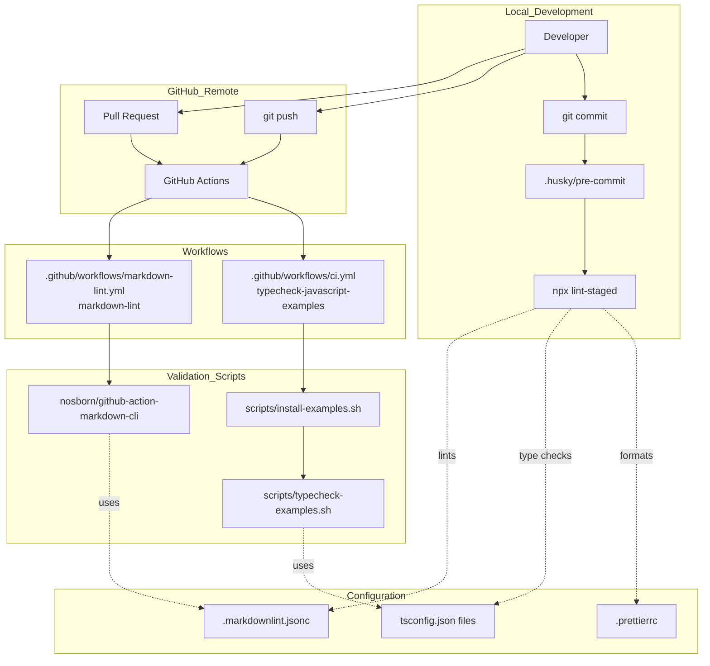
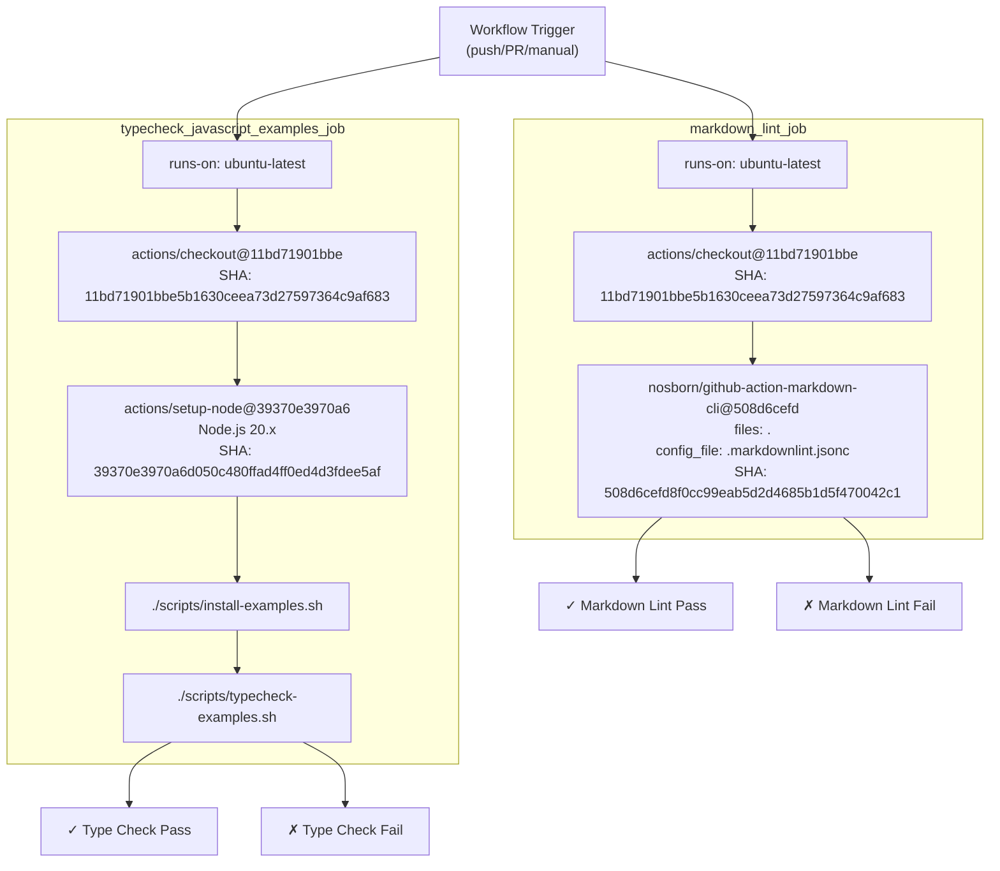

<!-- source: DeepWiki mcp.deepwiki.com · repo makenotion/notion-cookbook · page 7 Development Infrastructure · fetched 2026-10-26 -->

# Development Infrastructure

<details>
<summary>Relevant source files</summary>

The following files were used as context for generating this wiki page:

- [.github/workflows/ci.yml](.github/workflows/ci.yml)
- [.github/workflows/markdown-lint.yml](.github/workflows/markdown-lint.yml)
- [.husky/pre-commit](.husky/pre-commit)

</details>


## Purpose and Scope

This document provides an overview of the development infrastructure that ensures code quality and consistency across the Notion Cookbook repository. It covers the tooling stack, automation systems, and local development setup that developers interact with when contributing to the project.

For detailed information about specific components:
- CI/CD workflows and GitHub Actions configuration: see [CI/CD Pipeline](#7.1)
- Pre-commit hooks and local enforcement: see [Pre-commit Hooks](#7.2)
- Code formatting and linting rules: see [Code Style Standards](#6.1)

**Sources:** [.github/workflows/ci.yml:1-26](), [.github/workflows/markdown-lint.yml:1-23](), [.husky/pre-commit:1-2]()

## Overview

The development infrastructure implements a defense-in-depth approach to code quality enforcement. It operates at two layers:

1. **Local enforcement**: Pre-commit hooks run before code is committed, providing immediate feedback to developers
2. **Remote validation**: GitHub Actions workflows validate all code pushed to the repository or submitted via pull requests

This dual-layer approach ensures that code quality issues are caught early in the development cycle, reducing the feedback loop and preventing broken code from being merged into the main branch.

**Sources:** [.github/workflows/ci.yml:1-26](), [.husky/pre-commit:1-2]()

## Tooling Stack

The infrastructure uses the following tools:

| Tool | Purpose | Configuration File |
|------|---------|-------------------|
| Husky | Git hooks management | `.husky/pre-commit` |
| lint-staged | Run linters on staged files | `package.json` |
| TypeScript Compiler | Type checking JavaScript examples | `tsconfig.json` files |
| Prettier | Code formatting | `.prettierrc` |
| markdownlint-cli | Markdown file linting | `.markdownlint.jsonc` |
| GitHub Actions | CI/CD automation | `.github/workflows/*.yml` |
| Node.js 20.x | JavaScript runtime environment | Specified in workflows |

**Sources:** [.github/workflows/ci.yml:17-21](), [.husky/pre-commit:1-2](), [.github/workflows/markdown-lint.yml:17-22]()

## Infrastructure Architecture



**Diagram: Complete Development Infrastructure Flow**

This diagram shows how the development infrastructure components interact from local development through CI validation. The `npx lint-staged` command invoked by `.husky/pre-commit` enforces code quality locally, while GitHub Actions workflows provide remote validation through shell scripts and third-party actions.

**Sources:** [.github/workflows/ci.yml:1-26](), [.github/workflows/markdown-lint.yml:1-23](), [.husky/pre-commit:1-2]()

## Workflow Trigger Configuration

Both CI workflows are configured with identical trigger conditions:

| Trigger Type | Configuration | Purpose |
|--------------|---------------|---------|
| `push` | Branches: `[main]` | Validate all commits to main branch |
| `pull_request` | Branches: `[main]` | Validate all PRs targeting main branch |
| `workflow_dispatch` | N/A | Allow manual workflow execution |

This configuration ensures that code quality checks run automatically on all changes to the main branch, whether through direct pushes or pull requests, while also allowing developers to manually trigger workflows when needed for debugging.

**Sources:** [.github/workflows/ci.yml:3-8](), [.github/workflows/markdown-lint.yml:3-8]()

## CI Workflow Execution Flow



**Diagram: GitHub Actions Workflow Execution**

This diagram maps the exact execution flow of the CI workflows, including the specific action versions and SHA hashes used. Both workflows use `ubuntu-latest` runners and pin specific action versions for security and reproducibility. The `typecheck-javascript-examples` job executes custom shell scripts, while the `markdown-lint` job uses a third-party GitHub Action.

**Sources:** [.github/workflows/ci.yml:10-26](), [.github/workflows/markdown-lint.yml:10-23]()

## Action Version Pinning

The workflows implement security best practices by pinning GitHub Actions to specific commit SHAs rather than version tags:

| Action | Version Tag | Pinned SHA |
|--------|-------------|------------|
| `actions/checkout` | v4.2.2 | `11bd71901bbe5b1630ceea73d27597364c9af683` |
| `actions/setup-node` | v4.1.0 | `39370e3970a6d050c480ffad4ff0ed4d3fdee5af` |
| `nosborn/github-action-markdown-cli` | v3.5.0 | `508d6cefd8f0cc99eab5d2d4685b1d5f470042c1` |

SHA pinning prevents supply chain attacks by ensuring that workflow dependencies cannot be silently updated by compromised upstream repositories. Version tag comments provide human-readable context.

**Sources:** [.github/workflows/ci.yml:15-19](), [.github/workflows/markdown-lint.yml:15-19]()

## Local Pre-commit Hook

The local enforcement layer is implemented through a minimal pre-commit hook:

```bash
npx lint-staged
```

This single command invokes the `lint-staged` package, which is configured in the repository's `package.json` to run appropriate linters and formatters only on files that are staged for commit. The configuration determines which tools run on which file types.

The hook is installed in the `.husky/pre-commit` file and executes automatically before each commit is created.

**Sources:** [.husky/pre-commit:1-2]()

## CI Job Configuration Details

### Type Check Job Configuration

The `typecheck-javascript-examples` job executes with the following step sequence:

1. **Checkout** [.github/workflows/ci.yml:16](): Retrieves repository code using `actions/checkout`
2. **Node.js Setup** [.github/workflows/ci.yml:17-21](): Installs Node.js 20.x using `actions/setup-node`
3. **Install Dependencies** [.github/workflows/ci.yml:22-23](): Executes `./scripts/install-examples.sh`
4. **Type Checking** [.github/workflows/ci.yml:24-25](): Executes `./scripts/typecheck-examples.sh`

### Markdown Lint Job Configuration

The `markdown-lint` job executes with the following step sequence:

1. **Checkout** [.github/workflows/markdown-lint.yml:16](): Retrieves repository code using `actions/checkout`
2. **Lint Markdown** [.github/workflows/markdown-lint.yml:17-22](): Runs `nosborn/github-action-markdown-cli` with:
   - `files: .` - Lints all Markdown files in repository
   - `config_file: .markdownlint.jsonc` - Uses repository's Markdown linting rules

**Sources:** [.github/workflows/ci.yml:14-25](), [.github/workflows/markdown-lint.yml:14-22]()

## Validation Scripts

The CI workflow relies on two custom shell scripts for validation:

| Script | Purpose | Invoked By |
|--------|---------|------------|
| `scripts/install-examples.sh` | Installs dependencies for all JavaScript examples | CI workflow step 3 |
| `scripts/typecheck-examples.sh` | Type checks all JavaScript examples | CI workflow step 4 |

These scripts are executed sequentially in the `typecheck-javascript-examples` job. The installation script must complete successfully before type checking can proceed, ensuring that all dependencies are available for the TypeScript compiler.

**Sources:** [.github/workflows/ci.yml:22-25]()

## Manual Workflow Dispatch

Both workflows support manual execution through the `workflow_dispatch` event:

```yaml
on:
  push:
    branches: [main]
  pull_request:
    branches: [main]
  workflow_dispatch:
```

This allows developers to manually trigger workflows from the GitHub Actions UI without creating a push or pull request. This is useful for:

- Testing workflow changes
- Re-running failed workflows after external service issues
- Debugging CI issues in isolation

**Sources:** [.github/workflows/ci.yml:3-8](), [.github/workflows/markdown-lint.yml:3-8]()

## Runner Environment

Both workflows execute on `ubuntu-latest` runners provided by GitHub Actions:

```yaml
jobs:
  typecheck-javascript-examples:
    runs-on: ubuntu-latest
```

```yaml
jobs:
  markdown-lint:
    runs-on: ubuntu-latest
```

The `ubuntu-latest` runner provides a Linux environment with pre-installed tools and sufficient resources for the validation tasks. Using the same runner for both jobs ensures consistency in the execution environment.

**Sources:** [.github/workflows/ci.yml:11-12](), [.github/workflows/markdown-lint.yml:11-12]()

## Integration with Code Style Standards

The development infrastructure enforces the code style standards documented in [Code Style Standards](#6.1). The infrastructure consists of:

- **Prettier** for code formatting (enforced by `lint-staged`)
- **markdownlint-cli** for Markdown linting (enforced by both `lint-staged` and GitHub Actions)
- **TypeScript compiler** for type checking (enforced by both `lint-staged` and GitHub Actions)

The `.markdownlint.jsonc` configuration file contains custom rules for "Notion-flavored markdown" that disable certain default rules to accommodate the repository's documentation style.

**Sources:** [.github/workflows/markdown-lint.yml:22]()

---

