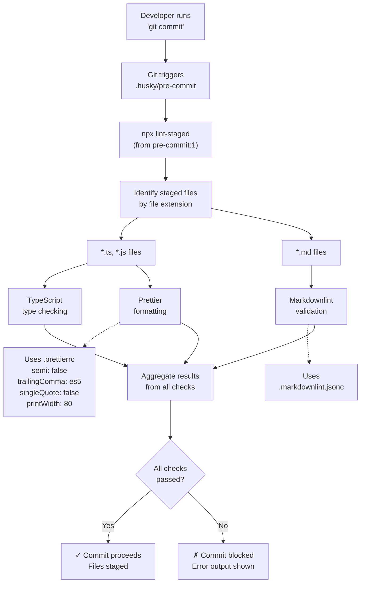
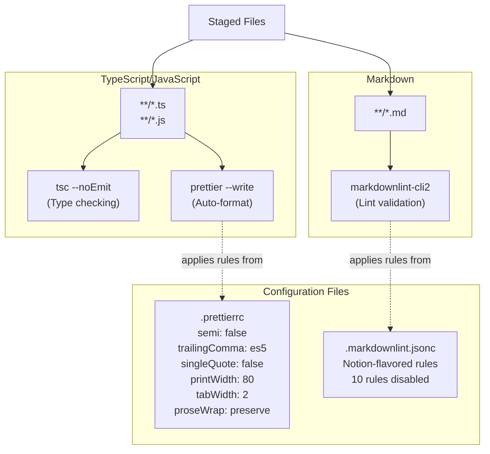
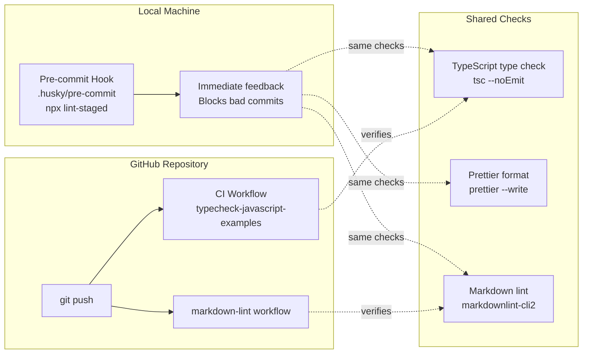
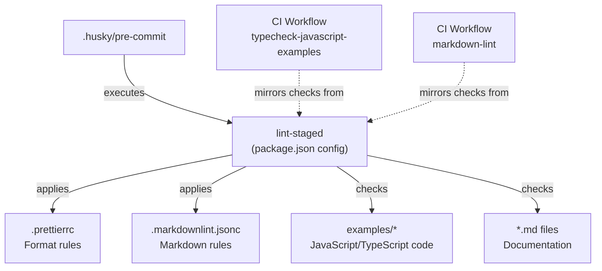

<!-- source: DeepWiki mcp.deepwiki.com · repo makenotion/notion-cookbook · page 7.2 Pre-commit Hooks · fetched 2026-10-26 -->

# Pre-commit Hooks

<details>
<summary>Relevant source files</summary>

The following files were used as context for generating this wiki page:

- [.husky/pre-commit](.husky/pre-commit)
- [.prettierrc](.prettierrc)

</details>


## Purpose and Scope

This document describes the pre-commit hook system that enforces code quality standards before code is committed to the repository. The system uses Husky to manage Git hooks and lint-staged to run checks only on staged files, providing fast feedback to developers.

For information about the CI/CD workflows that serve as a safety net after code is pushed, see [CI/CD Pipeline](#7.1). For details on the formatting and linting rules enforced by these hooks, see [Code Style Standards](#6.1).

**Sources:** [.husky/pre-commit:1](), [.prettierrc:1-8]()

---

## System Architecture

The pre-commit hook system consists of two primary components working together:

| Component | Purpose | Configuration |
|-----------|---------|---------------|
| **Husky** | Git hook manager that intercepts `git commit` | [.husky/pre-commit:1]() |
| **lint-staged** | Runs linters/formatters only on staged files | `package.json` (root level) |

When a developer attempts to commit changes, Git triggers the Husky pre-commit hook, which executes `npx lint-staged`. The lint-staged tool then identifies staged files and routes them to appropriate checkers based on file patterns.

**Sources:** [.husky/pre-commit:1]()

---

## Pre-commit Execution Flow



**Execution Path:**
1. Developer stages files and runs `git commit`
2. Git invokes [.husky/pre-commit:1]() which runs `npx lint-staged`
3. lint-staged scans staged files and groups them by type
4. TypeScript/JavaScript files undergo type checking and formatting
5. Markdown files undergo linting validation
6. If all checks pass, the commit proceeds; otherwise, it is blocked with error output

**Sources:** [.husky/pre-commit:1](), [.prettierrc:1-8]()

---

## File Type Routing and Checks

The lint-staged configuration (defined in the root `package.json`) routes files to different checkers based on glob patterns:



### TypeScript/JavaScript Files

For files matching `**/*.ts` and `**/*.js`:

1. **Type Checking**: Runs `tsc --noEmit` to validate TypeScript types without emitting compiled output
2. **Formatting**: Runs `prettier --write` to auto-format code according to [.prettierrc:2-7]()

The Prettier configuration enforces:
- No semicolons ([.prettierrc:2]())
- ES5-compatible trailing commas ([.prettierrc:3]())
- Double quotes ([.prettierrc:4]())
- 80-character line width ([.prettierrc:5]())
- 2-space indentation ([.prettierrc:6]())
- Preserved prose wrapping for Markdown ([.prettierrc:7]())

### Markdown Files

For files matching `**/*.md`:

1. **Linting**: Runs `markdownlint-cli2` to validate Markdown style according to `.markdownlint.jsonc`

The Markdown configuration disables 10 rules to accommodate Notion-flavored Markdown and Claude skills documentation patterns (see [Code Style Standards](#6.1) for details).

**Sources:** [.prettierrc:1-8]()

---

## Integration with CI/CD

The pre-commit hooks serve as the first line of defense in a multi-layered quality enforcement strategy:



**Defense-in-Depth Strategy:**

| Layer | Location | Timing | Purpose |
|-------|----------|--------|---------|
| Pre-commit Hook | Local machine | Before commit | Fast feedback, prevent bad commits |
| CI Workflow | GitHub Actions | After push | Safety net, verify all examples |
| PR Checks | GitHub | On pull request | Gate for code review |

This layered approach ensures that:
1. Developers get immediate local feedback (seconds)
2. Repository integrity is maintained by CI verification
3. Pull requests cannot be merged with failing checks

The pre-commit hook runs the **same checks** as CI, ensuring consistency between local and remote validation. This prevents the common scenario where code passes locally but fails in CI due to configuration drift.

**Sources:** [.husky/pre-commit:1]()

---

## Husky Configuration Details

The Husky hook is minimal and delegates all logic to lint-staged:

```
File: .husky/pre-commit
Line 1: npx lint-staged
```

### Why `npx`?

Using `npx` ensures that lint-staged is executed from the project's local `node_modules`, guaranteeing version consistency with the project's dependencies. This prevents issues where a globally installed version might have different behavior.

### Hook Installation

Husky hooks are installed via the `prepare` script in the root `package.json`, which runs automatically after `npm install`. This ensures that all developers have the hooks configured consistently without manual setup.

**Sources:** [.husky/pre-commit:1]()

---

## Prettier Configuration

The [.prettierrc:1-8]() file defines formatting rules applied to all JavaScript, TypeScript, and Markdown files:

| Rule | Value | Purpose |
|------|-------|---------|
| `semi` | `false` | No semicolons ([.prettierrc:2]()) |
| `trailingComma` | `"es5"` | Trailing commas where ES5 allows ([.prettierrc:3]()) |
| `singleQuote` | `false` | Use double quotes ([.prettierrc:4]()) |
| `printWidth` | `80` | Maximum line length ([.prettierrc:5]()) |
| `tabWidth` | `2` | Indentation size ([.prettierrc:6]()) |
| `proseWrap` | `"preserve"` | Don't rewrap prose in Markdown ([.prettierrc:7]()) |

The `proseWrap: "preserve"` setting is particularly important for maintaining manually formatted documentation and preventing unwanted line break changes in Markdown files.

**Sources:** [.prettierrc:1-8]()

---

## Bypassing Hooks (When Necessary)

In rare cases, developers may need to bypass the pre-commit hooks:

```bash
git commit --no-verify
```

**Use Cases for Bypassing:**
- Emergency hotfixes requiring immediate commit
- Work-in-progress commits on feature branches
- Known issues being tracked separately

**Important:** Bypassing hooks does not bypass CI checks. Any code pushed to GitHub will still be validated by the CI workflow, and pull requests will be blocked if checks fail.

**Sources:** [.husky/pre-commit:1]()

---

## Troubleshooting

### Hook Not Running

If the pre-commit hook doesn't execute:

1. Verify Husky is installed: Check for `.husky/pre-commit` file
2. Ensure hooks are executable: Run `chmod +x .husky/pre-commit`
3. Reinstall hooks: Run `npm install` (triggers `prepare` script)

### Type Check Failures

If `tsc --noEmit` fails:

1. Check that you're in the correct example directory
2. Verify `tsconfig.json` exists in the example folder
3. Ensure dependencies are installed: Run `npm install` in the example directory

### Prettier Formatting Conflicts

If Prettier changes create merge conflicts:

1. Run `prettier --write .` to format all files
2. Stage the formatted files: `git add .`
3. Commit again

### Performance Issues

If lint-staged is slow:

- It only processes staged files, not the entire repository
- Large files or many staged files will take longer
- Consider staging files in smaller batches

**Sources:** [.husky/pre-commit:1]()

---

## Relationship to Other Systems

The pre-commit hook system interacts with several other repository systems:



**Integration Points:**

1. **Code Style Standards ([#6.1](#6.1))**: The pre-commit hooks enforce the rules documented in the style standards
2. **CI/CD Pipeline ([#7.1](#7.1))**: CI runs the same checks as a safety net
3. **Examples ([#3](#3))**: All JavaScript examples are type-checked before commit
4. **Documentation ([#5](#5))**: All Markdown files are linted before commit
5. **Contributing ([#6](#6))**: Contributors must pass pre-commit checks before submitting PRs

**Sources:** [.husky/pre-commit:1](), [.prettierrc:1-8]()

---

