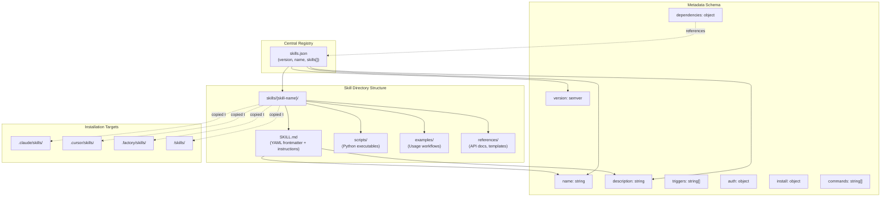
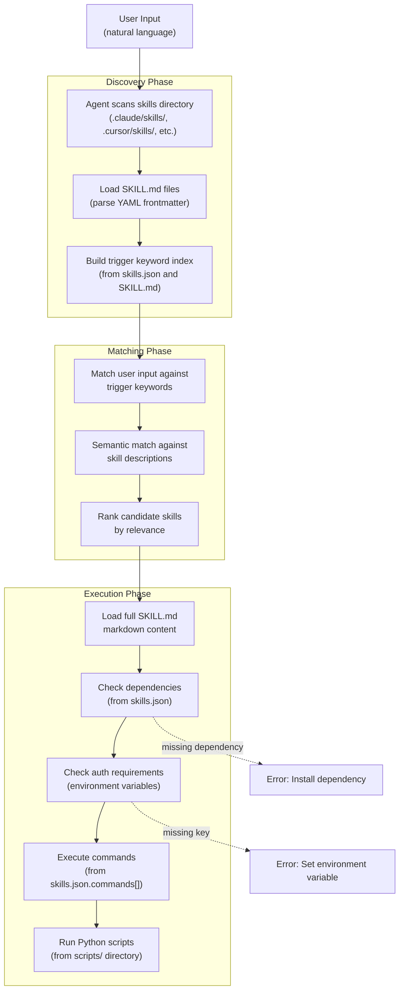
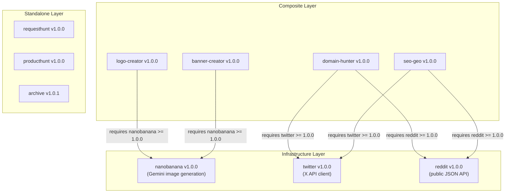

<!-- source: DeepWiki mcp.deepwiki.com · repo ReScienceLab/opc-skills · page 2 Skills System · fetched 2026-10-26 -->

# Skills System

<details>
<summary>Relevant source files</summary>

The following files were used as context for generating this wiki page:

- [README.md](README.md)
- [skill-logos/archive.svg](skill-logos/archive.svg)
- [skills.json](skills.json)
- [skills/archive/SKILL.md](skills/archive/SKILL.md)
- [skills/archive/references/TEMPLATE.md](skills/archive/references/TEMPLATE.md)
- [website/opc-banner.png](website/opc-banner.png)

</details>


The Skills System is the core architecture that defines, organizes, and manages modular AI agent capabilities in the OPC Skills repository. This system provides a standardized way to package instructions, scripts, and metadata into reusable units that AI agents can dynamically load and execute.

This document covers the fundamental architecture of skills, including the central registry, directory structure, metadata schemas, and dependency relationships. For installation mechanisms, see [Installation & Distribution](#3). For skill creation workflows, see [Creating New Skills](#7).

## System Architecture

The Skills System consists of three primary components: a central manifest registry (`skills.json`), individual skill directories containing structured content, and a dependency resolution mechanism.

### Skills System Component Diagram



**Sources:** [skills.json:1-539](), [README.md:36-40](), [skills/archive/SKILL.md:1-56]()

## Skills Registry

The central registry is defined in `skills.json` at the repository root. This file serves as the single source of truth for all available skills and their metadata.

### Registry Structure

The registry follows this top-level schema:

| Field | Type | Purpose |
|-------|------|---------|
| `version` | string | Global registry version (semantic versioning) |
| `name` | string | Repository display name |
| `description` | string | Repository description |
| `repository` | string | GitHub repository URL |
| `website` | string | Marketing website URL |
| `logo` | string | Repository logo URL |
| `skills` | array | Array of skill definition objects |

**Sources:** [skills.json:1-8]()

### Skill Definition Schema

Each entry in the `skills` array contains the following fields:

| Field | Type | Required | Description |
|-------|------|----------|-------------|
| `name` | string | Yes | Unique skill identifier (kebab-case) |
| `version` | string | Yes | Skill version (semantic versioning) |
| `description` | string | Yes | Concise skill purpose and use cases |
| `logo` | string | Yes | Skill logo URL (SVG preferred) |
| `icon` | string | Yes | Icon identifier for UI rendering |
| `color` | string | Yes | Hex color code (without `#` prefix) |
| `triggers` | string[] | Yes | Keywords for natural language activation |
| `dependencies` | object | Yes | Required skill dependencies with version constraints |
| `auth` | object | Yes | API key requirements and acquisition URLs |
| `install` | object | Yes | Platform-specific installation commands |
| `commands` | string[] | Yes | Executable command templates |
| `links` | object | Yes | Documentation and example URLs |

**Sources:** [skills.json:9-74](), [skills.json:76-127]()

### Skill Metadata Examples

**Infrastructure Skill (No Dependencies):**
```json
{
  "name": "reddit",
  "version": "1.0.0",
  "dependencies": {},
  "auth": {
    "required": false,
    "type": null,
    "keys": []
  }
}
```

**Composite Skill (With Dependencies):**
```json
{
  "name": "logo-creator",
  "version": "1.0.0",
  "dependencies": {
    "nanobanana": ">=1.0.0"
  },
  "auth": {
    "required": true,
    "type": "api_key",
    "keys": [
      {
        "env": "GEMINI_API_KEY",
        "url": "https://aistudio.google.com/apikey"
      }
    ]
  }
}
```

**Sources:** [skills.json:348-391](), [skills.json:177-241]()

## Skill Directory Structure

Each skill is self-contained within a directory at `skills/{skill-name}/`. The standard structure follows the Agent Skills Standard defined at [agentskills.io](http://agentskills.io).

### Standard Directory Layout

```
skills/{skill-name}/
├── SKILL.md              # Main skill definition (required)
├── scripts/              # Executable scripts (optional)
│   ├── script1.py
│   └── script2.py
├── examples/             # Usage examples (optional)
│   └── example-workflow.md
└── references/           # API docs, templates (optional)
    └── TEMPLATE.md
```

**Sources:** [README.md:153-158](), [skills/archive/SKILL.md:1-56]()

### SKILL.md Format

The `SKILL.md` file must contain YAML frontmatter followed by markdown documentation:

```markdown
---
name: skill-name
description: "Clear description of skill purpose and when to use it"
---

# Skill Name

Detailed instructions, workflows, and usage guidelines...
```

**Minimum Required Frontmatter:**
- `name`: Must match directory name and `skills.json` entry
- `description`: Concise purpose statement

**Extended Frontmatter (Archive Skill Example):**
```yaml
---
name: archive
description: "Archive session learnings, debugging solutions, and deployment logs to .archive/yyyy-mm-dd/ as indexed markdown with searchable tags. Use when completing a significant task, resolving a tricky bug, deploying, or when the user says \"archive this\". Maintains .archive/MEMORY.md index for cross-session knowledge reuse."
---
```

**Sources:** [README.md:159-165](), [skills/archive/SKILL.md:1-4]()

## Skill Activation and Execution Flow

AI agents use multiple mechanisms to discover and activate skills during natural language interactions.

### Skill Activation Flow Diagram



**Sources:** [skills.json:16-27](), [skills.json:63-69](), [skills.json:89-99]()

## Trigger Keyword System

Skills define trigger keywords that help AI agents determine when to activate them. Triggers are specified in the `triggers` array in `skills.json`.

### Trigger Examples by Skill Category

| Skill | Trigger Keywords | Purpose |
|-------|-----------------|---------|
| `seo-geo` | `SEO`, `GEO`, `search optimization`, `schema markup`, `JSON-LD`, `meta tags`, `keyword research`, `AI visibility`, `ChatGPT ranking`, `Perplexity` | SEO and generative engine optimization |
| `requesthunt` | `requesthunt`, `request hunt`, `feature request`, `user demand`, `demand research` | Market research and user feedback analysis |
| `domain-hunter` | `domain`, `registrar`, `buy domain`, `domain price`, `.ai domain`, `.com domain` | Domain search and price comparison |
| `logo-creator` | `logo`, `brand`, `icon`, `favicon`, `mascot`, `emblem`, `create logo`, `design logo` | Logo design and generation |
| `nanobanana` | `generate image`, `create image`, `nano banana`, `nanobanana`, `gemini image`, `AI image` | Image generation via Gemini API |
| `reddit` | `reddit`, `subreddit`, `r/` | Reddit content retrieval |
| `twitter` | `twitter`, `X`, `tweet` | Twitter/X content retrieval |
| `archive` | `archive this`, `archive session`, `save learnings`, `document this`, `session notes`, `what did we learn`, `check archives`, `past solutions` | Session knowledge persistence |

**Sources:** [skills.json:16-27](), [skills.json:82-88](), [skills.json:136-142](), [skills.json:183-192](), [skills.json:304-310](), [skills.json:354-358](), [skills.json:399-403](), [skills.json:501-510]()

## Authentication and API Keys

Skills declare their authentication requirements in the `auth` object within `skills.json`.

### Auth Object Schema

| Field | Type | Description |
|-------|------|-------------|
| `required` | boolean | Whether auth is mandatory for skill operation |
| `type` | string\|null | Authentication type (`api_key` or `null`) |
| `keys` | array | Array of required API key definitions |

### API Key Definition Schema

| Field | Type | Description |
|-------|------|-------------|
| `env` | string | Environment variable name (e.g., `GEMINI_API_KEY`) |
| `url` | string | URL where users can obtain the API key |
| `optional` | boolean | Whether the key is optional for basic functionality |
| `note` | string | Additional information (e.g., pricing) |

### Authentication Examples

**No Authentication Required:**
```json
{
  "auth": {
    "required": false,
    "type": null,
    "keys": []
  }
}
```

**Single Required API Key:**
```json
{
  "auth": {
    "required": true,
    "type": "api_key",
    "keys": [
      {
        "env": "GEMINI_API_KEY",
        "url": "https://aistudio.google.com/apikey"
      }
    ]
  }
}
```

**Multiple API Keys (Some Optional):**
```json
{
  "auth": {
    "required": true,
    "type": "api_key",
    "keys": [
      {
        "env": "GEMINI_API_KEY",
        "url": "https://aistudio.google.com/apikey"
      },
      {
        "env": "REMOVE_BG_API_KEY",
        "url": "https://www.remove.bg/api",
        "optional": true
      },
      {
        "env": "RECRAFT_API_KEY",
        "url": "https://www.recraft.ai/api",
        "optional": true
      }
    ]
  }
}
```

**Sources:** [skills.json:32-47](), [skills.json:90-99](), [skills.json:147-151](), [skills.json:196-215]()

## Command Templates

Skills define executable command templates in the `commands` array. These templates use placeholder syntax for dynamic values.

### Command Template Syntax

- **Curly braces** `{variable}` indicate runtime substitution
- **Double quotes** `"{multi word input}"` wrap user-provided text
- **Python scripts** are executed relative to the skill directory
- **Angle brackets** `<skill-name>` reference dependency script paths

### Command Examples

**Python Script Execution:**
```json
"commands": [
  "python3 scripts/get_posts.py {subreddit} --limit 20",
  "python3 scripts/search_posts.py \"{query}\" --limit 20",
  "python3 scripts/get_subreddit.py {subreddit}",
  "python3 scripts/get_post.py {post_id}",
  "python3 scripts/get_user.py {username}"
]
```

**Dependency Script Reference:**
```json
"commands": [
  "python3 <nanobanana>/scripts/batch_generate.py \"{prompt}\" -n 20 --ratio 1:1 -d ./logos -p logo",
  "python3 scripts/crop_logo.py {input.png} {output.png}",
  "python3 scripts/remove_bg.py {input.png} {output.png}",
  "python3 scripts/vectorize.py {input.png} {output.svg}"
]
```

**Native Command Execution:**
```json
"commands": [
  "whois {domain}.{tld}",
  "WebSearch: cheapest .{tld} domain registrar"
]
```

**Sources:** [skills.json:380-386](), [skills.json:231-236](), [skills.json:167-170]()

## Installation Command Structure

Skills define platform-specific installation commands in the `install` object, which contains two categories: `user` (global agent installation) and `project` (project-specific installation).

### Install Object Structure

```json
{
  "install": {
    "user": {
      "claude": "npx skills add ReScienceLab/opc-skills --skill {skill-name} -a claude",
      "droid": "npx skills add ReScienceLab/opc-skills --skill {skill-name} -a droid",
      "opencode": "npx skills add ReScienceLab/opc-skills --skill {skill-name} -a opencode",
      "codex": "npx skills add ReScienceLab/opc-skills --skill {skill-name} -a codex"
    },
    "project": {
      "claude": "npx skills add ReScienceLab/opc-skills --skill {skill-name}",
      "droid": "npx skills add ReScienceLab/opc-skills --skill {skill-name}",
      "cursor": "npx skills add ReScienceLab/opc-skills --skill {skill-name}",
      "opencode": "npx skills add ReScienceLab/opc-skills --skill {skill-name}",
      "codex": "npx skills add ReScienceLab/opc-skills --skill {skill-name}"
    }
  }
}
```

### Supported Platforms

| Platform | Agent Type | Default Install Directory |
|----------|-----------|---------------------------|
| `claude` | Claude Code Desktop | `.claude/skills/` |
| `cursor` | Cursor IDE | `.cursor/skills/` |
| `droid` | Factory Droid | `.factory/skills/` |
| `windsurf` | Windsurf IDE | Configuration-dependent |
| `opencode` | OpenCode | Configuration-dependent |
| `codex` | Codex | Configuration-dependent |

**Sources:** [skills.json:48-62](), [skills.json:100-114](), [README.md:109-128]()

## Dependency Resolution

Skills can declare dependencies on other skills using semantic versioning constraints. Dependencies are specified in the `dependencies` object.

### Dependency Graph Structure



**Sources:** [skills.json:28-31](), [skills.json:143-146](), [skills.json:193-195](), [skills.json:259-261]()

### Dependency Declaration Syntax

Dependencies use semantic versioning constraints:

```json
{
  "dependencies": {
    "skill-name": ">=1.0.0"
  }
}
```

**Constraint Operators:**
- `>=1.0.0` - Minimum version (most common)
- `^1.0.0` - Compatible with 1.x.x
- `~1.0.0` - Compatible with 1.0.x
- `1.0.0` - Exact version

### Transitive Dependency Example

When installing `logo-creator`, the system automatically resolves and installs `nanobanana`:

```bash
npx skills add ReScienceLab/opc-skills --skill logo-creator
# Automatically installs:
# - logo-creator v1.0.0
# - nanobanana v1.0.0 (dependency)
```

**Sources:** [skills.json:193-195](), [README.md:93-106]()

## Links and Documentation References

Each skill defines external links for documentation, source code, and examples in the `links` object.

### Links Object Structure

| Field | Type | Description |
|-------|------|-------------|
| `github` | string | URL to skill directory in repository |
| `docs` | string | URL to external API documentation (if applicable) |
| `example` | string | URL to example workflow markdown file |

### Links Examples

**Skill with Example Workflow:**
```json
{
  "links": {
    "github": "https://github.com/ReScienceLab/opc-skills/tree/main/skills/requesthunt",
    "docs": "https://requesthunt.com/docs",
    "example": "https://github.com/ReScienceLab/opc-skills/blob/main/skills/requesthunt/examples/calendar-app-research.md"
  }
}
```

**Infrastructure Skill with API Documentation:**
```json
{
  "links": {
    "github": "https://github.com/ReScienceLab/opc-skills/tree/main/skills/nanobanana",
    "docs": "https://ai.google.dev/gemini-api/docs/image-generation"
  }
}
```

**Simple Skill (GitHub Only):**
```json
{
  "links": {
    "github": "https://github.com/ReScienceLab/opc-skills/tree/main/skills/archive"
  }
}
```

**Sources:** [skills.json:122-127](), [skills.json:342-345](), [skills.json:533-535]()

## Skill Versioning

The Skills System uses two-level versioning:

1. **Global Registry Version** - `skills.json` version field tracks the overall repository state
2. **Individual Skill Versions** - Each skill maintains independent semantic versioning

### Version Update Rules

| Change Type | Version Increment | Example |
|-------------|------------------|---------|
| New skill added | Registry MINOR | `1.0.0` → `1.1.0` |
| Skill bug fix | Skill PATCH | Skill `1.0.0` → `1.0.1` |
| Skill breaking change | Skill MAJOR + dependent skills | Skill `1.0.0` → `2.0.0` |
| Registry structure change | Registry MAJOR | `1.0.0` → `2.0.0` |

### Current System Version

As of this writing:
- **Registry Version:** `1.0.10` [skills.json:2]()
- **Skill Versions:** All skills at `1.0.0` except `archive` at `1.0.1`

**Sources:** [skills.json:2](), [skills.json:11](), [skills.json:496]()

## Skills Inventory

The current repository contains 10 skills across four categories:

### Foundation Skills (4)

| Skill | Version | Auth Required | Dependencies |
|-------|---------|---------------|--------------|
| `nanobanana` | 1.0.0 | Yes (Gemini) | None |
| `twitter` | 1.0.0 | Yes (twitterapi.io) | None |
| `reddit` | 1.0.0 | No | None |
| `archive` | 1.0.1 | No | None |

### Design Skills (2)

| Skill | Version | Auth Required | Dependencies |
|-------|---------|---------------|--------------|
| `logo-creator` | 1.0.0 | Yes (Gemini + optional) | `nanobanana` |
| `banner-creator` | 1.0.0 | Yes (Gemini) | `nanobanana` |

### SEO & Research Skills (2)

| Skill | Version | Auth Required | Dependencies |
|-------|---------|---------------|--------------|
| `seo-geo` | 1.0.0 | No (optional DataForSEO) | `twitter`, `reddit` |
| `requesthunt` | 1.0.0 | Yes (requesthunt.com) | None |

### Discovery Skills (2)

| Skill | Version | Auth Required | Dependencies |
|-------|---------|---------------|--------------|
| `domain-hunter` | 1.0.0 | No | `twitter`, `reddit` |
| `producthunt` | 1.0.0 | Yes (Product Hunt) | None |

**Sources:** [skills.json:8-537](), [README.md:42-56]()

---

