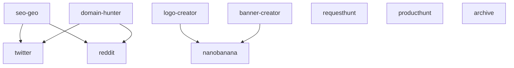
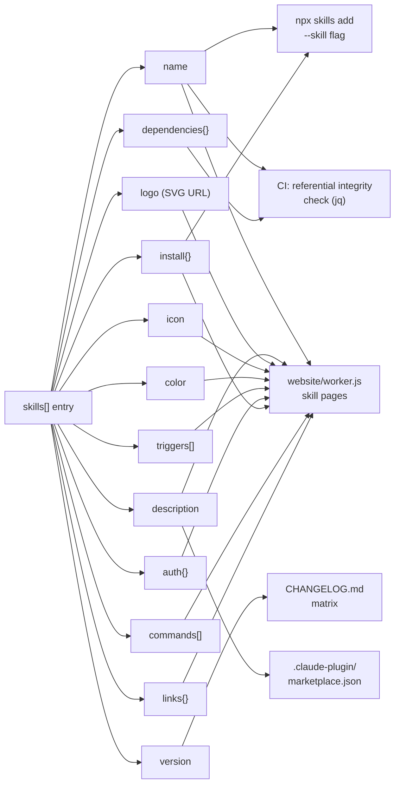
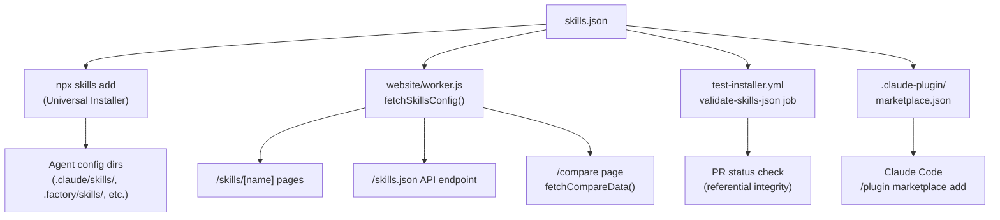

<!-- source: DeepWiki mcp.deepwiki.com · repo ReScienceLab/opc-skills · page 2.1 Skills Registry (skills.json) · fetched 2026-10-26 -->

# Skills Registry (skills.json)

<details>
<summary>Relevant source files</summary>

The following files were used as context for generating this wiki page:

- [.factory/AGENTS.md](.factory/AGENTS.md)
- [CHANGELOG.md](CHANGELOG.md)
- [skills.json](skills.json)
- [skills/archive/SKILL.md](skills/archive/SKILL.md)
- [skills/archive/references/TEMPLATE.md](skills/archive/references/TEMPLATE.md)
- [template/SKILL.md](template/SKILL.md)
- [website/blog/posts/why-skills-beat-docs.md](website/blog/posts/why-skills-beat-docs.md)

</details>


`skills.json` is the top-level manifest for the OPC Skills repository. It serves as the single source of truth for all skill metadata: what skills exist, what they require, how they are installed, and what commands they expose. Every automated system that reads or distributes skills — the universal installer, the website, and the CI validation pipeline — derives its data from this file.

This page documents the schema in detail and explains how each field is consumed. For how skills are physically laid out on disk, see [Skill Structure & Standards](#2.2). For how dependencies between skills are validated, see [Dependency Management](#2.3). For how the installer uses this file at runtime, see [Universal Installer (npx skills add)](#3.3).

---

## File Location and Format

The registry lives at [skills.json:1-538]() in the root of the repository. It is a single, hand-maintained JSON file. Its validity is checked in CI using `jq` and a Python JSON parse on every push that touches `skills.json` or the `skills/` directory. See [Automated Testing Pipeline](#6.2) for the exact validation rules.

---

## Top-Level Schema

The root object contains six fields before the `skills` array.

| Field | Type | Description |
|---|---|---|
| `version` | string | Monotonically increasing semver for the registry itself (e.g. `"1.0.10"`). Bumped on every release regardless of which skill changed. |
| `name` | string | Human-readable name of the registry (`"OPC Skills"`). |
| `description` | string | One-line description used in marketplace metadata. |
| `repository` | string | Canonical GitHub URL used by the installer to clone or reference the repo. |
| `website` | string | Public website URL (`"https://opc.dev"`). |
| `logo` | string | Absolute URL to the repository's top-level SVG logo, hosted on GitHub raw content. |
| `skills` | array | Ordered array of skill entry objects. Order matters: the website renders skills in this order. |

**Example (top-level):**
```json
{
  "version": "1.0.10",
  "name": "OPC Skills",
  "description": "Agent Skills for One Person Companies",
  "repository": "https://github.com/ReScienceLab/opc-skills",
  "website": "https://opc.dev",
  "logo": "https://raw.githubusercontent.com/.../opc-logo.svg",
  "skills": [...]
}
```

Sources: [skills.json:1-8]()

---

## Skill Entry Schema

Each element of the `skills` array is an object with the following fields:

### Identity Fields

| Field | Type | Required | Description |
|---|---|---|---|
| `name` | string | Yes | Unique kebab-case identifier. Must match the directory name under `skills/`. Used as the `--skill` flag value in install commands. |
| `version` | string | Yes | Independent semver for this skill. Skills are versioned independently of the registry `version`. |
| `description` | string | Yes | Full description shown on the website skill card and in marketplace listings. |
| `logo` | string | Yes | Absolute URL to the skill's SVG logo under `skill-logos/`. |
| `icon` | string | Yes | [Simple Icons](https://simpleicons.org/) slug (e.g. `"reddit"`, `"x"`, `"googlegemini"`) or a generic name (`"globe"`, `"image"`, `"archive"`). Used by the website to render an icon badge. |
| `color` | string | Yes | Six-character hex color without `#` (e.g. `"FF4500"`). Used for the skill card accent color on the website. |

Sources: [skills.json:10-16](), [skills.json:297-302](), [.factory/skills/add-new-opc-skill/SKILL.md:73-120]()

---

### `triggers` Array

An array of strings. These are the natural-language keywords or phrases that should cause an AI agent to activate this skill. The CI validator does not check trigger uniqueness across skills, but authors should avoid overlapping triggers.

```json
"triggers": ["SEO", "GEO", "search optimization", "schema markup", "AI visibility"]
```

Sources: [skills.json:16-27]()

---

### `dependencies` Object

Declares inter-skill dependencies. Keys are skill `name` values from the same `skills` array; values are semver range strings.

```json
"dependencies": {
  "twitter": ">=1.0.0",
  "reddit": ">=1.0.0"
}
```

An empty object (`{}`) means no dependencies. The CI pipeline performs a referential integrity check: every key in any skill's `dependencies` must match a `name` that exists elsewhere in the `skills` array. See [Dependency Management](#2.3) for full details.

**Dependency map across all skills (current):**



Sources: [skills.json:28-32](), [skills.json:143-146](), [skills.json:193-195](), [skills.json:259-261]()

---

### `auth` Object

Describes authentication requirements for the skill's scripts.

| Field | Type | Description |
|---|---|---|
| `required` | boolean | If `true`, the skill will not function at all without credentials. If `false`, the skill works without credentials but some features may be limited. |
| `type` | string \| null | Authentication mechanism. Currently always `"api_key"` or `null`. |
| `keys` | array | List of API key descriptor objects (see below). Empty array `[]` when `type` is `null`. |

Each object in the `keys` array has:

| Field | Type | Description |
|---|---|---|
| `env` | string | The environment variable name the scripts read (e.g. `"GEMINI_API_KEY"`). |
| `url` | string | URL where the user can obtain the credential. |
| `optional` | boolean | If present and `true`, the key enables additional features but is not required to run the skill at all. |
| `note` | string | Optional human-readable note (e.g. cost estimate). |

**Example — skill with optional keys (`seo-geo`):**
```json
"auth": {
  "required": false,
  "type": "api_key",
  "keys": [
    { "env": "DATAFORSEO_LOGIN", "url": "https://dataforseo.com", "optional": true },
    { "env": "DATAFORSEO_PASSWORD", "url": "https://dataforseo.com", "optional": true }
  ]
}
```

**Example — skill with no auth (`reddit`):**
```json
"auth": {
  "required": false,
  "type": null,
  "keys": []
}
```

Sources: [skills.json:32-46](), [skills.json:360-364](), [skills.json:404-415]()

---

### `install` Object

The `install` object provides ready-to-run shell commands for installing the skill on each supported agent platform. It has two sub-objects:

- **`user`** — installs the skill globally for the current user (`-a <agent>` flag selects the agent-specific global config directory).
- **`project`** — installs the skill into the current project directory (no `-a` flag; target directory is resolved relative to the working directory).

Supported agent keys within each sub-object:

| Key | Appears in `user` | Appears in `project` |
|---|---|---|
| `claude` | Yes | Yes |
| `droid` | Yes | Yes |
| `opencode` | Yes | Yes |
| `codex` | Yes | Yes |
| `cursor` | No | Yes |

`cursor` is absent from `user`-level installs. All commands follow the pattern:

```
npx skills add ReScienceLab/opc-skills --skill <name> [-a <agent>]
```

Sources: [skills.json:48-62](), [.factory/skills/add-new-opc-skill/SKILL.md:91-103]()

---

### `commands` Array

A list of representative CLI command strings for the skill's scripts. These are documentation and are surfaced on the website's skill detail page. They use brace-delimited placeholders like `{domain}` and `"{query}"`.

```json
"commands": [
  "python3 scripts/keyword_research.py \"{keyword}\" --limit 20",
  "python3 scripts/domain_overview.py \"{domain}\""
]
```

Skills that are instruction-only (no scripts) use an empty array: `"commands": []`. The `archive` skill is the current example of this.

One special notation appears in skills that depend on `nanobanana`: their commands reference the dependency's scripts with the `<nanobanana>` placeholder:

```json
"python3 <nanobanana>/scripts/batch_generate.py \"{prompt}\" -n 20 --ratio 1:1 -d ./logos -p logo"
```

Sources: [skills.json:63-69](), [skills.json:231-235](), [skills.json:287-289](), [skills.json:532]()

---

### `links` Object

A free-form object containing named URL strings. The `github` key is always present and points to the skill directory on GitHub. Additional optional keys include `docs` (external API documentation) and `example` (a concrete usage example file in the repo).

| Key | Description |
|---|---|
| `github` | URL to the skill's directory on `github.com` |
| `docs` | URL to external API/service documentation |
| `example` | URL to an example `.md` file in the repo |

Sources: [skills.json:70-73](), [skills.json:121-126](), [skills.json:387-390]()

---

## Complete Skill Entry Structure

The following diagram maps each field in a skill entry to how it is consumed downstream.

**Skill entry field consumption diagram:**



Sources: [skills.json:1-538](), [.factory/skills/add-new-opc-skill/SKILL.md:73-119]()

---

## Skills Inventory

The table below lists all ten current skills and their key metadata fields.

| Name | Version | `auth.required` | Dependencies | Auth Env Vars |
|---|---|---|---|---|
| `seo-geo` | 1.0.0 | false (optional keys) | twitter, reddit | `DATAFORSEO_LOGIN`, `DATAFORSEO_PASSWORD` (optional) |
| `requesthunt` | 1.0.0 | true | — | `REQUESTHUNT_API_KEY` |
| `domain-hunter` | 1.0.0 | false | twitter, reddit | — |
| `logo-creator` | 1.0.0 | true | nanobanana | `GEMINI_API_KEY`, `REMOVE_BG_API_KEY` (optional), `RECRAFT_API_KEY` (optional) |
| `banner-creator` | 1.0.0 | true | nanobanana | `GEMINI_API_KEY` |
| `nanobanana` | 1.0.0 | true | — | `GEMINI_API_KEY` |
| `reddit` | 1.0.0 | false | — | — |
| `twitter` | 1.0.0 | true | — | `TWITTERAPI_API_KEY` |
| `producthunt` | 1.0.0 | true | — | `PRODUCTHUNT_ACCESS_TOKEN` |
| `archive` | 1.0.1 | false | — | — |

Sources: [skills.json:8-537](), [CHANGELOG.md:12-23]()

---

## How `skills.json` Is Used

### By the Universal Installer

`npx skills add` reads `skills.json` to resolve the skill directory path and construct the correct install command string. The `install.user` or `install.project` sub-object is selected based on whether the `-a` flag is passed. See [Universal Installer (npx skills add)](#3.3).

### By the Website

`website/worker.js` fetches `skills.json` at runtime (via the `fetchSkillsConfig` function) to render skill list pages and the `/skills/[name]` detail pages. The `icon`, `color`, `logo`, `description`, `triggers`, `auth`, `install`, `commands`, and `links` fields are all surfaced in the rendered HTML. The website also exposes `skills.json` verbatim at the `/skills.json` route as a machine-readable API. See [Website Architecture](#4.1) and [API Endpoints](#4.4).

### By the Claude Code Plugin Marketplace

Each skill has a corresponding `plugin.json` under `.claude-plugin/`. Those files reference the skill's `name` and install commands. See [Claude Code Plugin Marketplace](#3.2).

### By the CI Pipeline

The `validate-skills-json` job in `.github/workflows/test-installer.yml` runs three checks against `skills.json`:

1. **Syntax**: `jq '.' skills.json` parses the file.
2. **Required fields**: Verifies each skill entry contains `name`, `version`, `description`, `triggers`, `dependencies`, `auth`, `install`, and `commands`.
3. **Referential integrity**: Every key in any skill's `dependencies` object must correspond to a `name` that exists elsewhere in the `skills` array.

See [Automated Testing Pipeline](#6.2).

**Data flow from `skills.json` to consuming systems:**



Sources: [skills.json:1-538](), [.factory/skills/add-new-opc-skill/SKILL.md:120-218](), [CHANGELOG.md:1-31]()

---

## Adding a New Skill Entry

When a new skill is added, the required fields and their exact format are enforced by the `validate-skills-json` CI job. The `.factory/skills/add-new-opc-skill/SKILL.md` checklist specifies the exact JSON template to use [.factory/skills/add-new-opc-skill/SKILL.md:73-112]().

After editing `skills.json`, validate locally with:

```bash
python3 -c "import json; json.load(open('skills.json')); print('valid')"
```

The full process for adding a skill — including logo generation, README update, `worker.js` update, and `CHANGELOG.md` update — is covered in [Skill Structure & Standards](#2.2).

---

