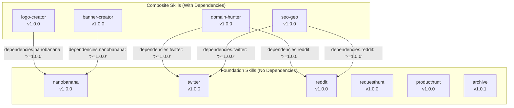
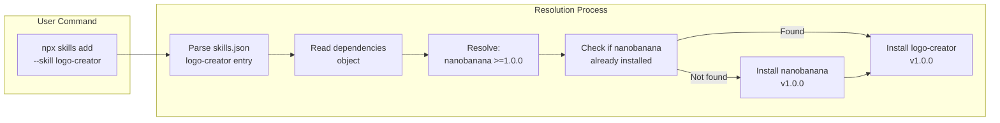
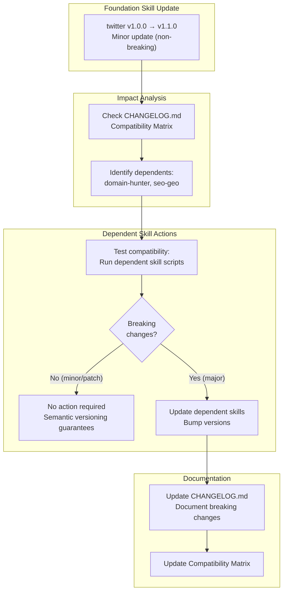
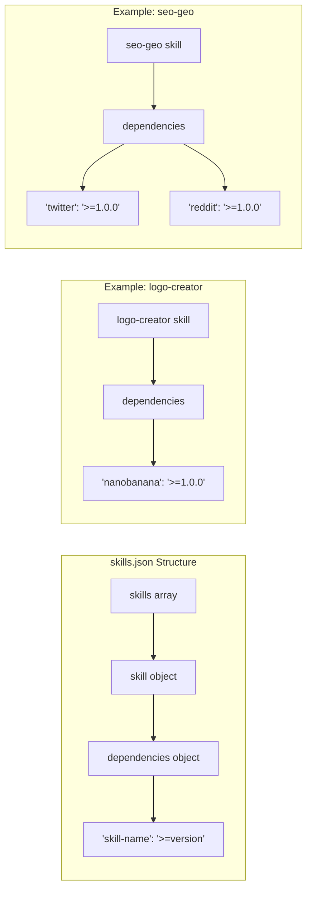

<!-- source: DeepWiki mcp.deepwiki.com · repo ReScienceLab/opc-skills · page 2.3 Dependency Management · fetched 2026-10-26 -->

# Dependency Management

<details>
<summary>Relevant source files</summary>

The following files were used as context for generating this wiki page:

- [.factory/AGENTS.md](.factory/AGENTS.md)
- [CHANGELOG.md](CHANGELOG.md)
- [skills.json](skills.json)
- [skills/archive/SKILL.md](skills/archive/SKILL.md)
- [skills/archive/references/TEMPLATE.md](skills/archive/references/TEMPLATE.md)
- [template/SKILL.md](template/SKILL.md)
- [website/blog/posts/why-skills-beat-docs.md](website/blog/posts/why-skills-beat-docs.md)

</details>


This document explains how OPC Skills manages dependencies between skills, including dependency declaration, semantic versioning, compatibility tracking, and automatic resolution during installation.

For information about the skills.json registry structure, see [Skills Registry (skills.json)](#2.1). For details on creating new skills with dependencies, see [Creating New Skills](#7).

---

## Dependency Declaration in skills.json

Skills declare their dependencies in the `dependencies` object within their skill entry in [skills.json](). Each dependency specifies a minimum version using semantic versioning constraints.

**Dependency Format:**

```json
{
  "name": "skill-name",
  "version": "1.0.0",
  "dependencies": {
    "dependency-skill-name": ">=minimum.version.number"
  }
}
```

**Example from domain-hunter:**

[skills.json:129-146]()

```json
{
  "name": "domain-hunter",
  "version": "1.0.0",
  "dependencies": {
    "twitter": ">=1.0.0",
    "reddit": ">=1.0.0"
  }
}
```

**Dependency-Free Skills:**

Skills without dependencies use an empty object:

[skills.json:89](), [skills.json:311](), [skills.json:359](), [skills.json:404](), [skills.json:456](), [skills.json:511]()

```json
{
  "name": "nanobanana",
  "version": "1.0.0",
  "dependencies": {}
}
```

Sources: [skills.json:1-538]()

---

## Dependency Graph

### Current Skill Dependencies

The following diagram shows the actual dependency relationships between all skills in the repository:



**Dependency Statistics:**

| Foundation Skill | Dependents | Impact Radius |
|-----------------|------------|---------------|
| `nanobanana` | 2 skills (logo-creator, banner-creator) | Design automation |
| `twitter` | 2 skills (domain-hunter, seo-geo) | Social media research |
| `reddit` | 2 skills (domain-hunter, seo-geo) | Social media research |
| `requesthunt` | 0 skills | Standalone |
| `producthunt` | 0 skills | Standalone |
| `archive` | 0 skills | Standalone |

Sources: [skills.json:10-74](), [skills.json:129-175](), [skills.json:177-241](), [skills.json:243-295](), [skills.json:297-346]()

---

## Semantic Versioning Constraints

OPC Skills uses [Semantic Versioning 2.0.0](https://semver.org/) for all version numbers and dependency constraints.

### Version Number Format

```
MAJOR.MINOR.PATCH
```

- **MAJOR**: Breaking changes or API incompatibility
- **MINOR**: New features (backward compatible)
- **PATCH**: Bug fixes (backward compatible)

### Constraint Operators

Currently, all dependencies use the `>=` operator, which means "greater than or equal to":

```json
{
  "dependencies": {
    "nanobanana": ">=1.0.0"
  }
}
```

**Interpretation:**
- ✅ Compatible: `1.0.0`, `1.0.1`, `1.1.0`, `1.2.5`
- ✅ Compatible: `2.0.0` (unless breaking changes documented)
- ❌ Incompatible: `0.9.0`, `0.9.9`

### Version Compatibility Rules

From [CHANGELOG.md:8-30]():

| Dependency Update Type | Dependent Skill Action | Version Bump Required |
|----------------------|------------------------|----------------------|
| Patch (`1.0.0` → `1.0.1`) | No action needed | No |
| Minor (`1.0.0` → `1.1.0`) | No action needed | No |
| Major with no breaking changes | No action needed | No |
| Major with breaking changes | Must update to support new API | Patch or Minor |

Sources: [CHANGELOG.md:1-30](), [.factory/AGENTS.md:112-123]()

---

## Compatibility Matrix in CHANGELOG.md

The [CHANGELOG.md]() maintains a compatibility matrix that documents all dependency relationships and version requirements:

[CHANGELOG.md:8-30]()

```markdown
## Skill Compatibility & Dependency Matrix

| Skill | Current Version | Requires | Min Versions |
|-------|-----------------|----------|--------------|
| **requesthunt** | 1.0.0 | - | - |
| **domain-hunter** | 1.0.0 | twitter, reddit | twitter ≥1.0.0, reddit ≥1.0.0 |
| **logo-creator** | 1.0.0 | nanobanana | nanobanana ≥1.0.0 |
| **banner-creator** | 1.0.0 | nanobanana | nanobanana ≥1.0.0 |
| **nanobanana** | 1.0.0 | - | - |
| **reddit** | 1.0.0 | - | - |
| **twitter** | 1.0.0 | - | - |
| **producthunt** | 1.0.0 | - | - |
| **seo-geo** | 1.0.0 | twitter, reddit | twitter ≥1.0.0, reddit ≥1.0.0 |
| **archive** | 1.0.1 | - | - |
```

**Matrix Usage:**

1. **Before updating a skill**: Check which skills depend on it
2. **Before installing a skill**: Verify minimum versions of dependencies
3. **During breaking changes**: Identify all skills that need updates

### Key Points from CHANGELOG.md

[CHANGELOG.md:25-30]()

- Each skill has an independent version number
- Skills can be released independently
- Use this matrix to identify dependencies before updating
- When a dependency skill updates with breaking changes, dependent skills need testing

Sources: [CHANGELOG.md:8-30]()

---

## Dependency Declaration in SKILL.md

Individual skill documentation files also declare dependencies in their YAML frontmatter, though the authoritative source is [skills.json]().

**Archive Skill (No Dependencies):**

[skills/archive/SKILL.md:1-4]()

```yaml
---
name: archive
description: "Archive session learnings..."
---
```

**Template Structure:**

[template/SKILL.md:1-4]()

```yaml
---
name: skill-name
description: Clear description...
---
```

**Note:** The `dependencies` field was previously included in SKILL.md frontmatter but is now primarily managed in [skills.json](). The SKILL.md should document prerequisite skills in prose within the "Prerequisites" section.

Sources: [skills/archive/SKILL.md:1-56](), [template/SKILL.md:1-130]()

---

## Transitive Dependency Resolution

### How It Works

When a user installs a skill with dependencies, the installer automatically resolves and installs all required dependencies recursively.



### Example: Installing domain-hunter

**User executes:**

```bash
npx skills add ReScienceLab/opc-skills --skill domain-hunter
```

**Resolution flow:**

1. Installer reads [skills.json:129-175]()
2. Parses `dependencies` object:
   ```json
   {
     "twitter": ">=1.0.0",
     "reddit": ">=1.0.0"
   }
   ```
3. Checks if `twitter` v1.0.0+ is installed
4. Checks if `reddit` v1.0.0+ is installed
5. Installs missing dependencies
6. Installs `domain-hunter` v1.0.0

**Installation order:**

```
twitter (1.0.0) → Installed
reddit (1.0.0) → Installed
domain-hunter (1.0.0) → Installed
```

Sources: [skills.json:129-175](), [.factory/AGENTS.md:99-110]()

---

## Installation Commands with Dependencies

### Platform-Specific Installation

Each skill in [skills.json]() provides installation commands for multiple platforms. Dependencies are automatically resolved regardless of which command is used.

**From domain-hunter skill:**

[skills.json:152-166]()

```json
{
  "install": {
    "user": {
      "claude": "npx skills add ReScienceLab/opc-skills --skill domain-hunter -a claude",
      "droid": "npx skills add ReScienceLab/opc-skills --skill domain-hunter -a droid",
      "opencode": "npx skills add ReScienceLab/opc-skills --skill domain-hunter -a opencode",
      "codex": "npx skills add ReScienceLab/opc-skills --skill domain-hunter -a codex"
    },
    "project": {
      "claude": "npx skills add ReScienceLab/opc-skills --skill domain-hunter",
      "droid": "npx skills add ReScienceLab/opc-skills --skill domain-hunter",
      "cursor": "npx skills add ReScienceLab/opc-skills --skill domain-hunter",
      "opencode": "npx skills add ReScienceLab/opc-skills --skill domain-hunter",
      "codex": "npx skills add ReScienceLab/opc-skills --skill domain-hunter"
    }
  }
}
```

### Bulk Installation

Installing all skills also resolves dependencies correctly:

```bash
npx skills add ReScienceLab/opc-skills
```

This command installs all 10 skills with proper dependency ordering.

Sources: [skills.json:48-73](), [skills.json:100-166]()

---

## Dependency Lifecycle Management

### When Dependencies Update

The following diagram shows the workflow when a foundation skill releases an update:



### Breaking Change Example

From [.factory/AGENTS.md:440-459]():

When `twitter` releases a breaking v2.0.0:

1. **Identify dependent skills** using CHANGELOG.md Matrix:
   - `domain-hunter` (depends on twitter >=1.0.0)
   - `seo-geo` (depends on twitter >=1.0.0)

2. **Create separate PRs** for each dependent skill:
   - `feature/skill/domain-hunter/twitter-v2-compat`
   - `feature/skill/seo-geo/twitter-v2-compat`

3. **Test compatibility** before merging

4. **Update versions** only if dependent skills needed code changes

5. **Document in CHANGELOG.md**:
   ```markdown
   ### twitter
   #### [2.0.0] - 2025-01-23 ⚠️ BREAKING
   - **Changed**: API now requires v2 endpoint authentication
   - **Migration Guide**: See docs/migration-guide.md
   
   ### domain-hunter
   #### [1.0.1] - 2025-01-24
   - **Fixed**: Updated to support twitter v2.0.0
   ```

Sources: [.factory/AGENTS.md:440-495](), [CHANGELOG.md:25-30]()

---

## Dependency Validation

### Pre-Commit Checks

Skills with dependencies must pass validation before merging:

From [.factory/AGENTS.md:312-338]():

**PR Requirements Checklist:**

- [ ] **Dependencies declared** in skills.json `dependencies` object
- [ ] **Minimum versions** specified using `>=` operator
- [ ] **CHANGELOG.md updated** with dependency information
- [ ] **Compatibility tested** with declared dependency versions
- [ ] **Version constraints** follow semantic versioning

### Testing Dependencies

**Testing that a skill works with its dependencies:**

[.factory/AGENTS.md:475-486]()

```bash
# Test skill with dependencies
cd skills/domain-hunter
python3 scripts/test_dependencies.py

# Test that dependent skills still work (when updating foundation skill)
cd skills/logo-creator
python3 scripts/test_nanobanana_compat.py
```

Sources: [.factory/AGENTS.md:312-338](), [.factory/AGENTS.md:475-486]()

---

## Dependency-Related Fields in skills.json

### Complete Dependency Schema



**Field Locations in skills.json:**

| Skill | dependencies Field | Line Range |
|-------|-------------------|------------|
| seo-geo | Line 28-31 | [skills.json:28-31]() |
| requesthunt | Line 89 | [skills.json:89]() |
| domain-hunter | Line 143-146 | [skills.json:143-146]() |
| logo-creator | Line 193-195 | [skills.json:193-195]() |
| banner-creator | Line 259-261 | [skills.json:259-261]() |
| nanobanana | Line 311 | [skills.json:311]() |
| reddit | Line 359 | [skills.json:359]() |
| twitter | Line 404 | [skills.json:404]() |
| producthunt | Line 456 | [skills.json:456]() |
| archive | Line 511 | [skills.json:511]() |

Sources: [skills.json:28-31](), [skills.json:89](), [skills.json:143-146](), [skills.json:193-195](), [skills.json:259-261](), [skills.json:311](), [skills.json:359](), [skills.json:404](), [skills.json:456](), [skills.json:511]()

---

## Circular Dependency Prevention

### Current Status

The OPC Skills repository has **no circular dependencies**. The dependency graph is a directed acyclic graph (DAG).

**Validation:**
- Foundation skills (nanobanana, twitter, reddit, requesthunt, producthunt, archive) have no dependencies
- Composite skills (logo-creator, banner-creator, domain-hunter, seo-geo) only depend on foundation skills
- No skill depends on a composite skill

### Prevention Strategy

From [.factory/AGENTS.md:25-70]():

1. **Foundation Skills** provide base capabilities (no dependencies)
2. **Composite Skills** build on foundation skills only
3. **No cross-dependencies** between composite skills

**Example of prevented circular dependency:**

```
❌ INVALID:
logo-creator depends on banner-creator
banner-creator depends on logo-creator

✅ VALID:
logo-creator depends on nanobanana
banner-creator depends on nanobanana
```

Sources: [.factory/AGENTS.md:25-70](), [skills.json:1-538]()

---

## Commands That Reference Dependencies

### In logo-creator

The `logo-creator` skill references its `nanobanana` dependency in command templates:

[skills.json:231-236]()

```json
{
  "commands": [
    "python3 <nanobanana>/scripts/batch_generate.py \"{prompt}\" -n 20 --ratio 1:1 -d ./logos -p logo",
    "python3 scripts/crop_logo.py {input.png} {output.png}",
    "python3 scripts/remove_bg.py {input.png} {output.png}",
    "python3 scripts/vectorize.py {input.png} {output.svg}"
  ]
}
```

**Note:** The `<nanobanana>` placeholder indicates that the command should be executed from the nanobanana skill's directory.

### In banner-creator

[skills.json:287-290]()

```json
{
  "commands": [
    "python3 <nanobanana>/scripts/batch_generate.py \"{prompt}\" -n 20 --ratio 21:9 -d ./banners -p banner",
    "python3 scripts/crop_banner.py {input.png} {output.png} --ratio 2:1 --width 1280"
  ]
}
```

Sources: [skills.json:231-236](), [skills.json:287-290]()

---

## Future Dependency Features

### Potential Enhancements

Based on the current structure, future improvements could include:

1. **Version Range Constraints**
   ```json
   {
     "dependencies": {
       "twitter": ">=1.0.0 <2.0.0"
     }
   }
   ```

2. **Optional Dependencies**
   ```json
   {
     "dependencies": {
       "dataforseo": ">=1.0.0"
     },
     "optionalDependencies": {
       "advanced-analytics": ">=2.0.0"
     }
   }
   ```

3. **Peer Dependencies**
   ```json
   {
     "peerDependencies": {
       "nanobanana": ">=1.0.0"
     }
   }
   ```

### Current Limitations

- Only `>=` version constraint supported
- No optional dependency mechanism (though `auth.optional: true` exists for API keys)
- No explicit peer dependency declarations
- No dependency lock file

Sources: [skills.json:32-46]() (auth.optional example)

---

