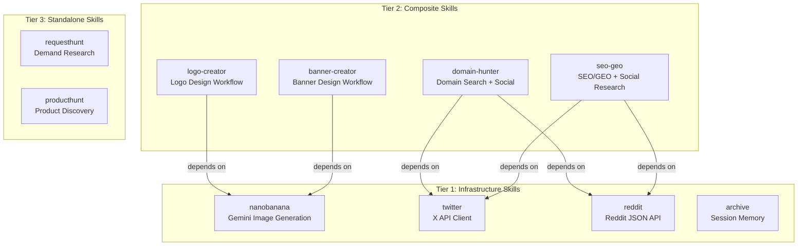
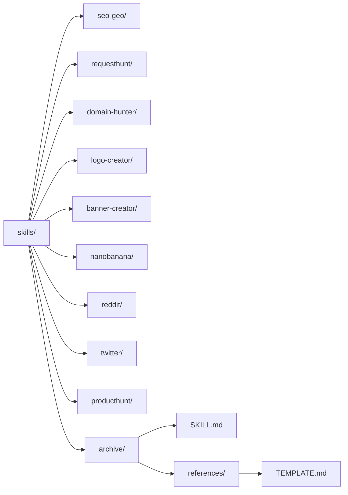
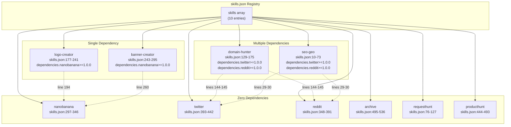
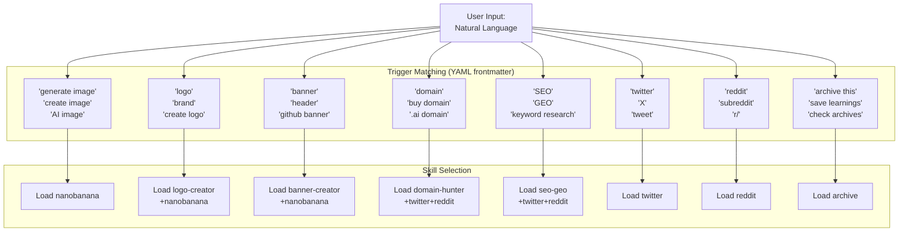
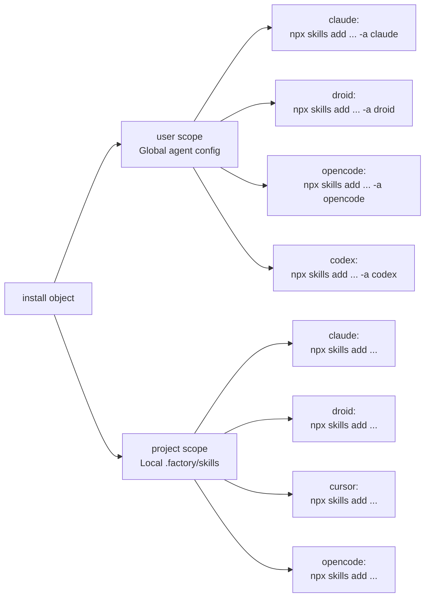

<!-- source: DeepWiki mcp.deepwiki.com · repo ReScienceLab/opc-skills · page 2.4 Skill Categories & Reference · fetched 2026-10-26 -->

# Skill Categories & Reference

<details>
<summary>Relevant source files</summary>

The following files were used as context for generating this wiki page:

- [README.md](README.md)
- [skill-logos/archive.svg](skill-logos/archive.svg)
- [skills.json](skills.json)
- [skills/archive/SKILL.md](skills/archive/SKILL.md)
- [skills/archive/references/TEMPLATE.md](skills/archive/references/TEMPLATE.md)
- [website/opc-banner.png](website/opc-banner.png)

</details>


This page provides a comprehensive overview of the skill categorization system and serves as a reference guide to all available OPC skills. It explains the architectural taxonomy that organizes skills into functional tiers (infrastructure, composite, standalone) and documents the dependency relationships between skills. For detailed documentation of individual skills, see the category-specific pages linked below.

For information about dependency version management and resolution, see [Dependency Management](#2.3). For the skills.json registry structure, see [Skills Registry (skills.json)](#2.1).

---

## Skill Taxonomy

OPC Skills are organized into three architectural tiers based on their dependencies and functionality. This taxonomy reflects how skills compose together to provide higher-level capabilities.

### Three-Tier Architecture



**Tier 1 - Infrastructure Skills**: Provide foundational API access and core capabilities. No dependencies on other skills. Include `nanobanana`, `twitter`, `reddit`, and `archive`.

**Tier 2 - Composite Skills**: Build on infrastructure skills to deliver specialized workflows. Include `logo-creator`, `banner-creator`, `domain-hunter`, and `seo-geo`.

**Tier 3 - Standalone Skills**: Operate independently with their own external API integrations. Include `requesthunt` and `producthunt`.

**Sources:** [skills.json:8-537](), high-level system diagrams (Diagram 2)

---

## Skill Directory Structure

Each skill is organized in the repository following a standardized structure:



Each skill directory contains:
- `SKILL.md` - Primary documentation with YAML frontmatter (required)
- `scripts/` - Executable Python/Shell scripts (optional)
- `examples/` - Usage examples and workflows (optional)
- `references/` - API documentation and templates (optional)

**Sources:** [skills/archive/SKILL.md:1-56](), [skills/archive/references/TEMPLATE.md:1-40]()

---

## Skill Registry Metadata

The [skills.json:1-538]() registry defines 10 skills with structured metadata. Each skill entry contains:

| Field | Type | Description |
|-------|------|-------------|
| `name` | string | Unique skill identifier (lowercase-kebab-case) |
| `version` | string | Semantic version (e.g., "1.0.0") |
| `description` | string | Human-readable purpose and capabilities |
| `logo` | string | URL to SVG logo in skill-logos/ directory |
| `icon` | string | Icon identifier for UI rendering |
| `color` | string | Hex color code (without #) |
| `triggers` | array | Keywords that activate the skill |
| `dependencies` | object | Required skills with version constraints |
| `auth` | object | API key requirements and acquisition URLs |
| `install` | object | Platform-specific installation commands |
| `commands` | array | Executable script templates |
| `links` | object | GitHub, docs, and example URLs |

**Sources:** [skills.json:8-537]()

---

## Skill Categories by Function

### Foundation Skills (Tier 1)

Infrastructure skills providing core API access and memory persistence.

| Skill | Directory | Dependencies | Auth Required |
|-------|-----------|--------------|---------------|
| nanobanana | `skills/nanobanana/` | None | Yes (GEMINI_API_KEY) |
| twitter | `skills/twitter/` | None | Yes (TWITTERAPI_API_KEY) |
| reddit | `skills/reddit/` | None | No |
| archive | `skills/archive/` | None | No |

**Detailed Documentation:** See [Foundation Skills](#2.4.1)

**Sources:** [skills.json:297-346]() (nanobanana), [skills.json:393-442]() (twitter), [skills.json:348-391]() (reddit), [skills.json:495-536]() (archive)

### Design & Image Generation Skills (Tier 2)

Composite skills for iterative design workflows built on `nanobanana`.

| Skill | Directory | Dependencies | Optional APIs |
|-------|-----------|--------------|---------------|
| logo-creator | `skills/logo-creator/` | nanobanana>=1.0.0 | remove.bg, recraft.ai |
| banner-creator | `skills/banner-creator/` | nanobanana>=1.0.0 | None |

Both skills use [skills.json:232]() and [skills.json:288]() to invoke nanobanana's `batch_generate.py` script with the `<nanobanana>` path placeholder.

**Detailed Documentation:** See [Design & Image Generation Skills](#2.4.2)

**Sources:** [skills.json:177-241]() (logo-creator), [skills.json:243-295]() (banner-creator)

### SEO & GEO Optimization (Tier 2)

The `seo-geo` skill provides AI search optimization built on social media research.

| Skill | Directory | Dependencies | Optional APIs |
|-------|-----------|--------------|---------------|
| seo-geo | `skills/seo-geo/` | twitter>=1.0.0, reddit>=1.0.0 | DataForSEO |

**Detailed Documentation:** See [SEO & GEO Optimization Skill](#2.4.3)

**Sources:** [skills.json:10-73]()

### Research & Validation Skills (Tier 3)

Standalone skills for demand research and product discovery.

| Skill | Directory | Dependencies | Auth Required |
|-------|-----------|--------------|---------------|
| requesthunt | `skills/requesthunt/` | None | Yes (REQUESTHUNT_API_KEY) |
| producthunt | `skills/producthunt/` | None | Yes (PRODUCTHUNT_ACCESS_TOKEN) |

**Detailed Documentation:** See [Research & Validation Skills](#2.4.4)

**Sources:** [skills.json:76-127]() (requesthunt), [skills.json:444-493]() (producthunt)

### Social Media & Domain Skills (Tier 2)

The `domain-hunter` skill orchestrates domain search with social media research.

| Skill | Directory | Dependencies | Auth Required |
|-------|-----------|--------------|---------------|
| domain-hunter | `skills/domain-hunter/` | twitter>=1.0.0, reddit>=1.0.0 | No |

**Detailed Documentation:** See [Social Media & Domain Skills](#2.4.5)

**Sources:** [skills.json:129-175]()

---

## Dependency Resolution

### Dependency Graph



**Dependency Declaration Format** in skills.json:
```json
"dependencies": {
  "nanobanana": ">=1.0.0",
  "twitter": ">=1.0.0",
  "reddit": ">=1.0.0"
}
```

When a user installs a composite skill, the installer automatically resolves and installs its dependencies. For example, installing `domain-hunter` will automatically install `twitter` and `reddit` if not already present.

**Sources:** [skills.json:28-31]() (seo-geo deps), [skills.json:143-146]() (domain-hunter deps), [skills.json:193-195]() (logo-creator deps), [skills.json:259-261]() (banner-creator deps)

---

## Trigger Keywords

Skills are activated by natural language triggers defined in [skills.json:16-27]() (example: seo-geo). AI agents match user intent against these keywords to determine which skill to load.

### Trigger Keyword Mapping



**Example Trigger Arrays in skills.json:**

- **nanobanana** [skills.json:303-310](): `["generate image", "create image", "nano banana", "nanobanana", "gemini image", "AI image"]`
- **logo-creator** [skills.json:183-192](): `["logo", "brand", "icon", "favicon", "mascot", "emblem", "create logo", "design logo"]`
- **archive** [skills.json:501-510](): `["archive this", "archive session", "save learnings", "document this", "session notes", "what did we learn", "check archives", "past solutions"]`

**Sources:** [skills.json:16-27](), [skills.json:82-88](), [skills.json:136-142](), [skills.json:183-192](), [skills.json:249-258](), [skills.json:303-310](), [skills.json:354-358](), [skills.json:399-403](), [skills.json:450-455](), [skills.json:501-510]()

---

## Authentication Requirements

Skills requiring API keys declare them in the `auth` field with acquisition URLs:

| Skill | Required Keys | Optional Keys | Cost |
|-------|--------------|---------------|------|
| nanobanana | GEMINI_API_KEY | - | Free tier available |
| twitter | TWITTERAPI_API_KEY | - | ~$0.15-0.18/1k requests |
| reddit | - | - | Free (public API) |
| producthunt | PRODUCTHUNT_ACCESS_TOKEN | - | Free |
| requesthunt | REQUESTHUNT_API_KEY | - | Paid service |
| logo-creator | GEMINI_API_KEY | REMOVE_BG_API_KEY, RECRAFT_API_KEY | Mixed |
| banner-creator | GEMINI_API_KEY | - | Free tier available |
| domain-hunter | - | - | Free (uses whois) |
| seo-geo | - | DATAFORSEO_LOGIN, DATAFORSEO_PASSWORD | Optional paid features |
| archive | - | - | Free (local only) |

**Auth Field Structure** in skills.json:
```json
"auth": {
  "required": true,
  "type": "api_key",
  "keys": [
    {
      "env": "GEMINI_API_KEY",
      "url": "https://aistudio.google.com/apikey"
    }
  ]
}
```

**Sources:** [skills.json:32-47]() (seo-geo auth), [skills.json:90-99]() (requesthunt auth), [skills.json:196-214]() (logo-creator auth), [skills.json:312-321]() (nanobanana auth), [skills.json:405-415]() (twitter auth), [skills.json:457-466]() (producthunt auth)

---

## Skill Logos and Visual Identity

Each skill has an SVG logo stored in [skill-logos/]() directory and referenced in skills.json. The archive skill logo is stored at [skill-logos/archive.svg:1-10]().

Logo URLs follow the pattern:
```
https://raw.githubusercontent.com/ReScienceLab/opc-skills/main/skill-logos/{skill-name}.svg
```

Logos are displayed in:
- README.md skill table [README.md:44-55]()
- opc.dev website skill cards
- Claude marketplace listings
- skills.sh browser

**Sources:** [skills.json:13]() (seo-geo logo), [skills.json:79]() (requesthunt logo), [skills.json:132]() (domain-hunter logo), [skills.json:179]() (logo-creator logo), [skills.json:245]() (banner-creator logo), [skills.json:300]() (nanobanana logo), [skills.json:351]() (reddit logo), [skills.json:396]() (twitter logo), [skills.json:447]() (producthunt logo), [skills.json:498]() (archive logo), [skill-logos/archive.svg:1-10]()

---

## Installation Commands

Each skill entry in skills.json contains platform-specific installation commands under the `install` field [skills.json:48-62]() (example: seo-geo).

### Installation Command Structure



Example from skills.json:
```json
"install": {
  "user": {
    "claude": "npx skills add ReScienceLab/opc-skills --skill seo-geo -a claude",
    "droid": "npx skills add ReScienceLab/opc-skills --skill seo-geo -a droid"
  },
  "project": {
    "claude": "npx skills add ReScienceLab/opc-skills --skill seo-geo",
    "cursor": "npx skills add ReScienceLab/opc-skills --skill seo-geo"
  }
}
```

**Sources:** [skills.json:48-62]() (seo-geo install), [skills.json:100-114]() (requesthunt install), [skills.json:152-166]() (domain-hunter install)

---

## Navigation to Detailed Documentation

For comprehensive documentation of each skill category:

- **[Foundation Skills](#2.4.1)** - nanobanana, twitter, reddit, archive
- **[Design & Image Generation Skills](#2.4.2)** - logo-creator, banner-creator
- **[SEO & GEO Optimization Skill](#2.4.3)** - seo-geo
- **[Research & Validation Skills](#2.4.4)** - requesthunt, producthunt
- **[Social Media & Domain Skills](#2.4.5)** - domain-hunter

For skill creation guidelines, see [Creating New Skills](#7).

**Sources:** [skills.json:8-537](), [README.md:42-55]()

---

