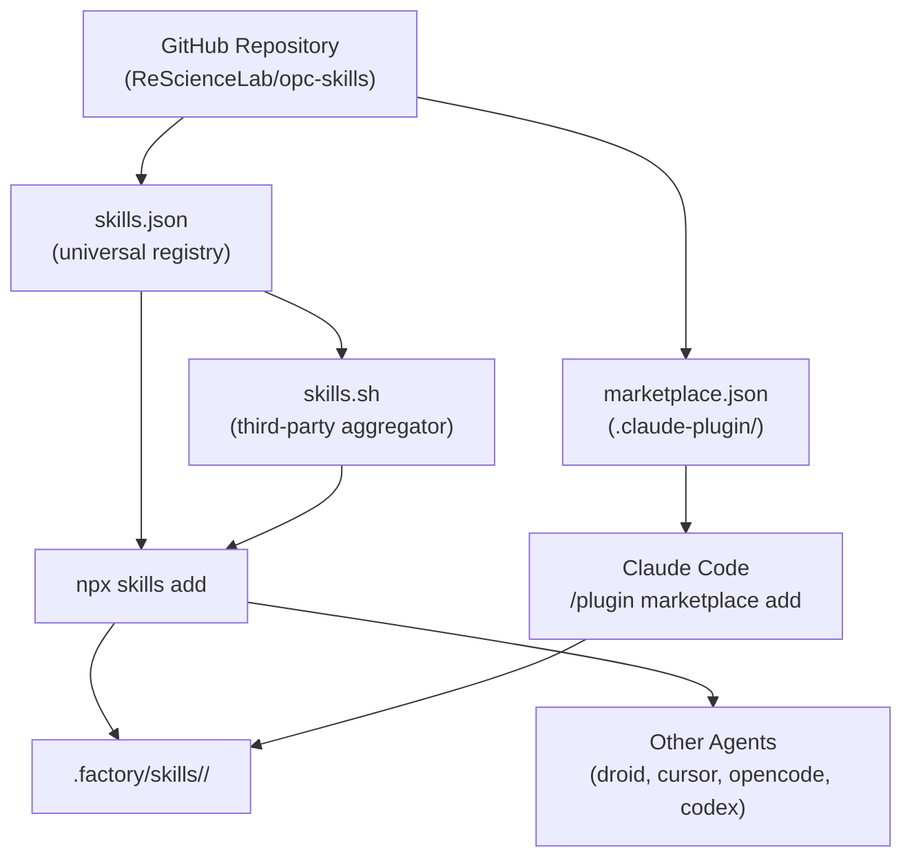
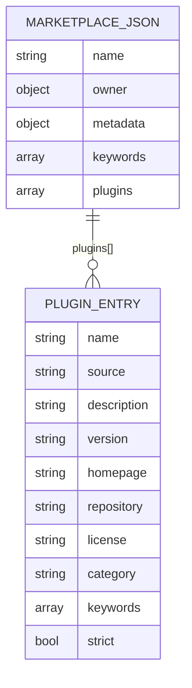
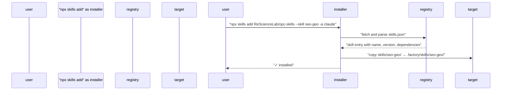
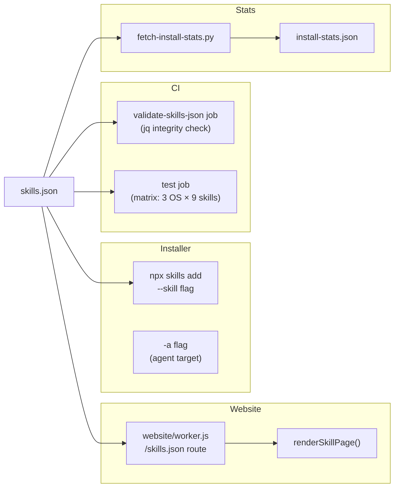

<!-- source: DeepWiki mcp.deepwiki.com · repo ReScienceLab/opc-skills · page 3 Installation & Distribution · fetched 2026-10-26 -->

# Installation & Distribution

<details>
<summary>Relevant source files</summary>

The following files were used as context for generating this wiki page:

- [.claude-plugin/marketplace.json](.claude-plugin/marketplace.json)
- [README.md](README.md)
- [skill-logos/archive.svg](skill-logos/archive.svg)
- [website/opc-banner.png](website/opc-banner.png)

</details>


This page provides a high-level overview of how OPC Skills are distributed and installed across AI coding tools. It covers the two primary distribution channels, the install target directory convention, required API credentials per skill, and how the installer is tested in CI.

For detailed coverage of individual topics, see:
- [Installation Methods Overview](#3.1) — per-method comparison and `.factory/skills/` directory details
- [Claude Code Plugin Marketplace](#3.2) — `marketplace.json` schema and `/plugin` commands
- [Universal Installer (npx skills add)](#3.3) — CLI flags and `skills.json` resolution
- [Platform-Specific Installation](#3.4) — per-platform install command strings
- [Installation Statistics System](#3.5) — automated stats pipeline

---

## Distribution Channels

OPC Skills uses two parallel distribution channels that serve different audiences.

**Distribution channel overview:**



Sources: [skills.json:1-10](), [.claude-plugin/marketplace.json:1-10](), [CHANGELOG.md:240-260]()

---

## Channel 1 — Claude Code Plugin Marketplace

The file [.claude-plugin/marketplace.json]() is a manifest read by Claude Code's `/plugin marketplace add` command. It contains a top-level marketplace record plus one entry per skill in the `plugins` array.

Each plugin entry includes:
- `source` — relative path to the skill directory (e.g., `"./skills/requesthunt"`)
- `strict` — set to `true` for all OPC skills
- `category` — groups skills by function
- `homepage` — points to the corresponding `opc.dev/skills/<name>` page

**Plugin manifest structure:**



Sources: [.claude-plugin/marketplace.json:1-182]()

A historical note: prior to v1.0.5, plugin `source` paths used bare names like `"./domain-hunter"` instead of `"./skills/domain-hunter"`, causing "Source path does not exist" errors in Claude Code. See [CHANGELOG.md:90-99]() for the fix.

---

## Channel 2 — Universal Installer (`npx skills add`)

The `npx skills add` command reads `skills.json` from the specified GitHub repository to resolve and copy skill directories. The `-y` flag suppresses interactive prompts and the `-a <agent>` flag targets a specific agent platform.

**Installer flow:**



Sources: [skills.json:48-74](), [.github/workflows/test-installer.yml:30-47]()

The `install` field in each `skills.json` skill entry defines the exact install command string for every supported platform and scope combination. For example, the `seo-geo` skill defines [skills.json:48-62]():

```
install.user.claude   = "npx skills add ReScienceLab/opc-skills --skill seo-geo -a claude"
install.project.claude = "npx skills add ReScienceLab/opc-skills --skill seo-geo"
install.project.cursor = "npx skills add ReScienceLab/opc-skills --skill seo-geo"
```

---

## Supported Platforms

The `install` field supports two scopes (`user`, `project`) and five agent targets. Not all agents support both scopes.

| Platform | User-Level | Project-Level |
|----------|-----------|---------------|
| `claude` | ✓ | ✓ |
| `droid` | ✓ | ✓ |
| `opencode` | ✓ | ✓ |
| `codex` | ✓ | ✓ |
| `cursor` | ✗ | ✓ |

Sources: [skills.json:48-62](), [skills.json:100-113]()

---

## Install Target Directory

Regardless of the installation pathway used, skills land in `.factory/skills/<skill-name>/` within the working directory. This is the convention validated by the CI test suite at [.github/workflows/test-installer.yml:41-46]():

```
.factory/
  skills/
    seo-geo/
    requesthunt/
    nanobanana/
    ...
```

The CI test checks for the presence of `.factory/skills/<skill>` after each `npx skills add` invocation. If missing, the job exits with a failure.

---

## Required API Keys

Skills declare their authentication requirements in the `auth` field of `skills.json`. The `required` boolean flags whether any key is mandatory; individual keys may be marked `optional`.

| Skill | Required Keys | Optional Keys | Auth Required |
|-------|--------------|---------------|---------------|
| `seo-geo` | — | `DATAFORSEO_LOGIN`, `DATAFORSEO_PASSWORD` | No |
| `requesthunt` | `REQUESTHUNT_API_KEY` | — | Yes |
| `domain-hunter` | — | — | No |
| `logo-creator` | `GEMINI_API_KEY` | `REMOVE_BG_API_KEY`, `RECRAFT_API_KEY` | Yes |
| `banner-creator` | `GEMINI_API_KEY` | — | Yes |
| `nanobanana` | `GEMINI_API_KEY` | — | Yes |
| `reddit` | — | — | No |
| `twitter` | `TWITTERAPI_API_KEY` | — | Yes |
| `producthunt` | `PRODUCTHUNT_ACCESS_TOKEN` | — | Yes |
| `archive` | — | — | No |

Sources: [skills.json:32-46](), [skills.json:90-98](), [skills.json:147-151](), [skills.json:196-214](), [skills.json:263-270](), [skills.json:312-320](), [skills.json:360-364](), [skills.json:404-415](), [skills.json:456-464](), [skills.json:511-515]()

---

## Relationship Between skills.json and Distribution

**How skills.json serves multiple consumers:**



Sources: [skills.json:1-538](), [.github/workflows/test-installer.yml:85-117](), [CHANGELOG.md:240-260]()

---

## CI Validation

The [.github/workflows/test-installer.yml]() workflow runs on any push or pull request that modifies `skills.json` or any file under `skills/**`. It contains three jobs:

| Job | Matrix | What It Checks |
|-----|--------|----------------|
| `test` | 3 OS × 9 skills | Each skill installs individually via `npx skills add ... --skill <name> -y` |
| `test-all-skills` | 3 OS | All skills install together; asserts `SKILL_COUNT >= 9` |
| `validate-skills-json` | ubuntu-latest | JSON syntax via `jq empty`; required fields; dependency name referential integrity |

The referential integrity check ([.github/workflows/test-installer.yml:98-115]()) extracts all `name` values from `skills.json` and verifies that every key in any skill's `dependencies` object matches a known skill name. Both object and legacy array formats are supported.

Sources: [.github/workflows/test-installer.yml:1-117]()

---

