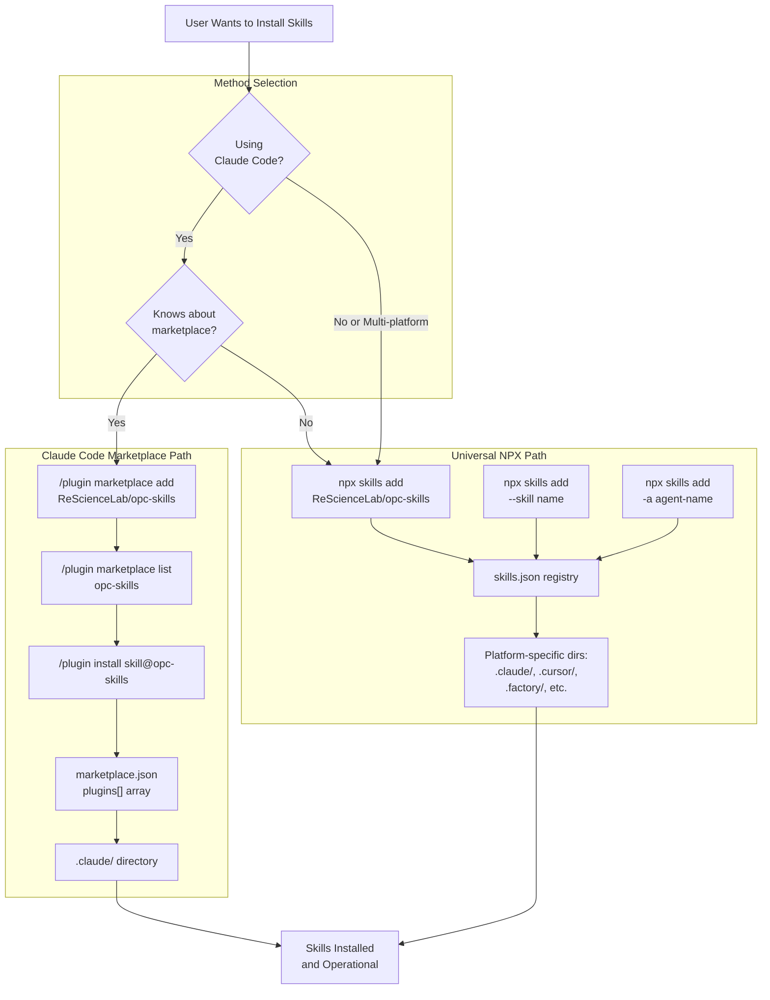
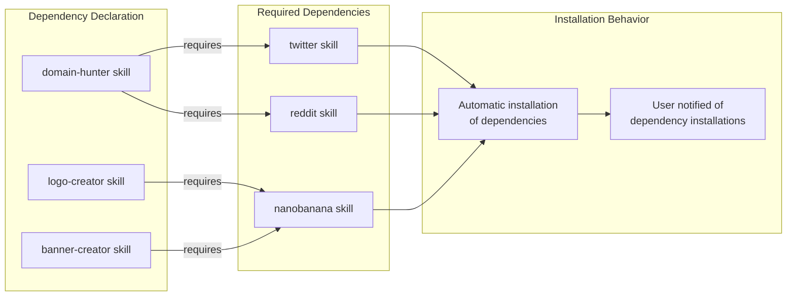
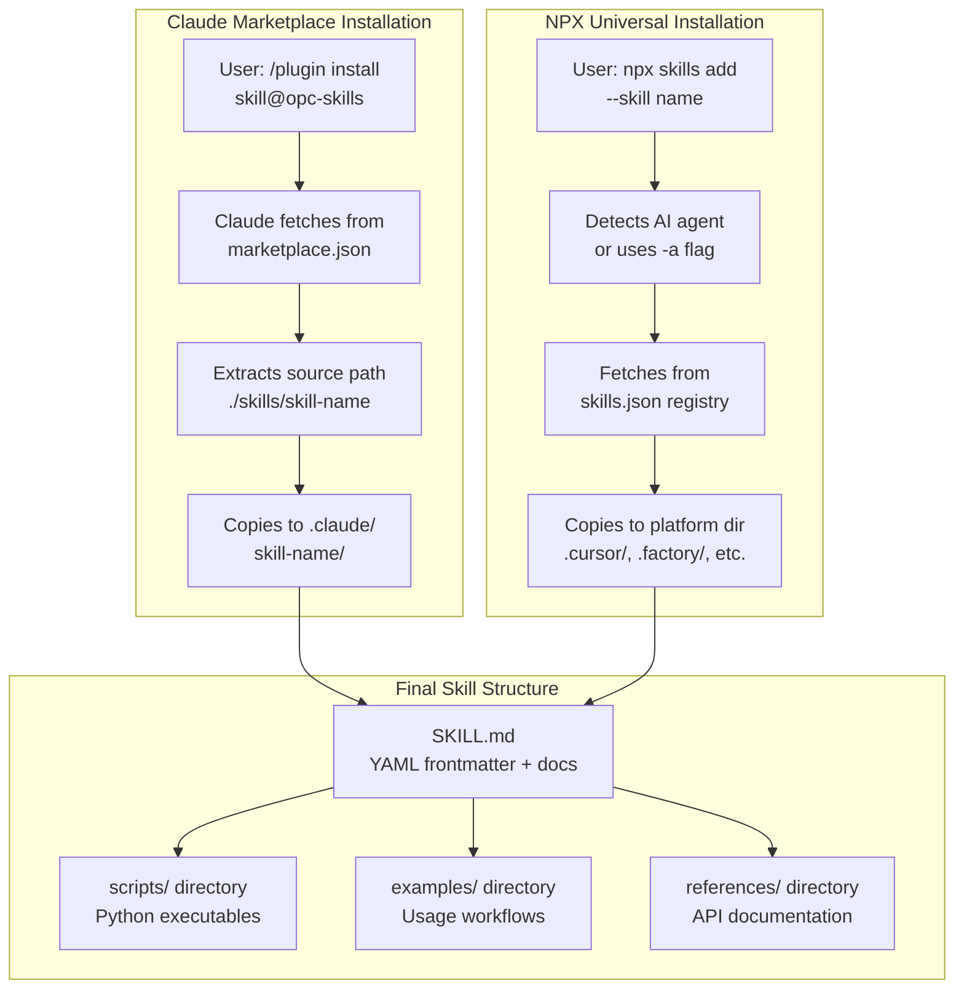
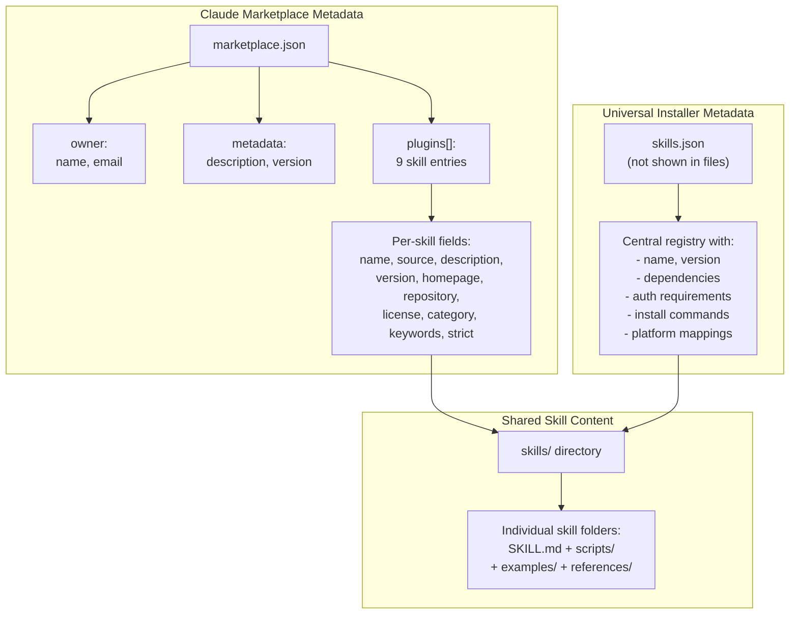

<!-- source: DeepWiki mcp.deepwiki.com · repo ReScienceLab/opc-skills · page 3.1 Installation Methods Overview · fetched 2026-10-26 -->

# Installation Methods Overview

<details>
<summary>Relevant source files</summary>

The following files were used as context for generating this wiki page:

- [.claude-plugin/marketplace.json](.claude-plugin/marketplace.json)
- [README.md](README.md)
- [skill-logos/archive.svg](skill-logos/archive.svg)
- [website/opc-banner.png](website/opc-banner.png)

</details>


## Purpose and Scope

This document provides an overview of the two primary installation pathways available for OPC Skills: the universal NPX installer and the Claude Code-specific marketplace. It explains the architectural differences between these methods, their target platforms, and how they handle skill distribution and dependency resolution.

For detailed documentation on Claude Code's plugin marketplace, see [Claude Code Plugin Marketplace](#3.2). For the universal installer's implementation details, see [Universal Installer (npx skills add)](#3.3). For platform-specific installation directories and commands, see [Platform-Specific Installation](#3.4).

## Dual-Pathway Architecture

OPC Skills implements two distinct installation pathways to maximize compatibility across the AI agent ecosystem:

| Installation Method | Primary Use Case | Platform Support | Dependency Resolution | Defined In |
|---------------------|------------------|------------------|----------------------|------------|
| Claude Code Marketplace | Native integration for Claude Code/Desktop users | Claude Code, Claude Desktop | Automatic | [.claude-plugin/marketplace.json:1-182]() |
| Universal NPX Installer | Cross-platform installation for 16+ AI agents | Claude Code, Cursor, Droid, Windsurf, Goose, Roo Code, Trae, and 9+ others | Automatic | Compatible with `vercel-labs/add-skill` |

Both pathways install the same skill content (SKILL.md files and associated scripts) but differ in their discovery mechanisms, installation commands, and target directory structures.

**Sources:** [README.md:57-128](), [.claude-plugin/marketplace.json:1-182]()

## Installation Method Comparison



**Diagram: Installation Pathway Decision Flow**

This diagram shows how users select between installation methods based on their platform and familiarity with the Claude marketplace system. Both paths converge on the same functional outcome but use different metadata sources and directory structures.

**Sources:** [README.md:59-89](), [.claude-plugin/marketplace.json:1-24]()

## Claude Code Marketplace Method

### Command Structure

The Claude Code marketplace uses native `/plugin` commands within the Claude interface:

```bash
# Add the OPC Skills marketplace
/plugin marketplace add ReScienceLab/opc-skills

# List available skills
/plugin marketplace list opc-skills

# Install specific skills
/plugin install requesthunt@opc-skills
/plugin install domain-hunter@opc-skills
/plugin install seo-geo@opc-skills
```

**Sources:** [README.md:59-74]()

### Marketplace Metadata Structure

Skills available through the Claude marketplace are defined in `marketplace.json`. Each skill entry contains:

```json
{
  "name": "skill-name",
  "source": "./skills/skill-name",
  "description": "Skill description",
  "version": "1.0.0",
  "homepage": "https://opc.dev/skills/skill-name",
  "repository": "https://github.com/ReScienceLab/opc-skills",
  "license": "MIT",
  "category": "category-name",
  "keywords": ["keyword1", "keyword2"],
  "strict": true
}
```

The `plugins` array in `marketplace.json` contains 9 skill entries covering SEO, research, design, social media, and AI tools categories.

**Sources:** [.claude-plugin/marketplace.json:24-181]()

### Marketplace Skill Registry

| Skill Name | Category | Source Path | Description |
|------------|----------|-------------|-------------|
| `requesthunt` | market-research | `./skills/requesthunt` | User demand research from Reddit, X, GitHub |
| `domain-hunter` | business | `./skills/domain-hunter` | Domain search, price comparison, promo codes |
| `logo-creator` | design | `./skills/logo-creator` | AI logo generation with iterative workflow |
| `banner-creator` | design | `./skills/banner-creator` | AI banner generation for social platforms |
| `nanobanana` | ai-tools | `./skills/nanobanana` | Gemini 3 Pro Image generation |
| `reddit` | social-media | `./skills/reddit` | Reddit content via public JSON API |
| `twitter` | social-media | `./skills/twitter` | Twitter/X content via twitterapi.io |
| `producthunt` | product-discovery | `./skills/producthunt` | Product Hunt via GraphQL API |
| `seo-geo` | seo | `./skills/seo-geo` | SEO & GEO optimization |

**Sources:** [.claude-plugin/marketplace.json:24-181]()

## Universal NPX Installer Method

### Command Variants

The universal installer supports multiple invocation patterns:

```bash
# Install all skills
npx skills add ReScienceLab/opc-skills

# Install specific skill by name
npx skills add ReScienceLab/opc-skills --skill reddit

# Install multiple specific skills
npx skills add ReScienceLab/opc-skills --skill reddit --skill twitter --skill domain-hunter

# Target specific AI agent
npx skills add ReScienceLab/opc-skills -a droid
npx skills add ReScienceLab/opc-skills -a cursor
```

**Sources:** [README.md:76-106]()

### Platform Compatibility Matrix

The universal installer supports 16+ AI coding agents through the `vercel-labs/add-skill` compatibility layer:

| Platform | Agent Flag | Installation Directory | Notes |
|----------|------------|------------------------|-------|
| Claude Code | `claude` | `.claude/` | Also supports marketplace method |
| Cursor | `cursor` | `.cursor/` | AI-first code editor |
| Factory Droid | `droid` | `.factory/` | AI software engineering agent |
| Windsurf | `windsurf` | Platform-specific | AI-powered IDE |
| OpenCode | `opencode` | Platform-specific | Open-source AI assistant |
| Codex | `codex` | Platform-specific | AI code generation |
| GitHub Copilot | `copilot` | Platform-specific | AI pair programmer |
| Gemini CLI | `gemini` | Platform-specific | Command-line AI |
| Goose | `goose` | Platform-specific | Terminal-based agent |
| Kilo Code | `kilo` | Platform-specific | Lightweight AI tool |
| Roo Code | `roo` | Platform-specific | AI code assistant |
| Trae | `trae` | Platform-specific | AI development companion |

Full compatibility list available at `github.com/vercel-labs/add-skill#available-agents`.

**Sources:** [README.md:109-128]()

## Dependency Handling Across Methods

Both installation methods automatically resolve skill dependencies, but the mechanism differs:



**Diagram: Automatic Dependency Resolution**

Skills with dependencies are documented in the README and automatically installed when the parent skill is requested.

**Sources:** [README.md:93-106]()

### Known Dependency Relationships

The following skills have declared dependencies:

- **domain-hunter** → requires `twitter` and `reddit`
- **logo-creator** → requires `nanobanana`
- **banner-creator** → requires `nanobanana`

When installing `domain-hunter`, the installer automatically includes `twitter` and `reddit`. When installing `logo-creator` or `banner-creator`, `nanobanana` is automatically included.

**Sources:** [README.md:93-106]()

## Installation Output Comparison



**Diagram: Installation Output Structure**

Both methods install identical skill directory structures. The key difference is the metadata source (`marketplace.json` vs `skills.json`) and target directory location.

**Sources:** [README.md:36-40](), [.claude-plugin/marketplace.json:24-181]()

## Skill Discovery Mechanisms

### Claude Marketplace Discovery

Users discover skills through:

1. `/plugin marketplace list opc-skills` - Lists all 9 skills in the marketplace
2. Claude Code's plugin UI - Visual browsing interface
3. Marketplace badges - Homepage links to `https://opc.dev/skills/skill-name`

### Universal Installer Discovery

Users discover skills through:

1. **skills.sh** - Public skills browser at `https://skills.sh/ReScienceLab/opc-skills`
2. **README.md** - Skills table with descriptions and logos
3. **opc.dev website** - Skill detail pages
4. **DeepWiki** - AI-powered documentation at `https://deepwiki.com/ReScienceLab/opc-skills`

**Sources:** [README.md:8-23](), [README.md:131-147]()

## Metadata Source Comparison



**Diagram: Metadata Architecture**

The Claude marketplace uses `marketplace.json` with a `plugins` array structure, while the universal installer references `skills.json` (compatible with the Agent Skills Standard). Both point to the same underlying skill directories in `skills/`.

**Sources:** [.claude-plugin/marketplace.json:1-10](), [.claude-plugin/marketplace.json:24-42]()

## Installation Statistics Tracking

Both installation methods contribute to unified install statistics tracked at `skills.sh`. The statistics system is documented in [Installation Statistics System](#3.5).

Install counts are aggregated across both pathways and displayed on:
- `https://skills.sh/ReScienceLab/opc-skills` - Public install statistics
- `https://opc.dev` - Website displays live stats via `install-stats.json`

**Sources:** [README.md:91]()

## Method Selection Guidelines

### Choose Claude Marketplace When:

- User exclusively uses Claude Code/Desktop
- User prefers native `/plugin` commands
- User wants Claude-native skill discovery UI
- Installation limited to Claude ecosystem

### Choose Universal NPX Installer When:

- User works with multiple AI agents
- User needs Cursor, Droid, Windsurf, or other platform support
- User prefers command-line installation workflow
- User wants future platform compatibility without reconfiguration

Both methods provide identical skill functionality after installation. The choice depends on platform requirements and user workflow preferences.

**Sources:** [README.md:57-128]()

---

