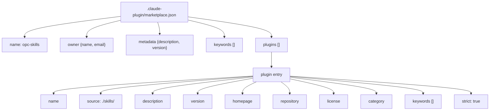
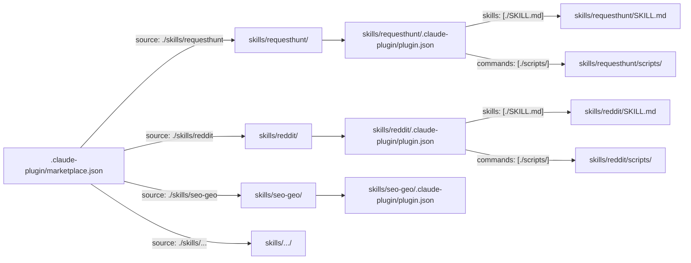

<!-- source: DeepWiki mcp.deepwiki.com · repo ReScienceLab/opc-skills · page 3.2 Claude Code Plugin Marketplace · fetched 2026-10-26 -->

# Claude Code Plugin Marketplace

<details>
<summary>Relevant source files</summary>

The following files were used as context for generating this wiki page:

- [.claude-plugin/marketplace.json](.claude-plugin/marketplace.json)
- [README.md](README.md)
- [skill-logos/archive.svg](skill-logos/archive.svg)
- [website/opc-banner.png](website/opc-banner.png)

</details>


This page documents the Claude Code plugin marketplace integration for OPC Skills — specifically the manifest formats that register the skill collection with Claude Code's plugin system. For a comparison of all installation methods including `npx skills add` and agent-specific flags, see [Installation Methods Overview](#3.1). For per-platform install command strings, see [Platform-Specific Installation](#3.4).

---

## Overview

OPC Skills exposes itself to Claude Code's plugin marketplace through two layers of manifest files:

1. **A top-level collection manifest** at `.claude-plugin/marketplace.json` — registers the entire `opc-skills` collection and lists all available plugins.
2. **Per-skill plugin manifests** at `skills/<name>/.claude-plugin/plugin.json` — describe individual skills including their entry points (`SKILL.md`) and supporting scripts.

**Directory layout for the marketplace integration:**

```
.claude-plugin/
  marketplace.json          ← collection-level manifest

skills/
  requesthunt/
    .claude-plugin/
      plugin.json           ← per-skill manifest
  domain-hunter/
    .claude-plugin/
      plugin.json
  logo-creator/
    .claude-plugin/
      plugin.json
  ... (one per skill)
```

Sources: [.claude-plugin/marketplace.json:1-182](), [skills/requesthunt/.claude-plugin/plugin.json:1-24]()

---

## `marketplace.json` — Collection Manifest

The file [.claude-plugin/marketplace.json]() registers the entire `opc-skills` collection with Claude Code's marketplace.

### Top-Level Fields

| Field | Type | Description |
|---|---|---|
| `name` | string | Unique identifier for the collection (`"opc-skills"`) |
| `owner.name` | string | Organization name (`"ReScienceLab"`) |
| `owner.email` | string | Contact email for the collection owner |
| `metadata.description` | string | Human-readable summary of the collection |
| `metadata.version` | string | Collection-level semver version (e.g. `"1.0.4"`) |
| `keywords` | string[] | Search tags used by the marketplace for discovery |
| `plugins` | object[] | Array of plugin entry descriptors (see below) |

Sources: [.claude-plugin/marketplace.json:1-23]()

### `plugins` Array — Per-Entry Fields

Each element of the `plugins` array in `marketplace.json` describes one skill:

| Field | Type | Description |
|---|---|---|
| `name` | string | Skill identifier (e.g. `"requesthunt"`) |
| `source` | string | Relative path to the skill directory (e.g. `"./skills/requesthunt"`) |
| `description` | string | Short description shown in marketplace UI |
| `version` | string | Skill-level semver version |
| `homepage` | string | URL to the skill's page on `opc.dev` |
| `repository` | string | GitHub repository URL |
| `license` | string | License identifier (`"MIT"`) |
| `category` | string | Category tag (see table below) |
| `keywords` | string[] | Additional search tags specific to the skill |
| `strict` | boolean | When `true`, enforces strict plugin loading mode |

#### Category Values in Use

| Category | Skills |
|---|---|
| `market-research` | `requesthunt` |
| `business` | `domain-hunter` |
| `design` | `logo-creator`, `banner-creator` |
| `ai-tools` | `nanobanana` |
| `social-media` | `reddit`, `twitter` |
| `product-discovery` | `producthunt` |
| `seo` | `seo-geo` |

Sources: [.claude-plugin/marketplace.json:24-181]()

### `marketplace.json` — Annotated Structure Diagram

**Diagram: marketplace.json schema structure**



Sources: [.claude-plugin/marketplace.json:1-182]()

---

## Per-Skill `plugin.json` Manifests

Each skill directory contains its own `.claude-plugin/plugin.json`. This file is what Claude Code reads once a plugin is installed to understand its entry points.

### `plugin.json` Fields

| Field | Type | Description |
|---|---|---|
| `name` | string | Skill identifier matching the `skills.json` name |
| `version` | string | Skill semver version |
| `description` | string | Detailed description of the skill's capability |
| `author.name` | string | Author or organization name |
| `homepage` | string | GitHub tree URL for the skill directory |
| `repository` | string | Root repository URL |
| `license` | string | License identifier |
| `keywords` | string[] | Trigger-oriented keywords for agent invocation |
| `skills` | string[] | Paths to `SKILL.md` files (always `["./SKILL.md"]`) |
| `commands` | string[] | Paths to script directories (always `["./scripts/"]`) |

The `skills` field points Claude Code to the `SKILL.md` file, which contains the agent-readable instructions and trigger conditions for the skill. The `commands` field points to the scripts directory where executable Python helper scripts live. For more on `SKILL.md` structure, see [Skill Structure & Standards](#2.2).

Sources: [skills/requesthunt/.claude-plugin/plugin.json:1-24](), [skills/seo-geo/.claude-plugin/plugin.json:1-29](), [skills/reddit/.claude-plugin/plugin.json:1-22]()

### Inventory of Per-Skill `plugin.json` Files

| Skill | `plugin.json` Path | `skills` Entry | `commands` Entry |
|---|---|---|---|
| `requesthunt` | `skills/requesthunt/.claude-plugin/plugin.json` | `./SKILL.md` | `./scripts/` |
| `reddit` | `skills/reddit/.claude-plugin/plugin.json` | `./SKILL.md` | `./scripts/` |
| `twitter` | `skills/twitter/.claude-plugin/plugin.json` | `./SKILL.md` | `./scripts/` |
| `nanobanana` | `skills/nanobanana/.claude-plugin/plugin.json` | `./SKILL.md` | `./scripts/` |
| `producthunt` | `skills/producthunt/.claude-plugin/plugin.json` | `./SKILL.md` | `./scripts/` |
| `seo-geo` | `skills/seo-geo/.claude-plugin/plugin.json` | `./SKILL.md` | `./scripts/` |

> **Note:** Not every skill directory has been shown in the source files above, but all skills follow the same pattern.

Sources: [skills/seo-geo/.claude-plugin/plugin.json:23-28](), [skills/nanobanana/.claude-plugin/plugin.json:19-24](), [skills/producthunt/.claude-plugin/plugin.json:18-23]()

---

## File Relationships and Data Flow

**Diagram: marketplace.json → plugin.json → skill entry points**



Sources: [.claude-plugin/marketplace.json:24-44](), [skills/requesthunt/.claude-plugin/plugin.json:16-23](), [skills/reddit/.claude-plugin/plugin.json:16-22]()

---

## Claude Code Plugin Commands

The following `/plugin` commands are used to interact with OPC Skills through Claude Code's marketplace system. These operate on the manifests described above.

| Command | Description |
|---|---|
| `/plugin marketplace add <url>` | Register the OPC Skills marketplace using the repository URL |
| `/plugin install <name>` | Install a specific skill by its `name` field from `marketplace.json` |
| `/plugin list` | List all installed plugins and their versions |
| `/plugin enable <name>` | Enable a previously installed but disabled plugin |
| `/plugin marketplace update` | Pull the latest `marketplace.json` to refresh available skill listings |

After installation, Claude Code reads the target skill's `plugin.json`, loads the `SKILL.md` specified in `skills`, and makes the scripts in `commands` available for agent invocation.

---

## `strict` Field Behavior

All plugin entries in `marketplace.json` set `"strict": true` [.claude-plugin/marketplace.json:42](). In strict mode, Claude Code enforces that the plugin's declared entry points (`SKILL.md`, `scripts/`) exist and are valid before the plugin is considered successfully installed. This prevents partially installed or misconfigured skills from being silently activated.

Sources: [.claude-plugin/marketplace.json:42](), [.claude-plugin/marketplace.json:59](), [.claude-plugin/marketplace.json:78]()

---

## Relationship to Other Installation Methods

The Claude Code plugin marketplace is one of three ways to install OPC Skills. The `source` paths in `marketplace.json` point to the same skill directories that the `npx skills add` installer and agent-specific commands use. All methods converge on the same `skills/<name>/` directory structure.

For how `npx skills add` resolves and installs these same directories, see [Universal Installer (npx skills add)](#3.3). For the full comparison of all methods, see [Installation Methods Overview](#3.1).

---

