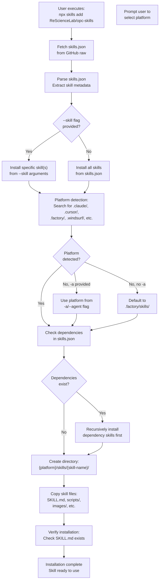
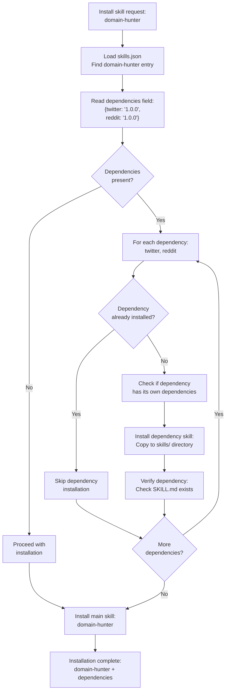
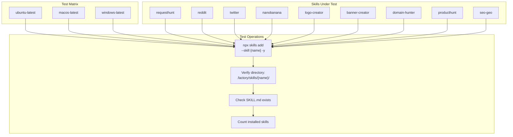

<!-- source: DeepWiki mcp.deepwiki.com · repo ReScienceLab/opc-skills · page 3.3 Universal Installer (npx skills add) · fetched 2026-10-26 -->

# Universal Installer (npx skills add)

<details>
<summary>Relevant source files</summary>

The following files were used as context for generating this wiki page:

- [.gitattributes](.gitattributes)
- [.github/workflows/test-installer.yml](.github/workflows/test-installer.yml)
- [README.md](README.md)
- [skill-logos/archive.svg](skill-logos/archive.svg)
- [website/opc-banner.png](website/opc-banner.png)

</details>


## Purpose and Scope

This document covers the universal installer for OPC Skills, which uses the `npx skills add` command to install skills across 16+ AI coding platforms. The installer abstracts platform differences, automatically detects the target environment, and handles dependency resolution.

For information about installing via Claude Code's plugin marketplace, see [Claude Code Plugin Marketplace](#3.2). For platform-specific installation details and directory structures, see [Platform-Specific Installation](#3.4).

**Sources:** [README.md:1-182]()

---

## Command Syntax

The universal installer uses `npx` to execute the `skills` command from Vercel Labs' `@skills/cli` package without requiring global installation.

### Basic Usage

| Command | Description |
|---------|-------------|
| `npx skills add ReScienceLab/opc-skills` | Install all skills from the repository |
| `npx skills add ReScienceLab/opc-skills --skill reddit` | Install a specific skill |
| `npx skills add ReScienceLab/opc-skills --skill reddit --skill twitter` | Install multiple specific skills |
| `npx skills add ReScienceLab/opc-skills -a droid` | Install to specific agent (Factory Droid) |
| `npx skills add ReScienceLab/opc-skills -y` | Skip confirmation prompts |

### Command Structure

```
npx skills add <repository> [options]
```

**Arguments:**
- `<repository>`: GitHub repository in format `owner/repo` (e.g., `ReScienceLab/opc-skills`)

**Options:**
- `--skill <name>`: Install specific skill(s) - can be specified multiple times
- `-a, --agent <name>`: Target specific AI agent platform
- `-y, --yes`: Auto-confirm installation without prompts
- `--help`: Display help information

**Sources:** [README.md:77-88](), [.github/workflows/test-installer.yml:30-46]()

---

## Supported AI Platforms

The universal installer supports 16+ AI coding platforms through automatic platform detection:

```mermaid
graph TB
    subgraph "Primary Platforms"
        Claude["Claude Code<br/>.claude/skills/"]
        Cursor["Cursor<br/>.cursor/skills/"]
        Droid["Factory Droid<br/>.factory/skills/"]
        Windsurf["Windsurf<br/>.windsurf/skills/"]
    end
    
    subgraph "Additional Platforms"
        OpenCode["OpenCode<br/>.opencode/skills/"]
        Codex["Codex<br/>.codex/skills/"]
        Copilot["GitHub Copilot<br/>.copilot/skills/"]
        Gemini["Gemini CLI<br/>.gemini/skills/"]
        Goose["Goose<br/>.goose/skills/"]
        Kilo["Kilo Code<br/>.kilo/skills/"]
        Roo["Roo Code<br/>.roo/skills/"]
        Trae["Trae<br/>.trae/skills/"]
    end
    
    Installer["npx skills add<br/>ReScienceLab/opc-skills"]
    
    Installer -->|"Auto-detects"| Claude
    Installer -->|"Auto-detects"| Cursor
    Installer -->|"Auto-detects"| Droid
    Installer -->|"Auto-detects"| Windsurf
    Installer -->|"Auto-detects"| OpenCode
    Installer -->|"Auto-detects"| Codex
    Installer -->|"Auto-detects"| Copilot
    Installer -->|"Auto-detects"| Gemini
    Installer -->|"Auto-detects"| Goose
    Installer -->|"Auto-detects"| Kilo
    Installer -->|"Auto-detects"| Roo
    Installer -->|"Auto-detects"| Trae
```



**Platform Detection:**
The installer searches for existing platform-specific directories in the current working directory. If multiple platforms are detected, it prompts the user to select one. The `-a` flag overrides auto-detection.

**Default Platform:**
If no platform is detected and no `-a` flag is provided, the installer defaults to `.factory/skills/` (Factory Droid).

**Sources:** [README.md:109-127](), [.github/workflows/test-installer.yml:41-47]()

---

## Installation Process Flow

The following diagram shows the complete installation flow from command execution to installed skills:

### Installation Flow Diagram



**Sources:** [README.md:77-104](), [.github/workflows/test-installer.yml:30-83]()

---

## Installation Directories

The installer creates a consistent directory structure across all platforms:

```
{platform}/
└── skills/
    ├── {skill-name}/
    │   ├── SKILL.md
    │   ├── scripts/
    │   │   └── (optional scripts)
    │   ├── images/
    │   │   └── (optional images)
    │   └── examples/
    │       └── (optional examples)
    └── {another-skill}/
        └── ...
```

### Platform-Specific Paths

| Platform | Installation Directory | Example |
|----------|----------------------|---------|
| Claude Code | `.claude/skills/{skill-name}/` | `.claude/skills/reddit/` |
| Cursor | `.cursor/skills/{skill-name}/` | `.cursor/skills/twitter/` |
| Factory Droid | `.factory/skills/{skill-name}/` | `.factory/skills/seo-geo/` |
| Windsurf | `.windsurf/skills/{skill-name}/` | `.windsurf/skills/domain-hunter/` |
| OpenCode | `.opencode/skills/{skill-name}/` | `.opencode/skills/logo-creator/` |
| Codex | `.codex/skills/{skill-name}/` | `.codex/skills/nanobanana/` |
| GitHub Copilot | `.copilot/skills/{skill-name}/` | `.copilot/skills/requesthunt/` |
| Gemini CLI | `.gemini/skills/{skill-name}/` | `.gemini/skills/producthunt/` |
| Goose | `.goose/skills/{skill-name}/` | `.goose/skills/banner-creator/` |

**Sources:** [.github/workflows/test-installer.yml:41-47](), [README.md:109-127]()

---

## Dependency Resolution

The installer automatically resolves and installs skill dependencies as defined in `skills.json`.

### Dependency Resolution Process



### Skills with Dependencies

The following skills have dependencies that are automatically installed:

| Skill | Dependencies | Reason |
|-------|--------------|--------|
| `seo-geo` | `twitter`, `reddit` | Requires social media data for SEO research |
| `domain-hunter` | `twitter`, `reddit` | Requires social validation for domain suggestions |
| `logo-creator` | `nanobanana` | Uses image generation capability |
| `banner-creator` | `nanobanana` | Uses image generation capability |

**Example:** Installing `domain-hunter` automatically installs `twitter` and `reddit` if not already present:

```bash
npx skills add ReScienceLab/opc-skills --skill domain-hunter
# Installs: reddit, twitter, domain-hunter
```

**Sources:** [README.md:92-104]()

---

## Cross-Platform Testing

The repository includes comprehensive automated testing to validate installation across platforms and operating systems.

### Testing Matrix

The CI/CD pipeline tests every skill on every supported operating system:



### Test Workflow Details

The test workflow (`test-installer.yml`) runs on every push to `main` and on pull requests that modify `skills.json` or the `skills/` directory.

**Test Jobs:**

1. **Individual Skill Tests** (27 parallel runs)
   - Matrix: 9 skills × 3 operating systems = 27 test runs
   - Each test installs a single skill and verifies the installation

2. **All Skills Test** (3 parallel runs)
   - Matrix: 3 operating systems
   - Each test installs all skills at once
   - Verifies that at least 9 skills are installed

3. **skills.json Validation**
   - Validates JSON syntax using `jq`
   - Verifies required fields (name, description, dependencies)
   - Validates that all dependencies reference existing skills

**Test Steps:**

```yaml
# Individual skill test
npx skills add ${{ github.repository }} --skill ${{ matrix.skill }} -y
# Verify
ls -la .factory/skills/${{ matrix.skill }}/

# All skills test
npx skills add ${{ github.repository }} -y
# Count
SKILL_COUNT=$(ls -1 .factory/skills/ | wc -l)
```

**Sources:** [.github/workflows/test-installer.yml:1-118]()

---

## Command Options Reference

### Complete Options Table

| Option | Short | Type | Default | Description |
|--------|-------|------|---------|-------------|
| `--skill` | - | string[] | all skills | Specific skill(s) to install (repeatable) |
| `--agent` | `-a` | string | auto-detect | Target AI platform |
| `--yes` | `-y` | boolean | false | Skip confirmation prompts |
| `--help` | `-h` | boolean | - | Display help information |

### Agent Platform Names

Valid values for the `-a/--agent` flag:

| Name | Platform | Directory |
|------|----------|-----------|
| `claude` | Claude Code | `.claude/skills/` |
| `cursor` | Cursor | `.cursor/skills/` |
| `droid` | Factory Droid | `.factory/skills/` |
| `windsurf` | Windsurf | `.windsurf/skills/` |
| `opencode` | OpenCode | `.opencode/skills/` |
| `codex` | Codex | `.codex/skills/` |
| `copilot` | GitHub Copilot | `.copilot/skills/` |
| `gemini` | Gemini CLI | `.gemini/skills/` |
| `goose` | Goose | `.goose/skills/` |
| `kilo` | Kilo Code | `.kilo/skills/` |
| `roo` | Roo Code | `.roo/skills/` |
| `trae` | Trae | `.trae/skills/` |

**Sources:** [README.md:77-127](), [.github/workflows/test-installer.yml:30-46]()

---

## Installation Examples

### Example 1: Install All Skills

```bash
npx skills add ReScienceLab/opc-skills -y
```

**Result:**
- Installs all 9 skills from the repository
- Auto-detects platform or uses `.factory/skills/` as default
- Resolves all dependencies automatically

### Example 2: Install Specific Skills

```bash
npx skills add ReScienceLab/opc-skills --skill reddit --skill twitter --skill domain-hunter
```

**Result:**
- Installs `reddit`, `twitter`, and `domain-hunter`
- Since `domain-hunter` depends on `reddit` and `twitter`, those dependencies are satisfied
- No duplicate installations occur

### Example 3: Install to Specific Platform

```bash
npx skills add ReScienceLab/opc-skills -a cursor --skill seo-geo
```

**Result:**
- Installs to `.cursor/skills/seo-geo/`
- Also installs dependencies to `.cursor/skills/twitter/` and `.cursor/skills/reddit/`

### Example 4: Install All Skills for Multiple Platforms

```bash
# Install for Cursor
npx skills add ReScienceLab/opc-skills -a cursor -y

# Install for Factory Droid
npx skills add ReScienceLab/opc-skills -a droid -y
```

**Result:**
- Creates separate skill installations in both `.cursor/skills/` and `.factory/skills/`
- Each platform maintains its own independent skill collection

**Sources:** [README.md:77-104](), [.github/workflows/test-installer.yml:30-83]()

---

## Error Handling and Troubleshooting

### Common Installation Issues

| Issue | Cause | Solution |
|-------|-------|----------|
| "No platform detected" | Working directory has no platform folders | Use `-a` flag to specify target platform |
| "Skill not found" | Skill name doesn't exist in `skills.json` | Check available skills with `/plugin marketplace list` |
| "Permission denied" | Insufficient write permissions | Run with appropriate permissions or change directory |
| Network errors | GitHub API rate limiting or connectivity | Wait and retry, or check network connection |
| Validation fails | `skills.json` has invalid dependencies | CI will catch this before merge |

### Verification Commands

After installation, verify skills are properly installed:

```bash
# List installed skills
ls -la .factory/skills/

# Check specific skill
cat .factory/skills/reddit/SKILL.md

# Count installed skills
ls -1 .factory/skills/ | wc -l
```

**Expected Output:**
- Each skill directory contains at minimum a `SKILL.md` file
- Skill count should match the number of skills installed
- `SKILL.md` should have valid YAML frontmatter

**Sources:** [.github/workflows/test-installer.yml:40-83]()

---

## Integration with skills.json

The installer reads skill metadata from `skills.json` to determine what to install and in what order.

### skills.json Structure Used by Installer

```json
{
  "version": "1.0.7",
  "skills": [
    {
      "name": "reddit",
      "description": "Search and retrieve content from Reddit",
      "version": "1.0.0",
      "dependencies": {}
    },
    {
      "name": "domain-hunter",
      "description": "Find domains, compare registrar prices",
      "version": "1.0.0",
      "dependencies": {
        "twitter": "1.0.0",
        "reddit": "1.0.0"
      }
    }
  ]
}
```

**Key Fields:**
- `name`: Skill identifier used in `--skill` flag
- `version`: Skill version (currently pinned)
- `dependencies`: Object mapping dependency names to versions

For detailed information about `skills.json` structure and management, see [Skills Registry (skills.json)](#2.1).

**Sources:** [.github/workflows/test-installer.yml:85-117](), [README.md:92-104]()

---

