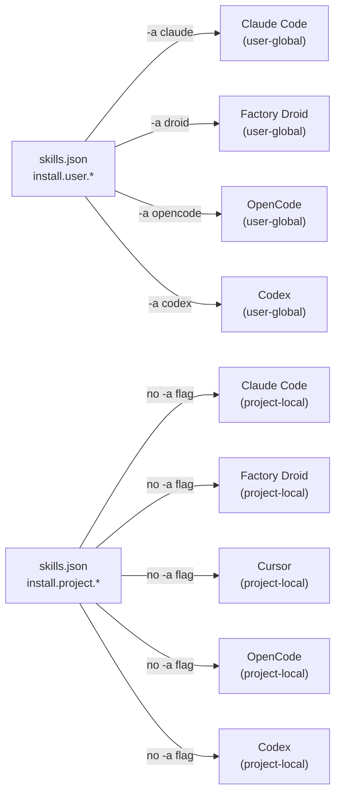
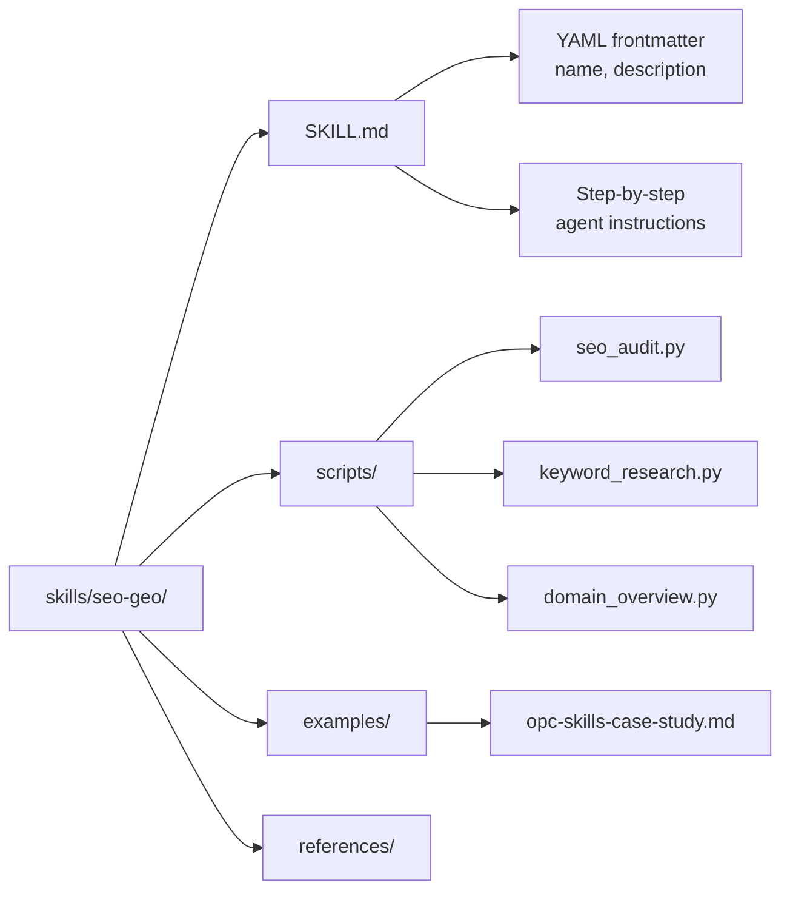
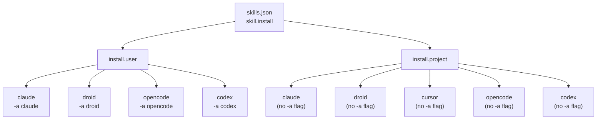
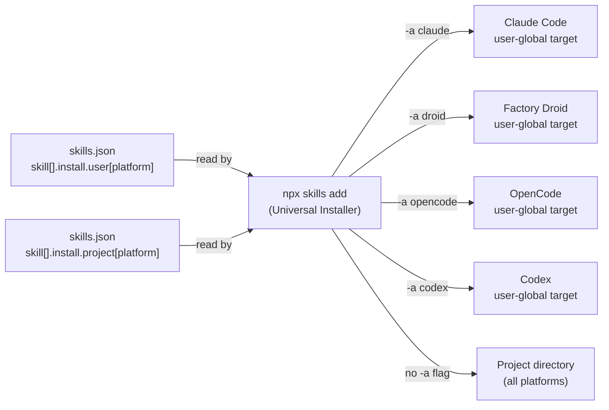
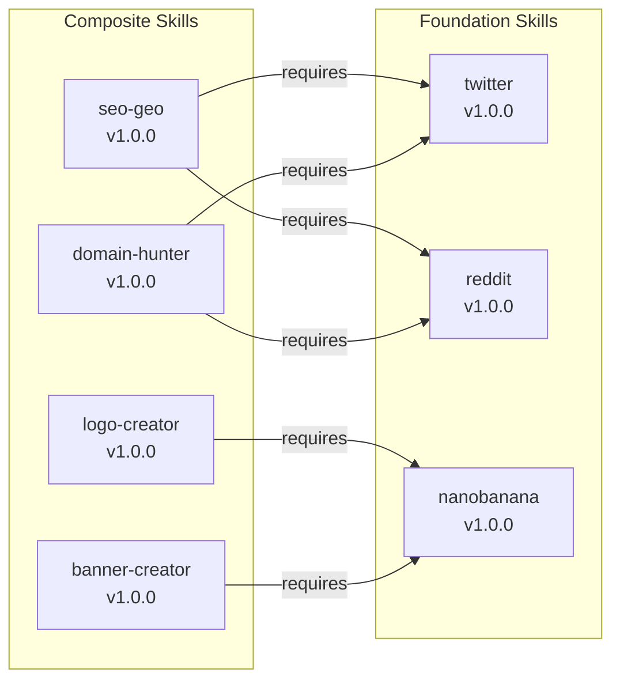

<!-- source: DeepWiki mcp.deepwiki.com · repo ReScienceLab/opc-skills · page 3.4 Platform-Specific Installation · fetched 2026-10-26 -->

# Platform-Specific Installation

<details>
<summary>Relevant source files</summary>

The following files were used as context for generating this wiki page:

- [README.md](README.md)
- [skill-logos/archive.svg](skill-logos/archive.svg)
- [skills.json](skills.json)
- [skills/archive/SKILL.md](skills/archive/SKILL.md)
- [skills/archive/references/TEMPLATE.md](skills/archive/references/TEMPLATE.md)
- [website/opc-banner.png](website/opc-banner.png)

</details>


## Purpose and Scope

This document provides detailed installation instructions for OPC Skills on specific AI coding platforms. It covers platform-specific directory structures, user-level vs project-level installation patterns, and platform-specific configuration requirements.

For an overview of installation methods, see [Installation Methods Overview](#3.1). For details about the Claude Plugin Marketplace, see [Claude Code Plugin Marketplace](#3.2). For the universal `npx skills add` installer, see [Universal Installer](#3.3).

## Installation Command Structure

Each skill entry in `skills.json` contains an `install` field with two sub-objects: `user` and `project`. These hold the exact commands for each supported platform.

**Install field schema** ([skills.json:48-61]()):

```
install
├── user
│   ├── claude    → npx skills add ... --skill <name> -a claude
│   ├── droid     → npx skills add ... --skill <name> -a droid
│   ├── opencode  → npx skills add ... --skill <name> -a opencode
│   └── codex     → npx skills add ... --skill <name> -a codex
└── project
    ├── claude    → npx skills add ... --skill <name>
    ├── droid     → npx skills add ... --skill <name>
    ├── cursor    → npx skills add ... --skill <name>
    ├── opencode  → npx skills add ... --skill <name>
    └── codex     → npx skills add ... --skill <name>
```

Key observations from `skills.json`:

- **User-level** commands add the `-a <platform>` flag to target a specific agent's global directory.
- **Project-level** commands omit the `-a` flag entirely; the installer places the skill in the current project directory.
- **Cursor** appears only in `project` installs, not `user` installs — Cursor does not have a user-level target in the install spec.

**Diagram: install field in skills.json → npx command flags**



Sources: [skills.json:48-61](), [skills.json:100-113](), [skills.json:152-165]()

### Skill Directory Structure

Once installed, each skill follows this internal layout:

**Diagram: Installed skill directory layout**



Sources: [skills.json:63-73](), [skills.json:1-538]()

## User-Level vs Project-Level Installation

### User-Level Installation

User-level installs place the skill in the agent's global directory, making it available across all projects for that user. The `-a <platform>` flag is required.

| Platform key | `install.user` command suffix |
|---|---|
| `claude` | `--skill <name> -a claude` |
| `droid` | `--skill <name> -a droid` |
| `opencode` | `--skill <name> -a opencode` |
| `codex` | `--skill <name> -a codex` |

**Cursor is not listed** in `install.user` for any skill in `skills.json`. User-level Cursor installation is not part of the current install spec.

**Use cases:**
- Foundation skills (`twitter`, `reddit`, `nanobanana`) used across many projects
- Personal automation workflows

Sources: [skills.json:49-54](), [skills.json:101-105](), [skills.json:323-327]()

### Project-Level Installation

Project-level installs place the skill in the current working directory. The `-a` flag is omitted; the installer targets whichever platform the project uses.

| Platform key | `install.project` command |
|---|---|
| `claude` | `npx skills add ReScienceLab/opc-skills --skill <name>` |
| `droid` | `npx skills add ReScienceLab/opc-skills --skill <name>` |
| `cursor` | `npx skills add ReScienceLab/opc-skills --skill <name>` |
| `opencode` | `npx skills add ReScienceLab/opc-skills --skill <name>` |
| `codex` | `npx skills add ReScienceLab/opc-skills --skill <name>` |

All project-level commands are identical in `skills.json`; the target platform is determined by the agent running in the project directory.

**Use cases:**
- Project-specific skills that should live alongside project code
- Team environments where skills are committed to version control
- Skills requiring project-specific API key configuration

Sources: [skills.json:55-61](), [skills.json:107-113](), [skills.json:329-335]()

## Platform-Specific Installation Commands

The following commands come directly from the `install` field of each skill entry in `skills.json`. All commands use `npx skills add`; the old `curl -fsSL opc.dev/install.sh` form is no longer used (see [CHANGELOG.md:64-67]()).

### Install Commands by Platform

**Diagram: skills.json install entries → platform-specific npx commands**



Sources: [skills.json:48-61](), [skills.json:100-113]()

### Claude Code

Claude Code supports both user-level and project-level install via `npx skills add`. It also supports installation through the Plugin Marketplace (see page 3.2).

| Level | Command |
|---|---|
| User | `npx skills add ReScienceLab/opc-skills --skill <name> -a claude` |
| Project | `npx skills add ReScienceLab/opc-skills --skill <name>` |

Example for `seo-geo` ([skills.json:50-57]()):

```
# User-level
npx skills add ReScienceLab/opc-skills --skill seo-geo -a claude

# Project-level
npx skills add ReScienceLab/opc-skills --skill seo-geo
```

Sources: [skills.json:49-57]()

### Factory Droid (`droid`)

| Level | Command |
|---|---|
| User | `npx skills add ReScienceLab/opc-skills --skill <name> -a droid` |
| Project | `npx skills add ReScienceLab/opc-skills --skill <name>` |

Example for `logo-creator` ([skills.json:219-229]()):

```
# User-level
npx skills add ReScienceLab/opc-skills --skill logo-creator -a droid

# Project-level
npx skills add ReScienceLab/opc-skills --skill logo-creator
```

Sources: [skills.json:217-229]()

### Cursor

Cursor is only present in `install.project` entries in `skills.json` — there is no `install.user.cursor` key for any skill. Cursor installation is project-level only.

| Level | Command |
|---|---|
| Project | `npx skills add ReScienceLab/opc-skills --skill <name>` |

Example for `domain-hunter` ([skills.json:160-165]()):

```
# Project-level only
npx skills add ReScienceLab/opc-skills --skill domain-hunter
```

Sources: [skills.json:159-165]()

### OpenCode

| Level | Command |
|---|---|
| User | `npx skills add ReScienceLab/opc-skills --skill <name> -a opencode` |
| Project | `npx skills add ReScienceLab/opc-skills --skill <name>` |

Example for `banner-creator` ([skills.json:276-285]()):

```
# User-level
npx skills add ReScienceLab/opc-skills --skill banner-creator -a opencode

# Project-level
npx skills add ReScienceLab/opc-skills --skill banner-creator
```

Sources: [skills.json:274-285]()

### Codex

| Level | Command |
|---|---|
| User | `npx skills add ReScienceLab/opc-skills --skill <name> -a codex` |
| Project | `npx skills add ReScienceLab/opc-skills --skill <name>` |

Example for `producthunt` ([skills.json:469-480]()):

```
# User-level
npx skills add ReScienceLab/opc-skills --skill producthunt -a codex

# Project-level
npx skills add ReScienceLab/opc-skills --skill producthunt
```

Sources: [skills.json:467-480]()

## Complete Install Command Reference

The table below lists every `install.user` and `install.project` command for all nine skills, as defined in `skills.json`. All commands follow the pattern `npx skills add ReScienceLab/opc-skills --skill <name> [-a <platform>]`.

**Diagram: Relationship between skills.json install entries and the npx skills add CLI**



Sources: [skills.json:48-61](), [skills.json:100-113](), [skills.json:152-165](), [skills.json:216-229]()

### User-Level Install Commands

| Skill | claude | droid | opencode | codex |
|---|---|---|---|---|
| `seo-geo` | `... --skill seo-geo -a claude` | `... --skill seo-geo -a droid` | `... --skill seo-geo -a opencode` | `... --skill seo-geo -a codex` |
| `requesthunt` | `... --skill requesthunt -a claude` | `... --skill requesthunt -a droid` | `... --skill requesthunt -a opencode` | `... --skill requesthunt -a codex` |
| `domain-hunter` | `... --skill domain-hunter -a claude` | `... --skill domain-hunter -a droid` | `... --skill domain-hunter -a opencode` | `... --skill domain-hunter -a codex` |
| `logo-creator` | `... --skill logo-creator -a claude` | `... --skill logo-creator -a droid` | `... --skill logo-creator -a opencode` | `... --skill logo-creator -a codex` |
| `banner-creator` | `... --skill banner-creator -a claude` | `... --skill banner-creator -a droid` | `... --skill banner-creator -a opencode` | `... --skill banner-creator -a codex` |
| `nanobanana` | `... --skill nanobanana -a claude` | `... --skill nanobanana -a droid` | `... --skill nanobanana -a opencode` | `... --skill nanobanana -a codex` |
| `reddit` | `... --skill reddit -a claude` | `... --skill reddit -a droid` | `... --skill reddit -a opencode` | `... --skill reddit -a codex` |
| `twitter` | `... --skill twitter -a claude` | `... --skill twitter -a droid` | `... --skill twitter -a opencode` | `... --skill twitter -a codex` |
| `producthunt` | `... --skill producthunt -a claude` | `... --skill producthunt -a droid` | `... --skill producthunt -a opencode` | `... --skill producthunt -a codex` |
| `archive` | `... --skill archive -a claude` | `... --skill archive -a droid` | `... --skill archive -a opencode` | `... --skill archive -a codex` |

> All commands prefixed with `npx skills add ReScienceLab/opc-skills`. Cursor has no user-level entry.

Sources: [skills.json:49-54](), [skills.json:101-105](), [skills.json:153-157](), [skills.json:217-221](), [skills.json:273-277](), [skills.json:323-327](), [skills.json:366-370](), [skills.json:417-421](), [skills.json:468-472](), [skills.json:519-523]()

### Project-Level Install Commands

All project-level commands are identical in form — the `-a` flag is omitted:

```
npx skills add ReScienceLab/opc-skills --skill <name>
```

This applies to: `claude`, `droid`, `cursor`, `opencode`, `codex` (all five platforms).

Sources: [skills.json:55-61](), [skills.json:107-113](), [skills.json:159-165]()

## Dependency Installation Patterns

### Skills with Dependencies

Some skills require other skills as dependencies. The dependency structure from [skills.json:28-31]():



### Installing Skills with Dependencies

**Manual Installation:**

```bash
# Install foundation skills first
npx skills add ReScienceLab/opc-skills --skill twitter
npx skills add ReScienceLab/opc-skills --skill reddit

# Then install composite skill
npx skills add ReScienceLab/opc-skills --skill domain-hunter
```

**Batch Installation:**

```bash
# Install all dependencies together
npx skills add ReScienceLab/opc-skills \
  --skill twitter \
  --skill reddit \
  --skill domain-hunter
```

Sources: [skills.json:28-31](), [skills.json:143-146](), [README.md:92-104]()

## Platform Compatibility Matrix

### Platform Support Matrix

The following matrix reflects what is actually declared in the `install` field of `skills.json`.

| Feature | claude | droid | cursor | opencode | codex |
|---|---|---|---|---|---|
| User-level (`install.user`) | ✓ | ✓ | — | ✓ | ✓ |
| Project-level (`install.project`) | ✓ | ✓ | ✓ | ✓ | ✓ |
| Plugin Marketplace (`.claude-plugin/`) | ✓ | — | — | — | — |

Cursor has no `install.user` entry in any skill in `skills.json`. The Plugin Marketplace is Claude Code–only (see page 3.2).

Sources: [skills.json:48-61](), [skills.json:100-113](), [.claude-plugin/marketplace.json:1-10]()

## Verification and Troubleshooting

### Verifying Installation

After running `npx skills add`, verify the skill was placed in the correct directory by checking for `SKILL.md`:

```bash
# Claude Code (project-level)
ls .claude/skills/seo-geo/SKILL.md

# Factory Droid (project-level)
ls .factory/skills/logo-creator/SKILL.md

# Cursor (project-level)
ls .cursor/skills/domain-hunter/SKILL.md
```

**Verify SKILL.md frontmatter:**

```bash
head -n 10 .claude/skills/seo-geo/SKILL.md
# Expected:
# ---
# name: seo-geo
# description: SEO & GEO (Generative Engine Optimization)...
# ---
```

### Common Installation Issues

#### Issue: Skill not recognized by AI agent

**Symptoms:**
- Agent doesn't activate skill on trigger keywords
- Commands not found

**Solutions:**

1. **Verify SKILL.md format:**
```bash
# Check YAML frontmatter is valid
cat ~/.claude/skills/seo-geo/SKILL.md | head -20
```

2. **Check directory name matches skill name:**
```bash
# Directory name must match 'name' field in SKILL.md
# Correct: ~/.claude/skills/seo-geo/
# Incorrect: ~/.claude/skills/SEO-GEO/
```

3. **Restart the AI platform:**
```bash
# Restart Claude Code, Cursor, etc. to reload skills
```

#### Issue: Dependency not found

**Symptoms:**
- Skill fails to execute
- Error messages about missing dependencies

**Solutions:**

1. **Check dependencies in skills.json:**
```bash
# View required dependencies
cat skills.json | grep -A 5 "domain-hunter"
```

2. **Install missing dependencies:**
```bash
# Install required foundation skills
npx skills add ReScienceLab/opc-skills --skill twitter --skill reddit
```

#### Issue: Script execution fails

**Symptoms:**
- Python script errors
- Permission denied errors

**Solutions:**

1. **Verify Python installation:**
```bash
python3 --version
# Should be Python 3.8+
```

2. **Check script permissions:**
```bash
chmod +x ~/.claude/skills/seo-geo/scripts/*.py
```

3. **Install Python dependencies:**
```bash
# Most skills include requirements.txt
cd ~/.claude/skills/seo-geo/
pip3 install -r requirements.txt
```

Sources: [.factory/AGENTS.md:540-571](), [skills.json:28-46]()

### Platform-Specific Troubleshooting

#### Claude Code

**Issue: Plugin marketplace source path errors**

From [CHANGELOG.md:92-105]():
- Claude Code has known bugs with `pluginRoot` field
- Solution: Uses full paths like `"./skills/domain-hunter"` instead of `"./domain-hunter"`

**Issue: Marketplace cache stale**

From [CHANGELOG.md:101-105]():
- Increment marketplace metadata version to trigger cache refresh
- Current version uses explicit skill paths to avoid cache issues

#### Cursor

**Issue: Skills not detected in project**

- Ensure `.cursor/skills/` directory exists in project root
- Check `.cursorignore` doesn't exclude skills directory

#### Factory Droid

**Issue: Dependency resolution**

- Skills with dependencies (e.g., `logo-creator` requires `nanobanana`) must be installed separately.
- Install dependencies first, then the composite skill.
- Check `.factory/skills/` for installed skill directories.

Sources: [CHANGELOG.md:88-105](), [skills.json:193-196]()

## Environment Variables and API Keys

Many skills require API keys for external services. These should be configured before skill installation.

### Required API Keys by Skill

| Skill | Environment Variable | Service | Required? |
|-------|---------------------|---------|-----------|
| twitter | `TWITTERAPI_API_KEY` | twitterapi.io | Yes |
| nanobanana | `GEMINI_API_KEY` | Google AI Studio | Yes |
| logo-creator | `GEMINI_API_KEY` | Google AI Studio | Yes |
| logo-creator | `REMOVE_BG_API_KEY` | remove.bg | Optional |
| logo-creator | `RECRAFT_API_KEY` | recraft.ai | Optional |
| banner-creator | `GEMINI_API_KEY` | Google AI Studio | Yes |
| producthunt | `PRODUCTHUNT_ACCESS_TOKEN` | Product Hunt | Yes |
| requesthunt | `REQUESTHUNT_API_KEY` | requesthunt.com | Yes |
| seo-geo | `DATAFORSEO_LOGIN` | DataForSEO | Optional |
| seo-geo | `DATAFORSEO_PASSWORD` | DataForSEO | Optional |

### Configuration Methods

**Platform environment files:**

```bash
# Claude Code
echo "GEMINI_API_KEY=your_key_here" >> ~/.claude/.env

# Cursor
echo "GEMINI_API_KEY=your_key_here" >> ~/.cursor/.env

# Factory Droid
echo "GEMINI_API_KEY=your_key_here" >> ~/.factory/.env
```

**Project-level configuration:**

```bash
# Create .env in project root
echo "GEMINI_API_KEY=your_key_here" >> .env
echo "TWITTERAPI_API_KEY=your_key_here" >> .env
```

Sources: [skills.json:32-46](), [skills.json:91-98](), [CHANGELOG.md:274-287]()

## Installation Best Practices

### Recommended Installation Order

Install foundation/dependency skills before the skills that depend on them.

1. **Foundation skills** (no dependencies):
```bash
npx skills add ReScienceLab/opc-skills --skill twitter -a claude
npx skills add ReScienceLab/opc-skills --skill reddit -a claude
npx skills add ReScienceLab/opc-skills --skill nanobanana -a claude
```

2. **Composite skills** (require foundation skills):
```bash
npx skills add ReScienceLab/opc-skills --skill seo-geo -a claude
npx skills add ReScienceLab/opc-skills --skill domain-hunter -a claude
npx skills add ReScienceLab/opc-skills --skill logo-creator -a claude
npx skills add ReScienceLab/opc-skills --skill banner-creator -a claude
```

3. **Standalone skills** (no dependencies):
```bash
npx skills add ReScienceLab/opc-skills --skill requesthunt -a claude
npx skills add ReScienceLab/opc-skills --skill producthunt -a claude
npx skills add ReScienceLab/opc-skills --skill archive -a claude
```

Replace `-a claude` with `-a droid`, `-a opencode`, or `-a codex` as appropriate for your platform. For project-level installs, omit the `-a` flag entirely.

### Version Control Considerations

**Include in version control:**
- `.claude/skills/` (if using project-level)
- `.cursor/skills/` (if using project-level)
- `.factory/skills/` (if using project-level)
- API key configuration templates (without actual keys)

**Exclude from version control:**
```gitignore
# User-level skills (installed globally)
~/.claude/skills/
~/.cursor/skills/
~/.factory/skills/

# Environment files with secrets
.env
.claude/.env
.cursor/.env
.factory/.env
```

### Team Collaboration

For teams using shared skill configurations:

1. **Commit project-level skills:**
```bash
git add .claude/skills/
git commit -m "Add seo-geo skill for project"
```

2. **Document required API keys:**
```bash
# Create .env.example
cat > .env.example << EOF
GEMINI_API_KEY=get_from_https://aistudio.google.com/apikey
TWITTERAPI_API_KEY=get_from_https://twitterapi.io
EOF
```

3. **Update project README:**
```markdown
## Skills Setup

1. Install skills:
   ```bash
   npx skills add ReScienceLab/opc-skills --skill seo-geo
   ```

2. Configure API keys:
   ```bash
   cp .env.example .env
   # Edit .env with your API keys
   ```
```

Sources: [.factory/AGENTS.md:66-109](), [README.md:92-104]()

---

