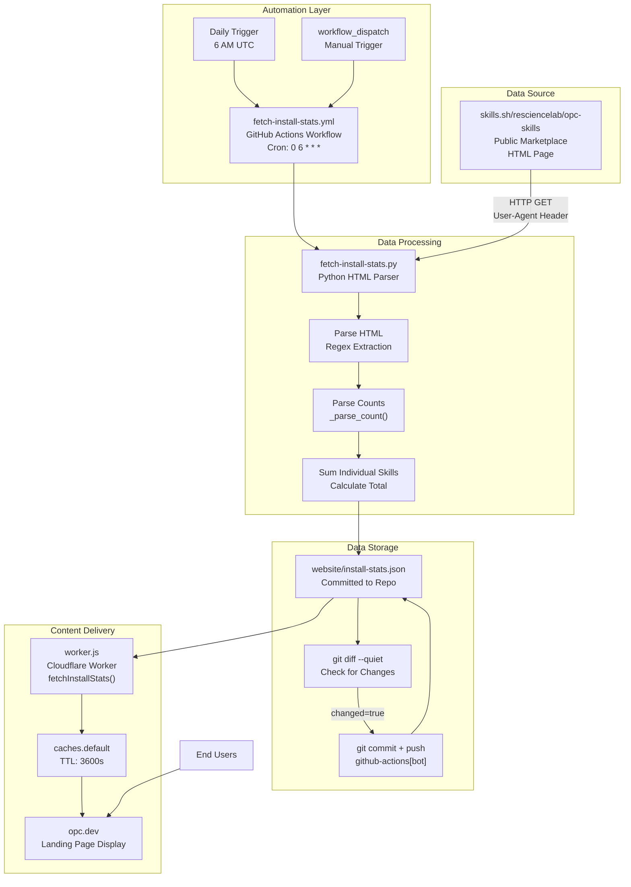
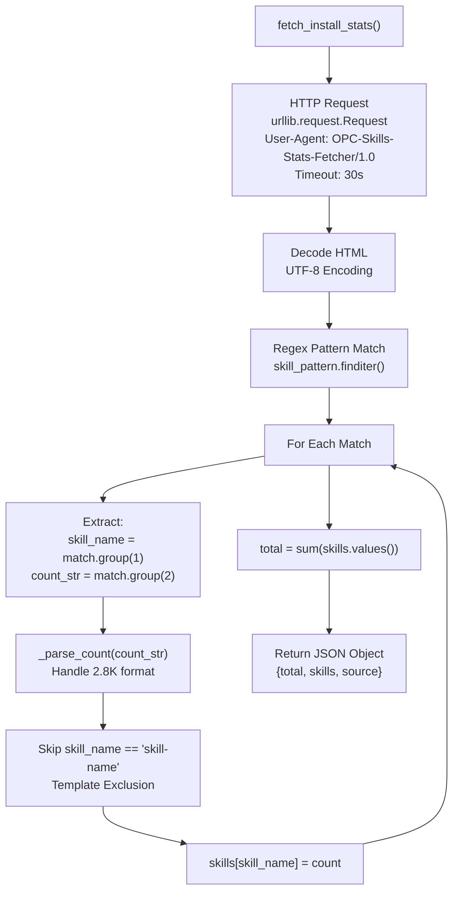
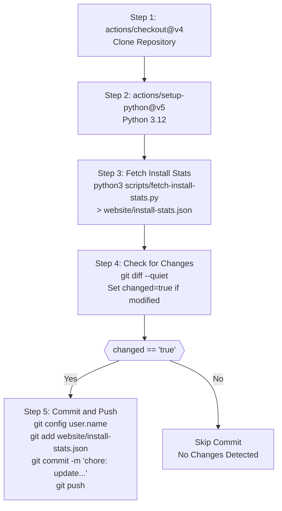
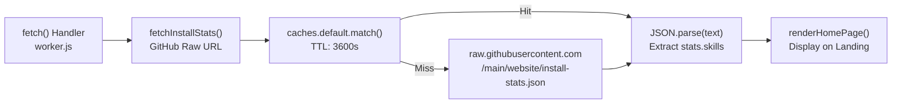

<!-- source: DeepWiki mcp.deepwiki.com · repo ReScienceLab/opc-skills · page 3.5 Installation Statistics System · fetched 2026-10-26 -->

# Installation Statistics System

<details>
<summary>Relevant source files</summary>

The following files were used as context for generating this wiki page:

- [.github/workflows/fetch-install-stats.yml](.github/workflows/fetch-install-stats.yml)
- [scripts/fetch-install-stats.py](scripts/fetch-install-stats.py)
- [website/install-stats.json](website/install-stats.json)

</details>


## Purpose and Scope

The Installation Statistics System tracks and displays real-time installation counts for OPC Skills by scraping the public skills.sh marketplace. This system automatically fetches install data daily, commits updated statistics to the repository, and serves them through the opc.dev website with edge caching. The system provides social proof and usage visibility to potential users.

For information about how these statistics are displayed on the website, see [Website Architecture](#4.1). For details on the website's caching strategy for these stats, see [Caching Strategy](#4.3).

---

## System Architecture

The statistics system operates as a fully automated pipeline with three core components: a Python scraper, a GitHub Actions scheduler, and a JSON data store served via Cloudflare Workers.

**Architecture Diagram: Installation Statistics Pipeline**



**Sources:** `.github/workflows/fetch-install-stats.yml`, `scripts/fetch-install-stats.py`, `website/install-stats.json`

---

## Data Source: skills.sh Marketplace

The system scrapes installation counts from `https://skills.sh/resciencelab/opc-skills`, a public marketplace aggregator that tracks skill installations across multiple AI agent platforms.

**Why skills.sh as Data Source:**
- **Cross-Platform Aggregation**: Consolidates installs from 16+ AI agents (Claude, Cursor, Droid, etc.)
- **Public Availability**: No authentication required, stable URL structure
- **Real-Time Updates**: Reflects actual usage across the ecosystem
- **Community Standard**: De facto marketplace for Agent Skills Standard implementations

The scraper targets specific HTML patterns in the skills.sh page to extract per-skill installation counts.

**Sources:** [scripts/fetch-install-stats.py:9]()

---

## Scraper Implementation

The `fetch-install-stats.py` script implements a lightweight HTML parser using Python's standard library (`urllib.request` and `re` modules).

### Core Parsing Logic

**Function: fetch_install_stats()**



**Sources:** [scripts/fetch-install-stats.py:20-63]()

### HTML Pattern Matching

The scraper uses a compiled regex pattern to extract skill names and install counts from the HTML structure:

**Pattern Structure:**
```
href="/resciencelab/opc-skills/([a-z0-9-]+)"[^>]*>.*?
<span[^>]*class="[^"]*font-mono[^"]*"[^>]*>([\d.,]+K?)</span>
```

**Capture Groups:**
1. **Group 1**: Skill name (e.g., `seo-geo`, `logo-creator`)
2. **Group 2**: Install count string (e.g., `7000`, `2.8K`, `5.3K`)

**Sources:** [scripts/fetch-install-stats.py:39-43]()

### Count Parsing Algorithm

The `_parse_count()` helper function handles both plain integers and abbreviated formats.

| Input Format | Example | Parsing Logic | Output |
|--------------|---------|---------------|---------|
| Plain Integer | `"380"` | `int(count_str)` | `380` |
| Abbreviated (K) | `"2.8K"` | `int(float("2.8") * 1000)` | `2800` |
| Comma-Separated | `"1,234"` | Strip commas → `int()` | `1234` |

**Implementation:**
```
count_str.strip().replace(",", "")
if count_str.upper().endswith("K"):
    return int(float(count_str[:-1]) * 1000)
return int(count_str)
```

**Sources:** [scripts/fetch-install-stats.py:12-17]()

### Error Handling

The scraper implements fail-fast error handling for network issues:

- **Timeout**: 30-second timeout on HTTP request [scripts/fetch-install-stats.py:27]()
- **User-Agent**: Custom header to identify the scraper [scripts/fetch-install-stats.py:25]()
- **Exception Handling**: Prints error to stderr and exits with code 1 [scripts/fetch-install-stats.py:29-31]()
- **Template Filtering**: Excludes `skill-name` template from results [scripts/fetch-install-stats.py:50]()

**Sources:** [scripts/fetch-install-stats.py:20-31](), [scripts/fetch-install-stats.py:49-51]()

---

## Automation Pipeline

The GitHub Actions workflow `fetch-install-stats.yml` orchestrates daily statistics updates with automatic commit logic.

### Workflow Configuration

**Workflow: fetch-install-stats.yml**

| Configuration | Value | Purpose |
|---------------|-------|---------|
| **Schedule** | `cron: '0 6 * * *'` | Daily execution at 6:00 AM UTC |
| **Manual Trigger** | `workflow_dispatch` | On-demand execution from GitHub UI |
| **Runner** | `ubuntu-latest` | Linux environment for Python 3.12 |
| **Permissions** | `contents: write` | Required for git commit/push |

**Sources:** [.github/workflows/fetch-install-stats.yml:3-12]()

### Execution Steps

**Workflow Step Diagram**



**Sources:** [.github/workflows/fetch-install-stats.yml:13-36]()

### Git Commit Strategy

The workflow uses conditional commit logic to avoid empty commits when statistics haven't changed:

**Change Detection:**
```bash
git diff --quiet website/install-stats.json || echo "changed=true" >> $GITHUB_OUTPUT
```

**Conditional Commit:**
```yaml
if: steps.diff.outputs.changed == 'true'
```

**Commit Metadata:**
- **Author**: `github-actions[bot]`
- **Email**: `github-actions[bot]@users.noreply.github.com`
- **Message**: `"chore: update install stats from skills.sh"`

**Sources:** [.github/workflows/fetch-install-stats.yml:24-36]()

---

## Data Format: install-stats.json

The output JSON file follows a simple three-field structure optimized for consumption by the Cloudflare Worker.

### Schema Structure

**Current Statistics (Example):**

```json
{
  "total": 12597,
  "skills": {
    "seo-geo": 7000,
    "reddit": 960,
    "nanobanana": 799,
    "logo-creator": 759,
    "twitter": 758,
    "domain-hunter": 582,
    "banner-creator": 546,
    "producthunt": 540,
    "requesthunt": 539,
    "archive": 114
  },
  "source": "https://skills.sh/resciencelab/opc-skills"
}
```

**Sources:** [website/install-stats.json:1-16]()

### Field Specifications

| Field | Type | Calculation | Purpose |
|-------|------|-------------|---------|
| `total` | Integer | `sum(skills.values())` | Aggregate install count across all skills |
| `skills` | Object | Per-skill scrape results | Individual skill popularity metrics |
| `source` | String | Hardcoded URL | Attribution and data provenance |

**Key Design Decisions:**
- **Calculated Total**: Total is computed from sum of individual skills rather than scraped from HTML, ensuring consistency [scripts/fetch-install-stats.py:55]()
- **Alphabetical Sorting**: Skills are ordered by name in the JSON output for readability
- **Source Attribution**: Explicit `source` field enables transparency and validation

**Sources:** [scripts/fetch-install-stats.py:57-61]()

---

## Integration with Website

The statistics file is consumed by the Cloudflare Worker through the `fetchInstallStats()` function with aggressive edge caching.

### Data Fetching Pattern

**Function Call Chain:**



**Cache Strategy:**
- **TTL**: 3600 seconds (1 hour)
- **Rationale**: Statistics update daily, so 1-hour cache provides near-real-time data while minimizing GitHub API load
- **Cache Key**: Full GitHub raw content URL

**Sources:** Website integration details covered in [Caching Strategy](#4.3)

### Display Locations

The install statistics are displayed in multiple locations on opc.dev:

| Location | Data Displayed | Format |
|----------|----------------|--------|
| Landing Page Header | `stats.total` | "12,597+ Installs" with comma formatting |
| Skills Comparison Table | Per-skill counts | Sortable column with popularity indicators |
| Individual Skill Pages | Skill-specific count | "Used by X developers" badge |

**Visual Presentation:**
- Total install count shown prominently as social proof metric
- Per-skill counts enable users to assess popularity and community adoption
- Real-time data (within 1-hour cache window) builds trust

---

## Code Entity Mapping

**Diagram: Natural Language to Code Entities**

```mermaid
graph TB
    subgraph "Natural Language Concepts"
        NL_SCRAPER["Install Stats<br/>Scraper"]
        NL_SCHEDULE["Daily Update<br/>Schedule"]
        NL_DATA["Statistics<br/>Data"]
        NL_WEBSITE["Website<br/>Display"]
    end
    
    subgraph "Code Entities"
        FILE_PY["scripts/fetch-install-stats.py"]
        FUNC_FETCH["fetch_install_stats()"]
        FUNC_PARSE["_parse_count()"]
        
        FILE_YML[".github/workflows/fetch-install-stats.yml"]
        JOB_FETCH["jobs.fetch-stats"]
        CRON["schedule.cron: '0 6 * * *'"]
        
        FILE_JSON["website/install-stats.json"]
        FIELD_TOTAL["total: 12597"]
        FIELD_SKILLS["skills: {...}"]
        
        FILE_WORKER["website/worker.js"]
        FUNC_STATS["fetchInstallStats()"]
        CONST_TTL["CACHE_TTL: 3600"]
    end
    
    NL_SCRAPER --> FILE_PY
    NL_SCRAPER --> FUNC_FETCH
    NL_SCRAPER --> FUNC_PARSE
    
    NL_SCHEDULE --> FILE_YML
    NL_SCHEDULE --> JOB_FETCH
    NL_SCHEDULE --> CRON
    
    NL_DATA --> FILE_JSON
    NL_DATA --> FIELD_TOTAL
    NL_DATA --> FIELD_SKILLS
    
    NL_WEBSITE --> FILE_WORKER
    NL_WEBSITE --> FUNC_STATS
    NL_WEBSITE --> CONST_TTL
```



**Key Code Symbols:**

| Natural Language Term | Primary Code Entity | File Location |
|----------------------|---------------------|---------------|
| HTML Parser | `fetch_install_stats()` | [scripts/fetch-install-stats.py:20]() |
| Count Parser | `_parse_count()` | [scripts/fetch-install-stats.py:12]() |
| Daily Cron Job | `schedule.cron: '0 6 * * *'` | [.github/workflows/fetch-install-stats.yml:5]() |
| Statistics JSON | `website/install-stats.json` | [website/install-stats.json:1]() |
| Total Installs | `stats.total` | [website/install-stats.json:2]() |
| Per-Skill Counts | `stats.skills` | [website/install-stats.json:3]() |
| Data Source URL | `SKILLS_SH_URL` | [scripts/fetch-install-stats.py:9]() |
| Regex Pattern | `skill_pattern` | [scripts/fetch-install-stats.py:39]() |
| Commit Bot | `github-actions[bot]` | [.github/workflows/fetch-install-stats.yml:32]() |

**Sources:** All files referenced in this section

---

## System Reliability

### Failure Modes

| Failure Scenario | Detection | Recovery |
|------------------|-----------|----------|
| skills.sh down | HTTP timeout (30s) | Script exits with code 1, workflow fails |
| HTML structure change | Regex returns empty matches | Total = 0, alerts via monitoring |
| Git push conflict | Push rejection | Workflow fails, manual resolution required |
| Invalid JSON output | JSON parsing error in worker | Stale cache served, 3600s expiry |

### Monitoring

**Automated Monitoring:**
- GitHub Actions workflow status (success/failure)
- Git commit history for `website/install-stats.json`
- Cloudflare Worker analytics for cache hit rates

**Manual Validation:**
- Compare `stats.total` against skills.sh UI
- Verify individual skill counts match marketplace display
- Check commit timestamps for daily updates

**Sources:** System reliability patterns inferred from [.github/workflows/fetch-install-stats.yml:29-31]() and [scripts/fetch-install-stats.py:29-31]()

---

## Performance Characteristics

| Metric | Value | Notes |
|--------|-------|-------|
| **Scraper Execution Time** | ~2-5 seconds | Network-bound, depends on skills.sh response time |
| **GitHub Actions Runtime** | ~30-45 seconds | Includes checkout, Python setup, commit, push |
| **Data Freshness** | Daily at 6 AM UTC | Configurable via cron schedule |
| **Website Cache Hit Rate** | 95%+ | 3600s TTL, low miss rate |
| **JSON File Size** | ~200 bytes | Minimal storage and bandwidth impact |

**Optimization Opportunities:**
- Increase scrape frequency (e.g., hourly) if real-time accuracy needed
- Add retry logic with exponential backoff for transient network failures
- Implement JSON schema validation before commit to catch parsing errors

**Sources:** Performance characteristics inferred from workflow configuration and caching strategy

---

