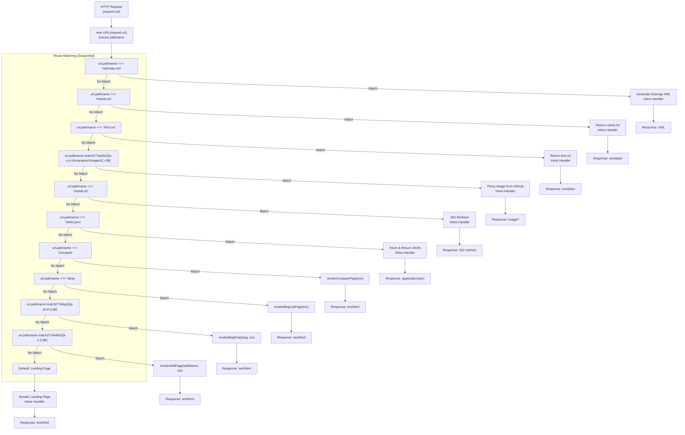
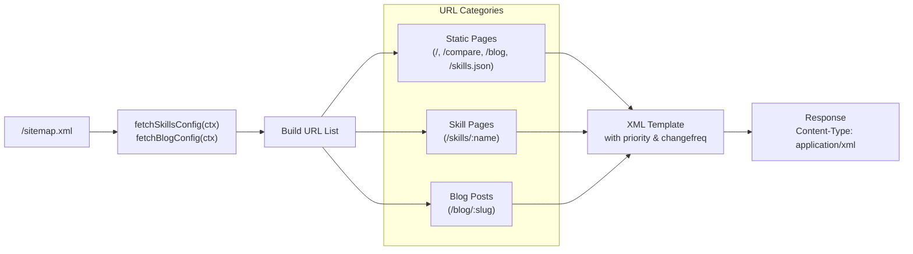
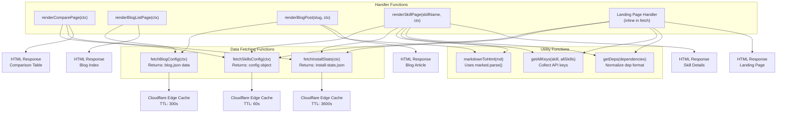
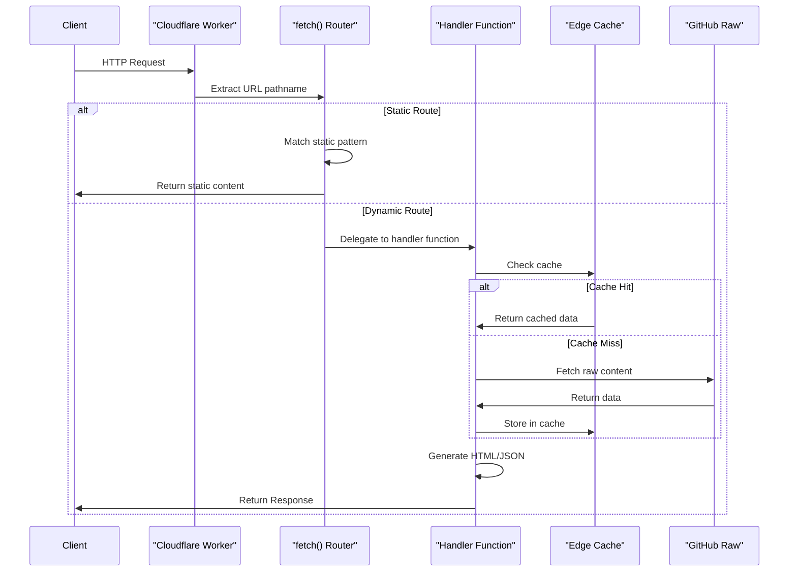

<!-- source: DeepWiki mcp.deepwiki.com · repo ReScienceLab/opc-skills · page 4.2 Request Routing & Handlers · fetched 2026-10-26 -->

# Request Routing & Handlers

Relevant source files

The following files were used as context for generating this wiki page:

- [website/worker.js](website/worker.js)
- [website/wrangler.toml](website/wrangler.toml)

This document describes the URL routing system and request handler functions in the Cloudflare Worker that powers opc.dev. It covers how incoming HTTP requests are matched to URL patterns, dispatched to appropriate handlers, and transformed into HTML or JSON responses.

For information about the overall worker architecture and deployment, see [Website Architecture](#4.1). For details on caching strategies applied to these routes, see [Caching Strategy](#4.3). For the specific data endpoints exposed, see [API Endpoints](#4.4).

## Routing Architecture Overview

The Cloudflare Worker implements a **sequential pattern-matching router** within the `fetch()` handler. Each incoming request's URL pathname is tested against a series of conditional statements in order of precedence, with the first match determining which handler processes the request.

**Sources:** [website/worker.js:1-1311]()

## Route Classification

Routes are categorized by their behavior: **static routes** return fixed or template-based content, while **dynamic routes** fetch data from GitHub and render HTML.

| Route Pattern | Type | Handler | Response Type | Cache TTL |
|--------------|------|---------|---------------|-----------|
| `/sitemap.xml` | Static (Generated) | Inline | `application/xml` | None |
| `/robots.txt` | Static | Inline | `text/plain` | 86400s |
| `/llms.txt` | Static (Template) | Inline | `text/plain` | 3600s |
| `/skills.json` | API | Inline | `application/json` | 300s |
| `/install.sh` | Redirect | Inline | 302 Redirect | None |
| `/skills/:name/examples/images/:file` | Proxy | Inline | `image/*` | 3600s |
| `/compare` | Dynamic | `renderComparePage` | `text/html` | 300s |
| `/blog` | Dynamic | `renderBlogListPage` | `text/html` | 300s |
| `/blog/:slug` | Dynamic | `renderBlogPost` | `text/html` | 300s |
| `/skills/:name` | Dynamic | `renderSkillPage` | `text/html` | 300s |
| `/` (default) | Dynamic | Inline | `text/html` | 300s |

**Sources:** [website/worker.js:4-1311]()

## Static Routes

### `/sitemap.xml` Route

Dynamically generates an XML sitemap by fetching skills and blog post metadata from GitHub. The sitemap includes entries for the landing page, comparison page, blog index, skills.json endpoint, individual skill pages, and blog posts.

**Implementation Details:**
- Executes at [website/worker.js:7-68]()
- Uses `fetchSkillsConfig` to get list of skills [website/worker.js:8]()
- Uses `fetchBlogConfig` to get list of blog posts [website/worker.js:10]()
- Each skill page has priority `0.8` and changefreq `weekly` [website/worker.js:20-21]()
- Blog posts have priority `0.7` and changefreq `monthly` [website/worker.js:32-33]()
- Landing page has priority `1.0` [website/worker.js:44]()

**Sources:** [website/worker.js:7-68]()

### `/robots.txt` Route

Returns a static robots.txt file that explicitly allows AI crawlers (GPTBot, ClaudeBot, PerplexityBot) while blocking SEO crawlers (AhrefsBot, SemrushBot). Includes a `Content-Signal` header for GEO compliance.

**Implementation:**
- Executes at [website/worker.js:70-126]()
- Returns inline string with User-agent directives [website/worker.js:71-117]()
- Sets `Cache-Control: public, max-age=86400` (24 hours) [website/worker.js:122]()
- Includes `X-Robots-Tag: all` header [website/worker.js:121]()
- References sitemap location [website/worker.js:117]()

**Sources:** [website/worker.js:70-126]()

### `/llms.txt` Route

Provides an AI-optimized plain text summary of the entire OPC Skills repository in a format designed for LLM consumption. Includes skill listings, installation instructions, statistics, and documentation links.

**Implementation:**
- Executes at [website/worker.js:129-179]()
- Template includes current date via `new Date().toISOString().split("T")[0]` [website/worker.js:130, 158]()
- Lists 9 skills with descriptions [website/worker.js:142-150]()
- Includes installation time, license, and FAQ count [website/worker.js:153-157]()
- Sets `Cache-Control: public, max-age=3600` (1 hour) [website/worker.js:175]()

**Sources:** [website/worker.js:129-179]()

### `/install.sh` Route

A redirect route that points users to the GitHub README installation section.

**Implementation:**
- Executes at [website/worker.js:210-215]()
- Returns 302 redirect to `https://github.com/ReScienceLab/opc-skills#installation` [website/worker.js:211-214]()

**Sources:** [website/worker.js:210-215]()

### `/skills.json` Route

Fetches and returns the skills registry from GitHub. This is the canonical API endpoint for skill metadata.

**Implementation:**
- Executes at [website/worker.js:218-227]()
- Calls `fetchSkillsConfig(ctx)` to retrieve cached/fresh data [website/worker.js:219]()
- Returns JSON with `Access-Control-Allow-Origin: *` for CORS [website/worker.js:223]()
- Sets `Cache-Control: public, max-age=300` (5 minutes) [website/worker.js:224]()

**Sources:** [website/worker.js:218-227]()

## Dynamic Routes with Regex Matching

### Image Proxy Route

Proxies skill example images from GitHub raw content URLs to avoid CORS issues.

**Pattern:** `/skills/:skillName/examples/images/:fileName`

**Regex:** `/^\/skills\/([a-z-]+)\/examples\/images\/(.+)$/`

```mermaid
graph LR
    Request["/skills/logo-creator/examples/images/logo.png"]
    
    Request --> Regex["url.pathname.match<br/>(regex pattern)"]
    
    Regex --> Extract["Extract:<br/>skillName = 'logo-creator'<br/>fileName = 'logo.png'"]
    
    Extract --> ContentType["Determine Content-Type<br/>by file extension"]
    
    ContentType --> FetchGH["fetch GitHub Raw URL<br/>raw.githubusercontent.com/.../fileName"]
    
    FetchGH --> Proxy["Proxy response body<br/>with correct Content-Type"]
    
    Proxy --> Response["Response: image/*<br/>Cache-Control: 3600s"]
```

**Implementation:**
- Executes at [website/worker.js:182-207]()
- Regex capture groups: `[, skillName, fileName]` [website/worker.js:186]()
- Content-Type detection for `.svg`, `.png`, `.jpeg` [website/worker.js:187-191]()
- Constructs GitHub URL: `https://raw.githubusercontent.com/ReScienceLab/opc-skills/main/skills/${skillName}/examples/images/${fileName}` [website/worker.js:192]()
- Returns 404 if image not found [website/worker.js:206]()

**Sources:** [website/worker.js:182-207]()

### Blog Post Route

Matches individual blog post URLs and delegates to the `renderBlogPost` handler.

**Pattern:** `/blog/:slug`

**Regex:** `/^\/blog\/([a-z0-9-]+)$/`

**Implementation:**
- Executes at [website/worker.js:240-243]()
- Regex captures slug: `blogMatch[1]` [website/worker.js:242]()
- Delegates to `renderBlogPost(slug, ctx)` function [website/worker.js:242]()

**Sources:** [website/worker.js:240-243]()

### Skill Page Route

Matches individual skill detail pages and delegates to the `renderSkillPage` handler.

**Pattern:** `/skills/:skillName`

**Regex:** `/^\/skills\/([a-z-]+)$/`

**Implementation:**
- Executes at [website/worker.js:246-249]()
- Regex captures skillName: `skillMatch[1]` [website/worker.js:248]()
- Delegates to `renderSkillPage(skillName, ctx)` function [website/worker.js:248]()

**Sources:** [website/worker.js:246-249]()

## Handler Function Architecture

Dynamic routes delegate to specialized handler functions that fetch data, render HTML, and return responses. The following diagram maps handlers to their data dependencies and outputs.

**Sources:** [website/worker.js:1-1311](), [website/worker.js:1314-1346](), [website/worker.js:1349-1381](), [website/worker.js:1626-1658](), [website/worker.js:1661-1675](), [website/worker.js:1678-1856]()

### `renderSkillPage(skillName, ctx)` Handler

Renders the detailed page for an individual skill, including its SKILL.md content, dependencies, API key requirements, install commands, and example images.

**Data Flow:**
1. Fetches skills config and install stats [website/worker.js:1679-1682]()
2. Finds matching skill object [website/worker.js:1683]()
3. Returns 404 if not found [website/worker.js:1685-1689]()
4. Extracts dependencies using helper functions [website/worker.js:1695-1699]()
5. Collects all API keys (including from dependencies) [website/worker.js:1702-1720]()
6. Fetches SKILL.md from GitHub raw URL [website/worker.js:1726-1733]()
7. Converts markdown to HTML using `markdownToHtml()` [website/worker.js:1735]()
8. Optionally fetches example markdown if `skill.links.example` exists [website/worker.js:1738-1753]()
9. Generates JSON-LD schema (WebPage, SoftwareApplication, BreadcrumbList, FAQPage) [website/worker.js:1757-1855]()
10. Renders HTML template with embedded CSS and JavaScript [website/worker.js:1857-2069]()

**Key Features:**
- Dependency tracking with visual tags [website/worker.js:1987]()
- API key display with provider URLs [website/worker.js:1986]()
- Install count display from stats [website/worker.js:1692, 1980]()
- Tab-based content sections (Overview, Installation, Examples) via JavaScript [website/worker.js:1938-1943]()

**Sources:** [website/worker.js:1678-2074]()

### Landing Page Handler (Inline)

The default route handler renders the main landing page with all skills displayed as cards. This handler is implemented inline within the `fetch()` function rather than as a separate function.

**Data Flow:**
1. Fetches skills config and install stats [website/worker.js:252-255]()
2. Generates JSON-LD structured data for all skills [website/worker.js:259-276]()
3. Creates FAQPage schema with 28+ questions [website/worker.js:278-543]()
4. Builds skill card HTML for each skill [website/worker.js:670-720]()
5. Renders complete HTML page with:
   - Hero section with install command [website/worker.js:1020-1115]()
   - Tools scroller (animated list of supported platforms) [website/worker.js:1030-1105]()
   - Skills grid [website/worker.js:1118-1120]()
   - FAQ section [website/worker.js:1122-1168]()

**Skill Card Generation:**
- Uses helper functions `getDeps()`, `getAllKeys()`, `requiresApiKey()` [website/worker.js:639-667]()
- Displays install count if > 0 [website/worker.js:672, 684]()
- Shows "API Key" or "Free" badge [website/worker.js:686]()
- Includes dependency auto-installation in command [website/worker.js:704]()
- Copy-to-clipboard functionality [website/worker.js:705]()

**Sources:** [website/worker.js:252-1309]()

### `renderBlogListPage(ctx)` Handler

Renders the blog index page listing all published blog posts. This function is referenced in the routing logic but its implementation is not provided in the given file.

**Expected Behavior:**
- Fetches blog configuration via `fetchBlogConfig(ctx)`
- Renders list of posts with titles, descriptions, dates
- Includes links to individual post pages

**Sources:** [website/worker.js:235-237]()

### `renderBlogPost(slug, ctx)` Handler

Renders an individual blog post page. This function is referenced in the routing logic but its implementation is not provided in the given file.

**Expected Behavior:**
- Fetches blog configuration to find post metadata
- Fetches markdown content from GitHub
- Converts markdown to HTML using `markdownToHtml()`
- Renders HTML with schema.org BlogPosting markup

**Sources:** [website/worker.js:240-243]()

### `renderComparePage(ctx)` Handler

Renders a comparison page (likely comparing OPC Skills to alternatives). This function is referenced in the routing logic but its implementation is not provided in the given file.

**Expected Behavior:**
- Fetches skills config
- Generates comparison table HTML
- Returns HTML response with Cache-Control

**Sources:** [website/worker.js:230-232]()

## Helper Functions

### `getDeps(dependencies)`

Normalizes the dependency field format, which can be either an array or an object with version requirements.

**Implementation:**
- Returns empty array if `deps` is falsy [website/worker.js:640]()
- Returns `deps` directly if already an array [website/worker.js:641]()
- Returns `Object.keys(deps)` if object [website/worker.js:642]()

**Sources:** [website/worker.js:639-643]()

### `getAllKeys(skill, allSkills)`

Recursively collects all API keys required by a skill, including those from its dependencies.

**Algorithm:**
1. Start with keys from `skill.auth?.keys` [website/worker.js:648]()
2. Get dependency names using `getDeps()` [website/worker.js:649]()
3. For each dependency:
   - Find dependency skill object [website/worker.js:651]()
   - Check if it has API keys [website/worker.js:652]()
   - Add keys that aren't already in the list [website/worker.js:653-656]()
   - Mark keys with `from: depName` property [website/worker.js:655]()
4. Return complete list [website/worker.js:660]()

**Sources:** [website/worker.js:647-661]()

### `requiresApiKey(skill, allSkills)`

Determines if a skill requires any non-optional API key, either directly or through dependencies.

**Implementation:**
- Calls `getAllKeys()` to get complete key list [website/worker.js:665]()
- Returns true if any key has `optional: false` (or undefined) [website/worker.js:666]()

**Sources:** [website/worker.js:664-667]()

### `markdownToHtml(md)`

Converts markdown to HTML using the `marked` library, with preprocessing to remove YAML frontmatter and postprocessing to wrap images in figure tags.

**Implementation:**
1. Returns empty string if input is falsy [website/worker.js:1662]()
2. Removes YAML frontmatter (lines between `---`) if present at start [website/worker.js:1664-1666]()
3. Parses markdown using `marked.parse()` [website/worker.js:1668]()
4. Wraps `` tags in `<figure>` with `<figcaption>` [website/worker.js:1670-1673]()
5. Returns processed HTML [website/worker.js:1674]()

**Sources:** [website/worker.js:1661-1675]()

## Data Fetching Functions

All data fetching functions follow a consistent caching pattern and are documented in detail in [Caching Strategy](#4.3). The routing layer invokes these functions as needed:

- `fetchSkillsConfig(ctx)` - Retrieves skills.json from GitHub [website/worker.js:1314-1346]()
- `fetchBlogConfig(ctx)` - Retrieves blog.json from GitHub [website/worker.js:1626-1658]()
- `fetchInstallStats(ctx)` - Retrieves install-stats.json from GitHub [website/worker.js:1349-1381]()
- `getFallbackConfig()` - Returns hardcoded fallback data if GitHub is unreachable [website/worker.js:1383-1623]()

**Sources:** [website/worker.js:1314-1658]()

## Request-Response Flow

The complete flow from incoming request to response follows this pattern:

**Key Characteristics:**
- **Sequential matching**: Routes are tested in declaration order
- **First-match wins**: Once a pattern matches, no further patterns are tested
- **Context passing**: All handlers receive `ctx` parameter for cache operations
- **Fallback behavior**: If no pattern matches, landing page is rendered
- **Error handling**: 404 responses for missing resources (e.g., skill not found)

**Sources:** [website/worker.js:1-1311]()

---

