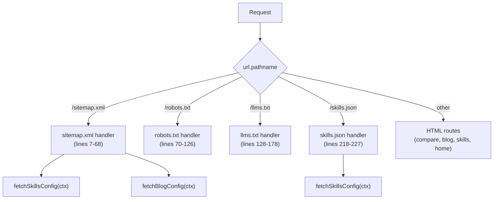
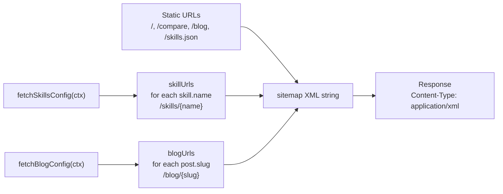
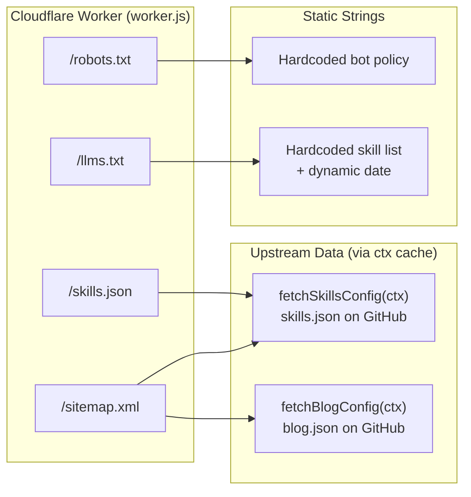

<!-- source: DeepWiki mcp.deepwiki.com · repo ReScienceLab/opc-skills · page 4.4 API Endpoints · fetched 2026-10-26 -->

# API Endpoints

<details>
<summary>Relevant source files</summary>

The following files were used as context for generating this wiki page:

- [website/worker.js](website/worker.js)
- [website/wrangler.toml](website/wrangler.toml)

</details>


This page documents the four machine-readable API endpoints exposed by the Cloudflare Worker at `website/worker.js`. These endpoints are designed for programmatic access, search engine crawlers, and LLM consumers — not for human browser navigation. For the full set of URL routes including HTML-rendered pages, see [Request Routing & Handlers](#4.2). For the caching behavior applied to upstream data fetches, see [Caching Strategy](#4.3).

---

## Endpoint Summary

| Path | Content-Type | Purpose | CORS | Cache TTL |
|---|---|---|---|---|
| `/skills.json` | `application/json` | Full skill registry for programmatic access | `*` | 5 minutes |
| `/sitemap.xml` | `application/xml` | Dynamically generated XML sitemap | — | None set |
| `/robots.txt` | `text/plain` | Bot allowlist / blocklist | — | 24 hours |
| `/llms.txt` | `text/plain` | Plain-text summary for LLM consumption | — | 1 hour |

Sources: [website/worker.js:218-227](), [website/worker.js:65-67](), [website/worker.js:119-125](), [website/worker.js:173-178]()

---

## Request Routing Overview

The four API endpoints are handled in the `fetch()` entrypoint before the HTML-rendering routes are reached. Each is matched by exact `pathname` equality (except `/sitemap.xml`, which also calls `fetchBlogConfig`).

**Diagram: API Endpoint Dispatch in `fetch()`**



Sources: [website/worker.js:7-8](), [website/worker.js:70](), [website/worker.js:129](), [website/worker.js:218-219]()

---

## `/skills.json`

Returns the full skill registry as JSON. This is the same data source used to render the homepage skill cards. It is the primary integration point for external tools that want to enumerate available skills programmatically (e.g., the universal installer described in [Universal Installer](#3.3)).

**Handler location:** [website/worker.js:218-227]()

**Response headers:**

| Header | Value |
|---|---|
| `Content-Type` | `application/json` |
| `Access-Control-Allow-Origin` | `*` |
| `Cache-Control` | `public, max-age=300` |

The wide-open CORS policy (`*`) means any browser-side JavaScript can fetch this endpoint directly. The 300-second cache TTL limits upstream calls to the GitHub-hosted `skills.json` source to at most once per 5 minutes per edge node.

The response body is the result of `JSON.stringify(skills, null, 2)` where `skills` is the object returned by `fetchSkillsConfig(ctx)`. The shape of this object is documented in [Skills Registry (skills.json)](#2.1).

**Example response structure (abbreviated):**

```json
{
  "version": "1.0",
  "name": "opc-skills",
  "skills": [
    {
      "name": "reddit",
      "version": "1.0.0",
      "description": "...",
      "triggers": ["..."],
      "dependencies": {},
      "auth": {},
      "install": {},
      "commands": [],
      "links": {}
    }
  ]
}
```

Sources: [website/worker.js:218-227]()

---

## `/sitemap.xml`

Generates an XML sitemap conforming to the [Sitemaps protocol](https://www.sitemaps.org/schemas/sitemap/0.9) schema. The sitemap is built dynamically at request time by combining:

1. A static set of top-level pages (`/`, `/compare`, `/blog`, `/skills.json`)
2. One `<url>` entry per skill, derived from `fetchSkillsConfig(ctx)`
3. One `<url>` entry per blog post, derived from `fetchBlogConfig(ctx)`

**Handler location:** [website/worker.js:7-68]()

**Diagram: Sitemap URL Assembly**



**URL priorities and change frequencies:**

| URL | `<priority>` | `<changefreq>` | `<lastmod>` |
|---|---|---|---|
| `/` | `1.0` | `weekly` | today (ISO date) |
| `/blog` | `0.8` | `weekly` | today |
| `/skills.json` | `0.6` | `weekly` | today |
| `/compare` | `0.7` | `monthly` | today |
| `/skills/{name}` | `0.8` | `weekly` | today |
| `/blog/{slug}` | `0.7` | `monthly` | `post.date` from blog config |

The `<lastmod>` for skill pages always uses the current date (computed as `new Date().toISOString().split("T")[0]`). Blog posts use the `date` field from each entry in `blog.json`.

No `Cache-Control` header is set on the sitemap response, so caching behavior falls back to Cloudflare's default edge policy.

Sources: [website/worker.js:7-68]()

---

## `/robots.txt`

Serves a static `robots.txt` directive file. The content is a string literal embedded directly in the handler — no upstream fetches are required.

**Handler location:** [website/worker.js:70-126]()

**Response headers:**

| Header | Value |
|---|---|
| `Content-Type` | `text/plain` |
| `X-Robots-Tag` | `all` |
| `Cache-Control` | `public, max-age=86400` |

The 86400-second TTL (24 hours) keeps this response cached aggressively at the edge, since the content rarely changes.

**Bot policy:**

| Bot user-agent | Directive |
|---|---|
| `*` (all) | `Allow: /` |
| `GPTBot` | `Allow: /` |
| `ChatGPT-User` | `Allow: /` |
| `PerplexityBot` | `Allow: /` |
| `ClaudeBot` | `Allow: /` |
| `anthropic-ai` | `Allow: /` |
| `Google-Extended` | `Allow: /` |
| `Applebot-Extended` | `Allow: /` |
| `Amazonbot` | `Allow: /` |
| `Bingbot` | `Allow: /` |
| `Googlebot` | `Allow: /` |
| `AhrefsBot` | `Disallow: /` |
| `SemrushBot` | `Disallow: /` |

The comment block at the top of the file explicitly marks the GEO intent:

```
# Content-Signal: search=yes, ai-input=yes, ai-train=no
```

The AI bot allowlist is intentional GEO (Generative Engine Optimization) strategy — permitting crawling by AI search engines so that OPC Skills content is indexed and cited by LLM-based search products. This is also discussed in [SEO & GEO Optimization Strategy](#4.5). The file ends with a `Sitemap:` directive pointing to `https://opc.dev/sitemap.xml`.

Sources: [website/worker.js:70-126]()

---

## `/llms.txt`

Returns a structured plain-text summary of the OPC Skills project, formatted for direct consumption by large language models. This follows the emerging `llms.txt` convention for machine-readable site metadata.

**Handler location:** [website/worker.js:128-178]()

**Response headers:**

| Header | Value |
|---|---|
| `Content-Type` | `text/plain` |
| `Cache-Control` | `public, max-age=3600` |

The 1-hour TTL is shorter than `robots.txt` because `llms.txt` includes a dynamic `Last updated: ${today}` line.

**Document structure:**

The response is a multi-section Markdown-style plain text document with the following sections:

| Section heading | Contents |
|---|---|
| `# OPC Skills - AI Agent Skills for Solopreneurs` | Title |
| `## Overview` | Skill count, supported platforms |
| `## Installation` | `npx skills add` command |
| `## Skills` | Numbered list of all 9 skills with one-line descriptions |
| `## Statistics` | Skill count, platform count, install time, license, FAQ count, last updated date |
| `## Documentation` | Links to opc.dev, GitHub, skills.sh, agentskills.io |
| `## Key Features` | Bullet list of key characteristics |

Unlike `/skills.json`, this endpoint's content is a static string literal in the source (not derived from `fetchSkillsConfig`). Skill entries in the `## Skills` section are hardcoded rather than generated from the live registry. Only the `Last updated` date is dynamic.

Sources: [website/worker.js:128-178]()

---

## Endpoint Relationship to Data Sources

**Diagram: Data Source Dependency per Endpoint**



Sources: [website/worker.js:7-227]()

---

## Notes

- All four endpoints are resolved before any HTML rendering logic runs in `fetch()`. If the pathname matches one of these four patterns, the function returns early.
- The `/skills.json` endpoint is the only one that sets `Access-Control-Allow-Origin: *`. The other three are not intended for cross-origin browser access.
- The `/llms.txt` skill list is not automatically synchronized with the live `skills.json` registry. If a new skill is added to the registry, the `/llms.txt` content must be manually updated in `worker.js`.
- The sitemap includes `/skills.json` itself as a crawlable URL with `priority=0.6`, signaling to search engines that the JSON data endpoint is a first-class document.

Sources: [website/worker.js:59-63](), [website/worker.js:218-227](), [website/worker.js:128-178]()

---

