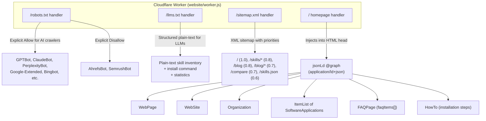
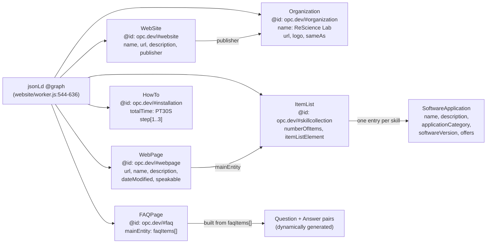
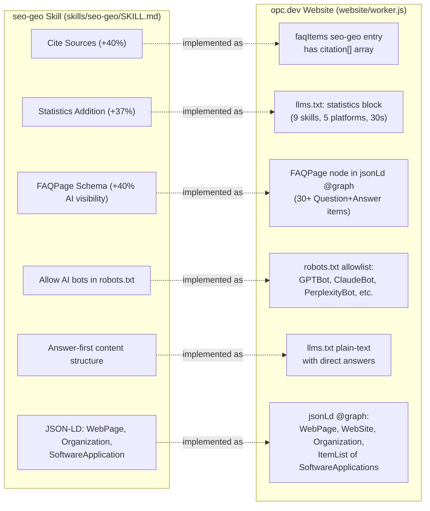

<!-- source: DeepWiki mcp.deepwiki.com · repo ReScienceLab/opc-skills · page 4.5 SEO & GEO Optimization Strategy · fetched 2026-10-26 -->

# SEO & GEO Optimization Strategy

<details>
<summary>Relevant source files</summary>

The following files were used as context for generating this wiki page:

- [website/worker.js](website/worker.js)
- [website/wrangler.toml](website/wrangler.toml)

</details>


This page documents the website-level SEO and GEO (Generative Engine Optimization) strategy embedded in `website/worker.js`. It covers the structured data schemas on the homepage, the `llms.txt` and `robots.txt` endpoints, and how the overall site is tuned for both traditional search engines and AI-powered answer engines.

> For documentation on the **`seo-geo` agent skill** — the installable tool that helps users apply these same techniques to *their own* websites — see [2.4.3](#2.4.3). For the full list of API endpoints exposed by the worker, see [4.4](#4.4). For the general website architecture, see [4.1](#4.1).

---

## Strategy Overview

The OPC Skills site implements a two-track visibility strategy: traditional SEO (meta tags, sitemaps, canonical URLs) and GEO (structured data, AI-bot permissions, `llms.txt`). All logic lives in a single Cloudflare Worker at `website/worker.js`.

**Strategy Overview: Routes and Their SEO/GEO Role**



Sources: [website/worker.js:70-179](), [website/worker.js:258-636]()

---

## AI Bot Access: `robots.txt`

The `/robots.txt` handler at [website/worker.js:70-126]() explicitly enumerates AI crawlers in a **GEO-specific allowlist**, with a comment noting the intent: `"We explicitly allow AI bots for GEO (Generative Engine Optimization)"`.

### AI Bot Allowlist

| User-Agent | Platform |
|---|---|
| `GPTBot` | OpenAI (ChatGPT training) |
| `ChatGPT-User` | ChatGPT with browsing |
| `PerplexityBot` | Perplexity |
| `ClaudeBot` | Anthropic Claude |
| `anthropic-ai` | Anthropic (alternate UA) |
| `Google-Extended` | Google AI training / SGE |
| `Applebot-Extended` | Apple |
| `Amazonbot` | Amazon |
| `Bingbot` | Microsoft Bing / Copilot |
| `Googlebot` | Google Search |

### Blocked Bots

| User-Agent | Reason |
|---|---|
| `AhrefsBot` | Competitor analytics scraper |
| `SemrushBot` | Competitor analytics scraper |

The response sets `Cache-Control: public, max-age=86400` (24-hour cache) and the `X-Robots-Tag: all` header.

The `Content-Signal` comment header in the file (`search=yes, ai-input=yes, ai-train=no`) is a human-readable annotation; it is not a recognized protocol field.

The sitemap reference at the bottom of `robots.txt` points to `https://opc.dev/sitemap.xml`, linking AI crawlers to the full page index.

Sources: [website/worker.js:70-126]()

---

## LLM Discoverability: `llms.txt`

The `/llms.txt` handler at [website/worker.js:128-179]() returns a plain-text document following the `llms.txt` convention — a structured, human-and-machine-readable summary intended for direct LLM consumption.

The response is `text/plain` with `Cache-Control: public, max-age=3600` (1-hour cache).

### `llms.txt` Content Structure

```
# OPC Skills - AI Agent Skills for Solopreneurs

## Overview
9 specialized AI agent skills for one-person companies.
Supports: Claude Code, Cursor, Factory Droid, OpenCode, Codex

## Installation
npx skills add ReScienceLab/opc-skills

## Skills
1. requesthunt - ...
2. domain-hunter - ...
...
9. seo-geo - ...

## Statistics
- 9 skills total
- 5 platforms supported
- Installation time: < 30 seconds
- License: MIT
- FAQ entries: 14+
- Last updated: <dynamic date>

## Documentation
Main site: https://opc.dev
GitHub: https://github.com/ReScienceLab/opc-skills
...
```

The `Last updated` line is dynamic — it uses `new Date().toISOString().split("T")[0]` at request time.

The purpose of `llms.txt` is to ensure that when AI answer engines (ChatGPT, Claude, Perplexity) access the site directly, they receive a concise, factual summary without needing to parse the full HTML page or execute JavaScript.

Sources: [website/worker.js:128-179]()

---

## Structured Data: JSON-LD `@graph`

The homepage handler assembles a `jsonLd` object containing a multi-type `@graph` array and injects it as a `<script type="application/ld+json">` tag in the HTML `<head>`.

**JSON-LD `@graph` Schema Composition**



Sources: [website/worker.js:258-636](), [website/worker.js:544-636]()

### `WebPage`, `WebSite`, and `Organization`

These three nodes form the site identity graph. They cross-reference each other via `@id` anchors ([website/worker.js:548-585]()):

- `WebPage` links its `mainEntity` to the `ItemList` (`#skillcollection`)
- `WebSite` links its `publisher` to the `Organization` (`#organization`)
- `Organization` provides a `sameAs` array pointing to the GitHub profile

The `WebPage` node includes a `speakable` field with CSS selectors (`h1`, `.skill-desc`, `.stats-bar`, `.compatibility-note`) that hint to voice search and AI engines which page content is most authoritative.

### `ItemList` of `SoftwareApplications`

Built dynamically from the live `skills` array fetched via `fetchSkillsConfig` ([website/worker.js:260-276]()):

```
skillsJsonLd = skills.map(s => ({
  "@type": "SoftwareApplication",
  name: s.name,
  description: s.description,
  applicationCategory: "DeveloperApplication",
  operatingSystem: "Cross-platform",
  softwareVersion: s.version,
  offers: { "@type": "Offer", price: "0", ... },
  url: `https://opc.dev/skills/${s.name}`
}))
```

Each skill becomes a `ListItem` with a `position` index inside the `ItemList` node.

### `FAQPage` and `faqItems[]`

The `FAQPage` node is the primary GEO optimization mechanism. The `faqItems` array is assembled at request time ([website/worker.js:278-543]()) and contains over 30 `Question`/`Answer` pairs. The items are grouped by topic:

| Group | Lines | Count | Content |
|---|---|---|---|
| Per-skill "What is X?" | [279-286]() | 5 | Auto-generated from first 5 skills |
| General product FAQs | [287-358]() | 10 | Platform support, cost, installation |
| Installation FAQs | [360-400]() | 4 | Flags, API keys, global vs project |
| Comparison FAQs | [401-426]() | 3 | vs manual, vs paid tools |
| Technical FAQs | [428-460]() | 4 | Languages, custom skills, OS |
| Use case FAQs | [462-508]() | 4 | requesthunt, domain-hunter, logo-creator, seo-geo |
| Platform FAQs | [510-543]() | 4 | Teams, commercial use, update cadence, offline |

The `seo-geo` FAQ item at [website/worker.js:488-508]() includes a `citation` array referencing the Princeton GEO research paper (`https://arxiv.org/abs/2311.03735`) and the Agent Skills Standard, demonstrating the "cite sources" GEO method within the schema itself.

### `HowTo` Schema

The `HowTo` node at [website/worker.js:603-635]() describes the three-step installation process with `totalTime: "PT30S"`. Each step is a `HowToStep` with a `position`, `name`, and `text`. This targets "how to install" queries in AI answer engines and voice search.

Sources: [website/worker.js:278-636]()

---

## Sitemap

The `/sitemap.xml` handler at [website/worker.js:7-68]() generates a dynamic XML sitemap including all skills pages and blog posts. Priorities are assigned as follows:

| URL Pattern | `changefreq` | `priority` |
|---|---|---|
| `/` | `weekly` | `1.0` |
| `/skills/[name]` | `weekly` | `0.8` |
| `/blog` | `weekly` | `0.8` |
| `/compare` | `monthly` | `0.7` |
| `/blog/[slug]` | `monthly` | `0.7` |
| `/skills.json` | `weekly` | `0.6` |

Skills and blog post URLs are generated by mapping over the `skills` and `posts` arrays fetched from `fetchSkillsConfig` and `fetchBlogConfig` respectively. The `lastmod` for skills uses today's date; blog posts use their individual `post.date` field.

Sources: [website/worker.js:7-68]()

---

## Traditional SEO: Meta Tags

The homepage HTML head ([website/worker.js:724-753]()) includes the standard suite of meta tags:

| Tag | Value |
|---|---|
| `<title>` | `AI Agent Skills for Solopreneurs \| Claude Code & Cursor` |
| `<meta name="description">` | 9 skills summary, 155 chars |
| `<meta name="keywords">` | AI agent skills, solopreneur tools, Claude Code skills, etc. |
| `<meta name="robots">` | `index, follow` |
| `<link rel="canonical">` | `https://opc.dev/` |
| `<meta property="og:*">` | Full Open Graph set with `og-image.png` |
| `<meta name="twitter:*">` | Twitter Card with `summary_large_image` |

Sources: [website/worker.js:722-753]()

---

## Relationship Between Website Strategy and the `seo-geo` Skill

The website's own implementation serves as a reference example of the `seo-geo` skill's recommendations in practice.

**Website Practice vs `seo-geo` Skill Method**



The nine Princeton GEO methods referenced in `skills/seo-geo/SKILL.md` ([skills/seo-geo/SKILL.md:86-97]()) include visibility boosts ranging from +15% (unique words, fluency) to +40% (citing sources). The `FAQPage` schema approach is explicitly tagged as "+40% AI visibility" in both the skill documentation and the worker code comment at [website/worker.js:278]().

The `seo-geo` skill's DataForSEO-powered scripts (`competitor_gap.py`, `related_keywords.py`, `autocomplete_ideas.py`) are tools intended for *users* to run against their own sites; the website itself uses WebSearch-based research as described in `SKILL.md` Step 2.

Sources: [skills/seo-geo/SKILL.md:83-115](), [website/worker.js:258-286](), [skills/seo-geo/scripts/competitor_gap.py:1-80](), [skills/seo-geo/scripts/related_keywords.py:1-84](), [skills/seo-geo/scripts/autocomplete_ideas.py:1-74]()

---

## Summary

| Mechanism | File | Purpose |
|---|---|---|
| `robots.txt` allowlist | `website/worker.js:70-126` | Let AI crawlers index all pages |
| `llms.txt` | `website/worker.js:128-179` | Structured summary for LLM direct access |
| `sitemap.xml` | `website/worker.js:7-68` | Full page index with priorities |
| `jsonLd` `@graph` | `website/worker.js:544-636` | Schema.org structured data |
| `FAQPage` + `faqItems[]` | `website/worker.js:278-602` | AI citation optimization via Q&A schema |
| `HowTo` node | `website/worker.js:603-635` | Installation query targeting |
| `ItemList` of `SoftwareApplication` | `website/worker.js:260-276` | Machine-readable skill catalog |
| `WebPage` `speakable` | `website/worker.js:556-564` | Voice search / AI content extraction hints |
| HTML meta + Open Graph | `website/worker.js:724-753` | Traditional search engine optimization |

---

