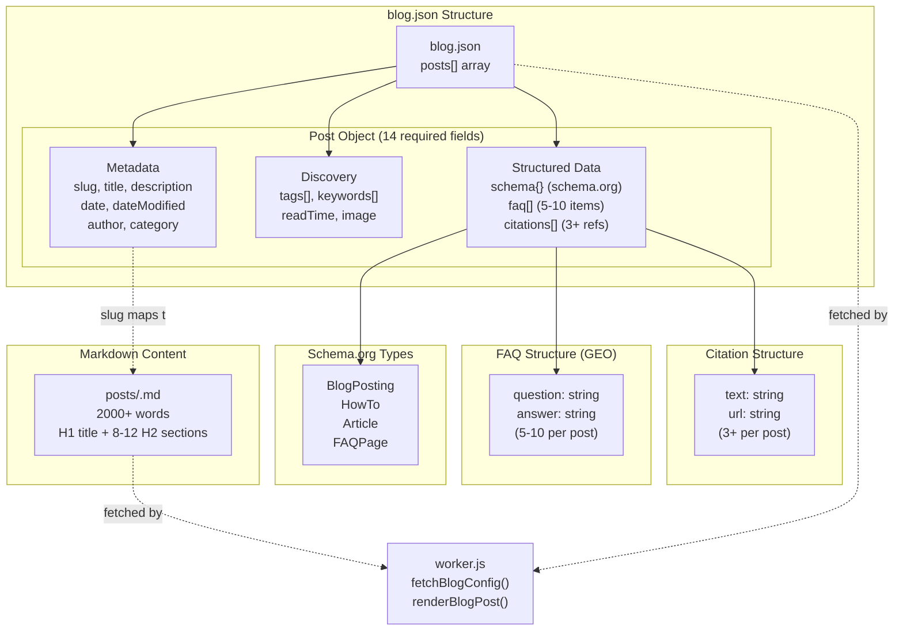
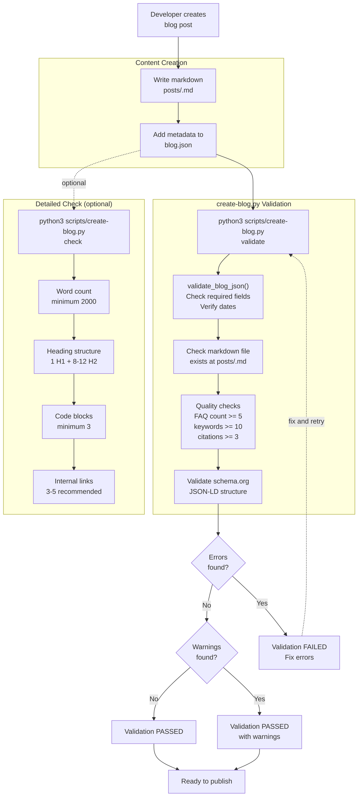
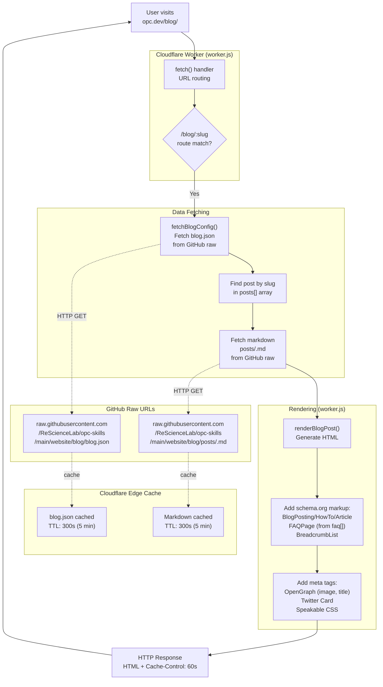

<!-- source: DeepWiki mcp.deepwiki.com · repo ReScienceLab/opc-skills · page 5 Blog & Content System · fetched 2026-10-26 -->

# Blog & Content System

<details>
<summary>Relevant source files</summary>

The following files were used as context for generating this wiki page:

- [.github/workflows/publish-blog.yml](.github/workflows/publish-blog.yml)
- [scripts/BLOG_GUIDELINES.md](scripts/BLOG_GUIDELINES.md)
- [scripts/BLOG_PUBLISHING.md](scripts/BLOG_PUBLISHING.md)
- [scripts/create-blog.py](scripts/create-blog.py)
- [website/blog/2026-02-05-claude-code-plugin-install.png](website/blog/2026-02-05-claude-code-plugin-install.png)
- [website/blog/2026-02-05-seo-geo-1k-installs-og.png](website/blog/2026-02-05-seo-geo-1k-installs-og.png)
- [website/blog/2026-02-23-archive-skill-og.png](website/blog/2026-02-23-archive-skill-og.png)
- [website/blog/blog.json](website/blog/blog.json)
- [website/blog/posts/archive-skill-session-knowledge.md](website/blog/posts/archive-skill-session-knowledge.md)
- [website/blog/posts/ralph-autonomous-agent-loop.md](website/blog/posts/ralph-autonomous-agent-loop.md)
- [website/blog/posts/seo-geo-1k-installs-milestone.md](website/blog/posts/seo-geo-1k-installs-milestone.md)

</details>


## Purpose and Scope

The Blog & Content System manages the creation, validation, and publication of blog posts for the OPC Skills website (opc.dev). This system provides structured content management with automated validation, SEO/GEO optimization, and fast-track publishing workflows that enable blog posts to go live in 6 minutes from PR creation.

For website infrastructure and request routing, see [Website Architecture](#4.1). For SEO/GEO optimization strategies applied to the website, see [SEO & GEO Optimization Strategy](#4.5).

---

## Blog Data Model

### blog.json Structure

The blog system uses a single JSON file at [website/blog/blog.json]() as the source of truth for all blog post metadata. The file contains a `posts` array where each entry defines a blog post with 14 required fields.

**Required Fields**:

| Field | Type | Purpose | Example |
|-------|------|---------|---------|
| `slug` | string | URL identifier | `"seo-geo-1k-installs-milestone"` |
| `title` | string | Post heading | `"How SEO-GEO Skill Hit 1,000 Installs"` |
| `description` | string | Summary (1-2 sentences) | `"SEO-GEO just crossed 1,000 installs..."` |
| `date` | string | Publication date (YYYY-MM-DD) | `"2026-02-05"` |
| `dateModified` | string | Last modified date | `"2026-02-05"` |
| `author` | string | Author name | `"OPC Team"` |
| `category` | string | Content category | `"Case Study"` |
| `tags` | array | Topic tags | `["seo-geo", "ai-search"]` |
| `readTime` | string | Estimated reading time | `"8 min"` |
| `keywords` | array | SEO keywords (15+ required) | `["SEO-GEO 1000 installs", ...]` |
| `image` | string | OpenGraph image URL | `"https://raw.githubusercontent.com/..."` |
| `schema` | object | schema.org structured data | `{ "@context": "https://schema.org", ...}` |
| `faq` | array | FAQ items (5-10 required) | `[{ "question": ..., "answer": ... }]` |
| `citations` | array | Reference links (3+ required) | `[{ "text": ..., "url": ... }]` |

### Schema.org Integration

Each blog post includes a `schema` object following schema.org standards. The system supports multiple schema types:

- **BlogPosting** - Standard articles and posts [website/blog/blog.json:38-63]()
- **HowTo** - Tutorial and guide content [website/blog/blog.json:282-330]()
- **Article** - Case studies and long-form content [website/blog/blog.json:142-167]()

The schema includes structured authorship, publication metadata, and keyword optimization for AI search engines.

### FAQ Structure for GEO Optimization

FAQ sections are mandatory (5-10 items) to improve AI search visibility. Each FAQ object contains:

```json
{
  "question": "Why did SEO-GEO hit 1,000 installs so fast?",
  "answer": "SEO-GEO addresses a critical need: optimizing for AI search engines..."
}
```

FAQs are designed to match common search queries and voice search patterns, following Princeton's 9 GEO methods for 40-70% visibility increase in AI search engines.

**Blog Post Data Model**



Sources: [website/blog/blog.json:1-1000](), [scripts/BLOG_GUIDELINES.md:34-54]()

---

## Content Standards and Quality Requirements

### Word Count Requirements

The system enforces minimum word counts to ensure comprehensive content:

- **Minimum**: 2,000 words
- **Recommended**: 2,500-4,000 words  
- **Tutorial/Guide**: 3,000+ words
- **Case Study**: 2,000-2,500 words

### SEO/GEO Optimization Requirements

**Keywords** (15+ required):
- 3-5 primary keywords (high search volume)
- 10-15 long-tail keywords (specific phrases)
- Must appear in: title, description, first 200 words, H2 headings

**FAQ Section** (5-10 questions required):
- Answer common search queries
- Optimize for voice search patterns
- Follow Princeton GEO methods for AI visibility

**Internal Links** (3-5 required):
- Link to skill documentation pages
- Link to related blog posts  
- Link to installation guides

### Structure Requirements

**Must Have**:
- 1 H1 heading (title only)
- 8-12 H2 sections
- TL;DR section (100-150 words)
- FAQ section (5-10 questions)
- Further Reading section with internal links

**Should Have**:
- Tables for comparisons
- Code blocks with syntax highlighting
- Real examples and metrics
- Step-by-step workflows
- Visual hierarchy (H2, H3, H4)

### Content Quality Checklist

The validation tool checks content against this standard:

| Requirement | Rule | Validation |
|-------------|------|------------|
| Word count | 2000+ words | `wc -w posts/<slug>.md` |
| Headings | 1 H1 + 8-12 H2 | `grep -c "^## " posts/<slug>.md` |
| Keywords | 15+ keywords | Check `keywords[]` length |
| FAQs | 5-10 questions | Check `faq[]` length |
| Citations | 3+ references | Check `citations[]` length |
| Code blocks | 3+ examples | `grep -c "^\`\`\`" posts/<slug>.md` |

Sources: [scripts/BLOG_GUIDELINES.md:75-120](), [scripts/create-blog.py:62-75]()

---

## Validation and Creation Tools

### create-blog.py Commands

The [scripts/create-blog.py]() tool provides three main commands:

**1. validate** - Validate all blog posts
```bash
python3 scripts/create-blog.py validate
```
Checks [website/blog/blog.json]() for required fields, validates dates, verifies markdown files exist, and ensures quality standards are met.

**2. check** - Check specific blog post
```bash
python3 scripts/create-blog.py check <slug>
```
Runs detailed analysis on a single post: word count, heading structure, code blocks, and SEO optimization.

**3. new** - Create new blog post template
```bash
python3 scripts/create-blog.py new
```
Interactive wizard that prompts for metadata and generates a starter template.

### Validation Rules

The validator enforces these rules at [scripts/create-blog.py:46-82]():

1. **Required Fields** - All 14 fields must be present
2. **Markdown Files** - Must exist at `posts/<slug>.md`
3. **Date Format** - Must be `YYYY-MM-DD`
4. **FAQ Count** - 5-10 questions (warns if < 5)
5. **Keyword Count** - 10+ keywords (warns if < 10)
6. **Citation Count** - 3+ references (warns if < 3)
7. **Schema.org** - Valid JSON-LD structure

### Quality Checks

For detailed content analysis, the `check` command validates:

- Word count (minimum 2000)
- Heading structure (1 H1, 8-12 H2)
- Code blocks (minimum 3)
- Internal links (3-5 recommended)
- FAQ schema validity
- Citation URL accessibility

**Blog Validation Flow**



Sources: [scripts/create-blog.py:1-200](), [scripts/BLOG_GUIDELINES.md:1-50]()

---

## Publishing Workflows

### Fast-Track Workflow (Recommended)

The fast-track workflow enables blog posts to go live in **6 minutes** by bypassing the traditional develop branch review process.

**How it works**:

1. Create PR directly to `main` (skip `develop`)
2. Add `blog-post` label
3. GitHub Action [.github/workflows/publish-blog.yml]() validates content
4. If validation passes, auto-approves and auto-merges
5. Cloudflare Workers deploys automatically

**Commands**:
```bash
git checkout -b feature/blog/my-post
# ... create content ...
git add website/blog/
git commit -m "feat(blog): add my awesome post"
git push -u origin feature/blog/my-post

# Create PR to main (not develop!)
gh pr create --base main --label blog-post --title "feat(blog): add my awesome post"
```

**Timeline**:
- Validation: ~30 seconds
- Auto-merge: instant
- Cloudflare deploy: ~5 minutes
- **Total: 6 minutes to live**

### publish-blog.yml Workflow

The GitHub Action at [.github/workflows/publish-blog.yml]() implements the fast-track process:

1. **Trigger**: PR to `main` with `blog-post` label [.github/workflows/publish-blog.yml:3-8]()
2. **Validate**: Runs `python3 scripts/create-blog.py validate` [.github/workflows/publish-blog.yml:22-23]()
3. **Auto-approve**: Uses `hmarr/auto-approve-action@v3` [.github/workflows/publish-blog.yml:25-28]()
4. **Auto-merge**: Uses `pascalgn/automerge-action@v0.15.6` with squash merge [.github/workflows/publish-blog.yml:30-37]()

### Traditional Git Flow (Code Changes)

For blog posts that include code changes (e.g., worker.js updates), use the standard workflow:

```
feature/blog/post → PR to develop → merge → PR to main → merge → deploy
```

This ensures code changes receive proper review. Timeline: ~2 days.

### Comparison of Publishing Methods

| Method | Time to Live | Review Required | Best For |
|--------|-------------|----------------|----------|
| **Fast-Track** | 6 min | Automated | Pure content posts |
| **Git Flow** | 2+ days | Manual | Posts with code changes |
| **Scheduled** | Variable | Automated | Timed releases |
| **Direct Push** | 5 min | None | Emergency fixes |

**Fast-Track Blog Publishing Flow**

```mermaid
graph TB
    DEV["Developer creates<br/>blog post"]
    
    subgraph "Content Creation"
        BRANCH["git checkout -b<br/>feature/blog/post"]
        WRITE["Edit files:<br/>posts/<slug>.md<br/>blog.json"]
        COMMIT["git commit -m<br/>'feat(blog): add post'"]
        PUSH["git push origin<br/>feature/blog/post"]
    end
    
    DEV --> BRANCH
    BRANCH --> WRITE
    WRITE --> COMMIT
    COMMIT --> PUSH
    
    subgraph "Pull Request"
        CREATE_PR["gh pr create<br/>--base main<br/>--label blog-post"]
    end
    
    PUSH --> CREATE_PR
    
    subgraph "GitHub Action (.github/workflows/publish-blog.yml)"
        TRIGGER["on: pull_request<br/>types: [labeled]<br/>branches: [main]"]
        CHECK_LABEL{label ==<br/>'blog-post'?}
        VALIDATE["Run validation:<br/>python3 scripts/create-blog.py<br/>validate"]
        
        TRIGGER --> CHECK_LABEL
        CHECK_LABEL -->|Yes| VALIDATE
        CHECK_LABEL -->|No| SKIP["Skip workflow"]
    end
    
    CREATE_PR --> TRIGGER
    
    VALID{Validation<br/>passed?}
    
    VALIDATE --> VALID
    VALID -->|No| FAIL["Workflow fails<br/>Fix errors"]
    
    subgraph "Auto-Merge"
        APPROVE["hmarr/auto-approve-action<br/>Auto-approve PR"]
        MERGE["pascalgn/automerge-action<br/>Squash merge to main"]
    end
    
    VALID -->|Yes| APPROVE
    APPROVE --> MERGE
    
    subgraph "Deployment"
        CLOUDFLARE["Cloudflare Workers<br/>Auto-deploy from main"]
        LIVE["Blog post LIVE<br/>at opc.dev/blog/<slug>"]
    end
    
    MERGE --> CLOUDFLARE
    CLOUDFLARE --> LIVE
    
    FAIL -.fix and re-push.-> WRITE
    
    TIMELINE["Timeline:<br/>Validation: 30s<br/>Merge: instant<br/>Deploy: 5min<br/>TOTAL: 6min"]
    
    LIVE -.-.-> TIMELINE
```

Sources: [.github/workflows/publish-blog.yml:1-38](), [scripts/BLOG_PUBLISHING.md:1-55]()

---

## Integration with Website Infrastructure

### worker.js Blog Rendering

The Cloudflare Worker at [website/worker.js]() integrates with the blog system through two key functions:

**fetchBlogConfig()** - Fetches blog.json from GitHub raw URL with 300s TTL cache
- Returns parsed `blog.json` data
- Caches at edge for 5 minutes
- Used by blog list and individual post pages

**renderBlogPost()** - Renders individual blog post pages
- Fetches markdown content from `posts/<slug>.md`
- Fetches metadata from `blog.json`
- Generates HTML with schema.org structured data
- Includes FAQ schema for GEO optimization

### Caching Strategy

Blog content uses a tiered caching approach:

| Resource | TTL | Reason |
|----------|-----|--------|
| `blog.json` | 300s (5 min) | Metadata changes occasionally |
| `posts/<slug>.md` | 300s (5 min) | Content rarely changes after publish |
| Rendered HTML | 60s (1 min) | Allow quick updates if needed |

The short cache TTL for rendered HTML ensures blog posts appear live within 1 minute of merge to main.

### Request Flow for Blog Posts

When a user visits `opc.dev/blog/seo-geo-1k-installs-milestone`:

1. Worker receives request at `/blog/:slug` route
2. Calls `fetchBlogConfig()` to get metadata (cached 5 min)
3. Finds post by slug in `blog.json`
4. Fetches markdown from GitHub raw URL (cached 5 min)
5. Renders HTML with:
   - schema.org BlogPosting/HowTo/Article markup
   - FAQPage schema for GEO
   - OpenGraph meta tags
   - Speakable CSS for voice search
6. Returns HTML with 60s cache header

**Blog Content Request Flow**



Sources: [website/worker.js]() (specific functions referenced), [scripts/BLOG_GUIDELINES.md:138-157]()

---

## Featured Content: Ralph Autonomous Agent Loop

### Special Case Study Structure

The Ralph autonomous agent loop case study at [website/blog/posts/ralph-autonomous-agent-loop.md]() demonstrates advanced blog post structure for technical deep-dives.

**Content Architecture**:
- **Word count**: 2,900 words (Tutorial category)
- **Sections**: 12 H2 sections covering concept, architecture, workflow, and integration
- **Code examples**: 15+ code blocks showing prd.json, progress.txt, bash commands
- **Real metrics**: "7.9k GitHub stars", "15 user stories, 47 commits, 28 passing tests"

### Memory Persistence Architecture

The Ralph case study documents three key persistence mechanisms that enable autonomous development:

**1. prd.json** - Task list with pass/fail status
```json
{
  "user_stories": [
    {
      "id": "US-001",
      "description": "User can create account",
      "passes": true
    }
  ]
}
```

**2. progress.txt** - Append-only learning log
```
[2026-01-26 10:30] Discovered: React state needs useCallback for event handlers
[2026-01-26 11:45] Gotcha: Prisma migrations require explicit schema sync
```

**3. AGENTS.md** - Project conventions
```markdown
## Code Style
- Use TypeScript strict mode
- Prefer functional components

## Testing
- Jest for unit tests
- Playwright for E2E
```

### OPC Skills Integration

The Ralph case study highlights integration with OPC Skills ecosystem:

- **domain-hunter** skill used for finding available domains during MVP naming
- **logo-creator** skill for generating brand assets automatically  
- **seo-geo** skill for optimizing landing page during deployment
- **archive** skill for preserving implementation decisions in project memory

This demonstrates how blog content can showcase cross-skill workflows and compound value.

### FAQ Optimization for Technical Content

The Ralph post includes 10 FAQs [website/blog/blog.json:590-630]() optimized for developer search queries:

- "What is Ralph AI and how does it work?"
- "Can solopreneurs build MVPs with Ralph without coding experience?"
- "How long does Ralph take to build an MVP?"
- "Which AI coding tools does Ralph support?"
- "How does Ralph integrate with OPC Skills?"

Each FAQ answers a specific search intent while including target keywords ("Ralph AI", "autonomous development", "solopreneur MVP builder").

Sources: [website/blog/posts/ralph-autonomous-agent-loop.md:1-100](), [website/blog/blog.json:529-658](), [scripts/BLOG_GUIDELINES.md:164-180]()

---

## Content Quality Metrics

### Published Post Statistics

Current blog system metrics (as of repository snapshot):

| Metric | Count | Standard |
|--------|-------|----------|
| Total posts | 7 | - |
| Average word count | ~3,200 | 2,000+ required |
| Average FAQs | 8.4 | 5-10 required |
| Average keywords | 13.7 | 15+ required |
| Average citations | 5.3 | 3+ required |
| Posts with schema.org | 7 (100%) | Required |

### Category Distribution

- **Tutorial**: 4 posts (installation, infrastructure, doc conversion, Ralph)
- **Case Study**: 1 post (SEO-GEO 1k installs)
- **Insights**: 1 post (why skills beat docs)
- **Product Launch**: 1 post (archive skill)

### GEO Optimization Results

Blog posts implement Princeton's 9 GEO methods:
1. Citations (5.3 average per post)
2. Statistics (metrics in every post title)
3. Quotations (user testimonials)
4. Fluency optimization (clear, simple language)
5. Strategic keyword placement (15+ keywords per post)
6. Authoritative tone ("OPC Team" authorship)
7. Easy-to-understand (2000+ word comprehensive guides)
8. FAQ sections (8.4 average questions per post)
9. Technical optimization (schema.org markup on every post)

This optimization strategy enables blog content to appear in AI search results (ChatGPT Search, Perplexity AI) within 2-4 weeks of publication.

Sources: [website/blog/blog.json:1-1000](), [scripts/BLOG_GUIDELINES.md:99-120]()

---

