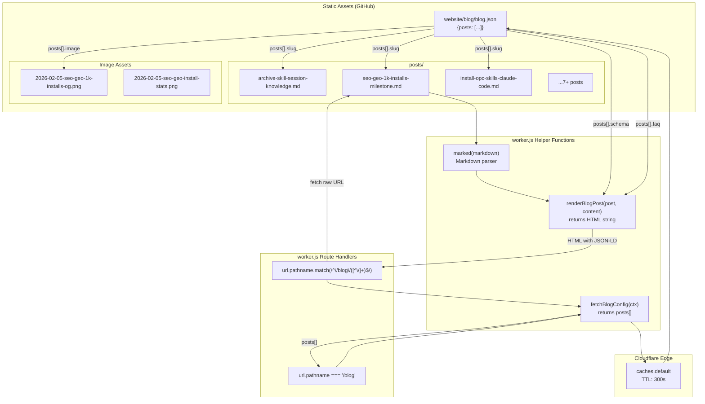
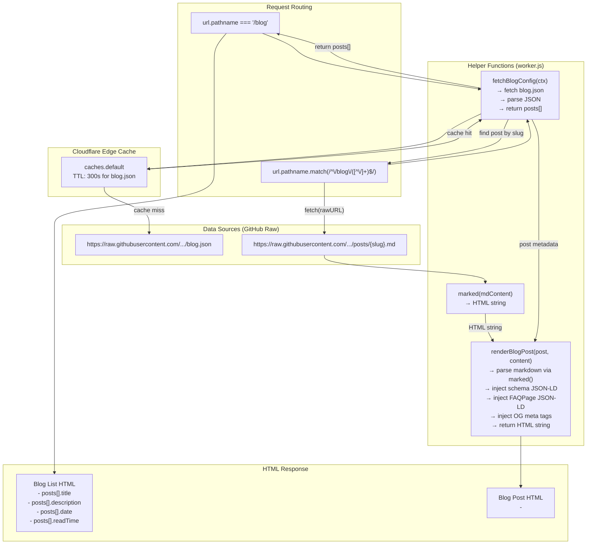

<!-- source: DeepWiki mcp.deepwiki.com · repo ReScienceLab/opc-skills · page 5.1 Blog System Architecture · fetched 2026-10-26 -->

# Blog System Architecture

<details>
<summary>Relevant source files</summary>

The following files were used as context for generating this wiki page:

- [website/blog/2026-02-05-claude-code-plugin-install.png](website/blog/2026-02-05-claude-code-plugin-install.png)
- [website/blog/2026-02-05-seo-geo-1k-installs-og.png](website/blog/2026-02-05-seo-geo-1k-installs-og.png)
- [website/blog/2026-02-23-archive-skill-og.png](website/blog/2026-02-23-archive-skill-og.png)
- [website/blog/blog.json](website/blog/blog.json)
- [website/blog/posts/archive-skill-session-knowledge.md](website/blog/posts/archive-skill-session-knowledge.md)
- [website/blog/posts/seo-geo-1k-installs-milestone.md](website/blog/posts/seo-geo-1k-installs-milestone.md)

</details>


## Purpose and Scope

This document describes the blog system architecture within the OPC Skills repository, focusing on the `blog.json` metadata registry, post organization, SEO/GEO optimization fields, and schema.org structured data. The blog system serves as a content marketing platform optimized for both traditional search engines and AI search engines (ChatGPT, Perplexity, Claude).

For information about:
- Blog content creation workflows and validation: see [Content Creation & Validation](#5.2)
- Blog publishing and deployment processes: see [Blog Publishing Workflows](#5.3)
- Website delivery and rendering of blog content: see [Website Architecture](#4.1)
- SEO/GEO optimization strategy implementation: see [SEO & GEO Optimization Strategy](#4.5)

---

## Blog Registry Overview

The blog system is centralized around a single metadata registry file that defines all published posts and their SEO/GEO attributes.

**Blog data flow — `blog.json` as metadata registry, `posts/*.md` as content, rendered by `worker.js`:**



Sources: [website/blog/blog.json:1-2](), [website/blog/posts/seo-geo-1k-installs-milestone.md:1-5]()

---

## blog.json Structure

The `blog.json` file is a flat JSON structure containing a single `posts` array with complete metadata for each blog post.

### Root Schema

The JSON structure contains a single top-level `posts` array:

```json
{
  "posts": [
    { /* post object 1 */ },
    { /* post object 2 */ },
    ...
  ]
}
```

The `posts` array is ordered newest-first (enforced by `scripts/create-blog.py` validation). Published posts as of February 2026:

| Slug | Category | Date | Word Count |
|------|----------|------|------------|
| `archive-skill-session-knowledge` | Product Launch | 2026-02-23 | 2400 |
| `seo-geo-1k-installs-milestone` | Case Study | 2026-02-05 | 3200 |
| `install-opc-skills-claude-code` | Tutorial | 2026-01-28 | — |
| `free-ai-infrastructure-deepseek-jan` | Tutorial | 2026-01-28 | 4200 |
| `ralph-autonomous-agent-loop` | Tutorial | 2026-01-26 | 2900 |
| `convert-docs-to-skills-guide` | Tutorial | 2026-01-24 | — |
| `why-skills-beat-docs` | Insights | 2026-01-23 | — |

Sources: [website/blog/blog.json:1-2](), [website/blog/blog.json:3-109](), [website/blog/blog.json:110-249]()

---

## Post Metadata Schema

Each post object in the `posts` array contains comprehensive metadata. The complete list of required fields is defined as `REQUIRED_FIELDS` in `scripts/create-blog.py`:

```python
REQUIRED_FIELDS = [
    "slug", "title", "description", "date", "dateModified", "author",
    "category", "tags", "readTime", "keywords", "image", "schema",
    "faq", "citations"
]
```

These 14 fields are validated by the `validate_blog_json()` function before any post can be published.

### Core Fields

| Field | Type | Purpose |
|-------|------|---------|
| `slug` | string | URL identifier (e.g., `"seo-geo-1k-installs-milestone"`); determines route `/blog/{slug}` and markdown filename `posts/{slug}.md` |
| `title` | string | Full post title |
| `description` | string | Meta description (~150-160 chars) |
| `date` | string | Publication date (ISO 8601: `"YYYY-MM-DD"`) |
| `dateModified` | string | Last modification date |
| `author` | string | Author name (typically `"OPC Team"`) |
| `category` | string | Content category: `"Case Study"`, `"Tutorial"`, `"Insights"`, `"Product Launch"` |
| `tags` | string[] | Topic tags for categorization |
| `readTime` | string | Estimated read time (e.g., `"8 min"`) |
| `keywords` | string[] | SEO keywords; validation warns if fewer than 10 |
| `image` | string | Absolute URL to OpenGraph PNG image |
| `schema` | object | schema.org JSON-LD structured data object |
| `faq` | object[] | FAQ entries; validation warns if fewer than 5 |
| `citations` | object[] | Source citations; validation warns if fewer than 3 |

Sources: [scripts/create-blog.py:23-27](), [website/blog/blog.json:3-134]()

### Example Post Entry

```json
{
  "slug": "seo-geo-1k-installs-milestone",
  "title": "How SEO-GEO Skill Hit 1,000 Installs: The AI Search Revolution Is Here",
  "description": "SEO-GEO just crossed 1,000 installs, making it the #1 skill...",
  "date": "2026-02-05",
  "dateModified": "2026-02-05",
  "author": "OPC Team",
  "category": "Case Study",
  "tags": ["seo-geo", "ai-search", "geo-optimization", "milestone", "chatgpt-search", "perplexity"],
  "readTime": "8 min",
  "keywords": [
    "SEO-GEO 1000 installs",
    "AI search optimization",
    "GEO Generative Engine Optimization",
    "ChatGPT Search SEO",
    "Perplexity AI citations",
    "Claude Code SEO plugin",
    "install seo-geo skill",
    "AI search visibility",
    "schema.org automation",
    "Princeton GEO methods",
    "solopreneur SEO tools",
    "free SEO alternative"
  ],
  "image": "https://raw.githubusercontent.com/ReScienceLab/opc-skills/main/website/blog/2026-02-05-seo-geo-1k-installs-og.png",
  "schema": { /* Article schema object */ },
  "faq": [ /* 10 question/answer pairs */ ],
  "citations": [ /* 9 source citations */ ]
}
```

The `slug` field serves as the primary key linking three artifacts:
1. The `blog.json` entry (this object)
2. The markdown file at `website/blog/posts/{slug}.md`
3. The URL route `/blog/{slug}` handled by `worker.js`

Sources: [website/blog/blog.json:110-168]()

---

## SEO/GEO Optimization Fields

The blog system implements aggressive SEO/GEO optimization through dedicated metadata fields designed to maximize visibility in both traditional and AI search engines.

### Keywords Array

Each post defines **10-15 target keywords** optimized for:
- Long-tail search queries
- Question-based searches
- Tool/product-specific searches
- Problem-solution searches

```json
"keywords": [
  "SEO-GEO 1000 installs",
  "AI search optimization",
  "GEO Generative Engine Optimization",
  "ChatGPT Search SEO",
  "Perplexity AI citations",
  "Claude Code SEO plugin",
  "install seo-geo skill",
  "AI search visibility",
  "schema.org automation",
  "Princeton GEO methods",
  "solopreneur SEO tools",
  "free SEO alternative"
]
```

**Sources:** [website/blog/blog.json:13-26]()

### Tags Array

Tags provide coarse-grained categorization for navigation and filtering:

| Post Category | Example Tags |
|---------------|--------------|
| Case Study | `["seo-geo", "ai-search", "milestone", "chatgpt-search"]` |
| Tutorial | `["installation", "claude-code", "tutorial", "getting-started"]` |
| Insights | `["agent-skills", "documentation", "ai-agents"]` |

**Sources:** [website/blog/blog.json:11](), [website/blog/blog.json:144]()

### Image Assets

Each post requires an OpenGraph image for social media sharing:

```json
"image": "https://raw.githubusercontent.com/ReScienceLab/opc-skills/main/website/blog/2026-02-05-seo-geo-1k-installs-og.png"
```

**Naming Convention:** `YYYY-MM-DD-{slug}-og.png`

**Sources:** [website/blog/blog.json:27](), [website/blog/blog.json:160]()

---

## Schema.org Structured Data

The `schema` field contains JSON-LD structured data that AI search engines and traditional search engines parse to understand content semantics.

**Schema.org `@type` variants and their field structure:**

```mermaid
graph TB
    subgraph "schema['@type'] Values"
        Article["Article<br/>(Case Studies)"]
        HowTo["HowTo<br/>(Step-by-step Tutorials)"]
        BlogPosting["BlogPosting<br/>(General Posts)"]
    end

    subgraph "Common Fields (All Types)"
        Context["@context: 'https://schema.org'"]
        Name["name or headline"]
        Desc["description"]
        Author["author: {<br/>@type: 'Organization',<br/>name: 'OPC Team',<br/>url: 'https://opc.dev'<br/>}"]
        DatePub["datePublished"]
        DateMod["dateModified"]
        Publisher["publisher: {<br/>@type: 'Organization',<br/>name: 'OPC Skills',<br/>logo: ImageObject<br/>}"]
        Image["image URL"]
        MainEntity["mainEntityOfPage URL"]
        Keywords["keywords string"]
    end

    subgraph "Type-Specific Fields"
        ArticleFields["articleSection<br/>wordCount"]
        HowToFields["step: [<br/>{@type: 'HowToStep',<br/>position, name, text, url}<br/>]<br/>totalTime: 'PT2M'<br/>tool: []<br/>supply: []"]
        BlogFields["headline<br/>articleSection<br/>wordCount"]
    end

    Article --> Context
    Article --> Name
    Article --> Desc
    Article --> Author
    Article --> DatePub
    Article --> DateMod
    Article --> Publisher
    Article --> Image
    Article --> MainEntity
    Article --> Keywords
    Article --> ArticleFields

    HowTo --> Context
    HowTo --> Name
    HowTo --> Desc
    HowTo --> HowToFields

    BlogPosting --> Context
    BlogPosting --> Name
    BlogPosting --> Desc
    BlogPosting --> Author
    BlogPosting --> DatePub
    BlogPosting --> DateMod
    BlogPosting --> Publisher
    BlogPosting --> Image
    BlogPosting --> MainEntity
    BlogPosting --> Keywords
    BlogPosting --> BlogFields
```



### Article Schema (Case Studies)

Used for case studies and analytical posts (e.g., `seo-geo-1k-installs-milestone`):

```json
{
  "@context": "https://schema.org",
  "@type": "Article",
  "name": "How SEO-GEO Skill Hit 1,000 Installs",
  "description": "Case study: SEO-GEO skill reaches 1,000 installs...",
  "author": {
    "@type": "Organization",
    "name": "OPC Team",
    "url": "https://opc.dev"
  },
  "datePublished": "2026-02-05",
  "dateModified": "2026-02-05",
  "publisher": {
    "@type": "Organization",
    "name": "OPC Skills",
    "url": "https://opc.dev",
    "logo": {
      "@type": "ImageObject",
      "url": "https://opc.dev/opc-logo.svg"
    }
  },
  "image": "https://raw.githubusercontent.com/.../2026-02-05-seo-geo-1k-installs-og.png",
  "mainEntityOfPage": "https://opc.dev/blog/seo-geo-1k-installs-milestone",
  "keywords": "SEO-GEO, AI search, GEO optimization, ChatGPT Search",
  "articleSection": "Case Study",
  "wordCount": 3200
}
```

Sources: [website/blog/blog.json:144-168]()

### HowTo Schema (Tutorials)

Used for step-by-step tutorial posts (e.g., `install-opc-skills-claude-code`). Each `step` entry uses `@type: HowToStep` with `position`, `name`, `text`, and a deep-link `url`:

```json
{
  "@context": "https://schema.org",
  "@type": "HowTo",
  "name": "How to Install OPC Skills in Claude Code",
  "description": "Step-by-step tutorial to install OPC Skills...",
  "totalTime": "PT2M",
  "tool": ["Claude Code"],
  "supply": ["Claude Code (free version)"],
  "step": [
    {
      "@type": "HowToStep",
      "position": 1,
      "name": "Add OPC Skills Marketplace",
      "text": "Open Claude Code and run: /plugin marketplace add ReScienceLab/opc-skills",
      "url": "https://opc.dev/blog/install-opc-skills-claude-code#step-1"
    },
    {
      "@type": "HowToStep",
      "position": 2,
      "name": "Install Skills",
      "text": "Run: /plugin install reddit@opc-skills (or any other skill)",
      "url": "https://opc.dev/blog/install-opc-skills-claude-code#step-2"
    }
  ]
}
```

`totalTime` uses ISO 8601 duration format (`"PT2M"` = 2 minutes).

Sources: [website/blog/blog.json:280-331]()

### BlogPosting Schema

Used for general blog content (e.g., `archive-skill-session-knowledge`, `free-ai-infrastructure-deepseek-jan`, `ralph-autonomous-agent-loop`). Uses `headline` instead of `name`, and includes `mainEntityOfPage`:

```json
{
  "@context": "https://schema.org",
  "@type": "BlogPosting",
  "headline": "How to Build MVPs for Free: DeepSeek + Jan + OPC Skills",
  "description": "Complete guide to building MVPs with zero API costs...",
  "author": {
    "@type": "Organization",
    "name": "OPC Team",
    "url": "https://opc.dev"
  },
  "datePublished": "2026-01-28",
  "dateModified": "2026-01-28",
  "mainEntityOfPage": "https://opc.dev/blog/free-ai-infrastructure-deepseek-jan",
  "articleSection": "Tutorial",
  "wordCount": 4200
}
```

Sources: [website/blog/blog.json:431-458]()

---

## FAQ Section for GEO Optimization

The `faq` array implements the **FAQPage schema** pattern, which is one of the 9 Princeton GEO methods proven to increase AI search citations by +40%.

### FAQ Structure

Each FAQ entry contains:

```json
{
  "question": "Why did SEO-GEO hit 1,000 installs so fast?",
  "answer": "SEO-GEO addresses a critical need: optimizing for AI search engines like ChatGPT Search and Perplexity AI. It's free, installs in 30 seconds, requires no API keys, and automates the 9 Princeton GEO methods proven to increase AI visibility by 40-70%."
}
```

**Sources:** [website/blog/blog.json:55-96]()

### FAQ Count by Post

The `validate_blog_json()` function in `scripts/create-blog.py` warns when a post has fewer than 5 FAQ entries (the GEO optimization minimum):

| Post Slug | FAQ Count | Schema `@type` |
|-----------|-----------|----------------|
| `archive-skill-session-knowledge` | 6 | `BlogPosting` |
| `seo-geo-1k-installs-milestone` | 10 | `Article` |
| `install-opc-skills-claude-code` | 10 | `HowTo` |
| `free-ai-infrastructure-deepseek-jan` | 10 | `BlogPosting` |
| `ralph-autonomous-agent-loop` | 10 | `BlogPosting` |
| `convert-docs-to-skills-guide` | 4 | `BlogPosting` |

Typical FAQ topics: installation instructions, cost comparisons, technical requirements, feature capabilities, troubleshooting, use-case validation.

Sources: [website/blog/blog.json:65-90](), [website/blog/blog.json:169-210](), [website/blog/blog.json:332-373](), [scripts/create-blog.py:63-65]()

---

## Citations Array

The `citations` array implements another Princeton GEO method: **adding authoritative citations** increases AI search visibility by +40%.

### Citation Structure

```json
{
  "text": "Princeton NLP: GEO Optimization Methods",
  "url": "https://arxiv.org/abs/2311.03735"
}
```

### Citation Categories

| Category | Example URLs |
|----------|-------------|
| Academic Research | `arxiv.org/abs/2311.03735` |
| GitHub Repositories | `github.com/ReScienceLab/opc-skills` |
| Official Documentation | `code.claude.com/docs` |
| Skill Registries | `skills.sh/ReScienceLab/opc-skills` |
| Community Discussions | `news.ycombinator.com/item?id=46730857` |
| Social Proof | `threads.com/@hannie.liu/post/...` |

**Sources:** [website/blog/blog.json:97-134]()

### Citation Counts

Posts typically include **5-9 citations**:

```json
"citations": [
  {"text": "Princeton NLP: GEO Optimization Methods", "url": "..."},
  {"text": "SEO-GEO Skill Documentation", "url": "..."},
  {"text": "SEO-GEO on Skills.sh Registry", "url": "..."},
  {"text": "OPC Skills GitHub Repository", "url": "..."},
  {"text": "Agent Skills Standard", "url": "..."},
  {"text": "Hacker News Discussion", "url": "..."},
  {"text": "Community Testimonial - Hannie Liu on Threads", "url": "..."},
  {"text": "ChatGPT Search Documentation", "url": "..."},
  {"text": "Perplexity AI", "url": "..."}
]
```

**Sources:** [website/blog/blog.json:97-134]()

---

## Content Organization

Blog content is organized into a simple directory structure optimized for fast access and clear separation of concerns.

```
website/blog/
├── blog.json                                          # Central registry
├── posts/
│   ├── seo-geo-1k-installs-milestone.md              # 486 lines
│   ├── free-ai-infrastructure-deepseek-jan.md        # 529 lines
│   ├── ralph-autonomous-agent-loop.md
│   ├── install-opc-skills-claude-code.md
│   ├── convert-docs-to-skills-guide.md
│   ├── why-skills-beat-docs.md
│   ├── domain-hunting-ai-saved-50.md
│   └── what-is-opc.md
├── 2026-02-05-seo-geo-1k-installs-og.png             # OpenGraph image
├── 2026-02-05-seo-geo-install-stats.png              # Content image
├── 2026-02-05-claude-code-plugin-install.png         # Screenshot
├── 2026-01-28-install-opc-skills-claude-code-og.png
├── 2026-01-28-free-infrastructure-og.png
└── ...
```

### File Naming Conventions

| Asset Type | Pattern | Example |
|------------|---------|---------|
| Markdown Posts | `{slug}.md` | `seo-geo-1k-installs-milestone.md` |
| OpenGraph Images | `YYYY-MM-DD-{slug}-og.png` | `2026-02-05-seo-geo-1k-installs-og.png` |
| Content Images | `YYYY-MM-DD-{slug}-{descriptor}.png` | `2026-02-05-seo-geo-install-stats.png` |

**Sources:** [website/blog/blog.json:1-699](), [website/blog/posts/seo-geo-1k-installs-milestone.md:1]()

---

## Blog Post Markdown Files

Markdown posts contain the full article content with frontmatter-style metadata at the top.

### Post Header Format

```markdown
# How SEO-GEO Skill Hit 1,000 Installs: The AI Search Revolution Is Here

*By OPC Team | February 5, 2026 | 8 min read*

**TL;DR** — Our SEO-GEO skill just crossed 1,000 installs...
```

**Sources:** [website/blog/posts/seo-geo-1k-installs-milestone.md:1-5]()

### Content Structure

Typical post structure:

1. **Title (H1)** - Matches `blog.json` title
2. **Byline** - Author, date, read time
3. **TL;DR section** - 2-3 sentence summary
4. **Problem statement** - What issue does this address?
5. **Solution explanation** - How to solve it
6. **Step-by-step guide** - Actionable instructions
7. **Results/case studies** - Social proof
8. **FAQ section** - Mirrors `blog.json` FAQ array
9. **References section** - Mirrors `blog.json` citations

**Sources:** [website/blog/posts/seo-geo-1k-installs-milestone.md:1-486]()

### Markdown Features

Posts extensively use:

```markdown
## Section Headers (H2, H3)

**Bold text** for emphasis

`inline code` for commands/filenames

```bash
# Code blocks with syntax highlighting
npx skills add ReScienceLab/opc-skills
```

> Blockquotes for testimonials

| Tables | For | Data |
|--------|-----|------|

- Bullet lists
- For clarity

1. Numbered lists
2. For steps


[Links](url)
```

**Sources:** [website/blog/posts/seo-geo-1k-installs-milestone.md:1-486](), [website/blog/posts/free-ai-infrastructure-deepseek-jan.md:1-529]()

---

## Post Metadata Validation

Validation is performed by `scripts/create-blog.py`. The `validate_blog_json()` function loads `BLOG_JSON` (`website/blog/blog.json`) and checks every entry in `posts`:

| Check | Level | Threshold |
|-------|-------|-----------|
| All 14 `REQUIRED_FIELDS` present | Error | — |
| Markdown file exists at `POSTS_DIR/{slug}.md` | Error | — |
| `faq` array length | Warning | < 5 |
| `keywords` array length | Warning | < 10 |
| `citations` array length | Warning | < 3 |
| `schema.@type` is a recognized type | Warning | — |
| `date` / `dateModified` are valid ISO dates | Warning | — |

The path constants used by the script:

```
PROJECT_ROOT / "website" / "blog"          → BLOG_DIR
BLOG_DIR / "blog.json"                     → BLOG_JSON
BLOG_DIR / "posts"                         → POSTS_DIR
```

For full details on the validation commands and content quality standards, see page 5.2.

Sources: [scripts/create-blog.py:18-27](), [scripts/create-blog.py:29-76]()

---

## Integration with Website Rendering

Blog content is rendered by `website/worker.js` using a two-stage pipeline: metadata loading via `fetchBlogConfig()` and HTML assembly via `renderBlogPost()`.

**Blog rendering pipeline in `worker.js`:**



### Key Functions

| Function | Parameters | Returns | Caching |
|----------|-----------|---------|---------|
| `fetchBlogConfig(ctx)` | `ctx` (cache context) | `Promise<{posts: []}>` | 300s TTL via `caches.default` |
| `renderBlogPost(post, content)` | `post` (metadata object), `content` (markdown string) | HTML string | None (computed per-request) |
| `marked(markdown)` | `markdown` (string) | HTML string | None |

The `ctx` parameter to `fetchBlogConfig()` enables Cloudflare edge caching: the blog registry is cached for 5 minutes to reduce GitHub API calls. Markdown content is fetched per-request and not cached (to enable fast content updates).

For details on the `fetchBlogConfig` caching strategy and the full set of routes, see pages 4.1, 4.2, and 4.3.

Sources: [website/blog/blog.json:1-2]()

---

## Schema.org Embedding Strategy

The `renderBlogPost()` function in `worker.js` embeds schema.org structured data via two separate `<script type="application/ld+json">` blocks in the HTML `<head>`.

### 1. Primary Schema — from `post.schema` field

The `schema` object from `blog.json` is serialized directly into JSON-LD. The `@type` varies by post category:

- **Case Studies** → `"Article"`
- **Tutorials** → `"HowTo"` or `"BlogPosting"`
- **Insights** → `"BlogPosting"`

Example rendering for a `"HowTo"` post:

```html
<script type="application/ld+json">
{
  "@context": "https://schema.org",
  "@type": "HowTo",
  "name": "How to Install OPC Skills in Claude Code",
  "description": "Step-by-step tutorial to install OPC Skills...",
  "totalTime": "PT2M",
  "tool": ["Claude Code"],
  "supply": ["Claude Code (free version)"],
  "step": [
    {
      "@type": "HowToStep",
      "position": 1,
      "name": "Add OPC Skills Marketplace",
      "text": "Open Claude Code and run: /plugin marketplace add ReScienceLab/opc-skills",
      "url": "https://opc.dev/blog/install-opc-skills-claude-code#step-1"
    }
  ],
  "author": { /* Organization object */ },
  "datePublished": "2026-01-28",
  "publisher": { /* Organization with logo */ },
  "image": "https://raw.githubusercontent.com/.../2026-01-28-install-opc-skills-claude-code-og.png"
}
</script>
```

### 2. FAQPage Schema — from `post.faq` array

The `faq` array is transformed into a separate `FAQPage` schema. This implements Princeton GEO method #8 (adding FAQ sections) proven to increase AI search citations by +40%.

Example rendering:

```html
<script type="application/ld+json">
{
  "@context": "https://schema.org",
  "@type": "FAQPage",
  "mainEntity": [
    {
      "@type": "Question",
      "name": "Why did SEO-GEO hit 1,000 installs so fast?",
      "acceptedAnswer": {
        "@type": "Answer",
        "text": "SEO-GEO addresses a critical need: optimizing for AI search engines like ChatGPT Search and Perplexity AI. It's free, installs in 30 seconds, requires no API keys..."
      }
    },
    {
      "@type": "Question",
      "name": "What is GEO (Generative Engine Optimization)?",
      "acceptedAnswer": {
        "@type": "Answer",
        "text": "GEO is the practice of optimizing content to be cited by AI search engines like ChatGPT, Perplexity, and Claude..."
      }
    }
  ]
}
</script>
```

Each `post.faq[]` entry with `{question, answer}` fields is mapped to a `Question` object with an `acceptedAnswer` containing an `Answer` object. The transformation occurs in `renderBlogPost()` during HTML assembly.

Sources: [website/blog/blog.json:169-210](), [website/blog/blog.json:280-331]()

---

## Summary

The blog system architecture consists of:

1. **Central Registry** - `blog.json` with 8+ posts
2. **Metadata Schema** - 17 fields per post including SEO/GEO optimizations
3. **Schema.org Types** - Article, HowTo, BlogPosting for different content types
4. **FAQ Arrays** - 4-10 questions per post for GEO optimization
5. **Citations** - 5-9 authoritative sources per post
6. **Markdown Content** - 2000+ word posts in `posts/` directory
7. **Image Assets** - OpenGraph and content images with date-based naming

This architecture enables the blog to rank highly in both traditional search engines and AI search engines (ChatGPT, Perplexity, Claude) through aggressive structured data optimization and GEO method implementation.

**Sources:** [website/blog/blog.json:1-699](), [website/blog/posts/seo-geo-1k-installs-milestone.md:1-486](), [website/blog/posts/free-ai-infrastructure-deepseek-jan.md:1-529]()

---

