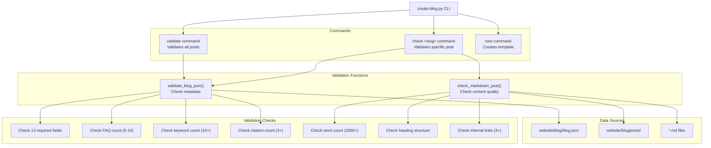
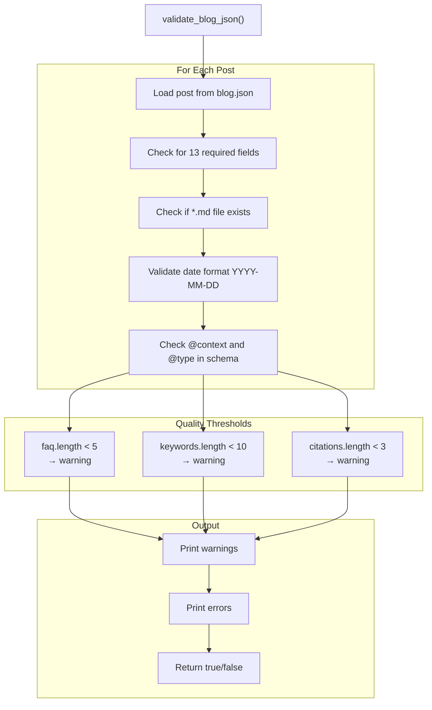
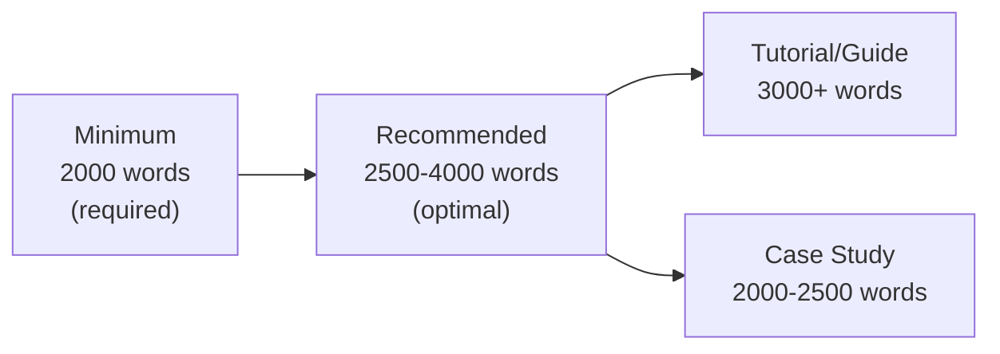
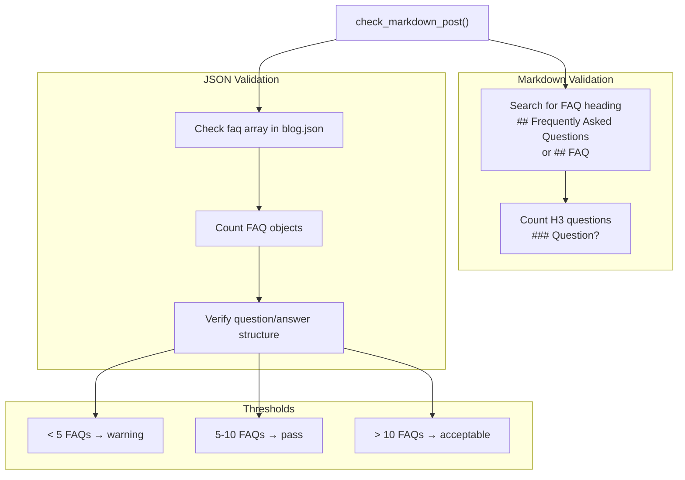
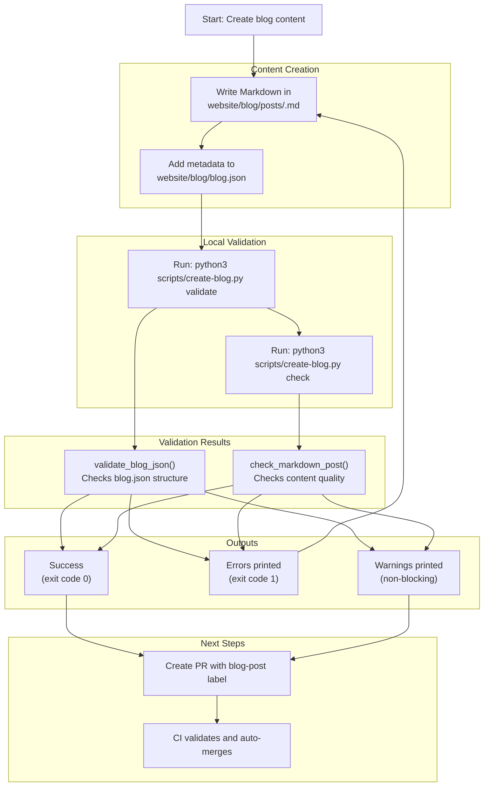
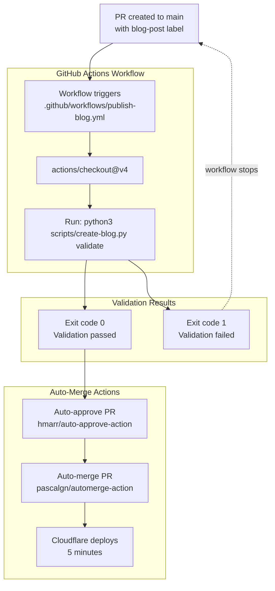
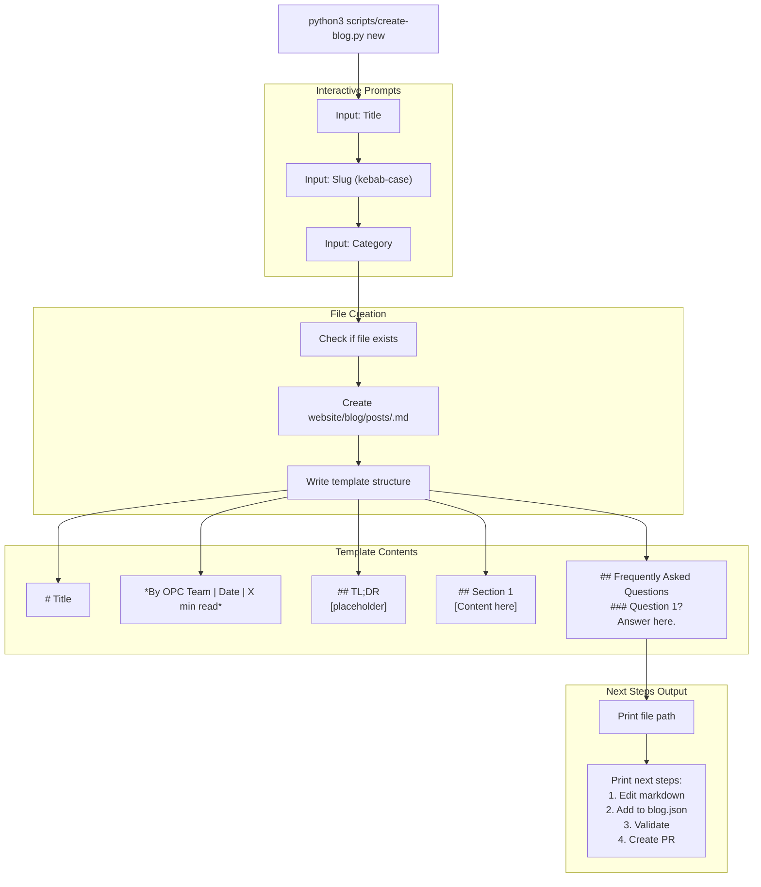

<!-- source: DeepWiki mcp.deepwiki.com · repo ReScienceLab/opc-skills · page 5.2 Content Creation & Validation · fetched 2026-10-26 -->

# Content Creation & Validation

<details>
<summary>Relevant source files</summary>

The following files were used as context for generating this wiki page:

- [.github/workflows/publish-blog.yml](.github/workflows/publish-blog.yml)
- [scripts/BLOG_GUIDELINES.md](scripts/BLOG_GUIDELINES.md)
- [scripts/BLOG_PUBLISHING.md](scripts/BLOG_PUBLISHING.md)
- [scripts/create-blog.py](scripts/create-blog.py)
- [website/blog/posts/ralph-autonomous-agent-loop.md](website/blog/posts/ralph-autonomous-agent-loop.md)

</details>


This document describes the blog content validation system, quality standards, and the `create-blog.py` validation tool. It covers content requirements (word count, structure, SEO/GEO optimization), schema.org markup, and the validation workflow that ensures all blog posts meet quality gates before publication.

For publishing workflows and deployment strategies, see [Blog Publishing Workflows](#5.3). For blog system architecture and rendering, see [Blog System Architecture](#5.1).

---

## Purpose and Scope

The content validation system enforces quality standards across all blog posts to maximize discoverability in AI search engines (ChatGPT, Perplexity) and traditional search (Google, Bing). The system validates:

- **Metadata completeness** in `blog.json`: 13 required fields including slug, title, keywords, schema, FAQ, citations
- **Content quality**: Minimum word counts, heading structure, FAQ sections, internal/external links
- **SEO/GEO requirements**: 15+ keywords, 5-10 FAQ questions, 3+ citations
- **Schema.org markup**: BlogPosting structured data with embedded FAQPage

All validation occurs before content is published, either locally via CLI or automatically in CI/CD.

---

## Validation Tool Architecture

### Overview

The validation system is implemented in `create-blog.py`, a Python CLI tool with three primary commands: `validate`, `check`, and `new`. The tool validates both metadata structure (JSON) and content quality (Markdown).

**Validation Tool Command Flow**



**Sources:** [scripts/create-blog.py:1-264](), [scripts/BLOG_GUIDELINES.md:1-366]()

---

### Command Reference

| Command | Purpose | Usage | Exit Code |
|---------|---------|-------|-----------|
| `validate` | Validate all blog posts | `python3 scripts/create-blog.py validate` | 0 if pass, 1 if fail |
| `check <slug>` | Validate specific post | `python3 scripts/create-blog.py check ralph-autonomous-agent-loop` | 0 if pass, 1 if fail |
| `new` | Create new template | `python3 scripts/create-blog.py new` | 0 if success |

**Sources:** [scripts/create-blog.py:3-9](), [scripts/BLOG_GUIDELINES.md:6-16]()

---

### Required Metadata Fields

The `validate_blog_json()` function checks for 13 required fields in each blog post entry:

```python
REQUIRED_FIELDS = [
    "slug", "title", "description", "date", "dateModified", "author",
    "category", "tags", "readTime", "keywords", "image", "schema",
    "faq", "citations"
]
```

**Field Validation Logic**



**Sources:** [scripts/create-blog.py:23-27](), [scripts/create-blog.py:29-104]()

---

### Content Quality Checks

The `check_markdown_post()` function validates Markdown content quality using regex pattern matching:

| Check | Threshold | Regex Pattern | Warning Condition |
|-------|-----------|---------------|-------------------|
| **Word count** | 2000+ words | `len(content.split())` | < 2000 words |
| **H1 headings** | Exactly 1 | `^# [^#]` | 0 or > 1 H1s |
| **H2 sections** | 8-12 sections | `^## [^#]` | < 5 H2s |
| **Internal links** | 3-5 links | `\]\(/blog/[^\)]+\)` | < 3 links |
| **Tables** | 1+ table | `^\|.*\|.*\|` | N/A (informational) |
| **Code blocks** | 1+ blocks | ``` ` ``` ` ``` ` ``` | N/A (informational) |
| **FAQ section** | Required | `## Frequently Asked Questions` or `## FAQ` | Missing section |

**Sources:** [scripts/create-blog.py:106-173](), [scripts/BLOG_GUIDELINES.md:76-98]()

---

## Content Quality Standards

### Word Count Requirements



**Rationale:** Posts under 2000 words have poor SEO performance. The +40% AI visibility boost comes from comprehensive content (2500+ words) with structured FAQ sections.

**Sources:** [scripts/BLOG_GUIDELINES.md:76-81](), [scripts/create-blog.py:122-125]()

---

### Structure Requirements

All blog posts must follow this structure:

| Section | Required | Description |
|---------|----------|-------------|
| **H1 Title** | ✅ Exactly 1 | Single H1 for main title only |
| **TL;DR** | ✅ Yes | 100-150 word summary with key metrics |
| **H2 Sections** | ✅ 8-12 sections | Main content organized hierarchically |
| **Tables** | ⚠️ Recommended | For comparisons, specifications |
| **Code blocks** | ⚠️ Recommended | With syntax highlighting |
| **Internal links** | ✅ 3-5 minimum | Link to related posts |
| **External citations** | ✅ 3-6 minimum | Authoritative sources |
| **FAQ section** | ✅ Yes | 5-10 questions for GEO |

**Example Structure from Ralph Post**

```markdown
# Title (H1)
*Metadata line*

## TL;DR
[Summary with metrics]

## Section 1 (H2)
[Content]

## Section 2 (H2)
[Content]

[8-12 H2 sections total]

## Frequently Asked Questions (H2)
### Question 1? (H3)
Answer here.

[5-10 FAQ questions]
```

**Sources:** [scripts/BLOG_GUIDELINES.md:83-98](), [website/blog/posts/ralph-autonomous-agent-loop.md:1-810]()

---

## SEO/GEO Optimization Requirements

### Keyword Strategy

The validation tool enforces minimum keyword counts to ensure search visibility:

**Keyword Requirements Table**

| Keyword Type | Count | Placement | Example |
|--------------|-------|-----------|---------|
| **Primary keywords** | 3-5 | Title, H2s, first 200 words | "build MVP automatically", "autonomous AI agent loop" |
| **Long-tail keywords** | 10-15 | Throughout content | "Ralph AI tutorial", "PRD to code automatically" |
| **Total keywords** | 15+ | `keywords` array in blog.json | Triggers warning if < 10 |

**Keyword Validation Logic:**

```python
keyword_count = len(post.get('keywords', []))
if keyword_count < 10:
    warnings.append(f"Post '{slug}' has only {keyword_count} keywords (recommend 10+ for SEO)")
```

**Sources:** [scripts/create-blog.py:67-70](), [scripts/BLOG_GUIDELINES.md:101-116]()

---

### FAQ Section Requirements

FAQ sections are critical for AI search engine optimization (GEO). The system validates both quantity and structure:

**FAQ Validation Flow**



**FAQ Best Practices:**

- Answer common search queries ("How do I...", "What is...", "Can I...")
- 50-150 word answers
- Include keywords naturally
- Optimize for voice search

**Example FAQ Structure:**

```json
{
  "faq": [
    {
      "question": "What is Ralph AI and how does it work?",
      "answer": "Ralph is an autonomous AI agent loop that runs coding tools..."
    },
    {
      "question": "Can solopreneurs build MVPs with Ralph without coding experience?",
      "answer": "Yes. Ralph requires a PRD (product requirements document)..."
    }
  ]
}
```

**Sources:** [scripts/BLOG_GUIDELINES.md:118-123](), [scripts/create-blog.py:62-65](), [website/blog/posts/ralph-autonomous-agent-loop.md:765-806]()

---

### Citation Requirements

External citations establish authority and improve trust signals for search engines:

| Requirement | Threshold | Validation |
|-------------|-----------|------------|
| **Minimum citations** | 3 | `len(post.get('citations', []))` |
| **Recommended citations** | 3-6 | Optimal for authority |
| **Citation types** | GitHub repos, official docs, research papers | Manual quality check |
| **Placement** | Markdown content AND citations array | Both required |

**Citations Array Structure:**

```json
{
  "citations": [
    {
      "title": "Ralph GitHub Repository",
      "url": "https://github.com/snarktank/ralph",
      "description": "Source code, examples, and community"
    },
    {
      "title": "Geoffrey Huntley's Ralph Article",
      "url": "https://ghuntley.com/ralph/",
      "description": "Original pattern and philosophy"
    }
  ]
}
```

**Sources:** [scripts/BLOG_GUIDELINES.md:129-133](), [scripts/create-blog.py:72-75]()

---

### Internal Link Requirements

Internal links distribute SEO value across the site and improve user engagement:

**Internal Link Validation:**

```python
internal_links = re.findall(r'\]\(/blog/[^\)]+\)', content)
print(f"  ✓ Internal links: {len(internal_links)}")
if len(internal_links) < 3:
    warnings.append(f"Only {len(internal_links)} internal links (recommend 3-5 for SEO)")
```

**Internal Link Strategy:**

- **Minimum:** 3 internal links to other blog posts
- **Recommended:** 3-5 links to related content
- **Anchor text:** Use descriptive phrases, not "click here"
- **Placement:** Natural within content, not forced

**Example from Ralph Post:**

```markdown
- [OPC Skills: AI Agent Skills for Solopreneurs](/blog/what-is-opc)
- [Why Skills Beat Docs: Agent-Native Documentation](/blog/why-skills-beat-docs)
- [How to Convert Your Docs to Agent Skills (5-Min Guide)](/blog/convert-docs-to-skills-guide)
```

**Sources:** [scripts/BLOG_GUIDELINES.md:124-128](), [scripts/create-blog.py:149-153](), [website/blog/posts/ralph-autonomous-agent-loop.md:745-752]()

---

## Schema.org Markup Requirements

### BlogPosting Schema

Every blog post must include a `schema` object in `blog.json` with required schema.org fields:

**Required Schema.org Fields**

```mermaid
graph TB
    SCHEMA["schema object"]
    
    subgraph "Core Fields (Required)"
        CONTEXT["@context: https://schema.org"]
        TYPE["@type: BlogPosting"]
        HEADLINE["headline: Post title"]
        DESC["description: Post description"]
    end
    
    subgraph "Author/Publisher (Required)"
        AUTHOR["author.@type: Organization"]
        AUTHOR_NAME["author.name: OPC Team"]
        AUTHOR_URL["author.url: https://opc.dev"]
        PUB["publisher: Same as author"]
    end
    
    subgraph "Dates (Required)"
        DATE_PUB["datePublished: YYYY-MM-DD"]
        DATE_MOD["dateModified: YYYY-MM-DD"]
    end
    
    subgraph "Additional Fields"
        IMAGE["image: Banner URL"]
        MAIN["mainEntityOfPage: Post URL"]
        KEYWORDS["keywords: Comma-separated"]
        SECTION["articleSection: Category"]
        WORD_COUNT["wordCount: Integer"]
    end
    
    SCHEMA --> CONTEXT
    SCHEMA --> TYPE
    SCHEMA --> HEADLINE
    SCHEMA --> DESC
    SCHEMA --> AUTHOR
    SCHEMA --> PUB
    SCHEMA --> DATE_PUB
    SCHEMA --> DATE_MOD
    SCHEMA --> IMAGE
    SCHEMA --> MAIN
    SCHEMA --> KEYWORDS
    SCHEMA --> SECTION
    SCHEMA --> WORD_COUNT
```



**Validation Check:**

```python
schema = post.get('schema', {})
if '@context' not in schema or '@type' not in schema:
    errors.append(f"Post '{slug}' missing required schema.org fields")
```

**Complete Schema Example:**

```json
{
  "schema": {
    "@context": "https://schema.org",
    "@type": "BlogPosting",
    "headline": "How Solopreneurs Build MVPs Automatically with Ralph",
    "description": "Ralph is an autonomous AI agent loop...",
    "author": {
      "@type": "Organization",
      "name": "OPC Team",
      "url": "https://opc.dev"
    },
    "datePublished": "2026-01-26",
    "dateModified": "2026-01-26",
    "publisher": {
      "@type": "Organization",
      "name": "OPC Team",
      "url": "https://opc.dev",
      "logo": {
        "@type": "ImageObject",
        "url": "https://opc.dev/opc-banner.png"
      }
    },
    "image": "https://opc.dev/opc-banner.png",
    "mainEntityOfPage": "https://opc.dev/blog/ralph-autonomous-agent-loop",
    "keywords": "build MVP automatically, solopreneur MVP builder, Ralph AI tutorial",
    "articleSection": "Tutorial",
    "wordCount": 2900
  }
}
```

**Sources:** [scripts/BLOG_GUIDELINES.md:135-156](), [scripts/create-blog.py:84-86]()

---

## Validation Workflow

### Local Validation Process

**End-to-End Validation Flow**



**Command Examples:**

```bash
# Validate all blog posts
python3 scripts/create-blog.py validate

# Check specific post for content quality
python3 scripts/create-blog.py check ralph-autonomous-agent-loop

# Create new blog post template
python3 scripts/create-blog.py new
```

**Sources:** [scripts/BLOG_GUIDELINES.md:19-73](), [scripts/create-blog.py:235-261]()

---

### CI/CD Validation Integration

The validation script integrates with the fast-track publishing workflow via GitHub Actions:

**CI Validation in publish-blog.yml**



**Workflow Configuration:**

```yaml
- name: Validate blog post
  run: |
    python3 scripts/create-blog.py validate
```

If validation fails (exit code 1), the workflow stops and the PR cannot be auto-merged. Authors must fix validation errors before re-triggering.

**Sources:** [.github/workflows/publish-blog.yml:1-38](), [scripts/BLOG_PUBLISHING.md:27-65]()

---

## Validation Checklist

### Pre-PR Checklist

Before creating a pull request, verify all items pass:

| Check | Command | Pass Criteria |
|-------|---------|---------------|
| **JSON structure** | `python3 scripts/create-blog.py validate` | Exit code 0, no errors |
| **Content quality** | `python3 scripts/create-blog.py check <slug>` | Exit code 0, no errors |
| **Word count** | Check output | > 2000 words |
| **FAQ section** | Check output | 5-10 questions |
| **Keywords** | Check blog.json | 10+ keywords in array |
| **Internal links** | Check markdown | 3+ links to /blog/ |
| **External citations** | Check blog.json | 3+ citations in array |
| **Schema.org markup** | Check blog.json | Complete schema object |
| **Tables** | Visual check | 1+ comparison tables |
| **Code blocks** | Visual check | Syntax highlighting present |
| **Reading time** | Check blog.json | Accurate estimate (word_count / 250) |

**Automated Checklist Output:**

```bash
🔍 Checking ralph-autonomous-agent-loop.md...
  ✓ Word count: 4850
  ✓ H1 headings: 1
  ✓ H2 headings: 15
  ✓ Tables: 8 rows
  ✓ Code blocks: 12
  ✓ Internal links: 4
  ✓ External links: 8
  ✓ FAQ section: present

✅ Blog post passed all checks!
```

**Sources:** [scripts/BLOG_GUIDELINES.md:323-338](), [scripts/create-blog.py:114-172]()

---

## Common Validation Errors

### Missing Required Fields

**Error Pattern:**

```
❌ 1 errors:
  - Post 'my-post-slug' missing fields: keywords, faq, citations
```

**Cause:** blog.json entry incomplete

**Fix:** Add all 13 required fields to the post object in blog.json:

```json
{
  "slug": "my-post-slug",
  "title": "...",
  "description": "...",
  "date": "2026-01-26",
  "dateModified": "2026-01-26",
  "author": "OPC Team",
  "category": "Tutorial",
  "tags": ["tag1", "tag2"],
  "readTime": "9 min",
  "keywords": ["keyword1", "keyword2", ...],
  "image": "https://opc.dev/opc-banner.png",
  "schema": { ... },
  "faq": [ ... ],
  "citations": [ ... ]
}
```

**Sources:** [scripts/create-blog.py:52-55]()

---

### Markdown File Not Found

**Error Pattern:**

```
❌ Post 'my-post-slug' has no markdown file at website/blog/posts/my-post-slug.md
```

**Cause:** blog.json references a slug that doesn't have a corresponding .md file

**Fix:** Create the markdown file with matching slug:

```bash
# Create the file
touch website/blog/posts/my-post-slug.md

# Or use the template generator
python3 scripts/create-blog.py new
```

**Sources:** [scripts/create-blog.py:57-60]()

---

### Insufficient FAQ Count

**Warning Pattern:**

```
⚠️  1 warnings:
  - Post 'my-post-slug' has only 3 FAQs (recommend 5-10 for GEO)
```

**Cause:** FAQ array has fewer than 5 questions

**Impact:** Non-blocking warning, but reduces AI search visibility

**Fix:** Add more FAQ questions to both the Markdown content and the faq array in blog.json:

```json
{
  "faq": [
    {"question": "Question 1?", "answer": "Answer 1"},
    {"question": "Question 2?", "answer": "Answer 2"},
    {"question": "Question 3?", "answer": "Answer 3"},
    {"question": "Question 4?", "answer": "Answer 4"},
    {"question": "Question 5?", "answer": "Answer 5"}
  ]
}
```

**Sources:** [scripts/create-blog.py:62-65]()

---

### Low Keyword Count

**Warning Pattern:**

```
⚠️  Post 'my-post-slug' has only 7 keywords (recommend 10+ for SEO)
```

**Cause:** keywords array has fewer than 10 entries

**Impact:** Reduces search engine discoverability

**Fix:** Add more long-tail keywords to the keywords array:

```json
{
  "keywords": [
    "primary keyword 1",
    "primary keyword 2",
    "long-tail keyword 1",
    "long-tail keyword 2",
    "long-tail keyword 3",
    "long-tail keyword 4",
    "long-tail keyword 5",
    "long-tail keyword 6",
    "long-tail keyword 7",
    "long-tail keyword 8",
    "long-tail keyword 9",
    "long-tail keyword 10"
  ]
}
```

**Sources:** [scripts/create-blog.py:67-70](), [scripts/BLOG_GUIDELINES.md:101-116]()

---

### Invalid Date Format

**Error Pattern:**

```
❌ Post 'my-post-slug' has invalid date format: 01/26/2026
```

**Cause:** date or dateModified field not in YYYY-MM-DD format

**Fix:** Use ISO 8601 date format:

```json
{
  "date": "2026-01-26",
  "dateModified": "2026-01-26"
}
```

**Sources:** [scripts/create-blog.py:78-81]()

---

### Missing Schema.org Fields

**Error Pattern:**

```
❌ Post 'my-post-slug' missing required schema.org fields
```

**Cause:** schema object missing `@context` or `@type`

**Fix:** Add complete schema object with required fields:

```json
{
  "schema": {
    "@context": "https://schema.org",
    "@type": "BlogPosting",
    "headline": "Post title",
    "description": "Post description",
    "author": { "@type": "Organization", "name": "OPC Team", "url": "https://opc.dev" },
    "datePublished": "2026-01-26",
    "dateModified": "2026-01-26",
    "publisher": { ... },
    "image": "https://opc.dev/opc-banner.png",
    "mainEntityOfPage": "https://opc.dev/blog/slug"
  }
}
```

**Sources:** [scripts/create-blog.py:84-86](), [scripts/BLOG_GUIDELINES.md:135-156]()

---

### Low Word Count

**Warning Pattern:**

```
⚠️  Post is only 1750 words (recommend 2500+ for SEO)
```

**Cause:** Markdown content has fewer than 2000 words

**Impact:** Poor SEO performance, reduces search ranking

**Fix:** Expand content with:
- More detailed explanations
- Additional examples and case studies
- Step-by-step tutorials
- Comparison tables
- Code examples with explanations

**Sources:** [scripts/create-blog.py:122-125](), [scripts/BLOG_GUIDELINES.md:76-81]()

---

### Missing FAQ Section in Markdown

**Warning Pattern:**

```
⚠️  FAQ section: missing
  - No FAQ section found (required for GEO)
```

**Cause:** Markdown file doesn't contain `## Frequently Asked Questions` or `## FAQ` heading

**Fix:** Add FAQ section to the Markdown file:

```markdown
## Frequently Asked Questions

### Question 1?

Answer here.

### Question 2?

Answer here.

[5-10 questions total]
```

**Sources:** [scripts/create-blog.py:160-163]()

---

### Insufficient Internal Links

**Warning Pattern:**

```
⚠️  Only 2 internal links (recommend 3-5 for SEO)
```

**Cause:** Fewer than 3 links to `/blog/` paths in the Markdown content

**Impact:** Lost SEO value distribution across the site

**Fix:** Add more internal links to related blog posts:

```markdown
## Further Reading

- [Related Post 1](/blog/related-post-1)
- [Related Post 2](/blog/related-post-2)
- [Related Post 3](/blog/related-post-3)
```

**Sources:** [scripts/create-blog.py:149-153](), [scripts/BLOG_GUIDELINES.md:124-128]()

---

## Template Generation

### Creating New Blog Posts

The `new` command generates a blog post template with placeholder structure:

**Template Generation Flow**



**Template Structure:**

```markdown
# {title}

*By OPC Team | {date} | X min read*

## TL;DR

[Write a 100-150 word summary here]

---

## Section 1

[Content here]

---

## Frequently Asked Questions

### Question 1?

Answer here.

### Question 2?

Answer here.

---

*Questions about [topic]? Open an issue on [GitHub](https://github.com/ReScienceLab/opc-skills/issues).*
```

**Sources:** [scripts/create-blog.py:175-233](), [scripts/BLOG_GUIDELINES.md:160-239]()

---

## Validation Output Examples

### Successful Validation

```bash
$ python3 scripts/create-blog.py validate

🔍 Validating blog.json...
✓ blog.json is valid JSON
✓ Total posts: 1
  ✓ Post: ralph-autonomous-agent-loop

✅ All blog posts validated successfully!
```

**Exit code:** 0

**Sources:** [scripts/create-blog.py:31-104]()

---

### Validation with Warnings

```bash
$ python3 scripts/create-blog.py check my-post

🔍 Checking my-post.md...
  ✓ Word count: 2150
  ✓ H1 headings: 1
  ✓ H2 headings: 8
  ✓ Tables: 3 rows
  ✓ Code blocks: 5
  ✓ Internal links: 2
  ✓ External links: 4
  ⚠ FAQ section: missing

⚠️  3 warnings:
  - Post is only 2150 words (recommend 2500+ for SEO)
  - Only 2 internal links (recommend 3-5 for SEO)
  - No FAQ section found (required for GEO)
```

**Exit code:** 0 (warnings don't block)

**Sources:** [scripts/create-blog.py:119-172]()

---

### Validation with Errors

```bash
$ python3 scripts/create-blog.py validate

🔍 Validating blog.json...
✓ blog.json is valid JSON
✓ Total posts: 2
  ⚠ Post: incomplete-post
  ✓ Post: complete-post

⚠️  2 warnings:
  - Post 'incomplete-post' has only 3 FAQs (recommend 5-10 for GEO)
  - Post 'incomplete-post' has only 6 keywords (recommend 10+ for SEO)

❌ 2 errors:
  - Post 'incomplete-post' missing fields: schema, citations
  - Post 'incomplete-post' has no markdown file at website/blog/posts/incomplete-post.md
```

**Exit code:** 1

**Sources:** [scripts/create-blog.py:91-102]()

---

## Summary

The content validation system ensures all blog posts meet quality standards before publication:

- **Validation tool:** `create-blog.py` with `validate`, `check`, and `new` commands
- **Required fields:** 13 metadata fields including keywords, FAQ, citations, schema
- **Content quality:** 2000+ words, 8-12 H2 sections, 5-10 FAQs, 3+ internal links
- **SEO/GEO:** 15+ keywords, FAQ sections for voice search, schema.org BlogPosting markup
- **CI/CD integration:** Automatic validation in GitHub Actions before auto-merge
- **Exit codes:** 0 for pass (with warnings), 1 for fail (with errors)

All validation must pass before content reaches production via the fast-track publishing workflow (see [Blog Publishing Workflows](#5.3)).

**Sources:** [scripts/create-blog.py:1-264](), [scripts/BLOG_GUIDELINES.md:1-366](), [.github/workflows/publish-blog.yml:1-38]()

---

