<!-- source: DeepWiki mcp.deepwiki.com · repo ReScienceLab/opc-skills · page 5.3 Blog Publishing Workflows · fetched 2026-10-26 -->

# Blog Publishing Workflows

<details>
<summary>Relevant source files</summary>

The following files were used as context for generating this wiki page:

- [.github/workflows/publish-blog.yml](.github/workflows/publish-blog.yml)
- [scripts/BLOG_GUIDELINES.md](scripts/BLOG_GUIDELINES.md)
- [scripts/BLOG_PUBLISHING.md](scripts/BLOG_PUBLISHING.md)
- [scripts/create-blog.py](scripts/create-blog.py)
- [website/blog/posts/ralph-autonomous-agent-loop.md](website/blog/posts/ralph-autonomous-agent-loop.md)

</details>


This document describes five publishing strategies for blog posts in the OPC Skills repository. The **Fast-Track Auto-Merge** workflow (recommended) publishes posts in ~6 minutes. Additional workflows support scheduled publishing, high-frequency blogging, non-technical authors, and maximum speed scenarios. For blog content structure and metadata schema, see page [5.1](). For content creation and the `create-blog.py` validation script, see page [5.2](). For general CI/CD and branching strategy, see page [6.1]().

## Overview

The repository supports five distinct publishing workflows:

| Workflow | Branch Target | Time to Live | Automation Level | Use Case |
|----------|---------------|--------------|------------------|----------|
| **Fast-Track Auto-Merge** | `main` | 6 minutes | Full (CI validates + auto-merges) | Default, recommended for all posts |
| **Scheduled Publishing** | `main` | On scheduled date | Full (cron triggers merge) | Content calendars, timed releases |
| **Blog Branch** | `blog` → `main` | 5 minutes | Partial (manual PR, auto-deploy) | High post frequency (multiple/day) |
| **Headless CMS** | `main` via CMS | 10 minutes | Full (CMS commits, CI deploys) | Non-technical authors, visual editing |
| **Direct Push to Main** | `main` (direct push) | 5 minutes | Minimal (post-push validation) | Single trusted author, maximum speed |

**Fast-Track Auto-Merge** is the only workflow with an active GitHub Actions implementation at [.github/workflows/publish-blog.yml:1-38](). It bypasses the standard `develop` branch used for code changes (see page [6.1]()).

**Publishing workflow decision tree:**

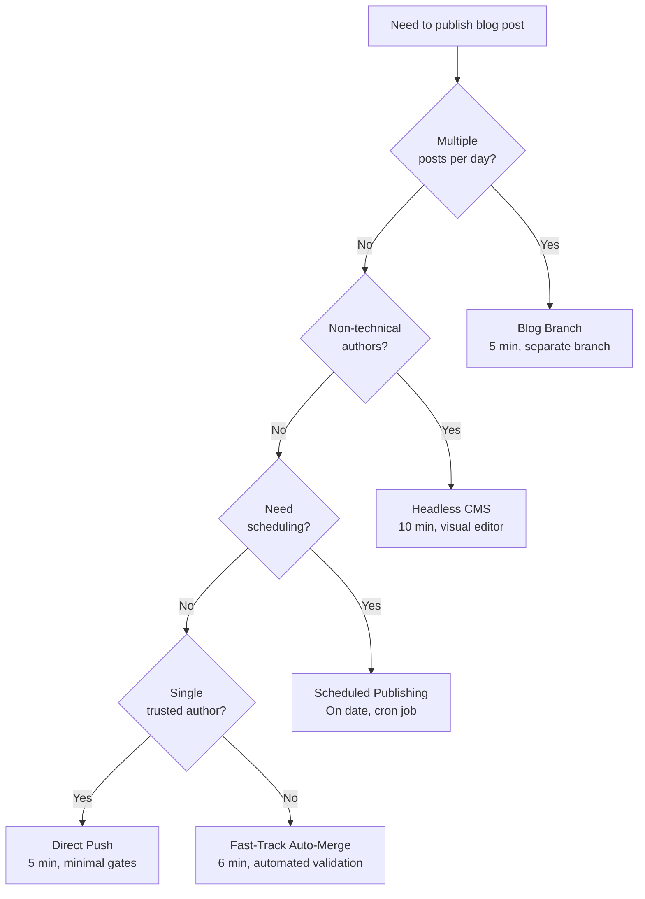

**Standard Git Flow comparison:**

| Phase | Standard Git Flow (code) | Fast-Track (blog posts) |
|-------|--------------------------|-------------------------|
| Branch target | `feature/blog/*` → `develop` → `main` | `feature/blog/*` → `main` |
| Review | Manual on two PRs | Automated `validate_blog_json()` |
| Merge | Manual (two PRs) | Auto-squash via `pascalgn/automerge-action` |
| Total time | 25+ hours | ~6 minutes |

Sources: [.github/workflows/publish-blog.yml:1-38](), [scripts/BLOG_PUBLISHING.md:23-393](), [scripts/create-blog.py:1-10]()

---

## Fast-Track Publishing Pipeline

The following sequence diagram maps the complete fast-track flow from local development to production, labeling each step with the actual script or action involved.

**Fast-Track Blog Publishing: End-to-End Sequence**

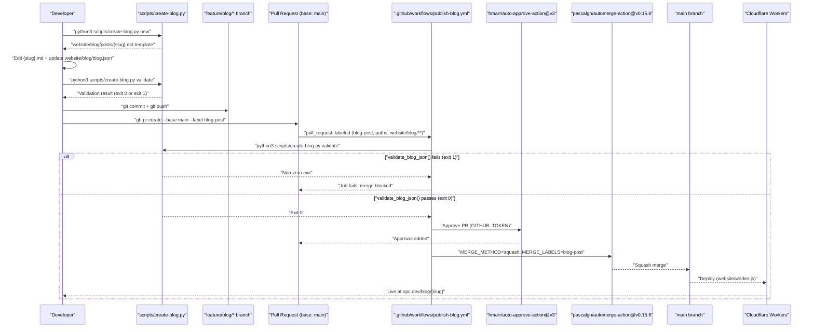

**Timing breakdown:**
- Local steps (`new`, `validate`, `check`): 30–60 minutes (human content time)
- Git operations and PR creation: ~30 seconds
- Automated pipeline (`publish-blog.yml` → deploy): ~6 minutes

Sources: [.github/workflows/publish-blog.yml:1-38](), [scripts/create-blog.py:29-104](), [scripts/BLOG_PUBLISHING.md:27-54]()

---

## Validation System

The CI validation step in `publish-blog.yml` runs `python3 scripts/create-blog.py validate`, which calls `validate_blog_json()` in [scripts/create-blog.py:29-104](). A non-zero exit code blocks the auto-merge. For a full description of all three commands (`validate`, `check`, `new`) and their quality thresholds, see page [5.2]().

**`validate_blog_json()` checks (run in CI):**

| Check | Threshold | Source |
|-------|-----------|--------|
| JSON syntax | Must be valid JSON | [scripts/create-blog.py:34-42]() |
| Required fields | All 14 fields present | [scripts/create-blog.py:53-55]() |
| Markdown file | `posts/{slug}.md` must exist | [scripts/create-blog.py:58-60]() |
| FAQ count | Warning if < 5 | [scripts/create-blog.py:63-65]() |
| Keyword count | Warning if < 10 | [scripts/create-blog.py:68-70]() |
| Citation count | Warning if < 3 | [scripts/create-blog.py:73-75]() |

**`REQUIRED_FIELDS` enforced in `blog.json`** [scripts/create-blog.py:23-27]():

```
slug, title, description, date, dateModified, author,
category, tags, readTime, keywords, image, schema, faq, citations
```

**Validation data flow:**

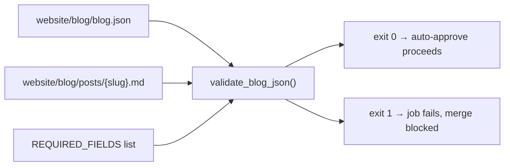

Sources: [scripts/create-blog.py:23-104](), [.github/workflows/publish-blog.yml:21-23]()

---

## `publish-blog.yml` Workflow

The automation is defined in [.github/workflows/publish-blog.yml:1-38](). It contains a single job, `auto-merge`, with four sequential steps.

### Trigger Conditions

All three conditions must be true simultaneously for the job to run [.github/workflows/publish-blog.yml:1-12]():

| Condition | Value |
|-----------|-------|
| Event type | `pull_request: labeled` |
| PR base branch | `main` |
| Changed paths | `website/blog/**` |
| Label name | `blog-post` (checked in `if:` on the job) |

### `auto-merge` Job Steps

**`publish-blog.yml` Job and Step Relationships**

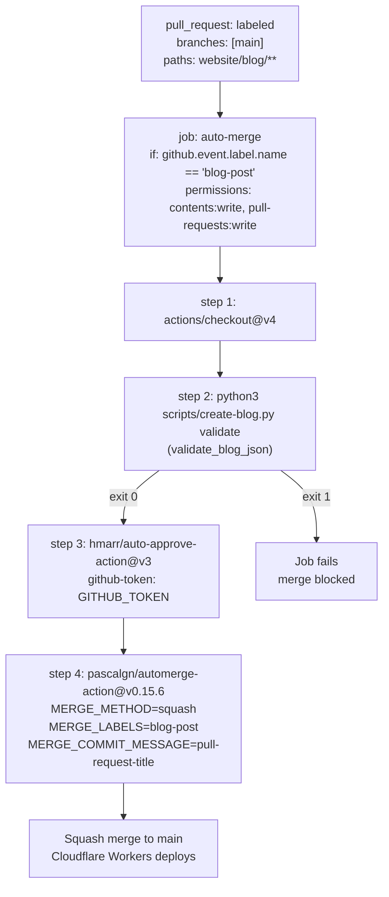

**Step details:**

1. **Checkout** [.github/workflows/publish-blog.yml:19](): `actions/checkout@v4` — checks out the PR branch.
2. **Validate** [.github/workflows/publish-blog.yml:21-23](): `python3 scripts/create-blog.py validate` — calls `validate_blog_json()`; non-zero exit fails the job and blocks merge.
3. **Auto-approve** [.github/workflows/publish-blog.yml:25-28](): `hmarr/auto-approve-action@v3` — adds a programmatic approval using `GITHUB_TOKEN` (`pull-requests: write` permission required).
4. **Auto-merge** [.github/workflows/publish-blog.yml:30-37](): `pascalgn/automerge-action@v0.15.6` — squash merges to `main`; commit message taken from the PR title; only activates for PRs carrying the `blog-post` label.

Sources: [.github/workflows/publish-blog.yml:1-38]()

---

## Local Development Workflow

Developers use `scripts/create-blog.py` locally before pushing. The three commands map directly to phases of the blog authoring lifecycle.

**Local Workflow: Commands and File Targets**

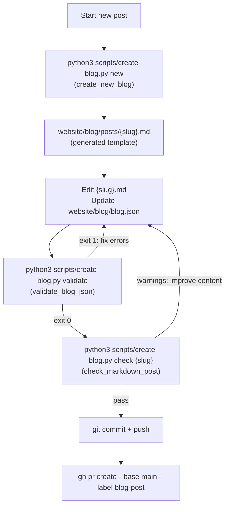

**Command summary:**

| Command | Function called | Output |
|---------|----------------|--------|
| `python3 scripts/create-blog.py new` | `create_new_blog()` | `website/blog/posts/{slug}.md` template |
| `python3 scripts/create-blog.py validate` | `validate_blog_json()` | Errors/warnings for all posts; exit 0 or 1 |
| `python3 scripts/create-blog.py check <slug>` | `check_markdown_post()` | Word count, heading count, link count, FAQ presence |

For full details on each command's checks and thresholds, see page [5.2]().

Sources: [scripts/create-blog.py:1-10](), [scripts/create-blog.py:175-233](), [scripts/BLOG_GUIDELINES.md:17-73]()

---

## Fast-Track Usage

The recommended command sequence to publish a post using the fast-track workflow:

```bash
# 1. Create branch and content
git checkout -b feature/blog/my-post
# Write website/blog/posts/my-post.md
# Add entry to website/blog/blog.json

# 2. Validate locally
python3 scripts/create-blog.py validate
python3 scripts/create-blog.py check my-post

# 3. Push and create PR targeting main (not develop)
git add website/blog/
git commit -m "feat(blog): add my post"
git push -u origin feature/blog/my-post
gh pr create --base main --label blog-post --title "feat(blog): add my post"

# publish-blog.yml triggers, validates, auto-approves, squash merges
# Post is live at opc.dev/blog/my-post in ~6 minutes
```

**Why this bypasses `develop`:** Blog posts contain only files under `website/blog/**`. They carry no code changes that require integration testing on `develop`. The `publish-blog.yml` path filter (`paths: website/blog/**`) enforces this scope. The standard Git Flow for code skill changes is described in page [6.1]().

Sources: [scripts/BLOG_PUBLISHING.md:42-54](), [.github/workflows/publish-blog.yml:7-8]()

---

## Workflow 1: Fast-Track Auto-Merge (Recommended)

The default workflow for publishing blog posts. Creates a PR directly to `main` with the `blog-post` label, triggering automated validation and merge.

**Implementation:** Active GitHub Actions workflow at [.github/workflows/publish-blog.yml:1-38]().

**Fast-Track workflow components:**

| Component | File/Action | Function |
|-----------|-------------|----------|
| Trigger label | `blog-post` | Activates automation when applied to PR |
| CI workflow | [.github/workflows/publish-blog.yml:1-38]() | Orchestrates validation, approval, merge |
| Validator | `validate_blog_json()` at [scripts/create-blog.py:29-104]() | Checks `blog.json` schema, required fields |
| Auto-approver | `hmarr/auto-approve-action@v3` at [.github/workflows/publish-blog.yml:25-28]() | Programmatic PR approval |
| Auto-merger | `pascalgn/automerge-action@v0.15.6` at [.github/workflows/publish-blog.yml:30-37]() | Squash merges to `main` |

**Complete Fast-Track flow:**

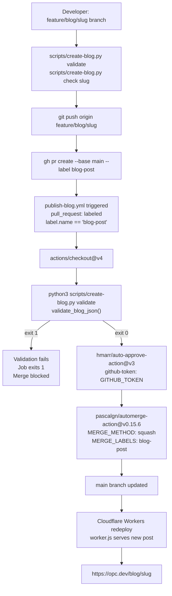

**Usage commands:**

```bash
# 1. Create branch and content
git checkout -b feature/blog/my-post
# Edit website/blog/posts/my-post.md
# Add entry at index 0 in website/blog/blog.json

# 2. Local validation
python3 scripts/create-blog.py validate  # Checks all posts
python3 scripts/create-blog.py check my-post  # Checks specific post

# 3. Create PR to main (NOT develop)
git add website/blog/
git commit -m "feat(blog): add my post"
git push -u origin feature/blog/my-post
gh pr create --base main --label blog-post --title "feat(blog): add my post"

# 4. Wait ~6 minutes for auto-merge and deploy
# Post live at https://opc.dev/blog/my-post
```

**Timing breakdown:**

| Stage | Duration |
|-------|----------|
| Local content creation | 30–60 minutes (human) |
| `python3 scripts/create-blog.py validate` | 1–3 seconds |
| `git push` + PR creation | 10–30 seconds |
| `publish-blog.yml` job (checkout + validate + approve + merge) | 30–60 seconds |
| Cloudflare Workers deployment | 3–5 minutes |
| **Total automated time** | **~6 minutes** |

Sources: [.github/workflows/publish-blog.yml:1-38](), [scripts/BLOG_PUBLISHING.md:27-54](), [scripts/create-blog.py:29-104]()

---

## Workflow 2: Scheduled Publishing

Publishes blog posts on a future date using cron jobs and PR labels. Not currently implemented in `.github/workflows/`, but documented in [scripts/BLOG_PUBLISHING.md:67-153]().

**Conceptual architecture:**

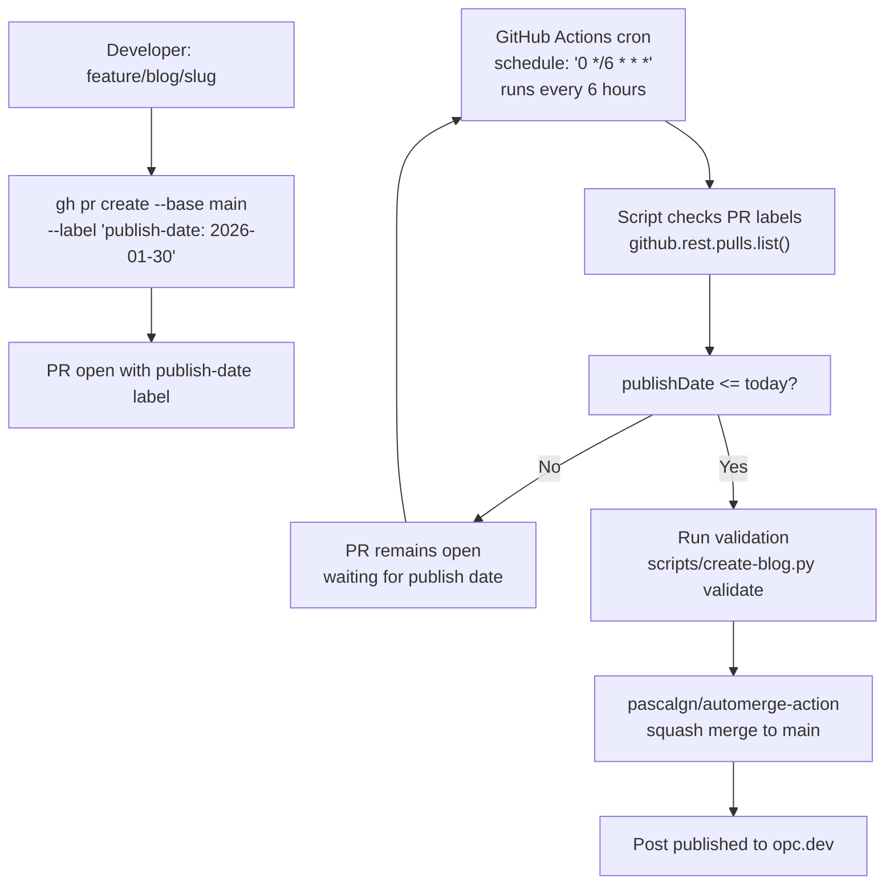

**Implementation requirements (not currently active):**

1. Create `.github/workflows/scheduled-publish.yml` with cron trigger
2. Cron schedule: `0 */6 * * *` (every 6 hours)
3. Script to find PRs with `publish-date:YYYY-MM-DD` labels
4. Date comparison: `publishDate <= today()`
5. On match: run `scripts/create-blog.py validate` → auto-merge

**Usage (if implemented):**

```bash
# Create PR with future publish date
gh pr create --base main \
  --label "publish-date: 2026-01-30" \
  --title "feat(blog): scheduled post for Jan 30"

# Cron job automatically merges on Jan 30, 2026
```

**Benefits:**
- Content calendar planning
- Coordinated multi-post launches
- Automated publishing during off-hours

**Limitations:**
- Requires cron monitoring infrastructure
- 6-hour granularity (cron runs every 6 hours)
- No active implementation in repository

Sources: [scripts/BLOG_PUBLISHING.md:67-153]()

---

## Workflow 3: Separate Blog Branch

Maintains a dedicated `blog` branch that continuously deploys. High-frequency use case (multiple posts per day). Not currently implemented.

**Blog branch architecture:**

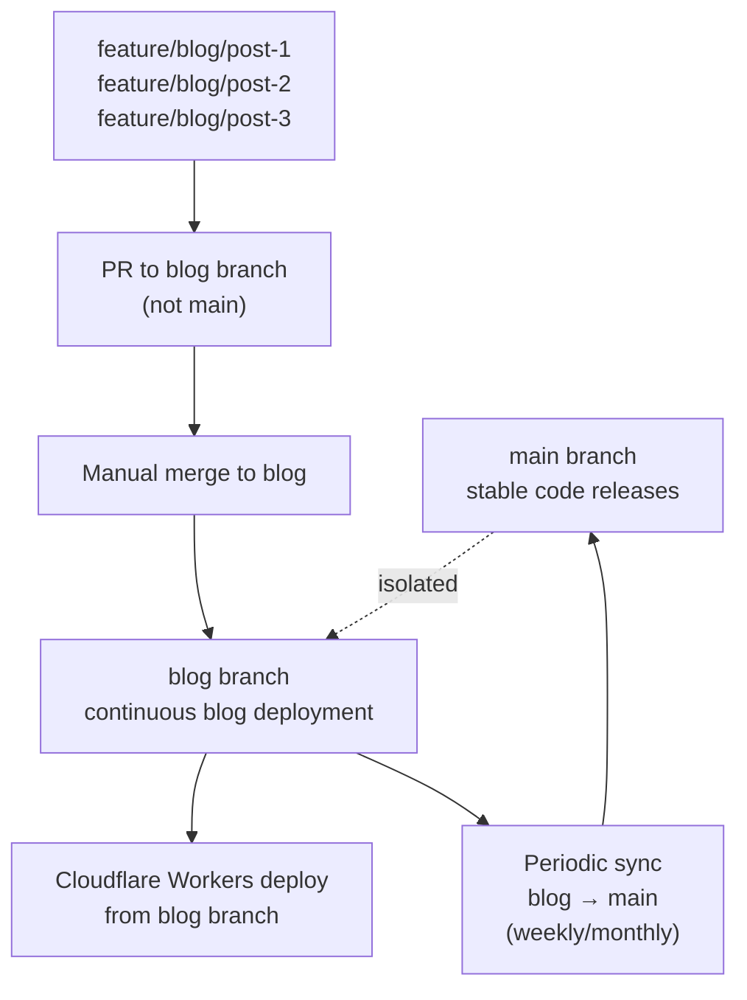

**Implementation requirements (not currently active):**

1. Create `blog` branch from `main`
2. Modify `.github/workflows/deploy-website.yml` to deploy on push to `blog` branch:
   ```yaml
   on:
     push:
       branches: [main, blog]
       paths: ['website/**']
   ```
3. Add validation step for `blog` branch pushes
4. Periodic sync workflow: `blog` → `main` (weekly)

**Usage (if implemented):**

```bash
# Work on blog branch
git checkout blog
git pull origin blog
git checkout -b feature/blog/post-1

# Edit files, commit, push
git add website/blog/
git commit -m "feat(blog): add post 1"
git push -u origin feature/blog/post-1

# PR to blog branch (not main)
gh pr create --base blog --title "feat(blog): add post 1"

# Merge → immediate deploy
# Repeat for multiple posts per day
```

**Benefits:**
- Isolates blog content from code releases
- Faster iteration (no `develop` → `main` flow)
- `blog` branch always production-ready

**Limitations:**
- Requires maintaining two branches (`main`, `blog`)
- Risk of divergence if sync fails
- No automated sync workflow implemented

Sources: [scripts/BLOG_PUBLISHING.md:155-221]()

---

## Workflow 4: Headless CMS Integration

Uses a headless CMS (TinaCMS, Sanity, Contentful) for visual editing. CMS commits to git, webhook triggers deployment. Not currently implemented.

**Headless CMS data flow:**

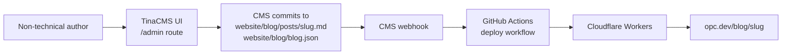

**Recommended CMS: TinaCMS** ([scripts/BLOG_PUBLISHING.md:234-289]()):

| Property | Value |
|----------|-------|
| Complexity | Low (markdown + git workflow) |
| Cost | Free tier available |
| Backend | Git (no separate database) |
| Editing | Visual markdown editor |
| Content structure | Defined in `.tina/config.ts` |

**TinaCMS configuration example** (from [scripts/BLOG_PUBLISHING.md:248-275]()):

```typescript
// .tina/config.ts
import { defineConfig } from "tinacms";

export default defineConfig({
  branch: "main",
  clientId: process.env.TINA_CLIENT_ID,
  token: process.env.TINA_TOKEN,
  build: {
    outputFolder: "admin",
    publicFolder: "website",
  },
  schema: {
    collections: [
      {
        name: "blog",
        label: "Blog Posts",
        path: "website/blog/posts",
        fields: [
          { type: "string", name: "title", label: "Title", required: true },
          { type: "rich-text", name: "body", label: "Body", isBody: true },
          { type: "datetime", name: "date", label: "Date" },
        ],
      },
    ],
  },
});
```

**Implementation requirements (not currently active):**

1. Install TinaCMS: `npm install tinacms @tinacms/cli`
2. Configure `.tina/config.ts` with blog schema
3. Set up TinaCMS Cloud account for authentication
4. Add `TINA_CLIENT_ID` and `TINA_TOKEN` to environment
5. Deploy admin UI at `/admin` route
6. Configure CMS webhook to trigger CI/CD

**Benefits:**
- Non-developers can publish without CLI
- Visual preview before publishing
- Version control via git (same as manual workflow)
- No separate database required

**Limitations:**
- Additional service dependency (TinaCMS Cloud)
- Requires initial setup and configuration
- Usage limits on free tier
- Not implemented in current repository

Sources: [scripts/BLOG_PUBLISHING.md:223-289]()

---

## Workflow 5: Direct Push to Main

Fastest possible publishing (5 minutes). Trusted author pushes directly to `main`, skipping PR process. Validation runs post-push, auto-reverts on failure. Not currently implemented.

**Direct push flow with post-commit validation:**

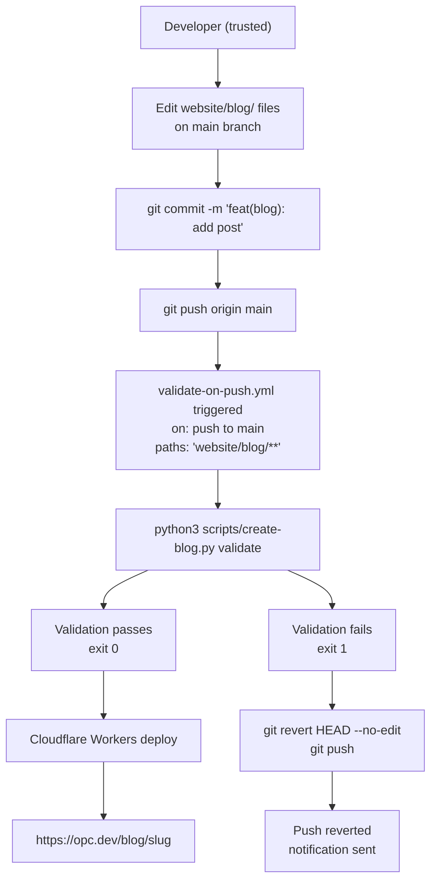

**Implementation requirements (not currently active):**

1. Grant trusted author direct write access to `main` branch
2. Create `.github/workflows/validate-on-push.yml`:
   - Trigger: `push` to `main` with `paths: website/blog/**`
   - Run: `python3 scripts/create-blog.py validate`
   - On failure: `git revert HEAD --no-edit && git push`
3. Configure branch protection to allow force push for revert action
4. Set up notifications for validation failures

**Usage (if implemented):**

```bash
# Work directly on main branch
git checkout main
git pull origin main

# Create post
echo "# My Post" > website/blog/posts/my-post.md
# Edit website/blog/blog.json

# Push directly (no PR)
git add website/blog/
git commit -m "feat(blog): add my post"
git push origin main

# Live in 5 minutes (or reverted if invalid)
```

**Benefits:**
- Fastest possible publishing (5 minutes)
- No PR overhead
- Minimal process friction

**Limitations:**
- No pre-merge review
- Risk of breaking `main` branch
- Requires high trust in author
- Auto-revert may cause confusion
- Not recommended for teams

Sources: [scripts/BLOG_PUBLISHING.md:291-350]()

---

---

## Workflow Comparison Matrix

**Publishing workflow trade-offs:**

| Factor | Fast-Track | Scheduled | Blog Branch | Headless CMS | Direct Push |
|--------|------------|-----------|-------------|--------------|-------------|
| **Time to live** | 6 min | On scheduled date | 5 min | 10 min | 5 min |
| **PR required** | Yes | Yes | Yes | No (CMS commits) | No |
| **Review process** | Automated `validate_blog_json()` | Automated validation | Manual merge | CMS preview | Post-push validation |
| **Git Flow compliance** | Partial (skips `develop`) | Partial | Separate branch | Full | Bypasses PRs |
| **Rollback mechanism** | Git revert PR | Git revert PR | Git revert on `blog` | Git revert commit | Auto-revert on fail |
| **CI/CD workflow file** | [.github/workflows/publish-blog.yml:1-38]() | Not implemented | Not implemented | Not implemented | Not implemented |
| **Best for** | All users (default) | Content calendars | High frequency (5+/day) | Non-technical authors | Single trusted author |
| **Risk level** | Low | Low | Medium (branch divergence) | Medium (external dependency) | High (no pre-merge checks) |

**Active vs. documented workflows:**

| Workflow | Status | Documentation | Implementation |
|----------|--------|---------------|----------------|
| Fast-Track Auto-Merge | ✅ **Active** | [scripts/BLOG_PUBLISHING.md:27-54]() | [.github/workflows/publish-blog.yml:1-38]() |
| Scheduled Publishing | 📄 Documented only | [scripts/BLOG_PUBLISHING.md:67-153]() | Not implemented |
| Blog Branch | 📄 Documented only | [scripts/BLOG_PUBLISHING.md:155-221]() | Not implemented |
| Headless CMS | 📄 Documented only | [scripts/BLOG_PUBLISHING.md:223-289]() | Not implemented |
| Direct Push to Main | 📄 Documented only | [scripts/BLOG_PUBLISHING.md:291-350]() | Not implemented |

Sources: [scripts/BLOG_PUBLISHING.md:352-393](), [.github/workflows/publish-blog.yml:1-38]()

---

## Content Quality Guidelines

Content quality thresholds are enforced by `validate_blog_json()` (warnings) and `check_markdown_post()` (soft warnings). See page [5.2]() for the full breakdown. Key thresholds from [scripts/BLOG_GUIDELINES.md:75-98]():

| Metric | Minimum | Recommended | Checked By |
|--------|---------|-------------|------------|
| Word count | 2,000 | 2,500–4,000 | `check_markdown_post()` at [scripts/create-blog.py:106-173]() |
| Keywords in `blog.json` | 10 | 15+ | `validate_blog_json()` at [scripts/create-blog.py:68-70]() |
| FAQ entries in `blog.json` | 5 | 5–10 | `validate_blog_json()` at [scripts/create-blog.py:63-65]() |
| External citations in `blog.json` | 3 | 3–6 | `validate_blog_json()` at [scripts/create-blog.py:73-75]() |
| Internal links in `.md` | 3 | 3–5 | `check_markdown_post()` at [scripts/create-blog.py:150-153]() |
| H2 sections in `.md` | 5 | 8–12 | `check_markdown_post()` at [scripts/create-blog.py:128-139]() |

All posts require a `schema` field in `blog.json` containing schema.org JSON-LD. The `@type` varies by content: `BlogPosting` for standard posts, `HowTo` for tutorials, `Article` for case studies.

Sources: [scripts/BLOG_GUIDELINES.md:75-156](), [scripts/create-blog.py:29-104](), [scripts/create-blog.py:106-173]()

---

## File Structure Reference

```
opc-skills/
├── .github/workflows/
│   └── publish-blog.yml              # Fast-Track auto-merge workflow
│
├── scripts/
│   ├── create-blog.py                # validate_blog_json / check_markdown_post / create_new_blog
│   ├── BLOG_GUIDELINES.md            # Content quality standards
│   └── BLOG_PUBLISHING.md            # Workflow options documentation
│
└── website/blog/
    ├── blog.json                     # Post metadata registry (REQUIRED_FIELDS enforced)
    └── posts/
        ├── {slug}.md                 # Markdown content files
        ├── archive-skill-session-knowledge.md
        ├── seo-geo-1k-installs-milestone.md
        ├── install-opc-skills-claude-code.md
        ├── free-ai-infrastructure-deepseek-jan.md
        ├── ralph-autonomous-agent-loop.md
        ├── convert-docs-to-skills-guide.md
        └── why-skills-beat-docs.md
```

**Key file paths:**
- Workflow: [.github/workflows/publish-blog.yml:1-38]()
- Validation script: [scripts/create-blog.py:1-264]()
- Metadata registry: [website/blog/blog.json:1-567]()
- Content directory: `website/blog/posts/`

Sources: [.github/workflows/publish-blog.yml:1](), [scripts/create-blog.py:1](), [website/blog/blog.json:1]()

---

## Error Handling

### Validation Errors That Block Merge

The `publish-blog.yml` validation step fails (non-zero exit) on hard errors in `validate_blog_json()`. Warnings do not fail the job.

| Error message | Cause | Fix |
|---------------|-------|-----|
| `blog.json is invalid JSON: ...` | JSON syntax error | Check trailing commas, missing quotes [scripts/create-blog.py:34-42]() |
| `Post 'slug' missing fields: ...` | Required field absent | Add missing fields from `REQUIRED_FIELDS` [scripts/create-blog.py:53-55]() |
| `Post 'slug' has no markdown file` | `posts/{slug}.md` absent | Create the markdown file [scripts/create-blog.py:58-60]() |

### Warnings (Do Not Block Merge)

| Warning | Threshold | Recommendation |
|---------|-----------|----------------|
| `Only X FAQs` | < 5 | Add FAQs for GEO optimization |
| `Only X keywords` | < 10 | Add keywords for SEO |
| `Only X citations` | < 3 | Add citations for authority |

### Debugging the CI Run

```bash
# Re-run validation locally to reproduce CI failure
python3 scripts/create-blog.py validate

# Check specific post content issues
python3 scripts/create-blog.py check <slug>

# View GitHub Actions run history for this workflow
gh run list --workflow=publish-blog.yml
gh run view <run-id>
```

Sources: [scripts/create-blog.py:29-104](), [.github/workflows/publish-blog.yml:21-23]()

---

## Timing Summary

**Standard Git Flow vs. all publishing workflows:**

| Stage | Standard Git Flow (code) | Fast-Track | Scheduled | Blog Branch | Headless CMS | Direct Push |
|-------|--------------------------|------------|-----------|-------------|--------------|-------------|
| Branch creation | 1 min | 1 min | 1 min | 1 min | N/A | N/A |
| Local validation | Varies | 3 sec | 3 sec | 3 sec | CMS handles | 3 sec |
| PR creation | 1 min | 30 sec | 30 sec | 30 sec | N/A | N/A |
| PR to `develop` review | 4–8 hours | N/A (skipped) | N/A | N/A | N/A | N/A |
| PR to `main` review | 4–8 hours | 30 sec (auto) | Wait for date | 30 sec | N/A | N/A |
| Validation | Manual | 30 sec (CI) | 30 sec (CI) | 30 sec (CI) | CMS preview | 30 sec (post-push) |
| Merge | Manual | Auto-squash | Auto-squash | Manual | Auto-commit | Direct push |
| Deployment | 5 min | 5 min | 5 min | 5 min | 5 min | 5 min |
| **Total time** | **~25 hours** | **~6 min** | **On schedule** | **~5 min** | **~10 min** | **~5 min** |

**Time to live comparison:**

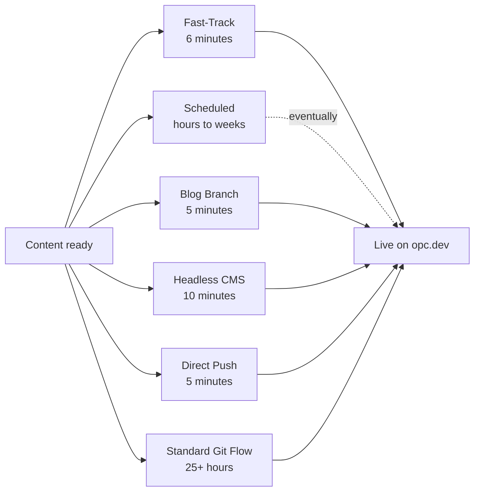

Sources: [scripts/BLOG_PUBLISHING.md:407-434](), [.github/workflows/publish-blog.yml:1-38]()

---

## Integration with Website Deployment

After auto-merge to `main`, the standard website deployment workflow takes over:

1. **Merge triggers**: Push to `main` branch in `website/**` paths
2. **Cloudflare Workers deploy**: Automatic via existing deployment workflow
3. **Blog rendering**: Website fetches `blog.json` and markdown files
4. **Live availability**: `https://opc.dev/blog/{slug}` accessible in ~5 minutes

For details on website deployment and blog rendering, see [Website Architecture](#4.1).

Sources: [scripts/BLOG_PUBLISHING.md:18-20]()

---

