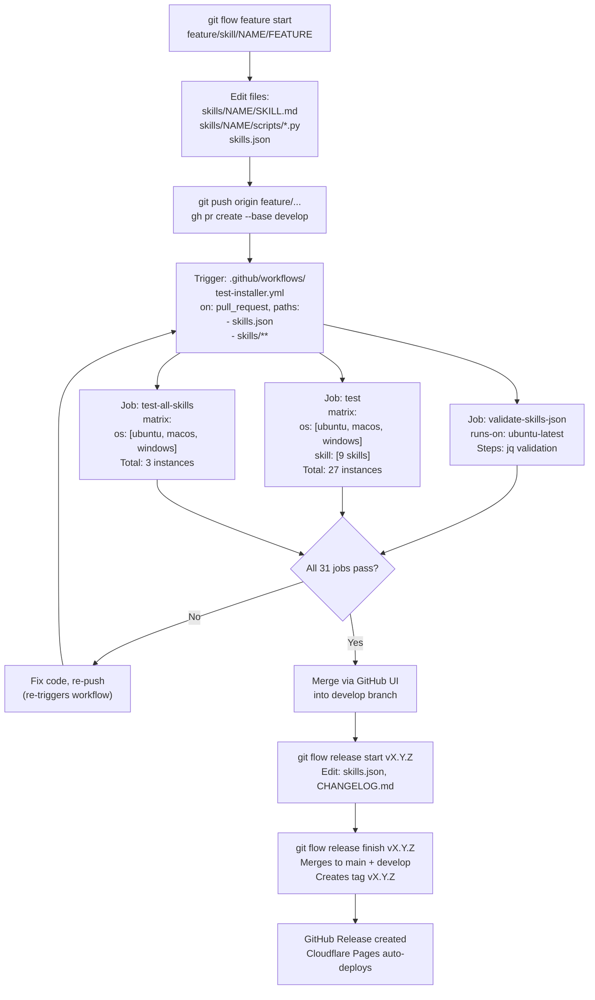
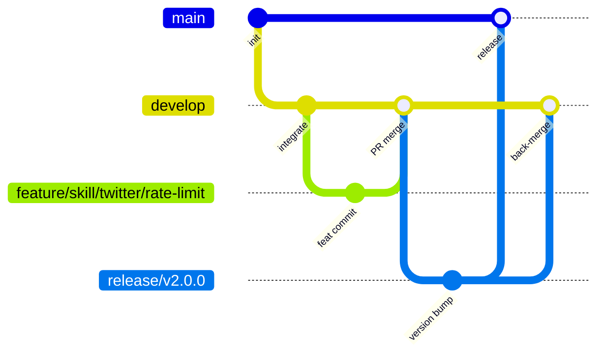
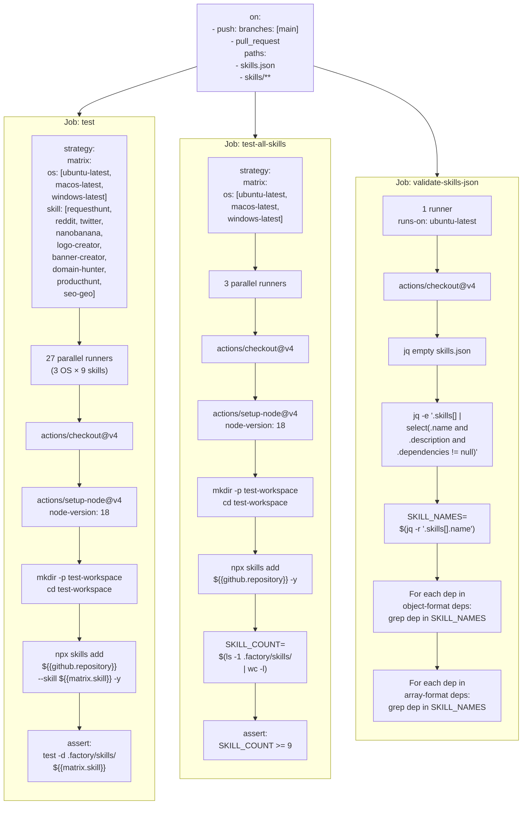
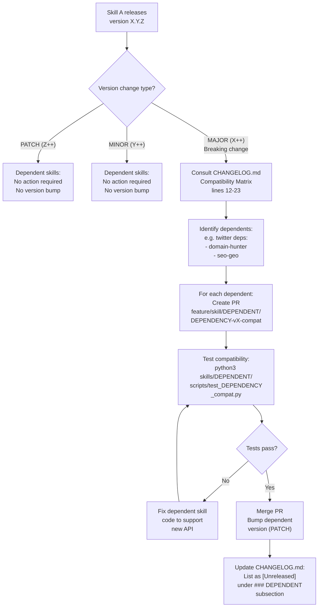

<!-- source: DeepWiki mcp.deepwiki.com · repo ReScienceLab/opc-skills · page 6 Development & CI/CD · fetched 2026-10-26 -->

# Development & CI/CD

<details>
<summary>Relevant source files</summary>

The following files were used as context for generating this wiki page:

- [.factory/AGENTS.md](.factory/AGENTS.md)
- [.gitattributes](.gitattributes)
- [.github/workflows/test-installer.yml](.github/workflows/test-installer.yml)
- [CHANGELOG.md](CHANGELOG.md)
- [template/SKILL.md](template/SKILL.md)
- [website/blog/posts/why-skills-beat-docs.md](website/blog/posts/why-skills-beat-docs.md)

</details>


This page provides an overview of the development workflow, automated testing pipeline, and release management practices for the OPC Skills project. It covers the full lifecycle of a change — from branching through CI validation to release.

For detailed information on each subsystem, see the child pages:
- Git branching rules and commit conventions: [Git Workflow & Branching Strategy](#6.1)
- The `test-installer.yml` workflow and its test matrix: [Automated Testing Pipeline](#6.2)
- Pre-commit hooks and the add-new-skill checklist: [Pre-commit Hooks & Quality Gates](#6.3)
- Version bumping rules and CHANGELOG maintenance: [Release Management](#6.4)

For information about the blog publishing automation (a separate CI workflow), see [Blog Publishing Workflows](#5.3).

---

## System Overview

The development lifecycle is organized around four interlocking concerns: branch discipline, automated CI checks, per-PR quality gates, and versioned releases. The diagram below maps the change flow from local feature branch to production release, showing actual file paths and CI job names.

**Diagram: Change Lifecycle from Branch to Production**



**Key File Locations in Change Flow:**

| Stage | Files Modified | Validation |
|-------|---------------|------------|
| Development | `skills/NAME/SKILL.md`, `skills/NAME/scripts/`, `skills.json` | Local: `npm run lint`, `npm run typecheck` |
| PR Creation | Branch pushed to `origin/feature/skill/NAME/FEATURE` | Automatic: `test-installer.yml` triggered |
| CI Validation | `.github/workflows/test-installer.yml` runs 31 jobs | Matrix: 3 OS × (9 skills + 1 bulk test) + 1 JSON validator |
| Release Prep | `release/vX.Y.Z` branch: bump versions in `skills.json`, `CHANGELOG.md` | Manual review |
| Production | Merge to `main`, tag `vX.Y.Z`, deploy to `opc.dev` | Cloudflare Pages auto-build |

Sources: [.github/workflows/test-installer.yml:1-20](), [.factory/AGENTS.md:166-218](), [.factory/AGENTS.md:311-328]()

---

## Key Components

| Component | Location | Role |
|---|---|---|
| `test-installer.yml` | `.github/workflows/test-installer.yml` | CI workflow: installs skills and validates `skills.json` |
| `skills.json` | `skills.json` | Central registry; version source of truth for all skills |
| `CHANGELOG.md` | `CHANGELOG.md` | Human-readable release notes and skill compatibility matrix |
| `AGENTS.md` | `.factory/AGENTS.md` | Agent-readable developer guide for git flow and release process |
| `hooks.json` | `.factory/hooks.json` | Pre-commit hook definitions |
| `template/SKILL.md` | `template/SKILL.md` | Template for new skill documentation |

Sources: [.factory/AGENTS.md:16-32](), [.github/workflows/test-installer.yml:1-20]()

---

## Git Workflow Summary

The project uses **Git Flow** branching. Branches follow strict naming conventions, and feature branches always merge to `develop` via a GitHub Pull Request — direct merges are not allowed.

**Diagram: Branch Topology and Merge Rules**



**Branch naming convention:**

| Branch Type | Pattern | Example |
|---|---|---|
| Feature | `feature/skill/<name>/<feature>` | `feature/skill/domain-hunter/promo-code-scraper` |
| Bug fix | `fix/skill/<name>/<issue>` | `fix/skill/requesthunt/reddit-pagination` |
| Release | `release/vX.Y.Z` | `release/v2.0.0` |
| Hotfix | `hotfix/vX.Y.Z` | `hotfix/v1.0.1` |

Commit messages use conventional commit format: `feat(skill-name): description`, `fix(skill-name): description`, `docs(skill-name): description`, `chore(skills): description`. Watermarks or AI-generated signatures in commit messages are explicitly prohibited ([.factory/AGENTS.md:250]()).

For full details, see [Git Workflow & Branching Strategy](#6.1).

Sources: [.factory/AGENTS.md:166-248]()

---

## Automated CI Pipeline Summary

The workflow defined in `.github/workflows/test-installer.yml` ([.github/workflows/test-installer.yml:1-118]()) triggers on `push` to `main` or `pull_request` events that modify `skills.json` or any path under `skills/**` ([.github/workflows/test-installer.yml:4-12]()).

It runs three parallel jobs totaling 31 concurrent GitHub Actions runners:

**Diagram: test-installer.yml Job Architecture**



**Job-Specific Details:**

| Job Name | Runners | Matrix Dimensions | Key Command | Success Criteria |
|----------|---------|-------------------|-------------|------------------|
| `test` | 27 | `os` × `skill` = 3 × 9 | `npx skills add --skill ${{matrix.skill}} -y` | Directory `.factory/skills/${{matrix.skill}}/` exists |
| `test-all-skills` | 3 | `os` = 3 | `npx skills add ${{github.repository}} -y` | `ls -1 .factory/skills/ \| wc -l` returns ≥ 9 |
| `validate-skills-json` | 1 | None | `jq empty skills.json` | JSON valid + all deps reference existing skills |

**Path Triggers:**

The workflow only runs when changes touch:
- `skills.json` (line 7)
- `skills/**` (line 8)

This avoids unnecessary CI runs for website-only changes (`website/`, `blog/`) or documentation updates (`README.md`, `CHANGELOG.md`).

**Node.js Setup:**

All jobs use `actions/setup-node@v4` with `node-version: '18'` ([.github/workflows/test-installer.yml:27-28](), [.github/workflows/test-installer.yml:59-61]()), as `npx skills add` requires Node.js runtime.

For full details on each job's implementation, see [Automated Testing Pipeline](#6.2).

Sources: [.github/workflows/test-installer.yml:1-118]()

---

## Quality Gates Summary

Before any PR is merged, the following checks must pass ([.factory/AGENTS.md:311-328]()):

**Automated Checks (CI):**
- All 31 GitHub Actions jobs in `test-installer.yml` pass (27 skill tests + 3 bulk tests + 1 JSON validator)
- `npx skills add` successfully installs skill to `.factory/skills/SKILL_NAME/` on ubuntu, macos, windows
- `jq` validation confirms `skills.json` structure and dependency references

**Manual Review Checks:**
- `npm run test` (website) passes without errors
- `npm run typecheck` (website TypeScript validation) shows no errors
- `npm run lint` (website ESLint) passes
- `SKILL.md` has valid YAML frontmatter with required fields:
  - `name`: string (kebab-case identifier)
  - `description`: string (includes "Use when..." trigger contexts inline)
- `skills.json` version field updated if functionality changed (see [Release Management](#6.4))
- `CHANGELOG.md` entry added under `[Unreleased]` section (skill-specific subsection)
- New dependencies declared in `SKILL.md` frontmatter and listed in `skills.json`
- PR description references issue number using closing keywords (`Fixes #123`, `Closes #124`)

**Pre-commit Hooks:**

Git hooks are defined in `.factory/hooks.json`. The `PreCommit` hook enforces:
- Block commits with `factory-droid[bot]` in co-author field (prevents bot attribution pollution)

**New Skill Checklist:**

When adding a new skill, the `.factory/skills/add-new-opc-skill/SKILL.md` checklist requires six file updates:

| File | Required Change | Example |
|------|----------------|---------|
| `skills/NAME/SKILL.md` | Create with YAML frontmatter (`name`, `description`) | [template/SKILL.md:1-10]() |
| `skill-logos/NAME.svg` | Add vector logo | Generated via `logo-creator` skill |
| `skills.json` | Add skill entry with name, version, dependencies, install commands | [CHANGELOG.md:12-23]() shows structure |
| `README.md` | Add row to skills table | Main repository README skills listing |
| `website/worker.js` | Hardcode skill metadata in `SKILLS_CATALOG` object | For opc.dev rendering |
| `CHANGELOG.md` | Add entry under `[Unreleased]` with skill subsection | [CHANGELOG.md:33-36]() shows format |

For full details on pre-commit hooks and the add-new-skill workflow, see [Pre-commit Hooks & Quality Gates](#6.3).

Sources: [.factory/AGENTS.md:311-328](), [template/SKILL.md:1-130](), [CHANGELOG.md:8-24]()

---

## Release Management Summary

Skills maintain independent version numbers in `skills.json` ([CHANGELOG.md:12-23]()). Each skill follows Semantic Versioning (MAJOR.MINOR.PATCH):

| Change Type | Version Bump | Example | Update `skills.json`? |
|-------------|--------------|---------|----------------------|
| Breaking API change | MAJOR | `1.0.0 → 2.0.0` | Yes |
| New backward-compatible feature | MINOR | `1.0.0 → 1.1.0` | Yes |
| Bug fix | PATCH | `1.0.0 → 1.0.1` | Yes |
| Documentation-only | None | — | No |
| Internal refactor (no behavior change) | None | — | No |

**Release Paths:**

Two release strategies are supported, depending on coordination needs:

**1. Quick Release (Single Skill):**

```bash
# Feature branch merged to develop
git checkout develop
git pull origin develop
git checkout -b feature/skill/twitter/rate-limit-improvement

# Edit files
vim skills/twitter/scripts/rate_limit.py
vim skills.json  # Bump twitter.version: "1.1.0"
vim CHANGELOG.md # Add entry under [Unreleased] > ### twitter > #### [1.1.0]

# Commit and PR
git commit -m "feat(twitter): Add retry mechanism for rate limiting"
git push -u origin feature/skill/twitter/rate-limit-improvement
gh pr create --base develop

# After merge, no release branch needed for independent skill version
```

**2. Coordinated Release (Multiple Skills):**

```bash
# All feature branches merged to develop first
git checkout develop
git pull origin develop
git flow release start v2.0.0

# Bump multiple skill versions in skills.json
vim skills.json  # Update: twitter 2.0.0, reddit 1.1.0, domain-hunter 1.1.0

# Reorganize CHANGELOG.md: move [Unreleased] entries to [2.0.0] section
vim CHANGELOG.md

# Create release PR to main
git push -u origin release/v2.0.0
gh pr create --base main --head release/v2.0.0

# After merge
git flow release finish v2.0.0  # Merges to main, tags, back-merges to develop
git push origin main develop --tags
```

**Dependency Update Decision Flow:**

When a dependency skill releases an update, downstream dependents follow this decision tree:

**Diagram: Dependency Update Decision Flow**



**Compatibility Matrix Usage:**

The `CHANGELOG.md` file contains a dependency matrix ([CHANGELOG.md:8-23]()):

```
| Skill           | Current Version | Requires       | Min Versions                  |
|-----------------|-----------------|----------------|-------------------------------|
| domain-hunter   | 1.0.0           | twitter, reddit| twitter ≥1.0.0, reddit ≥1.0.0 |
| logo-creator    | 1.0.0           | nanobanana     | nanobanana ≥1.0.0             |
| seo-geo         | 1.0.0           | twitter, reddit| twitter ≥1.0.0, reddit ≥1.0.0 |
```

When updating `twitter` to `2.0.0` (breaking change), you must:
1. Identify dependents: `domain-hunter`, `seo-geo` (from matrix)
2. Create compatibility PRs: `feature/skill/domain-hunter/twitter-v2-compat`, `feature/skill/seo-geo/twitter-v2-compat`
3. Update matrix minimum version requirements: `twitter ≥2.0.0`
4. Test each dependent independently before merging

**Version Update Rules:**

| Scenario | Action Required | Version Bump Needed? |
|----------|----------------|----------------------|
| Dependency releases PATCH | Dependent: no action | No |
| Dependency releases MINOR | Dependent: no action | No |
| Dependency releases MAJOR | Dependent: create compat PR | Yes (PATCH or MINOR) |
| Dependent wants to document new dependency version support | Update `CHANGELOG.md` matrix only | No |

For full release workflow details, see [Release Management](#6.4).

Sources: [.factory/AGENTS.md:349-508](), [CHANGELOG.md:1-23](), [CHANGELOG.md:112-167]()

---

## Developer Quick Reference

```
# First-time setup
git clone https://github.com/ReScienceLab/opc-skills
cd opc-skills
npm install
git flow init

# Start a new skill feature
git flow feature start skill/<name>/<feature>

# Push and open PR (never use git flow feature finish)
git push -u origin feature/skill/<name>/<feature>
gh pr create --base develop --head feature/skill/<name>/<feature>

# Start a release
git flow release start vX.Y.Z
git flow release finish vX.Y.Z
git push origin main develop --tags
```

Sources: [.factory/AGENTS.md:573-616]()

---

