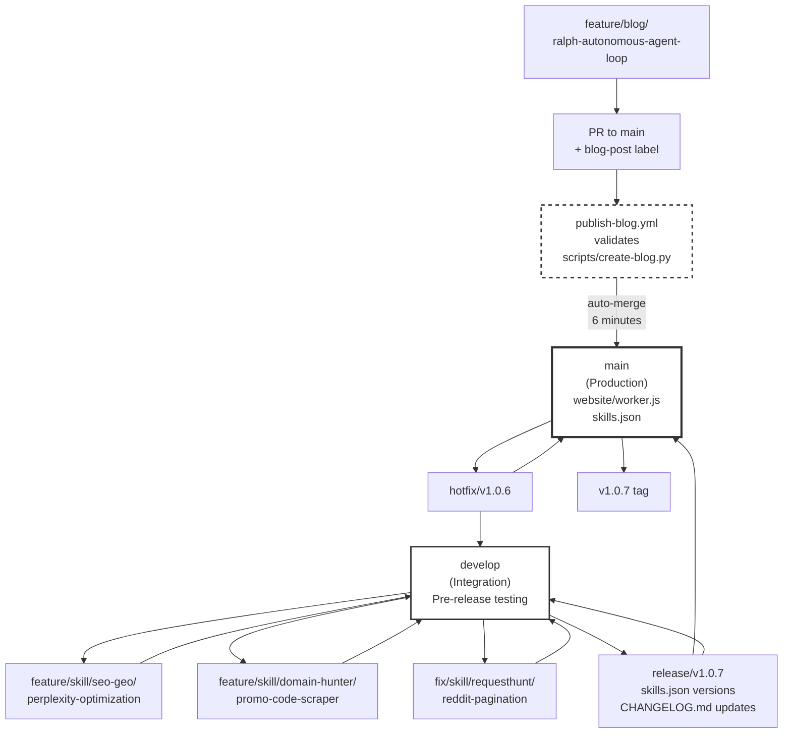
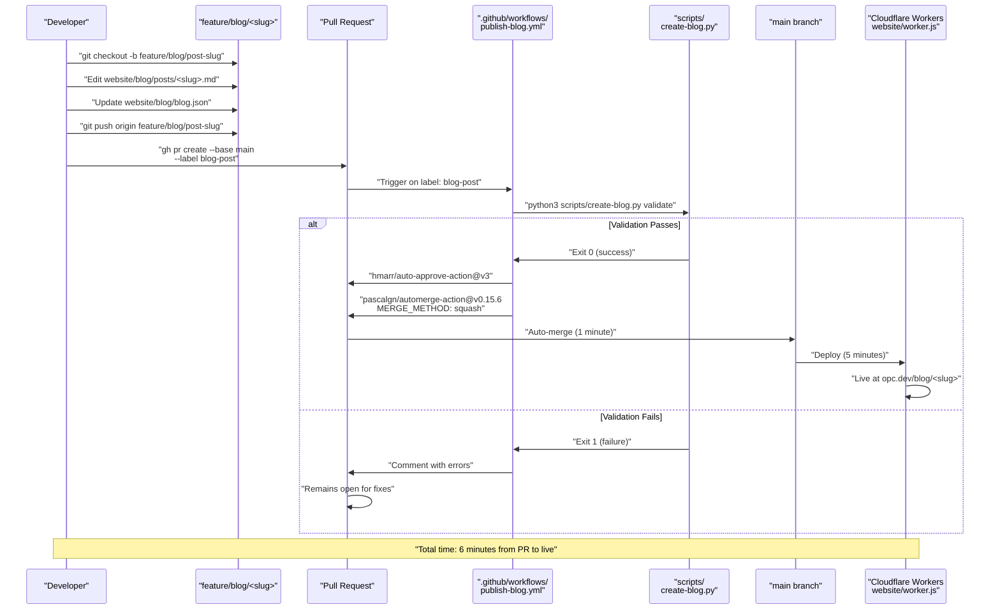
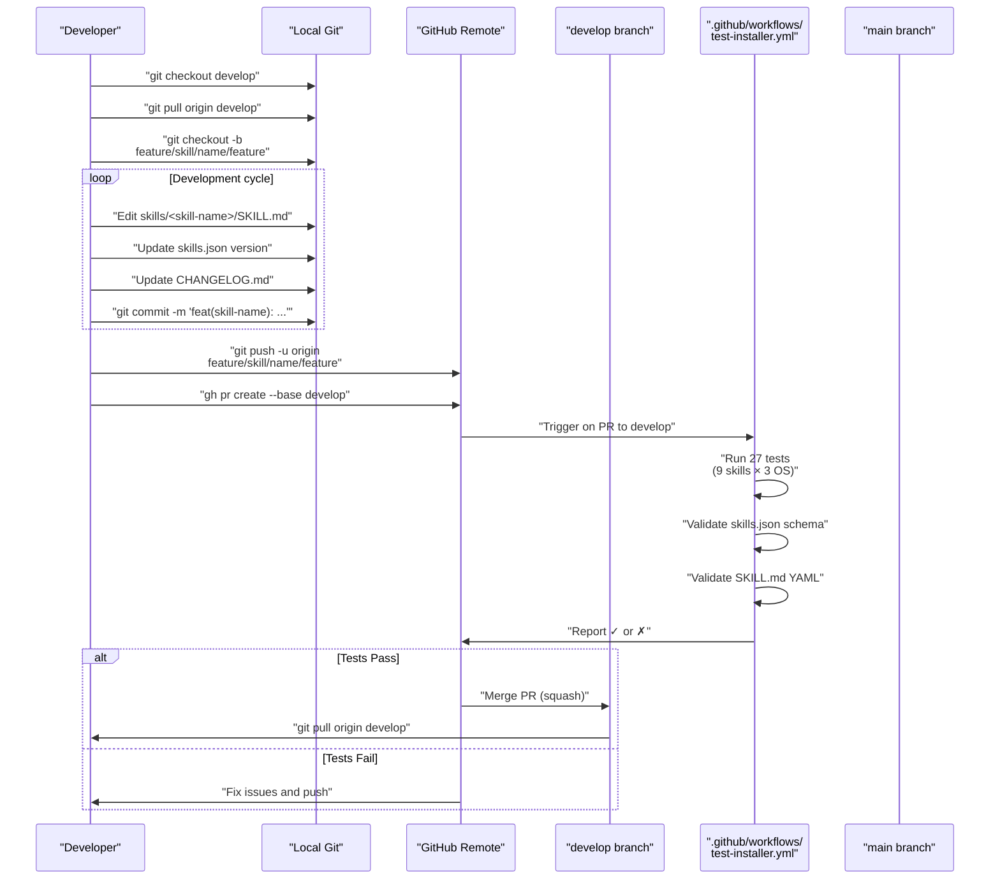
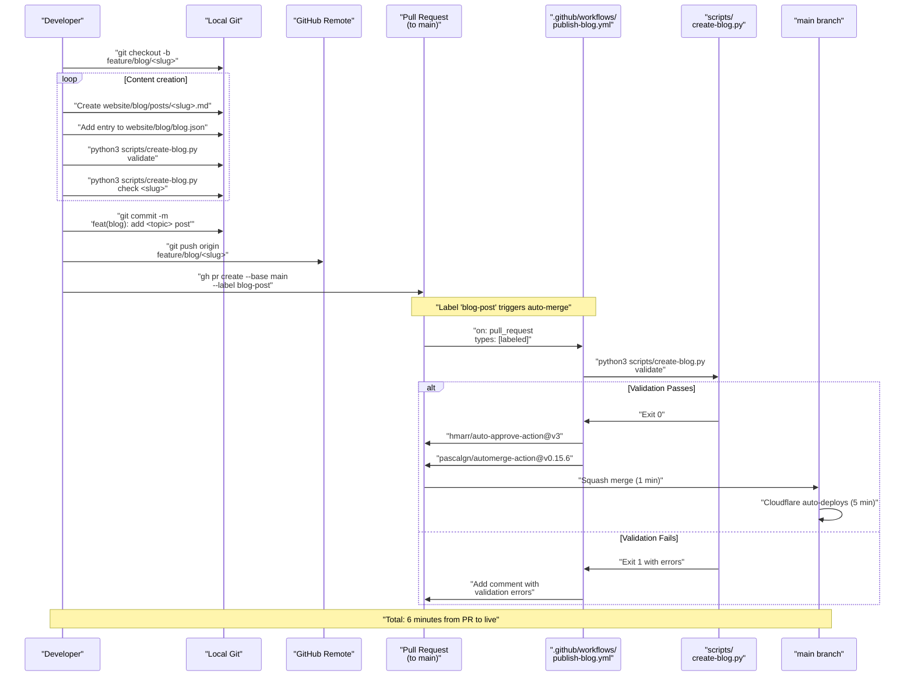
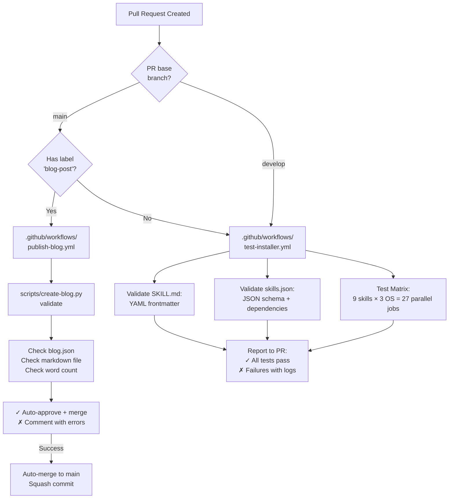
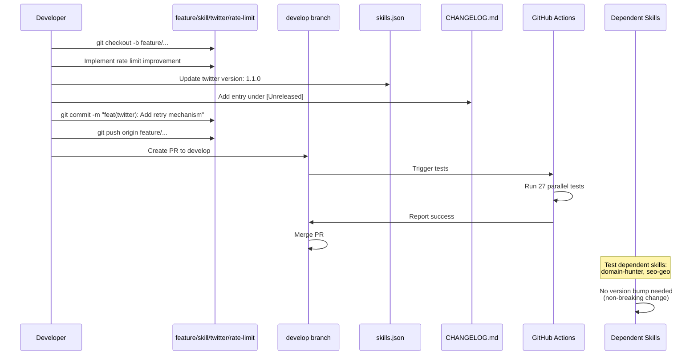
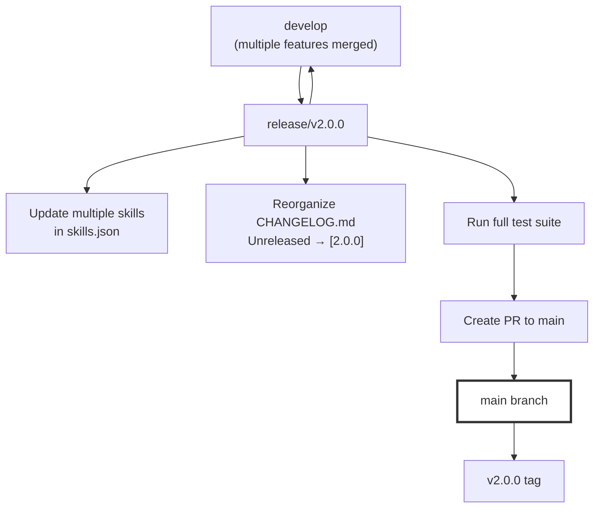
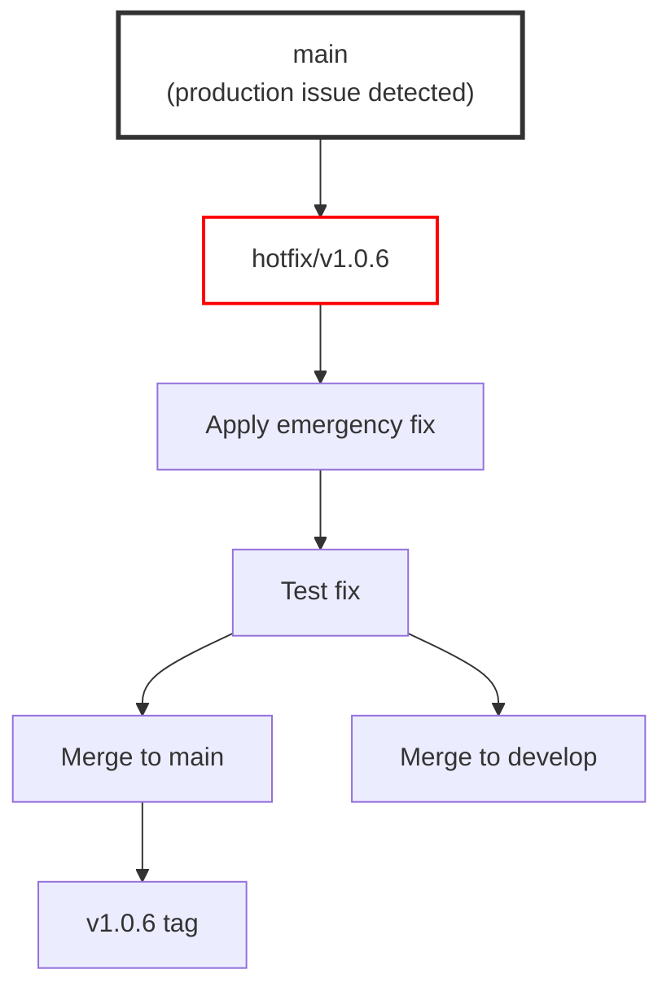

<!-- source: DeepWiki mcp.deepwiki.com · repo ReScienceLab/opc-skills · page 6.1 Git Workflow & Branching Strategy · fetched 2026-10-26 -->

# Git Workflow & Branching Strategy

<details>
<summary>Relevant source files</summary>

The following files were used as context for generating this wiki page:

- [.factory/AGENTS.md](.factory/AGENTS.md)
- [.github/workflows/publish-blog.yml](.github/workflows/publish-blog.yml)
- [CHANGELOG.md](CHANGELOG.md)
- [scripts/BLOG_GUIDELINES.md](scripts/BLOG_GUIDELINES.md)
- [scripts/BLOG_PUBLISHING.md](scripts/BLOG_PUBLISHING.md)
- [scripts/create-blog.py](scripts/create-blog.py)
- [template/SKILL.md](template/SKILL.md)
- [website/blog/posts/ralph-autonomous-agent-loop.md](website/blog/posts/ralph-autonomous-agent-loop.md)
- [website/blog/posts/why-skills-beat-docs.md](website/blog/posts/why-skills-beat-docs.md)

</details>


## Purpose and Scope

This document describes the Git Flow branching model, branch naming conventions, commit standards, and release processes used in the OPC Skills repository. It covers the complete development workflow from feature creation to production deployment.

For information about automated testing during the CI/CD pipeline, see [Automated Testing Pipeline](#6.2). For pre-commit validation rules, see [Pre-commit Hooks & Quality Gates](#6.3). For coordinating releases across multiple skills, see [Release Management](#6.4).

---

## Branching Model Overview

The repository implements **Git Flow** with a critical exception: blog posts follow a fast-track pathway directly to `main`, bypassing `develop` for rapid content publishing. This dual-pathway approach balances code stability (Git Flow for skills) with content agility (fast-track for blog).

### Primary Branch Structure

**Title: Complete Git Flow with Blog Fast-Track Pathway**



**Sources:** [.factory/AGENTS.md:166-219](), [scripts/BLOG_PUBLISHING.md:1-443](), [.github/workflows/publish-blog.yml:1-38]()

### Permanent Branches

| Branch | Purpose | Protected | Deployment Target |
|--------|---------|-----------|-------------------|
| `main` | Production-ready code, tagged releases | Yes | opc.dev production (Cloudflare Workers via `website/worker.js`) |
| `develop` | Integration branch for next release | Yes | No automatic deployment |

**Key Differences:**
- **Skills and code changes**: Must follow develop → main flow
- **Blog posts**: Can go directly to main via fast-track workflow (`.github/workflows/publish-blog.yml`)
- **Infrastructure changes**: Follow develop → main flow
- **Hotfixes**: Branch from main, merge to both main and develop

**Sources:** [.factory/AGENTS.md:172-174](), [scripts/BLOG_PUBLISHING.md:25-55]()
</thinking>

### Fast-Track Blog Publishing Pathway

Blog posts bypass the standard Git Flow to enable rapid content publishing. This pathway is explicitly designed for non-code content updates.

**Title: Blog Fast-Track Workflow with Auto-Merge**



**Validation Rules** (enforced by `scripts/create-blog.py`):
- All required fields present in `blog.json` entry
- Markdown file exists at `website/blog/posts/<slug>.md`
- Minimum 5 FAQ items (recommended 5-10 for GEO)
- Minimum 10 keywords (recommended 15+ for SEO)
- Valid date format: `YYYY-MM-DD`
- Valid `schema.org` structure with `@context` and `@type`

**Sources:** [.github/workflows/publish-blog.yml:1-38](), [scripts/create-blog.py:29-104](), [scripts/BLOG_PUBLISHING.md:27-54]()

---

## Branch Types and Naming Conventions

### Feature Branches

**Pattern:** `feature/skill/<skill-name>/<feature-description>`

Used for developing new features or enhancements to individual skills. Always branch from and merge back to `develop`.

**Examples:**
```
feature/skill/domain-hunter/promo-code-scraper
feature/skill/seo-geo/perplexity-optimization
feature/skill/requesthunt/github-integration
```

**Sources:** [.factory/AGENTS.md:175-180](), [.factory/AGENTS.md:183-189]()

### Fix Branches

**Pattern:** `fix/skill/<skill-name>/<issue-description>`

Used for bug fixes that are not urgent enough to require hotfix branches. Always merge to `develop`.

**Examples:**
```
fix/skill/requesthunt/reddit-pagination
fix/skill/twitter/rate-limit-handling
fix/skill/logo-creator/svg-export-error
```

**Sources:** [.factory/AGENTS.md:175-180]()

### Blog Feature Branches

**Pattern:** `feature/blog/<slug>` or `blog/<slug>`

Used for blog posts that will follow the fast-track publishing pathway directly to `main`.

**Examples:**
```
feature/blog/ralph-autonomous-agent-loop
feature/blog/why-skills-beat-docs
feature/blog/domain-hunting-ai-saved-50
blog/install-tutorial
```

**Critical Distinction:**
- Blog branches target `main` (not `develop`)
- Require `blog-post` label on PR
- Auto-merge via `.github/workflows/publish-blog.yml`
- No manual review required if validation passes

**Sources:** [scripts/BLOG_PUBLISHING.md:27-54](), [.github/workflows/publish-blog.yml:3-12]()

### Release Branches

**Pattern:** `release/v<version>`

Used to prepare a new production release. Allows final testing, version bumps, and changelog updates without blocking ongoing development.

**Examples:**
```
release/v1.0.7
release/v2.0.0
```

**Sources:** [.factory/AGENTS.md:175-180](), [.factory/AGENTS.md:205-209]()

### Hotfix Branches

**Pattern:** `hotfix/v<version>`

Used for emergency fixes to production. Branch from `main` and merge back to both `main` and `develop`.

**Examples:**
```
hotfix/v1.0.6
hotfix/v1.0.1
```

**Sources:** [.factory/AGENTS.md:175-180](), [.factory/AGENTS.md:213-217]()

---

## Development Workflow

### Standard Feature Development Flow (Skills & Code)

**Title: Standard Git Flow for Skill Development**



**Files Modified in Typical Skill PR:**
- `skills/<skill-name>/SKILL.md` - Skill documentation and frontmatter
- `skills.json` - Version number update for skill
- `CHANGELOG.md` - Entry under `[Unreleased]` section
- `README.md` - If adding new skill to table
- `website/worker.js` - If skill needs hardcoded metadata
- `skill-logos/<skill-name>.svg` - Skill logo file

**Sources:** [.factory/AGENTS.md:191-228](), [CHANGELOG.md:1-325]()

### Blog Content Publishing Flow (Fast-Track)

**Title: Fast-Track Blog Publishing to Main**



**Validation Performed:**
- `blog.json` is valid JSON
- All required fields present (`slug`, `title`, `description`, `date`, `author`, `category`, `tags`, `keywords`, `schema`, `faq`, `citations`)
- Markdown file exists at `website/blog/posts/<slug>.md`
- FAQ count ≥ 5 (warns if < 5)
- Keyword count ≥ 10 (warns if < 10)
- Citation count ≥ 3 (warns if < 3)
- Date format is `YYYY-MM-DD`
- Schema.org structure includes `@context` and `@type`

**Why Fast-Track Works:**
Blog posts are **non-executable content** that don't affect skill functionality. They require no dependency testing or cross-platform validation. The risk of breaking production is minimal since blog posts:
- Don't modify skill logic
- Don't change installation commands
- Don't affect API integrations
- Are isolated to `website/blog/*` paths

**Sources:** [.github/workflows/publish-blog.yml:1-38](), [scripts/create-blog.py:29-173](), [scripts/BLOG_PUBLISHING.md:27-55]()

### Git Flow Command Reference

```bash
# Initialize git flow (first time only)
git flow init

# Start a new feature
git flow feature start skill/domain-hunter/advanced-filtering

# Finish feature - DO NOT use git flow feature finish
# Instead, push and create PR:
git push -u origin feature/skill/domain-hunter/advanced-filtering
gh pr create --base develop --head feature/skill/domain-hunter/advanced-filtering

# Start a release
git flow release start v2.0.0

# Finish release (merges to main, develop, creates tag)
git flow release finish v2.0.0
git push origin main develop --tags

# Start a hotfix
git flow hotfix start v1.0.1

# Finish hotfix
git flow hotfix finish v1.0.1
git push origin main develop --tags
```

**Sources:** [.factory/AGENTS.md:191-218]()

### Important: Features Must Use Pull Requests

**Never directly merge feature branches.** The repository enforces a PR-based workflow:

1. Push feature branch to origin
2. Create PR targeting `develop`
3. Wait for CI checks to pass
4. Request review and get approval
5. Merge via GitHub UI (squash merge preferred)

**Sources:** [.factory/AGENTS.md:220-228]()

---

## Commit Conventions

The repository uses **Conventional Commits** for clear, parseable commit history.

### Commit Message Format

```
<type>(<scope>): <description>

[optional body]

[optional footer]
```

### Commit Types

| Type | Usage | Example |
|------|-------|---------|
| `feat` | New feature or capability | `feat(domain-hunter): Add WHOIS lookup for domain availability` |
| `fix` | Bug fix | `fix(requesthunt): Handle Reddit API pagination edge case` |
| `docs` | Documentation only | `docs(logo-creator): Add SVG export examples` |
| `test` | Test-related changes | `test(seo-geo): Add DataForSEO API mocks` |
| `refactor` | Code refactoring (no behavior change) | `refactor(twitter): Extract rate limit handling` |
| `chore` | Maintenance, dependencies | `chore(skills): Update dependencies` |

**Sources:** [.factory/AGENTS.md:229-251]()

### Scope Guidelines

The scope should identify which skill or area is affected:

- **Skill-specific:** Use skill name (`requesthunt`, `domain-hunter`, `seo-geo`)
- **Multiple skills:** Use `skills` as scope
- **Infrastructure:** Use `website`, `ci`, `docs`, or `chore`

### Commit Message Examples

```bash
# Good examples
git commit -m "feat(domain-hunter): Add WHOIS lookup for domain availability"
git commit -m "fix(requesthunt): Handle Reddit API pagination edge case"
git commit -m "docs(logo-creator): Add SVG export examples"
git commit -m "chore(skills): Update dependencies"

# Bad examples (avoid)
git commit -m "update stuff"
git commit -m "fix bug"
git commit -m "WIP"
```

**Sources:** [.factory/AGENTS.md:229-251]()

### Prohibited Commit Practices

**Do not add watermarks or AI-generated signatures** to commit messages. The pre-commit hook in `.factory/hooks.json` enforces this policy by blocking commits with `factory-droid[bot]` co-author signatures.

**Pre-commit Hook Configuration:**

```json
{
  "hooks": {
    "PreCommit": [
      {
        "name": "prevent-factory-droid-coauthor",
        "description": "Prevents adding factory-droid[bot] as co-author in commits",
        "type": "command",
        "command": "bash -c 'if git log -1 --pretty=%B | grep -q \"factory-droid\\[bot\\]\"; then echo \"Error: factory-droid[bot] co-author is not allowed in commits\"; exit 1; fi'"
      }
    ]
  }
}
```

**Rationale:** AI-generated signatures and bot co-authors create attribution confusion and pollute commit history. Human developers should be the sole authors in commit metadata.

**Sources:** [.factory/AGENTS.md:250-251](), [.factory/hooks.json:1-13]()

---

## Pull Request Process

### Pre-PR Checklist for Skill Changes

Before creating a pull request for skill or infrastructure changes:

- [ ] All tests pass: `npm run test` (website)
- [ ] Type checking passes: `npm run typecheck` (website)
- [ ] Linting passes: `npm run lint` (website)
- [ ] SKILL.md has valid YAML frontmatter (if modifying skills)
- [ ] Version updated in `skills.json` (if functionality changed)
- [ ] `CHANGELOG.md` updated under `[Unreleased]` section
- [ ] Documentation updated (SKILL.md, examples, README)
- [ ] Dependencies declared in SKILL.md (if new dependencies added)

**Sources:** [.factory/AGENTS.md:312-326]()

### Pre-PR Checklist for Blog Posts

Before creating a blog post PR:

- [ ] Run validation: `python3 scripts/create-blog.py validate`
- [ ] Check specific post: `python3 scripts/create-blog.py check <slug>`
- [ ] Markdown file exists: `website/blog/posts/<slug>.md`
- [ ] Entry added to `website/blog/blog.json` at position 0 (newest first)
- [ ] Word count ≥ 2,000 (check with `wc -w website/blog/posts/<slug>.md`)
- [ ] FAQ section present with 5-10 questions
- [ ] 10+ keywords in metadata
- [ ] 3+ citations in metadata
- [ ] Schema.org markup complete in `blog.json`
- [ ] Images referenced exist or use valid URLs
- [ ] Internal links point to existing blog posts

**Automated Validation:**
The `publish-blog.yml` workflow runs `create-blog.py validate` automatically. Fix any errors before the PR will auto-merge.

**Sources:** [scripts/BLOG_GUIDELINES.md:1-366](), [scripts/create-blog.py:29-104]()

### PR Description Requirements

Include in your PR description:

1. **Summary of changes** - What problem does this solve?
2. **Issue reference** - Use closing keywords: `Fixes #123`, `Closes #124`, `Resolves #125`
3. **Testing performed** - How did you verify the changes work?
4. **Breaking changes** - List any breaking changes (if applicable)
5. **Screenshots/examples** - For UI or skill behavior changes

**Sources:** [.factory/AGENTS.md:338-347]()

### GitHub Actions Validation

Different workflows trigger based on PR target and labels:

**Title: PR Validation Workflows**



**Workflow Triggers:**

| Workflow | Trigger | Purpose | Files Checked |
|----------|---------|---------|---------------|
| `test-installer.yml` | PR to `develop` | Validate skill installation across platforms | `skills/**`, `skills.json` |
| `publish-blog.yml` | PR to `main` with `blog-post` label | Auto-publish blog content | `website/blog/**` |
| `fetch-install-stats.yml` | Daily cron at 6 AM UTC | Update installation statistics | `install-stats.json` |

**Sources:** [.factory/AGENTS.md:312-326](), [.github/workflows/publish-blog.yml:1-38](), [.github/workflows/test-installer.yml:1-50]()

---

## Versioning Strategy

The repository uses **independent versioning** for individual skills while maintaining a project-level version for milestones.

### Version Number Format

All versions follow **Semantic Versioning (SemVer)**:

```
MAJOR.MINOR.PATCH

MAJOR: Breaking changes or API incompatibility
MINOR: New features (backward compatible)
PATCH: Bug fixes
```

**Sources:** [.factory/AGENTS.md:113-123](), [CHANGELOG.md:5-6]()

### Individual Skill Versions

Each skill maintains its own version in `skills.json`:

```json
{
  "skills": [
    {
      "name": "domain-hunter",
      "version": "1.0.0",
      "dependencies": {
        "twitter": ">=1.0.0",
        "reddit": ">=1.0.0"
      }
    }
  ]
}
```

**Update triggers:**
- **PATCH:** Bug fixes, documentation updates
- **MINOR:** New features, new scripts, enhancements
- **MAJOR:** Breaking API changes, removed functionality

**Sources:** [skills.json:129-175](), [.factory/AGENTS.md:113-165]()

### Project Version

The root `version` field in `skills.json` tracks overall project milestones:

```json
{
  "version": "1.0.7",
  "name": "OPC Skills",
  "skills": [...]
}
```

**Update triggers:**
- Major coordinated releases
- Infrastructure changes affecting all skills
- Milestone markers (1.0.0 = Initial release, 2.0.0 = Major refactor)

**Sources:** [skills.json:1-7](), [.factory/AGENTS.md:142-147]()

### Dependency Compatibility Matrix

Dependencies use SemVer range syntax:

```json
"dependencies": {
  "twitter": ">=1.0.0",
  "reddit": ">=1.0.0"
}
```

The `CHANGELOG.md` maintains a compatibility matrix:

| Skill | Current Version | Requires | Min Versions |
|-------|-----------------|----------|--------------|
| **seo-geo** | 1.0.0 | twitter, reddit | twitter ≥1.0.0, reddit ≥1.0.0 |
| **domain-hunter** | 1.0.0 | twitter, reddit | twitter ≥1.0.0, reddit ≥1.0.0 |
| **logo-creator** | 1.0.0 | nanobanana | nanobanana ≥1.0.0 |
| **banner-creator** | 1.0.0 | nanobanana | nanobanana ≥1.0.0 |

**Sources:** [CHANGELOG.md:8-29]()

---

## Release Types

### Quick Release - Single Skill Update

Each skill can be released independently without coordinating with other skills.

#### Workflow: Update twitter v1.0.0 → v1.1.0



**Steps:**

1. **Create feature branch**
   ```bash
   git checkout develop
   git pull origin develop
   git checkout -b feature/skill/twitter/rate-limit-improvement
   ```

2. **Update version in skills.json** (only this skill)
   ```json
   {
     "name": "twitter",
     "version": "1.1.0"  // ← update version only
   }
   ```

3. **Update CHANGELOG.md** - Add entry in Unreleased section
   ```markdown
   ### twitter
   #### [1.1.0] - 2025-01-22
   - **Added**: Retry mechanism for rate limit handling
   - **Fixed**: Improved error handling for connection timeouts
   ```

4. **Commit with conventional commit**
   ```bash
   git commit -m "feat(twitter): Add retry mechanism and improve rate limiting"
   ```

5. **Push and create PR**
   ```bash
   git push -u origin feature/skill/twitter/rate-limit-improvement
   gh pr create --base develop --head feature/skill/twitter/rate-limit-improvement
   ```

6. **Merge PR** when approved and tests pass

7. **Test dependents** if needed (for breaking changes only)

**Sources:** [.factory/AGENTS.md:348-398]()

### Coordinated Release - Multiple Skills

For milestone releases coordinating multiple skills:



**Steps:**

1. **Start release branch**
   ```bash
   git checkout develop
   git pull origin develop
   git checkout -b release/v2.0.0
   ```

2. **Update multiple skill versions** in `skills.json`
   ```json
   {
     "version": "2.0.0",
     "skills": [
       { "name": "twitter", "version": "2.0.0" },
       { "name": "reddit", "version": "1.1.0" },
       { "name": "domain-hunter", "version": "1.1.0" }
     ]
   }
   ```

3. **Update CHANGELOG.md** - Move Unreleased to versioned section
   ```markdown
   ## [2.0.0] - 2025-01-23
   
   ### twitter
   - **Changed**: API now requires v2 endpoint authentication ⚠️ BREAKING
   
   ### reddit
   - **Added**: Support for Reddit video posts
   
   ### domain-hunter
   - **Fixed**: Updated for twitter v2.0.0 compatibility
   ```

4. **Run tests**
   ```bash
   npm run test && npm run typecheck
   ```

5. **Create single PR** targeting main
   ```bash
   git add skills.json CHANGELOG.md
   git commit -m "chore(release): Version 2.0.0 - multiple skill updates"
   git push -u origin release/v2.0.0
   gh pr create --base main --head release/v2.0.0
   ```

6. **Merge to main** and create GitHub release

**Sources:** [.factory/AGENTS.md:400-438]()

### Hotfix Release - Emergency Production Fix

For urgent fixes to production:



**Steps:**

1. **Start hotfix from main**
   ```bash
   git checkout main
   git pull origin main
   git flow hotfix start v1.0.6
   ```

2. **Apply fix** and update version

3. **Finish hotfix** (merges to both main and develop)
   ```bash
   git flow hotfix finish v1.0.6
   git push origin main develop --tags
   ```

**Sources:** [.factory/AGENTS.md:213-217]()

### Breaking Changes Handling

When a skill introduces breaking changes, mark them clearly:

```markdown
### twitter
#### [2.0.0] - 2025-01-23 ⚠️ BREAKING
- **Changed**: API now requires v2 endpoint authentication
- **Removed**: Deprecated v1 endpoint support (use twitter-legacy v1.0.0 if needed)
- **Migration Guide**: See docs/migration-guide.md
```

**Handling dependents:**

1. Identify dependent skills using CHANGELOG.md matrix
2. Create separate PRs for each dependent skill
3. Test compatibility before merging
4. Update dependent versions only if they contain breaking change fixes

**Sources:** [.factory/AGENTS.md:440-472]()

### Dependency Update Rules

| Scenario | Dependent Skill Action | Version Bump |
|----------|------------------------|--------------|
| Dependency releases PATCH | No action needed | No change |
| Dependency releases MINOR | No action needed | No change |
| Dependency releases MAJOR (breaking) | Must update to support new version | PATCH or MINOR |
| Dependent wants to document support | Update CHANGELOG only | No version bump |

**Sources:** [.factory/AGENTS.md:488-496]()

---

## Release Checklist

Before merging any release PR:

- [ ] Version numbers updated in `skills.json` (only for skills being released)
- [ ] CHANGELOG.md entries created for each updated skill
- [ ] Skill's own dependencies tested (if applicable)
- [ ] Dependent skills tested if this is a breaking change
- [ ] Conventional commit message used
- [ ] PR description references issue number(s) if applicable
- [ ] All CI/CD checks pass (tests, type-check, lint)
- [ ] Documentation (SKILL.md, examples) updated if needed

**Sources:** [.factory/AGENTS.md:498-508]()

---

## File Structure Reference

Key files managed during Git workflow:

```
opc-skills/
├── skills.json                    → Version registry (update on release)
├── CHANGELOG.md                   → Version history (update per change)
├── .factory/
│   ├── AGENTS.md                  → Workflow documentation
│   └── hooks.json                 → Pre-commit hooks
├── .gitignore                     → Excludes .claude/, .factory/, etc.
└── skills/
    └── <skill-name>/
        └── SKILL.md               → Skill documentation (update on changes)
```

**Sources:** [skills.json:1-496](), [CHANGELOG.md:1-325](), [.factory/AGENTS.md:14-32](), [.gitignore:1-47]()

---

