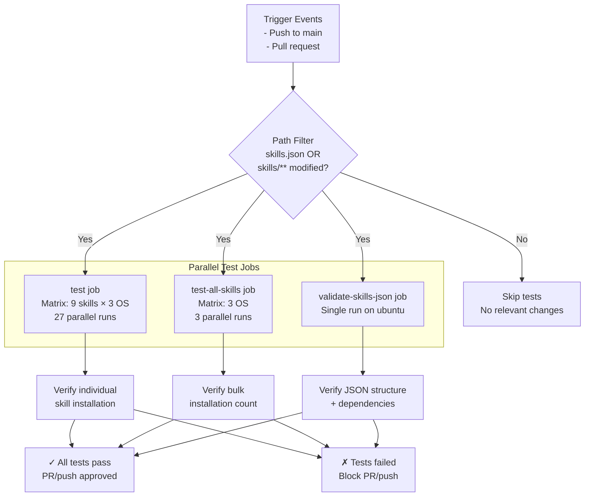
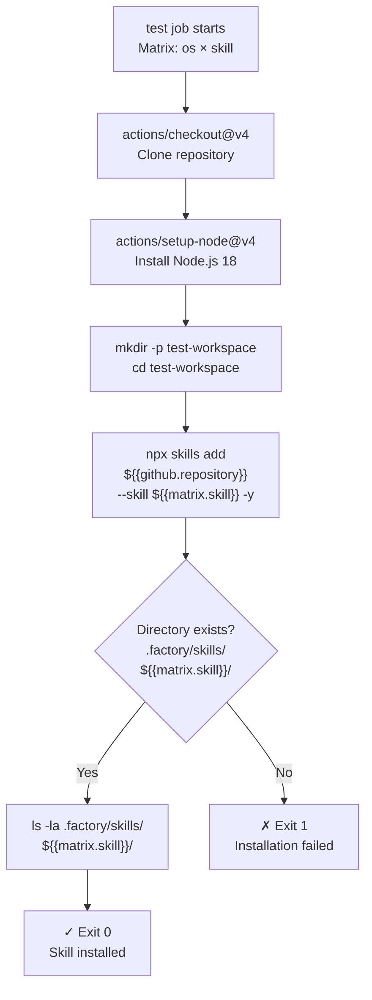
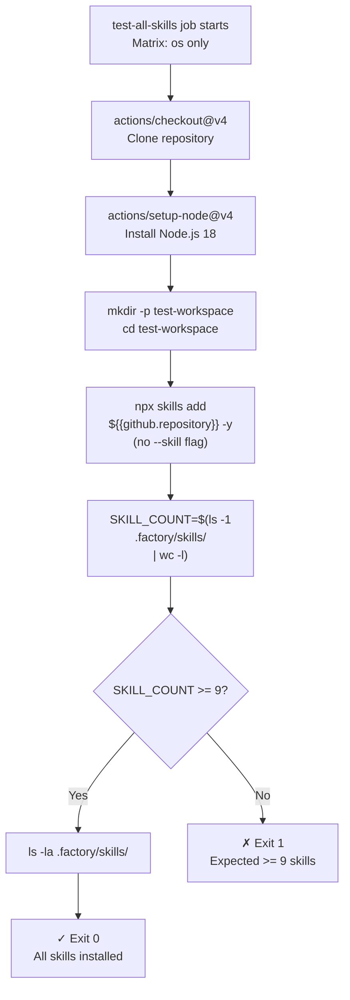
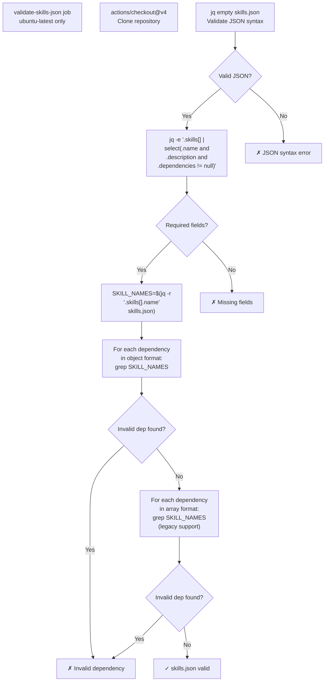

<!-- source: DeepWiki mcp.deepwiki.com · repo ReScienceLab/opc-skills · page 6.2 Automated Testing Pipeline · fetched 2026-10-26 -->

# Automated Testing Pipeline

<details>
<summary>Relevant source files</summary>

The following files were used as context for generating this wiki page:

- [.gitattributes](.gitattributes)
- [.github/workflows/test-installer.yml](.github/workflows/test-installer.yml)

</details>


## Purpose and Scope

This document describes the automated testing infrastructure that validates skill installations and registry integrity on every code change. The pipeline ensures that all 9 skills can be successfully installed across multiple operating systems using the universal installer (`npx skills add`), and that the central skills registry maintains valid structure and dependencies.

For information about the Git workflow that triggers these tests, see [Git Workflow & Branching Strategy](#6.1). For details on the universal installer being tested, see [Universal Installer (npx skills add)](#3.3). For release processes that depend on passing tests, see [Release Management](#6.4).

---

## Pipeline Architecture

The testing pipeline is implemented as a GitHub Actions workflow defined in [.github/workflows/test-installer.yml:1-118](). It consists of three parallel job groups that validate different aspects of the skills system.

### High-Level Test Workflow



**Sources:** [.github/workflows/test-installer.yml:3-12]()

---

## Test Matrix Strategy

The pipeline uses GitHub Actions matrix strategy to achieve comprehensive coverage with parallelization. The matrix dimensions create cartesian products that test all relevant combinations.

### Matrix Dimensions

| Job | Dimension 1 (os) | Dimension 2 (skill) | Total Runs |
|-----|------------------|---------------------|------------|
| `test` | 3 operating systems | 9 skills | **27** |
| `test-all-skills` | 3 operating systems | N/A | **3** |
| `validate-skills-json` | ubuntu-latest only | N/A | **1** |

### Operating Systems Tested

- `ubuntu-latest` - Linux validation
- `macos-latest` - macOS validation  
- `windows-latest` - Windows validation

These platforms represent the three major desktop environments where AI coding assistants run.

### Skills Tested

All 9 skills from the registry are tested individually:

```
requesthunt, reddit, twitter, nanobanana, logo-creator, 
banner-creator, domain-hunter, producthunt, seo-geo
```

**Sources:** [.github/workflows/test-installer.yml:16-19](), [.github/workflows/test-installer.yml:50-52]()

---

## Individual Skill Installation Test

The `test` job validates that each skill can be installed independently across all operating systems. This catches platform-specific installation issues and ensures the universal installer correctly handles individual skill selection.

### Test Job Workflow



### Verification Logic

The test verifies installation by checking for the existence of the skill directory at `.factory/skills/{skill_name}/`. The script uses shell conditionals to assert directory existence:

```bash
if [ -d ".factory/skills/${{ matrix.skill }}" ]; then
  echo "✓ Skill ${{ matrix.skill }} installed successfully"
  ls -la .factory/skills/${{ matrix.skill }}/
else
  echo "✗ Skill ${{ matrix.skill }} installation failed"
  exit 1
fi
```

The installer is invoked with the `-y` flag to skip interactive prompts, making it suitable for CI environments.

**Sources:** [.github/workflows/test-installer.yml:22-47]()

---

## Bulk Installation Test

The `test-all-skills` job validates that users can install all skills at once without specifying individual skill names. This tests the default behavior of the universal installer and ensures dependency resolution works correctly at scale.

### Test All Skills Job Workflow



### Count-Based Verification

Rather than checking for specific skill names, this test uses a count-based assertion:

```bash
SKILL_COUNT=$(ls -1 .factory/skills/ | wc -l)
echo "Installed $SKILL_COUNT skills"

if [ "$SKILL_COUNT" -ge 9 ]; then
  echo "✓ All skills installed successfully"
  ls -la .factory/skills/
else
  echo "✗ Expected at least 9 skills, found $SKILL_COUNT"
  exit 1
fi
```

The threshold is "at least 9" to allow for future skill additions without updating the test. This makes the test resilient to registry expansion.

**Sources:** [.github/workflows/test-installer.yml:49-83]()

---

## Skills Registry Validation

The `validate-skills-json` job ensures the central registry maintains structural integrity and valid dependency references. This job runs independently of OS since it's purely JSON validation.

### Validation Steps



### Required Field Validation

The pipeline checks that all skills have three mandatory fields using `jq` filtering:

- `name` - skill identifier
- `description` - human-readable description
- `dependencies` - dependency object (can be empty `{}` but must exist)

```bash
jq -e '.skills[] | select(.name and .description and .dependencies != null)' skills.json
```

The `-e` flag causes `jq` to exit with non-zero status if the filter produces no output, failing the test if any skill lacks required fields.

### Dependency Reference Validation

The pipeline validates that all dependency references point to existing skills in the registry. It supports both object format (current) and array format (legacy) for backward compatibility:

**Object Format Validation:**
```bash
for dep in $(jq -r '.skills[] | select(.dependencies | type == "object") | .dependencies | keys[]' skills.json 2>/dev/null); do
  if ! echo "$SKILL_NAMES" | grep -q "^${dep}$"; then
    echo "Error: Invalid dependency '$dep'"
    exit 1
  fi
done
```

**Array Format Validation (Legacy):**
```bash
for dep in $(jq -r '.skills[] | select(.dependencies | type == "array") | .dependencies[]' skills.json 2>/dev/null); do
  if ! echo "$SKILL_NAMES" | grep -q "^${dep}$"; then
    echo "Error: Invalid dependency '$dep'"
    exit 1
  fi
done
```

This prevents broken dependency chains where a skill references a non-existent dependency.

**Sources:** [.github/workflows/test-installer.yml:85-117]()

---

## Trigger Conditions

The test pipeline uses path-based filtering to run only when relevant files change, optimizing CI resource usage.

### Path Filter Configuration

```yaml
on:
  push:
    branches: [main]
    paths:
      - 'skills.json'
      - 'skills/**'
  pull_request:
    paths:
      - 'skills.json'
      - 'skills/**'
```

### Trigger Scenarios

| Event Type | Branch | Paths | Pipeline Runs? |
|------------|--------|-------|----------------|
| Push | `main` | `skills.json` modified | ✓ Yes |
| Push | `main` | Any file in `skills/` modified | ✓ Yes |
| Push | `main` | Only `.github/workflows/` modified | ✗ No |
| Pull Request | Any | `skills.json` modified | ✓ Yes |
| Pull Request | Any | Blog post modified | ✗ No |
| Push | `main` | Only website worker modified | ✗ No |

This design ensures tests run for skill-related changes while avoiding unnecessary CI runs for documentation, blog posts, or website updates.

**Sources:** [.github/workflows/test-installer.yml:3-12]()

---

## Test Environment Configuration

### Node.js Version

All jobs use Node.js 18 via the `actions/setup-node@v4` action:

```yaml
- name: Setup Node.js
  uses: actions/setup-node@v4
  with:
    node-version: '18'
```

This ensures consistency with the target runtime environments for AI coding assistants.

### Shell Compatibility

Tests explicitly specify `bash` as the shell for cross-platform compatibility:

```yaml
shell: bash
```

This is critical for Windows runners where the default shell is PowerShell. Using bash ensures consistent behavior across all three OS platforms.

### Installation Directory

Tests use `.factory/skills/` as the target installation directory, matching the Factory Droid platform convention. This is the default directory used by the universal installer when no platform is explicitly detected.

### Workspace Isolation

Each test run creates a fresh `test-workspace/` directory to ensure isolation:

```bash
mkdir -p test-workspace
cd test-workspace
```

This prevents state pollution between test runs and simulates a clean user environment.

**Sources:** [.github/workflows/test-installer.yml:25-35](), [.github/workflows/test-installer.yml:58-68]()

---

## Test Coverage Summary

The automated testing pipeline provides comprehensive validation across three dimensions:

| Validation Type | Coverage | Test Count |
|----------------|----------|------------|
| **Platform Coverage** | Linux, macOS, Windows | 3 OS × 10 skills = **30 test runs** |
| **Skill Installation** | Individual skill installs | 9 skills × 3 OS = **27 runs** |
| **Bulk Installation** | All skills at once | 3 OS = **3 runs** |
| **Registry Integrity** | JSON structure + dependencies | **1 run** |
| **Total Test Runs** | Per pipeline execution | **31 parallel jobs** |

The matrix strategy enables fast feedback by running all tests in parallel. A typical pipeline execution completes in 2-3 minutes despite running 31 validation jobs.

### Failure Modes Detected

The pipeline catches several categories of installation issues:

1. **Platform-specific bugs** - Script syntax issues on Windows vs Unix
2. **Broken dependencies** - Skills referencing non-existent dependencies
3. **Malformed JSON** - Invalid skills.json syntax
4. **Missing files** - Skills with incomplete file structures
5. **Installation path issues** - Universal installer directory resolution failures
6. **Count mismatches** - Registry declaring skills that don't exist in repository

**Sources:** [.github/workflows/test-installer.yml:1-118]()

---

