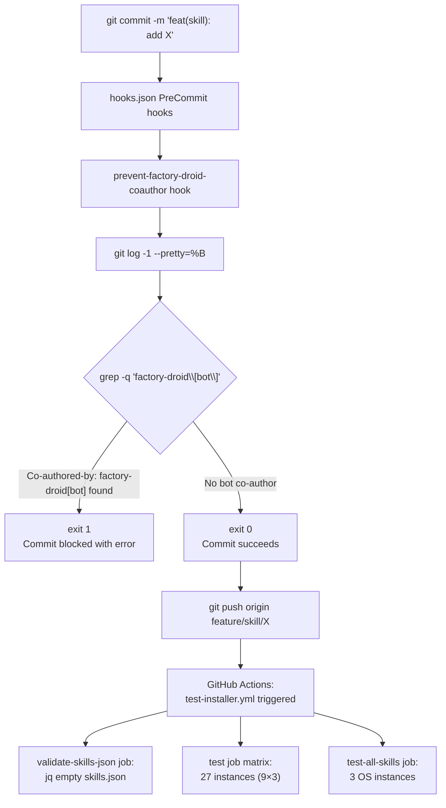
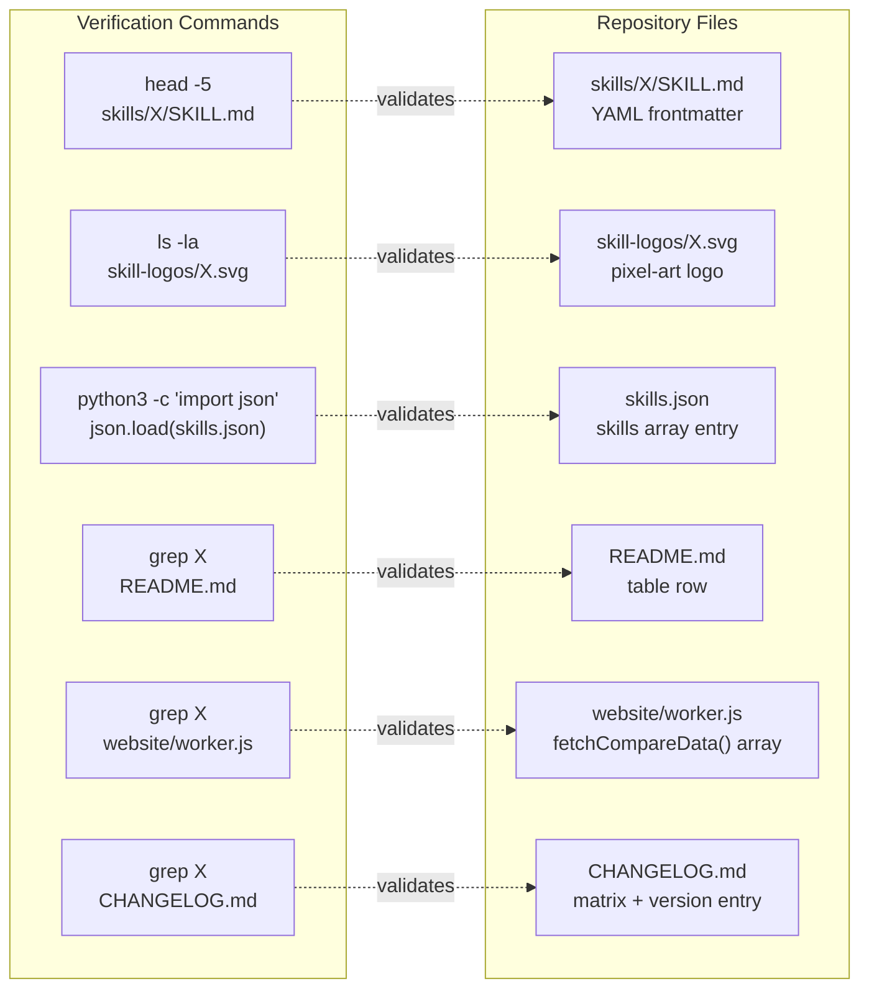
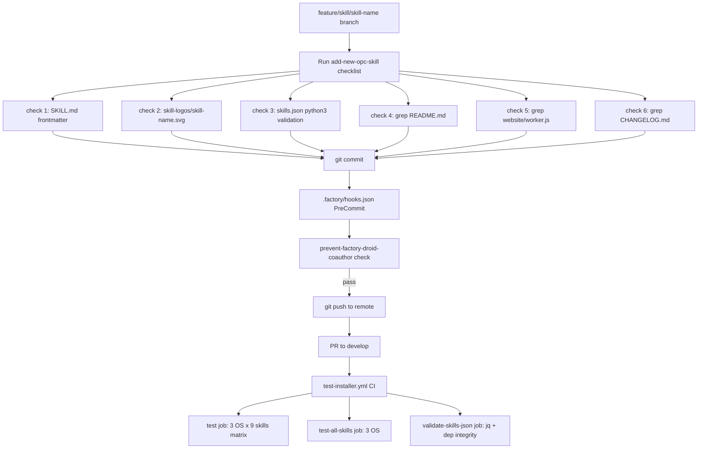

<!-- source: DeepWiki mcp.deepwiki.com · repo ReScienceLab/opc-skills · page 6.3 Pre-commit Hooks & Quality Gates · fetched 2026-10-26 -->

# Pre-commit Hooks & Quality Gates

<details>
<summary>Relevant source files</summary>

The following files were used as context for generating this wiki page:

- [.factory/hooks.json](.factory/hooks.json)
- [.factory/skills/add-new-opc-skill/SKILL.md](.factory/skills/add-new-opc-skill/SKILL.md)
- [.gitattributes](.gitattributes)
- [.github/workflows/test-installer.yml](.github/workflows/test-installer.yml)
- [.gitignore](.gitignore)
- [skills/domain-hunter/examples/auto-video-editing-domain.md](skills/domain-hunter/examples/auto-video-editing-domain.md)
- [website/resciencelab-logo.svg](website/resciencelab-logo.svg)

</details>


This page documents the pre-commit hook configuration in `.factory/hooks.json` and the manual six-item verification checklist defined in `.factory/skills/add-new-opc-skill/SKILL.md` that must pass before committing any new skill. Together these form the quality gate layer that runs locally, before code reaches CI.

For the automated CI pipeline that validates skills.json structure and runs installer tests after push, see [Automated Testing Pipeline](#6.2). For branch naming and commit message conventions, see [Git Workflow & Branching Strategy](#6.1).

---

## The `.factory/` Directory & Tracking Policy

Most of the `.factory/` directory is excluded from version control, but `hooks.json` is explicitly retained. The relevant `.gitignore` rules are:

[.gitignore:40-45]()

| Path | Tracked |
|---|---|
| `.factory/*` | No (default ignore) |
| `.factory/hooks.json` | **Yes** (explicit exception) |
| `.factory/AGENTS.md` | **Yes** (explicit exception) |
| `.factory/skills/` | **Yes** (explicit exception) |
| `.factory/skills/*` | No (default ignore within skills/) |
| `.factory/skills/add-new-opc-skill/` | **Yes** (explicit exception) |

This means the hook definition travels with the repository, while runtime agent state under `.factory/` does not.

Sources: [.gitignore:40-45]()

---

## Pre-commit Hook: `hooks.json`

The hook registry is defined in `.factory/hooks.json` using a flat JSON schema.

[.factory/hooks.json:1-12]()

**Schema overview:**

| Field | Value / Description |
|---|---|
| `hooks.PreCommit` | Array of hook objects that run before every commit |
| `name` | Unique identifier for the hook |
| `description` | Human-readable explanation |
| `type` | `"command"` — a shell command executed directly |
| `command` | The shell string to run; non-zero exit blocks the commit |

Currently one hook is registered:

### `prevent-factory-droid-coauthor`

**Purpose:** Blocks commits that include `factory-droid[bot]` in the `Co-authored-by` trailer.

**Command:**
```
bash -c 'if git log -1 --pretty=%B | grep -q "factory-droid\[bot\]"; then echo "Error: factory-droid[bot] co-author is not allowed in commits"; exit 1; fi'
```

**Mechanism:** Reads the most recent commit message via `git log -1 --pretty=%B` and pipes it through `grep -q`. If the bot string is found, the hook prints an error and exits with code `1`, which prevents the commit from completing.

**Why this exists:** The `factory-droid` automation bot may inject co-author lines automatically. This hook ensures those bot-attributed commits are never merged into the project's commit history under a human author.

Sources: [.factory/hooks.json:1-12]()

---

**Diagram: Hook execution flow from commit to CI**



Sources: [.factory/hooks.json:3-11]()

---

## Local Validation Commands

Before committing changes, developers should run local validation commands to catch issues early. These commands are referenced in the development workflow but are not enforced by automated hooks.

### NPM Validation Suite

The repository includes standard npm scripts for code quality checks:

```bash
npm run lint       # Lints JavaScript/TypeScript files
npm run typecheck  # Type-checks TypeScript code
npm run test       # Runs test suite
```

**When to run:** Before creating a pull request, especially when modifying:
- `website/worker.js` (Cloudflare Worker code)
- `scripts/*.py` validation tools
- Any TypeScript configuration

### Blog Post Validation

For blog content changes, the `create-blog.py` script provides validation:

```bash
python3 scripts/create-blog.py validate
```

**Validation checks:**
- `blog.json` structure and metadata fields
- Required content length (2000+ words)
- SEO requirements (15+ keywords, 3-5 internal links)
- FAQ count (5-10 questions)
- Schema.org markup validity

This validation is also run automatically in the `publish-blog.yml` workflow for fast-track blog publishing.

Sources: High-level system diagrams (Diagram 4: Development Workflow)

---

## Manual Verification Checklist (Add New OPC Skill)

When adding a new skill, the `add-new-opc-skill` SKILL.md defines a six-item verification checklist that must pass before committing. These are not automated by `hooks.json`; they are manual checks using shell commands.

[.factory/skills/add-new-opc-skill/SKILL.md:189-218]()

**Verification targets by item:**

| # | Item | File Checked | Command Tool |
|---|---|---|---|
| 1 | `SKILL.md` exists with valid YAML frontmatter | `skills/<skill-name>/SKILL.md` | `head` |
| 2 | Logo SVG exists | `skill-logos/<skill-name>.svg` | `ls` |
| 3 | `skills.json` entry is valid JSON with all required fields | `skills.json` | `python3` + `json` module |
| 4 | `README.md` lists the skill | `README.md` | `grep` |
| 5 | `website/worker.js` contains the skill entry | `website/worker.js` | `grep` |
| 6 | `CHANGELOG.md` has the skill in the matrix | `CHANGELOG.md` | `grep` |

---

**Diagram: Verification checks mapped to repository artifacts**



Sources: [.factory/skills/add-new-opc-skill/SKILL.md:189-218]()

---

### Check 1 — SKILL.md Frontmatter

[.factory/skills/add-new-opc-skill/SKILL.md:194-195]()

Verifies the file exists and opens with YAML frontmatter. `head -5` is used to quickly confirm the `---` delimiter and `name:` / `description:` fields are present without reading the full file.

---

### Check 2 — Logo SVG

[.factory/skills/add-new-opc-skill/SKILL.md:197-198]()

Confirms the pixel-art SVG generated by the logo pipeline was saved to `skill-logos/<skill-name>.svg`. This file is also referenced by the `logo` field in `skills.json` via a raw GitHub URL.

---

### Check 3 — `skills.json` Entry

[.factory/skills/add-new-opc-skill/SKILL.md:200-208]()

Uses a Python one-liner to:
1. Parse `skills.json` with `json.load` (syntax validation)
2. Filter for the new skill by `name`
3. Assert presence of all 11 required top-level fields: `name`, `version`, `description`, `logo`, `icon`, `color`, `triggers`, `dependencies`, `auth`, `install`, `links`

Required fields table:

| Field | Type | Notes |
|---|---|---|
| `name` | string | kebab-case |
| `version` | string | semver, e.g. `"1.0.0"` |
| `description` | string | |
| `logo` | string | Raw GitHub URL to SVG |
| `icon` | string | Simple Icons name or generic |
| `color` | string | 6-char hex without `#` |
| `triggers` | array | Keywords that activate the skill |
| `dependencies` | object | Keys are skill names, values are version ranges |
| `auth` | object | `required`, `type`, `keys` |
| `install` | object | `user` and `project` sub-objects per agent |
| `links` | object | At minimum `github` |

Sources: [.factory/skills/add-new-opc-skill/SKILL.md:72-120]()

---

### Check 4 — `README.md` Table Row

[.factory/skills/add-new-opc-skill/SKILL.md:210-211]()

A `grep` for the skill name confirms the "Included Skills" Markdown table in `README.md` was updated. The expected row format is:

```
| .svg" width="24"> | [<skill-name>](./skills/<skill-name>) | Short description |
```

---

### Check 5 — `website/worker.js` Entry

[.factory/skills/add-new-opc-skill/SKILL.md:213-214]()

`grep` confirms the skill name appears in `website/worker.js`. This corresponds to the skill object added inside the `fetchCompareData()` function's hardcoded skills array.

For the full `worker.js` architecture and why this array exists separately from `skills.json`, see [Website Architecture](#4.1).

---

### Check 6 — `CHANGELOG.md`

[.factory/skills/add-new-opc-skill/SKILL.md:216-217]()

`grep` confirms two things are present in `CHANGELOG.md`:
1. A row in the **Skill Compatibility & Dependency Matrix** table
2. An entry under `## [Unreleased]` or the relevant release section

For CHANGELOG versioning conventions and the full matrix format, see [Release Management](#6.4).

---

## End-to-End Quality Gate Flow

**Diagram: From local development to CI, quality gate checkpoints**



Sources: [.factory/hooks.json:1-12](), [.factory/skills/add-new-opc-skill/SKILL.md:189-234](), [.github/workflows/test-installer.yml:1-118]()

---

## Summary

| Gate | Mechanism | When | Automated |
|---|---|---|---|
| Six-item verification checklist | Shell commands (`head`, `ls`, `python3`, `grep`) | Before `git commit` | No — manual |
| `prevent-factory-droid-coauthor` | `.factory/hooks.json` PreCommit hook | On `git commit` | Yes — hook |
| `validate-skills-json` CI job | `jq` + dependency referential integrity | On PR push | Yes — GitHub Actions |
| Installer test matrix | `npx skills add` + directory check | On PR push | Yes — GitHub Actions |

---

