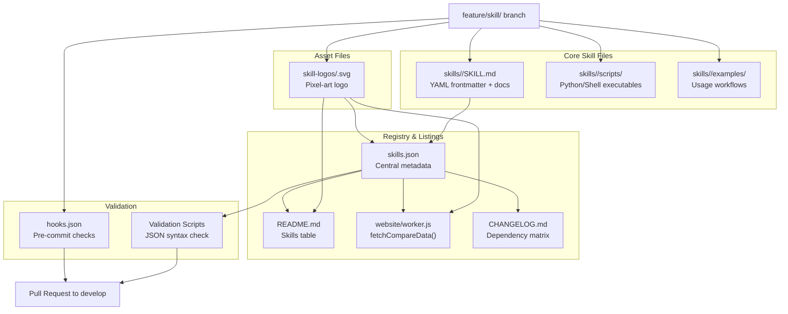
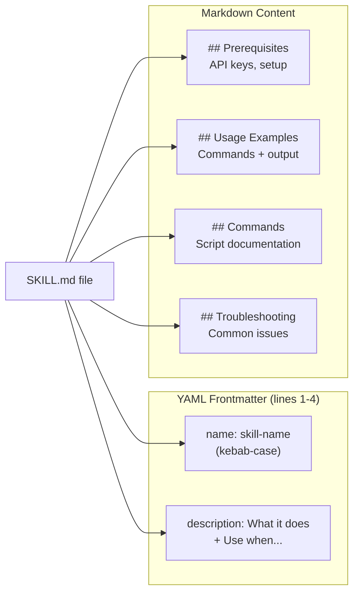
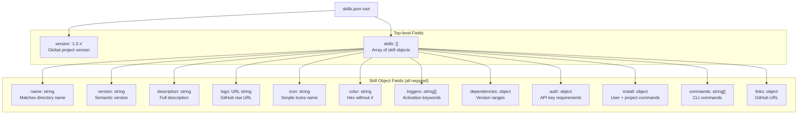
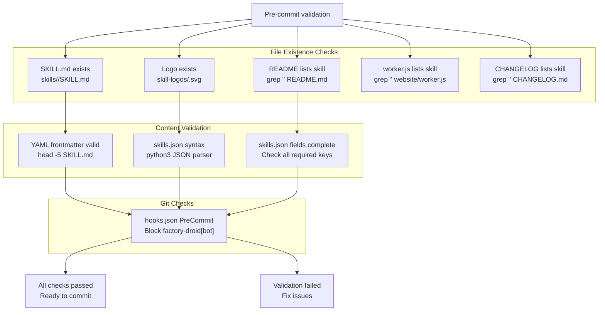
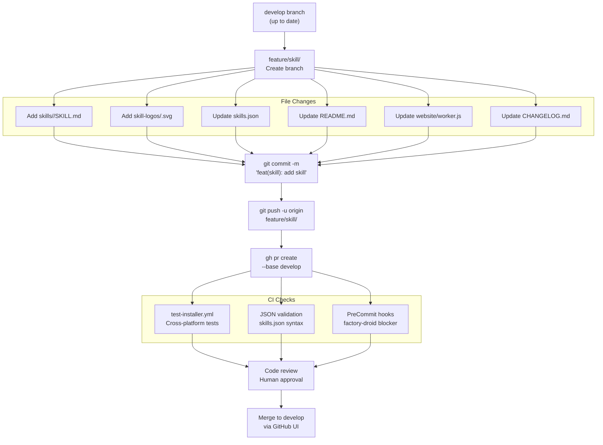

<!-- source: DeepWiki mcp.deepwiki.com · repo ReScienceLab/opc-skills · page 7 Creating New Skills · fetched 2026-10-26 -->

# Creating New Skills

<details>
<summary>Relevant source files</summary>

The following files were used as context for generating this wiki page:

- [.factory/AGENTS.md](.factory/AGENTS.md)
- [.factory/hooks.json](.factory/hooks.json)
- [.factory/skills/add-new-opc-skill/SKILL.md](.factory/skills/add-new-opc-skill/SKILL.md)
- [.gitignore](.gitignore)
- [CHANGELOG.md](CHANGELOG.md)
- [README.md](README.md)
- [skill-logos/archive.svg](skill-logos/archive.svg)
- [skills/domain-hunter/examples/auto-video-editing-domain.md](skills/domain-hunter/examples/auto-video-editing-domain.md)
- [template/SKILL.md](template/SKILL.md)
- [website/blog/posts/why-skills-beat-docs.md](website/blog/posts/why-skills-beat-docs.md)
- [website/opc-banner.png](website/opc-banner.png)
- [website/resciencelab-logo.svg](website/resciencelab-logo.svg)

</details>


This page provides a step-by-step technical guide for contributors adding new skills to the OPC Skills repository. It covers the add-new-opc-skill meta-skill workflow, required file modifications across six locations, validation procedures, and pull request submission.

For information about the overall development workflow and Git Flow branching strategy, see [Development & CI/CD](#6). For details on skill structure standards, see [Skill Structure & Standards](#2.2).

---

## Overview

Adding a new skill requires updating six files in a coordinated manner:

1. `skills/<skill-name>/SKILL.md` - Skill documentation with YAML frontmatter
2. `skill-logos/<skill-name>.svg` - Pixel-art style logo
3. `skills.json` - Central metadata registry
4. `README.md` - Skills listing table
5. `website/worker.js` - Hardcoded skill data for website rendering
6. `CHANGELOG.md` - Dependency matrix and version entry

The `.factory/skills/add-new-opc-skill/SKILL.md` meta-skill provides a comprehensive checklist to ensure no steps are missed.

**Sources:** [.factory/skills/add-new-opc-skill/SKILL.md:1-235](), [README.md:150-168]()

---

## Prerequisites

### Branch Setup

All new skills must be developed on a feature branch following the Git Flow naming convention:

```bash
feature/skill/<skill-name>/<feature-description>
```

Branch from `develop`, not `main`:

```bash
git checkout develop
git pull origin develop
git checkout -b feature/skill/my-new-skill
```

**Sources:** [.factory/AGENTS.md:176-189](), [.factory/skills/add-new-opc-skill/SKILL.md:10-14]()

### Naming Conventions

- **Skill directory name**: kebab-case (e.g., `domain-hunter`, `logo-creator`)
- **YAML `name` field**: Must match directory name exactly
- **Logo filename**: `skill-logos/<skill-name>.svg`

**Sources:** [.factory/AGENTS.md:52-55](), [.factory/skills/add-new-opc-skill/SKILL.md:14]()

---

## File Dependency Graph



All six registry/listing files must be updated in a single atomic commit to maintain consistency across the codebase.

**Sources:** [.factory/skills/add-new-opc-skill/SKILL.md:16-234](), [README.md:150-158]()

---

## Step 1: Create Skill Directory Structure

### Directory Layout

```bash
skills/<skill-name>/
├── SKILL.md              # Required: Main documentation
├── scripts/              # Conditional: Python/Shell scripts
│   └── *.py / *.sh
├── examples/             # Recommended: Usage examples
│   └── *.md
└── references/           # Optional: API docs
    └── *.md
```

Use the template as a starting point:

```bash
cp -r template skills/<skill-name>
```

**Sources:** [.factory/skills/add-new-opc-skill/SKILL.md:18-46](), [template/SKILL.md:1-130]()

### SKILL.md Frontmatter Structure



The frontmatter must follow this exact structure:

```yaml
---
name: skill-name
description: Clear description of what this skill does and when to use it. Include trigger keywords and contexts inline, e.g. "Use when user wants to X, Y, or Z."
---
```

**Key constraints:**
- No `triggers` field (deprecated as of v1.0.6 - merged into description)
- No `dependencies` field (declared only in `skills.json`)
- Description must be a single-line string (no YAML block scalars like `>-` or `|`)

**Sources:** [template/SKILL.md:1-130](), [CHANGELOG.md:81-86](), [.factory/skills/add-new-opc-skill/SKILL.md:33-40]()

---

## Step 2: Generate Skill Logo

All skill logos follow a consistent pixel-art style. Generation uses the `logo-creator` and `nanobanana` skills.

### Logo Generation Workflow

```bash
# 1. Generate 20 variations
python3 skills/nanobanana/scripts/batch_generate.py \
  "Pixel art <subject> logo, 8-bit retro style, black pixels on white background, minimalist icon, clean crisp edges, no text, centered" \
  -n 20 --ratio 1:1 \
  -d .skill-archive/logo-creator/$(date +%Y-%m-%d)-<skill-name> \
  -p logo

# 2. Preview in browser
cp skills/logo-creator/templates/preview.html .skill-archive/logo-creator/<date>-<skill-name>/
open .skill-archive/logo-creator/<date>-<skill-name>/preview.html

# 3. Crop and vectorize selected logo
python3 skills/logo-creator/scripts/crop_logo.py logo-05.png logo-cropped.png
python3 skills/logo-creator/scripts/vectorize.py logo-cropped.png skill-logos/<skill-name>.svg
```

### Logo Requirements

| Property | Requirement |
|----------|-------------|
| Format | SVG (vectorized from PNG) |
| Style | Pixel-art, 8-bit retro |
| Colors | Black pixels on white background |
| Size | 24px width for README display |
| Location | `skill-logos/<skill-name>.svg` |

**Sources:** [.factory/skills/add-new-opc-skill/SKILL.md:48-69](), [README.md:46-55]()

---

## Step 3: Add skills.json Entry

The `skills.json` file at the repository root contains the central skill registry. Each skill requires a complete metadata object.

### skills.json Schema



**Sources:** [.factory/skills/add-new-opc-skill/SKILL.md:72-120]()

### Complete skills.json Entry Template

```json
{
  "name": "skill-name",
  "version": "1.0.0",
  "description": "Full description of what the skill does and when to use it.",
  "logo": "https://raw.githubusercontent.com/ReScienceLab/opc-skills/main/skill-logos/skill-name.svg",
  "icon": "globe",
  "color": "6B7280",
  "triggers": ["keyword1", "keyword2", "phrase"],
  "dependencies": {},
  "auth": {
    "required": false,
    "type": null,
    "keys": []
  },
  "install": {
    "user": {
      "claude": "npx skills add ReScienceLab/opc-skills --skill skill-name -a claude",
      "droid": "npx skills add ReScienceLab/opc-skills --skill skill-name -a droid",
      "opencode": "npx skills add ReScienceLab/opc-skills --skill skill-name -a opencode",
      "codex": "npx skills add ReScienceLab/opc-skills --skill skill-name -a codex"
    },
    "project": {
      "claude": "npx skills add ReScienceLab/opc-skills --skill skill-name",
      "droid": "npx skills add ReScienceLab/opc-skills --skill skill-name",
      "cursor": "npx skills add ReScienceLab/opc-skills --skill skill-name",
      "opencode": "npx skills add ReScienceLab/opc-skills --skill skill-name",
      "codex": "npx skills add ReScienceLab/opc-skills --skill skill-name"
    }
  },
  "commands": [
    "python3 scripts/example.py \"{input}\""
  ],
  "links": {
    "github": "https://github.com/ReScienceLab/opc-skills/tree/main/skills/skill-name"
  }
}
```

### Field-Specific Requirements

| Field | Type | Notes |
|-------|------|-------|
| `icon` | string | Use [Simple Icons](https://simpleicons.org/) name or generic: `"globe"`, `"archive"`, `"image"` |
| `color` | string | 6-char hex **without** `#` prefix (e.g., `"6B7280"`) |
| `dependencies` | object | Keys: skill names, Values: version ranges (e.g., `{"twitter": ">=1.0.0"}`) |
| `auth.keys` | array | Each object: `{"env": "VAR_NAME", "url": "https://...", "optional": true/false}` |
| `commands` | array | Empty `[]` if skill provides instructions only, no scripts |

**Sources:** [.factory/skills/add-new-opc-skill/SKILL.md:72-125]()

### Validation

After editing `skills.json`, validate syntax:

```bash
python3 -c "import json; json.load(open('skills.json')); print('valid')"
```

**Sources:** [.factory/skills/add-new-opc-skill/SKILL.md:122-125]()

---

## Step 4: Update README.md Skills Table

The skills table in `README.md` provides a quick overview of all skills. Add a row to the markdown table at [README.md:42-55]():

```markdown
|  | [skill-name](./skills/skill-name) | Short description |
```

Insert the row in an appropriate position within the existing table (typically ordered by importance or category).

**Sources:** [.factory/skills/add-new-opc-skill/SKILL.md:127-135](), [README.md:42-55]()

---

## Step 5: Update website/worker.js Hardcoded Data

The Cloudflare Worker in `website/worker.js` contains hardcoded skill data for performance. The skill must be added to the `skills` array inside the `fetchCompareData()` function.

### Location in worker.js

Find the closing of the skills array (look for `],\n  };\n}`) and insert the new skill object **before** that closing:

```javascript
{
  name: "skill-name",
  version: "1.0.0",
  description: "Full description",
  icon: "globe",
  color: "6B7280",
  triggers: ["keyword1", "keyword2"],
  dependencies: [],
  auth: { required: false, note: "No API key needed" },
  install: {
    user: {
      claude: "npx skills add ReScienceLab/opc-skills --skill skill-name -a claude",
      droid: "npx skills add ReScienceLab/opc-skills --skill skill-name -a droid",
      opencode: "npx skills add ReScienceLab/opc-skills --skill skill-name -a opencode",
      codex: "npx skills add ReScienceLab/opc-skills --skill skill-name -a codex",
    },
    project: {
      claude: "npx skills add ReScienceLab/opc-skills --skill skill-name",
      droid: "npx skills add ReScienceLab/opc-skills --skill skill-name",
      cursor: "npx skills add ReScienceLab/opc-skills --skill skill-name",
      opencode: "npx skills add ReScienceLab/opc-skills --skill skill-name",
      codex: "npx skills add ReScienceLab/opc-skills --skill skill-name",
    },
  },
  commands: [],
  links: {
    github: "https://github.com/ReScienceLab/opc-skills/tree/main/skills/skill-name",
  },
},
```

**Important:** This data duplication exists because the worker fetches from GitHub raw URLs for dynamic skill pages, but uses hardcoded data for the compare page to avoid rate limiting.

**Sources:** [.factory/skills/add-new-opc-skill/SKILL.md:137-172]()

---

## Step 6: Update CHANGELOG.md

Two updates are required in `CHANGELOG.md`:

### 1. Dependency Matrix Table

Add a row to the compatibility matrix at [CHANGELOG.md:8-23]():

```markdown
| **skill-name** | 1.0.0 | - | - |
```

If the skill has dependencies:

```markdown
| **skill-name** | 1.0.0 | dependency1, dependency2 | dependency1 ≥1.0.0, dependency2 ≥1.0.0 |
```

### 2. Version Entry

Add a subsection under `## [Unreleased]` (or the specific release version section):

```markdown
### skill-name
#### [1.0.0] - YYYY-MM-DD
- **Added**: Initial release - brief description of functionality
```

**Sources:** [.factory/skills/add-new-opc-skill/SKILL.md:173-188](), [CHANGELOG.md:8-31]()

---

## Validation Workflow



**Sources:** [.factory/skills/add-new-opc-skill/SKILL.md:189-218]()

### Automated Validation Script

```bash
# 1. SKILL.md frontmatter check
head -5 skills/<skill-name>/SKILL.md

# 2. Logo existence
ls -la skill-logos/<skill-name>.svg

# 3. skills.json validation
python3 -c "
import json
config = json.load(open('skills.json'))
skill = [s for s in config['skills'] if s['name'] == '<skill-name>'][0]
required = ['name','version','description','logo','icon','color','triggers','dependencies','auth','install','links']
missing = [f for f in required if f not in skill]
print('PASS' if not missing else f'MISSING: {missing}')
"

# 4. README listing check
grep '<skill-name>' README.md

# 5. worker.js listing check
grep '<skill-name>' website/worker.js

# 6. CHANGELOG listing check
grep '<skill-name>' CHANGELOG.md
```

**Sources:** [.factory/skills/add-new-opc-skill/SKILL.md:195-218]()

---

## Git Workflow and PR Submission



**Sources:** [.factory/skills/add-new-opc-skill/SKILL.md:220-234](), [.factory/AGENTS.md:168-227]()

### Step-by-Step Commands

```bash
# 1. Create and switch to feature branch
git checkout develop
git pull origin develop
git checkout -b feature/skill/<skill-name>

# 2. Add all modified files
git add skills/<skill-name>/ \
        skill-logos/<skill-name>.svg \
        skills.json \
        README.md \
        website/worker.js \
        CHANGELOG.md

# 3. Commit with conventional commit format
git commit -m "feat(skill): add <skill-name> skill"

# 4. Push branch to origin
git push -u origin feature/skill/<skill-name>

# 5. Create PR targeting develop
gh pr create --base develop --head feature/skill/<skill-name>
```

**Sources:** [.factory/skills/add-new-opc-skill/SKILL.md:220-234](), [.factory/AGENTS.md:230-249]()

### Commit Message Convention

Use the `feat(skill)` prefix for new skills:

```
feat(skill): add <skill-name> skill
```

**Do not** include watermarks or AI-generated signatures in commit messages.

**Sources:** [.factory/AGENTS.md:230-249]()

### Pre-commit Hook Enforcement

The `.factory/hooks.json` file defines a pre-commit hook that blocks commits containing `factory-droid[bot]` as a co-author:

```json
{
  "hooks": {
    "PreCommit": [
      {
        "name": "prevent-factory-droid-coauthor",
        "description": "Prevents adding factory-droid[bot] as co-author in commits",
        "type": "command",
        "command": "bash -c 'if git log -1 --pretty=%B | grep -q \"factory-droid\\[bot\\]\"; then echo \"Error: factory-droid[bot] co-author is not allowed in commits\"; exit 1; fi'"
      }
    ]
  }
}
```

**Sources:** [.factory/hooks.json:1-12]()

---

## PR Merge Requirements

Before a PR can be merged, all of the following must pass:

| Check | Command/Process |
|-------|----------------|
| Website tests | `npm run test` in `website/` |
| Type checking | `npm run typecheck` in `website/` |
| Linting | `npm run lint` in `website/` |
| SKILL.md frontmatter | YAML parser validation |
| skills.json syntax | Python JSON validation |
| Cross-platform install | `test-installer.yml` workflow (27 skill × 3 OS tests) |
| Human code review | GitHub PR approval required |

**Sources:** [.factory/AGENTS.md:311-325]()

---

## Complete File Update Checklist

Use this checklist to ensure all required updates are complete:

- [ ] `skills/<name>/SKILL.md` created with valid YAML frontmatter
- [ ] `skill-logos/<name>.svg` generated and vectorized
- [ ] `skills.json` entry added with all 12 required fields
- [ ] `README.md` skills table row added
- [ ] `website/worker.js` hardcoded data entry added in `fetchCompareData()`
- [ ] `CHANGELOG.md` dependency matrix row added
- [ ] `CHANGELOG.md` version entry added under `[Unreleased]`
- [ ] Validation script executed successfully (all 6 checks pass)
- [ ] Feature branch created following naming convention
- [ ] Commit message follows `feat(skill): add <name> skill` format
- [ ] PR created targeting `develop` branch
- [ ] CI checks passing (test-installer.yml, JSON validation)

**Sources:** [.factory/skills/add-new-opc-skill/SKILL.md:189-234]()

---

## Example: Adding the archive Skill

The archive skill was added in PR #57. This example shows the actual file changes made:

### Files Modified

| File | Change Type | Specific Change |
|------|-------------|-----------------|
| `skills/archive/SKILL.md` | Created | YAML frontmatter + documentation [CHANGELOG.md:55-60]() |
| `skill-logos/archive.svg` | Created | Pixel-art archive box logo [skill-logos/archive.svg:1-10]() |
| `skills.json` | Entry added | Complete metadata object with install commands |
| `README.md` | Row added | `\|  \| [archive](./skills/archive) \| ...` [README.md:55]() |
| `website/worker.js` | Object added | Hardcoded skill data in `fetchCompareData()` |
| `CHANGELOG.md` | Matrix + entry | Dependency matrix row + version entry [CHANGELOG.md:23]() |

### Commit Pattern

```
feat(skill): add archive skill for indexed session knowledge

- Added archive skill with SKILL.md documentation
- Generated pixel-art logo via logo-creator skill
- Updated skills.json with complete metadata
- Added README.md listing and website worker.js data
- Updated CHANGELOG.md dependency matrix
```

**Sources:** [CHANGELOG.md:55-60](), [README.md:55]()

---

## Common Issues and Solutions

### Issue: skills.json Parse Error

**Symptom:** `JSONDecodeError` when validating `skills.json`

**Causes:**
- Missing comma between skill objects
- Trailing comma after last skill object
- Unescaped quotes in description strings

**Solution:**
```bash
# Use Python's JSON parser for detailed error messages
python3 -c "import json; json.load(open('skills.json'))"
```

**Sources:** [.factory/skills/add-new-opc-skill/SKILL.md:122-125]()

### Issue: SKILL.md Description Not Displaying on skills.sh

**Symptom:** Description field shows as `|` or is cut off on skills.sh

**Cause:** Using YAML block scalar syntax (`>-` or `|`) instead of single-line string

**Solution:** Use a single-line string without block scalar indicators:

```yaml
# ❌ Wrong - block scalar
description: >-
  This is a multi-line
  description

# ✅ Correct - single line
description: "This is a single-line description. Use when..."
```

**Sources:** [CHANGELOG.md:81-86]()

### Issue: Logo Not Appearing in README

**Symptom:** Broken image icon in README.md skills table

**Causes:**
- Logo filename doesn't match skill name
- Logo not committed to `skill-logos/` directory
- SVG file is corrupted or invalid

**Solution:**
```bash
# Verify logo exists with correct name
ls -la skill-logos/<skill-name>.svg

# Test SVG validity by opening in browser
open skill-logos/<skill-name>.svg
```

**Sources:** [.factory/skills/add-new-opc-skill/SKILL.md:48-69]()

### Issue: worker.js Not Showing Skill on Website

**Symptom:** Skill appears in JSON but not on opc.dev

**Cause:** Forgot to add hardcoded entry to `website/worker.js` `fetchCompareData()` function

**Solution:** Skill must be added in **both** locations:
1. `skills.json` (for dynamic skill pages)
2. `website/worker.js` (for compare page performance)

**Sources:** [.factory/skills/add-new-opc-skill/SKILL.md:137-172]()

---

## Related Documentation

- For skill dependency management and version compatibility, see [Dependency Management](#2.3)
- For the complete Git Flow workflow including releases, see [Git Workflow & Branching Strategy](#6.1)
- For understanding the CI/CD pipeline that validates new skills, see [Automated Testing Pipeline](#6.2)
- For details on the SKILL.md standard and frontmatter requirements, see [Skill Structure & Standards](#2.2)

**Sources:** [.factory/AGENTS.md:1-625](), [.factory/skills/add-new-opc-skill/SKILL.md:1-235]()