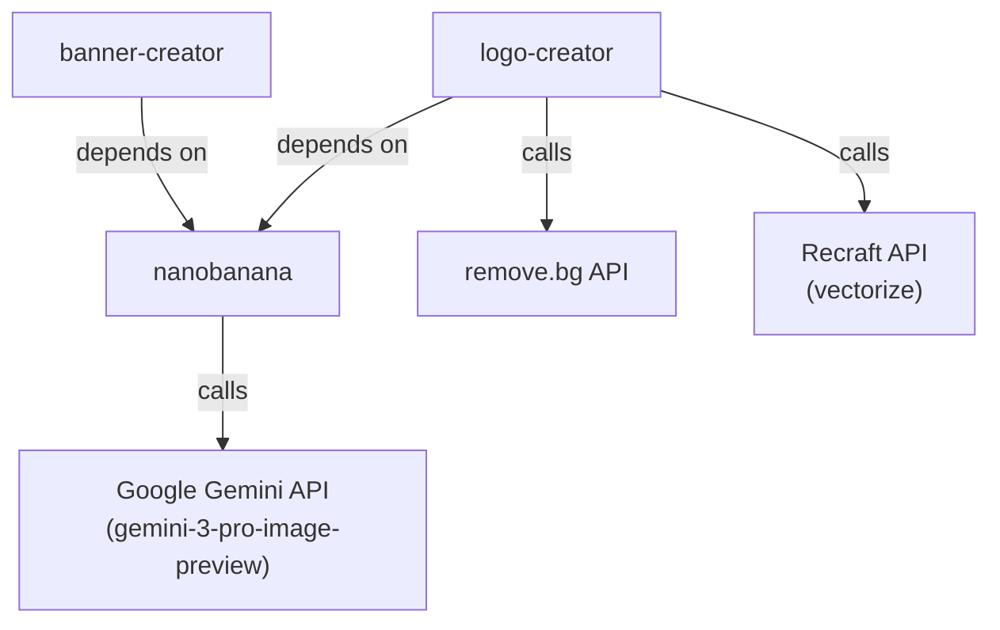
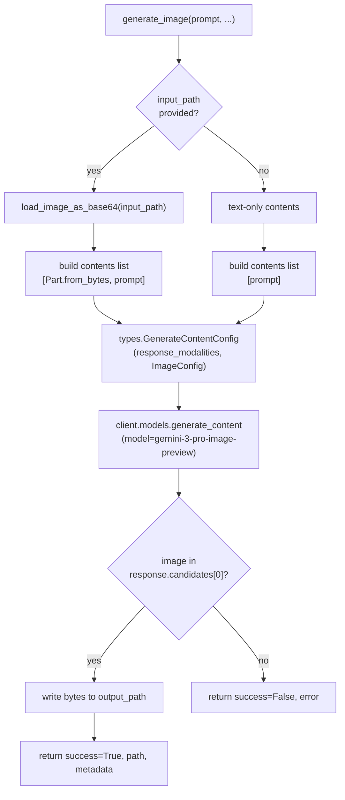
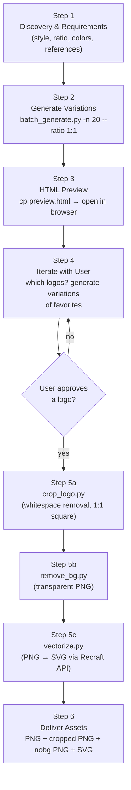
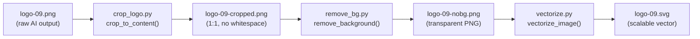
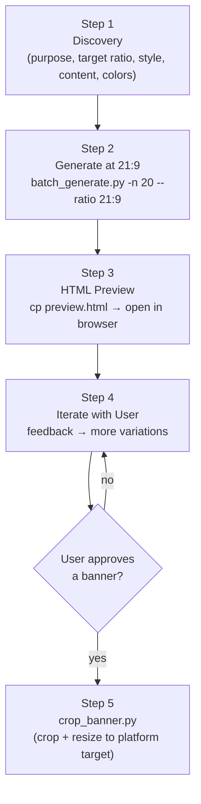
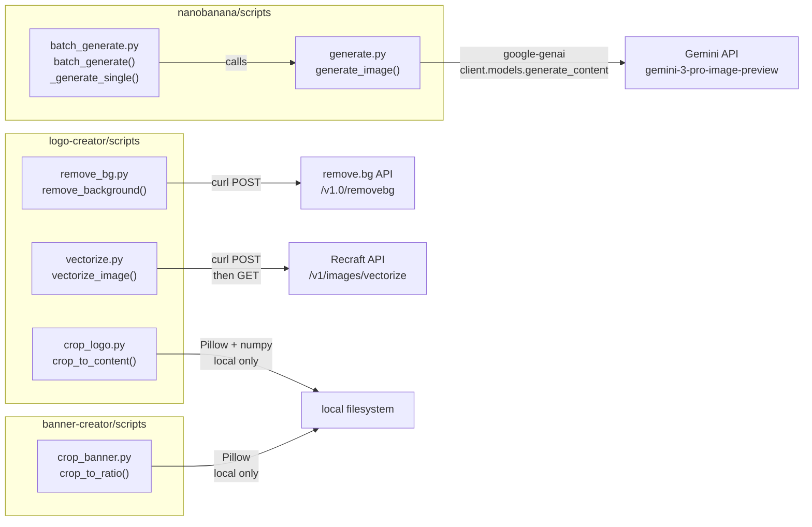

<!-- source: DeepWiki mcp.deepwiki.com · repo ReScienceLab/opc-skills · extra page Design & Image Generation Skills · fetched 2026-10-26 -->

# Design & Image Generation Skills

<details>
<summary>Relevant source files</summary>

The following files were used as context for generating this wiki page:

- [skills.json](skills.json)
- [skills/archive/SKILL.md](skills/archive/SKILL.md)
- [skills/archive/references/TEMPLATE.md](skills/archive/references/TEMPLATE.md)
- [skills/banner-creator/SKILL.md](skills/banner-creator/SKILL.md)
- [skills/logo-creator/SKILL.md](skills/logo-creator/SKILL.md)
- [skills/nanobanana/SKILL.md](skills/nanobanana/SKILL.md)

</details>


This page documents the three design-focused skills in the OPC Skills repository: `nanobanana`, `logo-creator`, and `banner-creator`. It covers the underlying image generation model integration, the CLI script interfaces, the iterative human-in-the-loop design workflow, and the full post-processing pipelines that convert raw generated images into production-ready assets.

For an overview of all nine skills and how they are categorized, see [Skill Categories & Reference](#2.4). For information on how these skills are installed and what API keys they require, see [Installation Methods Overview](#3.1).

---

## Skill Relationships

The three skills have a clear dependency hierarchy. `nanobanana` is the foundational generation primitive. Both `logo-creator` and `banner-creator` declare it as a required dependency and invoke its scripts directly.

**Skill dependency graph**



Sources: [skills/nanobanana/SKILL.md:1-20](), [skills/logo-creator/SKILL.md:1-19](), [skills/banner-creator/SKILL.md:1-19]()

---

## nanobanana — Core Image Generation

`nanobanana` wraps Google's `gemini-3-pro-image-preview` model (nicknamed "Nano Banana Pro") and exposes it through two Python CLI scripts.

### API Keys & Dependencies

| Variable | Source | Required by |
|---|---|---|
| `GEMINI_API_KEY` | Google AI Studio | All three skills |
| `IMAGE_OUTPUT_DIR` | Environment (optional) | `generate.py` default output path |

Python package requirement: `google-genai`, `pillow`

Sources: [skills/nanobanana/SKILL.md:12-19](), [skills/nanobanana/scripts/generate.py:18-26]()

### `generate.py` — Single Image Generation

The `generate_image` function in [skills/nanobanana/scripts/generate.py:80-223]() is the central entry point for all image generation. It supports:

- **Text-to-image**: prompt only
- **Image editing**: provide `-i / --input` with an existing image, the model edits it
- **Aspect ratio control**: via `types.ImageConfig` in the Gemini API config
- **Resolution**: `2K` (2048px) or `4K` (3840px)

**Supported aspect ratios** (defined as `VALID_ASPECT_RATIOS` at [skills/nanobanana/scripts/generate.py:28-31]()):

| Ratio | Common Use |
|---|---|
| `1:1` | Square — icons, avatars |
| `16:9` | Widescreen — YouTube, banners |
| `9:16` | Portrait — phone wallpapers |
| `21:9` | Ultra-wide — cinematic, banner source |
| `4:3`, `3:4`, `2:3`, `3:2`, `4:5`, `5:4` | Standard photo ratios |

**CLI synopsis:**

```
generate.py PROMPT [-o OUTPUT] [-i INPUT] [-r RATIO] [-s SIZE] [--search] [-v]
```

The function returns a dict with keys `success`, `path`, and `metadata` (or `error`). On success, the PNG is written to `output_path`. The `main()` function at [skills/nanobanana/scripts/generate.py:241-286]() drives the CLI and exits with code `1` on failure.

**Internal data flow for `generate_image`:**



Sources: [skills/nanobanana/scripts/generate.py:80-223]()

### `batch_generate.py` — Batch Generation

`batch_generate` at [skills/nanobanana/scripts/batch_generate.py:48-125]() generates `N` images sequentially (or in parallel) with zero-padded sequential filenames: `{prefix}-01.png`, `{prefix}-02.png`, etc.

**CLI synopsis:**

```
batch_generate.py PROMPT [-n COUNT] [-d DIR] [-p PREFIX] [-r RATIO] [-s SIZE]
                         [--delay SECONDS] [--parallel N] [-q]
```

Key behaviors:

- **Sequential mode** (default): adds a `delay` (default 3 seconds) between requests to avoid rate limiting
- **Parallel mode** (`--parallel N`): uses `ThreadPoolExecutor` with `N` workers; delay is ignored
- Results are sorted by index before being returned

The internal worker function `_generate_single` at [skills/nanobanana/scripts/batch_generate.py:24-45]() calls `generate_image` for each file and returns its result dict augmented with `index` and `filename`.

Sources: [skills/nanobanana/scripts/batch_generate.py:1-179]()

---

## logo-creator

`logo-creator` orchestrates a multi-step, human-in-the-loop workflow that moves from prompt → generated PNG variations → user selection → cropped, background-removed, vectorized SVG.

### API Keys Required

| Variable | Service |
|---|---|
| `GEMINI_API_KEY` | Image generation (via nanobanana) |
| `REMOVE_BG_API_KEY` | Background removal (remove.bg) |
| `RECRAFT_API_KEY` | PNG-to-SVG vectorization (recraft.ai) |

Sources: [skills/logo-creator/SKILL.md:10-16]()

### File Output Convention

All outputs land under `.skill-archive/logo-creator/<yyyy-mm-dd-summaryname>/`. The structure for a completed session looks like:

```
.skill-archive/logo-creator/2026-01-18-opc-logo/
  logo-01.png          ← generated variation
  logo-02.png
  ...
  logo-09-v1.png       ← iteration on logo-09
  logo-09-cropped.png  ← post-processed
  logo-09-nobg.png
  logo-09.svg
  preview.html
```

Sources: [skills/logo-creator/SKILL.md:22-47]()

### Workflow Overview

**Six-step logo-creator workflow**



Sources: [skills/logo-creator/SKILL.md:49-170]()

### Post-Processing Pipeline

The three post-processing scripts operate in sequence on the approved PNG.

**Post-processing script reference map**



Sources: [skills/logo-creator/SKILL.md:135-155](), [skills/logo-creator/scripts/crop_logo.py:1-95](), [skills/logo-creator/scripts/remove_bg.py:1-91](), [skills/logo-creator/scripts/vectorize.py:1-120]()

#### `crop_logo.py` — Whitespace Cropping

`crop_to_content` at [skills/logo-creator/scripts/crop_logo.py:20-75]():

1. Converts image to RGB, creates a NumPy boolean mask of non-white pixels (threshold: 240 by default)
2. Finds bounding rows/cols of the content
3. Adds `padding` pixels (default: 5)
4. Crops to content, then expands to a square by picking `max(width, height)` and centering on a white canvas

```
crop_logo.py input.png output-cropped.png [--padding 5]
```

#### `remove_bg.py` — Background Removal

`remove_background` at [skills/logo-creator/scripts/remove_bg.py:16-76]() calls the `remove.bg` API via `curl`. It reads `REMOVE_BG_API_KEY` from the environment (with a fallback to `~/.zshrc`). The API call POSTs the image to `https://api.remove.bg/v1.0/removebg` and writes the transparent PNG response directly to the output path.

```
remove_bg.py input.png output-nobg.png
```

#### `vectorize.py` — SVG Vectorization

`vectorize_image` at [skills/logo-creator/scripts/vectorize.py:17-105]() calls the Recraft API in two steps:

1. POSTs the PNG to `https://external.api.recraft.ai/v1/images/vectorize` with `RECRAFT_API_KEY`
2. Parses the JSON response to extract `image.url`, then downloads the SVG via `curl`

It validates the output by checking for `<svg` or `<?xml` in the first 100 characters of the downloaded file.

```
vectorize.py input.png output.svg
```

### Style Reference

The skill ships with `skills/logo-creator/references/styles.md` documenting 10 logo style categories:

| # | Style | Best For |
|---|---|---|
| 1 | Pixel Art / 8-bit Retro | Gaming, tech startups |
| 2 | Minimalist / Flat Design | Modern brands, SaaS |
| 3 | 3D / Isometric | Tech products, apps |
| 4 | Hand-drawn / Sketch | Creative agencies |
| 5 | Mascot / Character | Food brands, gaming |
| 6 | Monogram / Lettermark | Personal brands, luxury |
| 7 | Abstract / Geometric | Startups, tech |
| 8 | Emblem / Badge | Organizations, sports |
| 9 | Wordmark / Typography | Established brands |
| 10 | Combination Mark | Most new brands |

Sources: [skills/logo-creator/references/styles.md:1-230]()

---

## banner-creator

`banner-creator` follows a similar iterative workflow but is simpler: no background removal or vectorization. The final step is a crop-to-ratio operation targeting the banner's intended platform.

### API Keys Required

| Variable | Service |
|---|---|
| `GEMINI_API_KEY` | Image generation (via nanobanana) |

Sources: [skills/banner-creator/SKILL.md:10-14]()

### File Output Convention

```
.skill-archive/banner-creator/2026-01-19-opc-banner/
  banner-01.png
  ...
  banner-03-cropped.png
  preview.html
```

Sources: [skills/banner-creator/SKILL.md:22-37]()

### Workflow Overview

**Five-step banner-creator workflow**



The generation always uses the widest available ratio (`21:9`) and then crops down, ensuring no content is lost by generating too narrow.

Sources: [skills/banner-creator/SKILL.md:39-156]()

### `crop_banner.py` — Aspect Ratio Cropping

`crop_to_ratio` at [skills/banner-creator/scripts/crop_banner.py:32-56]() performs a centered crop:

- If the image is wider than the target ratio: crops width, keeps full height
- If the image is taller than the target ratio: crops height, keeps full width

After cropping, an optional resize is applied to match an exact pixel width (`--width`), height (`--height`), or explicit size (`--size 1280x640`).

```
crop_banner.py input.png output.png --ratio 2:1 --width 1280
```

**Platform crop targets:**

| Platform | Ratio | Width | Output Size |
|---|---|---|---|
| GitHub README | `2:1` | 1280 | 1280×640 |
| Twitter/X Header | `3:1` | 1500 | 1500×500 |
| LinkedIn Banner | `4:1` | 1584 | 1584×396 |
| Website Hero | `16:9` | 1920 | 1920×1080 |
| YouTube Channel | `16:9` | 2560 | 2560×1440 |

Sources: [skills/banner-creator/scripts/crop_banner.py:1-113](), [skills/banner-creator/references/formats.md:1-56]()

---

## HTML Preview Gallery

Both skills copy a `preview.html` template into the output directory so the user can view all generated images in a browser before selecting a favourite.

**logo-creator preview** ([skills/logo-creator/templates/preview.html:1-332]()):
- Responsive grid of logo thumbnails on a dark background (white card per logo)
- Click to open a fullscreen modal; arrow keys or `←`/`→` for navigation
- Double-click or press `F` to toggle a favourite; favourites listed in a bottom bar
- Search/filter field to narrow by filename or number
- Hides cards whose `` fails to load (`onerror`)

**banner-creator preview** ([skills/banner-creator/templates/preview.html:1-252]()):
- Same dark-background grid, 3-column layout
- Star button (★) per banner for favouriting
- Modal with previous/next navigation
- `BANNER_COUNT` and `BANNER_PREFIX` constants at the top of the `<script>` block must be updated to match the number of images actually generated

Both templates use only vanilla JS and CSS with no external dependencies — they work as local `file://` URLs.

Sources: [skills/logo-creator/templates/preview.html:256-331](), [skills/banner-creator/templates/preview.html:165-249]()

---

## End-to-End Script Interaction Map

This diagram maps the full set of scripts across all three skills to the external services they call.



Sources: [skills/nanobanana/scripts/generate.py:165-169](), [skills/logo-creator/scripts/remove_bg.py:47-59](), [skills/logo-creator/scripts/vectorize.py:51-83](), [skills/logo-creator/scripts/crop_logo.py:30-68](), [skills/banner-creator/scripts/crop_banner.py:32-56]()

---

