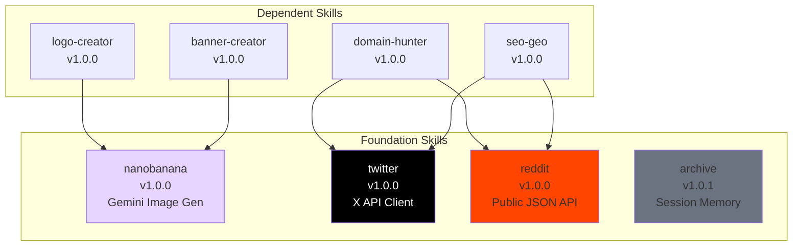
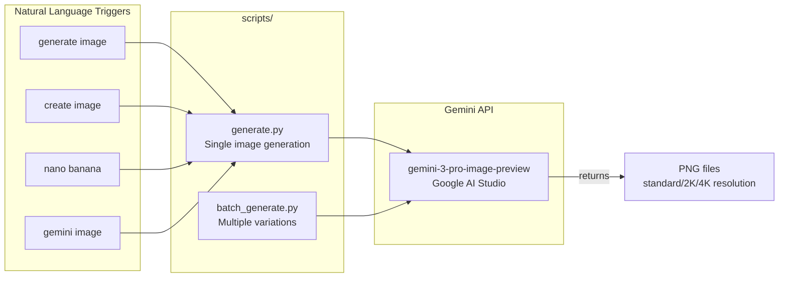
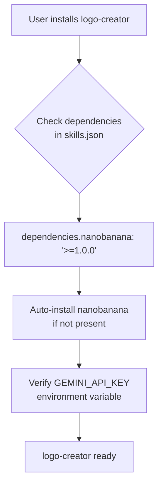
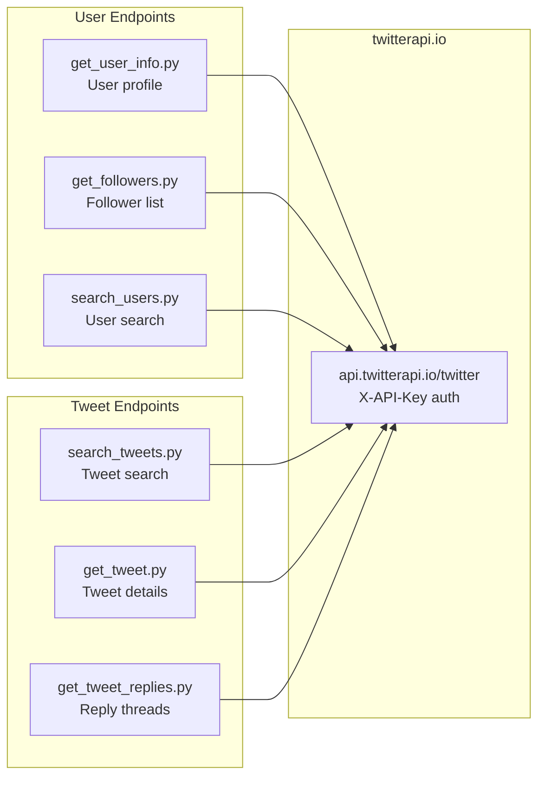
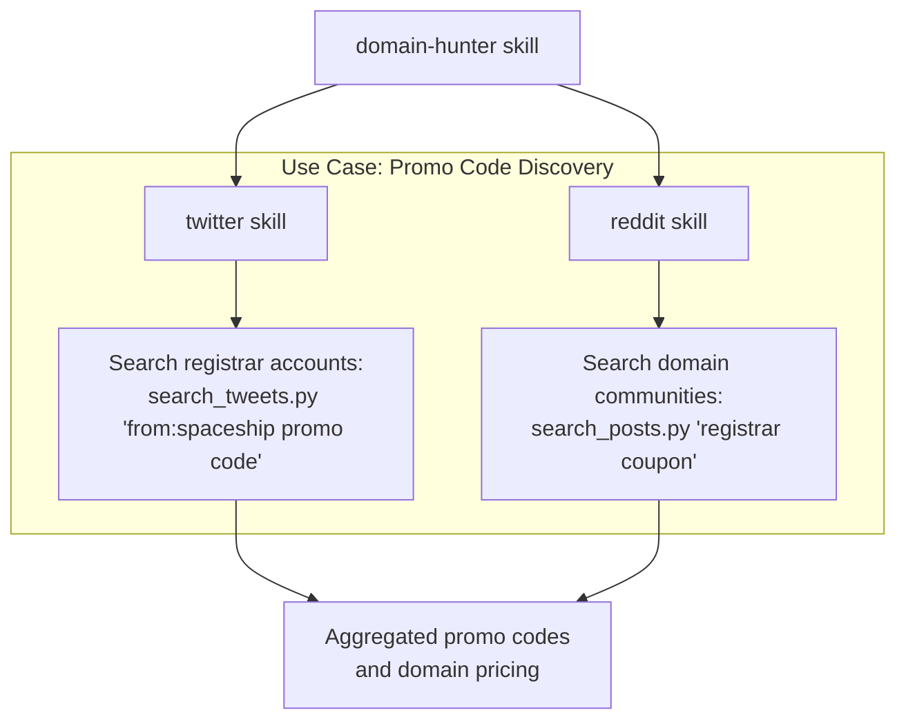
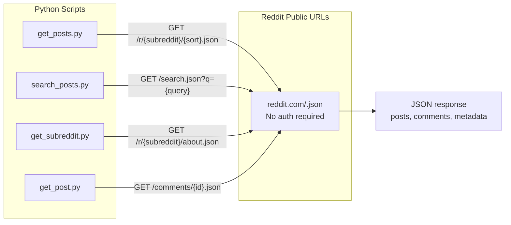
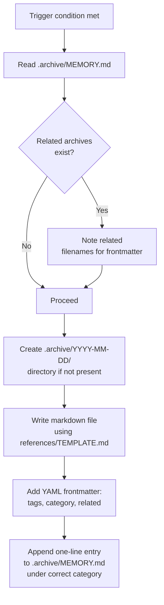
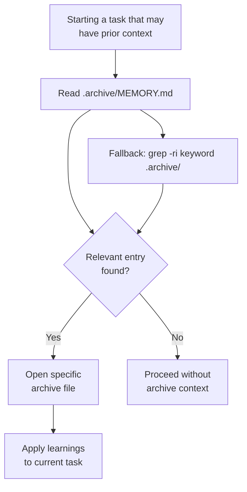
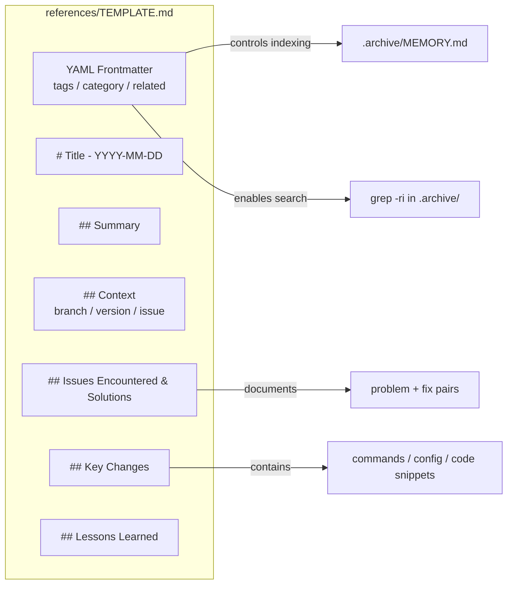

<!-- source: DeepWiki mcp.deepwiki.com · repo ReScienceLab/opc-skills · extra page Foundation Skills · fetched 2026-10-26 -->

# Foundation Skills

<details>
<summary>Relevant source files</summary>

The following files were used as context for generating this wiki page:

- [skills.json](skills.json)
- [skills/archive/SKILL.md](skills/archive/SKILL.md)
- [skills/archive/references/TEMPLATE.md](skills/archive/references/TEMPLATE.md)
- [skills/banner-creator/SKILL.md](skills/banner-creator/SKILL.md)
- [skills/domain-hunter/SKILL.md](skills/domain-hunter/SKILL.md)
- [skills/logo-creator/SKILL.md](skills/logo-creator/SKILL.md)
- [skills/nanobanana/SKILL.md](skills/nanobanana/SKILL.md)
- [skills/reddit/SKILL.md](skills/reddit/SKILL.md)
- [skills/twitter/SKILL.md](skills/twitter/SKILL.md)

</details>


Foundation skills provide core infrastructure capabilities that other skills depend on. This page documents four foundation skills in the OPC Skills collection:

| Skill | Purpose | Authentication | Dependencies |
|---|---|---|---|
| `nanobanana` | Google Gemini image generation | Required (`GEMINI_API_KEY`) | None |
| `twitter` | Twitter/X API client | Required (`TWITTERAPI_API_KEY`) | None |
| `reddit` | Reddit public JSON API | None | None |
| `archive` | Session memory persistence | None | None |

**Skill Dependency Graph:**



Foundation skills have no dependencies on other skills, making them the base layer of the OPC Skills ecosystem. For skill dependency management, see [Dependency Management](#2.3).

Sources: [skills.json:297-442]()

---

## nanobanana - Image Generation

The `nanobanana` skill provides AI image generation using Google's Gemini 3 Pro Image model (nicknamed "Nano Banana Pro"). It supports text-to-image generation, image editing, multiple aspect ratios, and high-resolution output (2K/4K).

### Purpose and Capabilities

**Core functions:**
- Text-to-image generation from natural language prompts
- Image editing via input image + transformation prompt
- Batch generation for exploring design variations
- Support for aspect ratios: `1:1`, `2:3`, `3:4`, `4:5`, `9:16`, `16:9`, `21:9`
- Optional Google Search grounding for factual accuracy

**Command Mapping to Python Scripts:**



Sources: [skills/nanobanana/SKILL.md:1-9](), [skills.json:297-346]()

### Authentication Requirements

| Environment Variable | Acquisition URL | Cost |
|---|---|---|
| `GEMINI_API_KEY` | https://aistudio.google.com/apikey | Free tier available |

Set in `~/.zshrc`:
```bash
export GEMINI_API_KEY="your_api_key"
```

Sources: [skills/nanobanana/SKILL.md:11-14]()

### Script Reference

**Single Image Generation:**
```bash
python3 scripts/generate.py "a cute robot mascot, pixel art style" -o robot.png
```

**Image Editing:**
```bash
python3 scripts/generate.py "make the background blue" -i input.jpg -o output.png
```

**Batch Generation (20 variations):**
```bash
python3 scripts/batch_generate.py "pixel art logo" -n 20 -d ./logos -p logo
```

**High-Resolution 4K Output:**
```bash
python3 scripts/generate.py "professional product photo" --size 4K -o product.png
```

**Command-Line Options:**

| Flag | Description | Example |
|---|---|---|
| `-o, --output` | Output file path | `-o image.png` |
| `-i, --input` | Input image for editing | `-i base.jpg` |
| `-r, --ratio` | Aspect ratio | `--ratio 16:9` |
| `-s, --size` | Resolution (2K/4K) | `--size 4K` |
| `--search` | Enable Google Search grounding | `--search` |
| `-n, --count` | Batch count | `-n 20` |
| `-d, --dir` | Output directory | `-d ./images` |
| `-p, --prefix` | Filename prefix | `-p logo` |
| `--delay` | Batch delay (seconds) | `--delay 5` |

Sources: [skills/nanobanana/SKILL.md:21-94](), [skills.json:337-341]()

### File Output Conventions

**Default output directory:** `./nanobanana-images/` (configurable via `IMAGE_OUTPUT_DIR` env var)

**Batch naming pattern:** `{prefix}-{01..N}.png`

Example batch output:
```
./logos/
  logo-01.png
  logo-02.png
  ...
  logo-20.png
```

Sources: [skills/nanobanana/SKILL.md:120-125]()

### Dependent Skills

The following skills declare `nanobanana` as a dependency:

| Skill | Dependency Declaration | Purpose |
|---|---|---|
| `logo-creator` | `"nanobanana": ">=1.0.0"` | Batch logo generation + post-processing |
| `banner-creator` | `"nanobanana": ">=1.0.0"` | Wide-format banner generation |

**Dependency Resolution Flow:**



Sources: [skills.json:193-195](), [skills.json:259-261](), [skills/logo-creator/SKILL.md:17-19]()

---

## twitter - X API Client

The `twitter` skill provides search and retrieval of Twitter/X content via the twitterapi.io third-party API. It supports user profiles, tweets, replies, followers/following, communities, spaces, and trend data.

### Purpose and Capabilities

**Core functions:**
- User profile and about information
- Tweet search with advanced query syntax
- User tweets, mentions, and replies
- Follower/following lists and relationship checks
- Community member and tweet retrieval
- Space metadata and trend data

**API Endpoints → Python Scripts Mapping:**



Sources: [skills/twitter/SKILL.md:1-8](), [skills.json:393-442]()

### Authentication Requirements

| Environment Variable | Acquisition URL | Pricing |
|---|---|---|
| `TWITTERAPI_API_KEY` | https://twitterapi.io | ~$0.15-0.18/1k requests |

Set in `~/.zshrc`:
```bash
export TWITTERAPI_API_KEY="your_api_key"
```

**Quick verification:**
```bash
cd skills/twitter
python3 scripts/get_user_info.py elonmusk
```

Sources: [skills/twitter/SKILL.md:10-21](), [skills.json:408-413]()

### Script Reference

**User Endpoints:**
```bash
python3 scripts/get_user_info.py USERNAME
python3 scripts/get_user_tweets.py USERNAME --limit 20
python3 scripts/get_followers.py USERNAME --limit 100
python3 scripts/check_relationship.py USER1 USER2
python3 scripts/search_users.py "query" --limit 20
```

**Tweet Endpoints:**
```bash
python3 scripts/get_tweet.py TWEET_ID
python3 scripts/search_tweets.py "query" --type Latest --limit 20
python3 scripts/get_tweet_replies.py TWEET_ID --limit 20
python3 scripts/get_tweet_thread.py TWEET_ID
```

**Community Endpoints:**
```bash
python3 scripts/get_community.py COMMUNITY_ID
python3 scripts/get_community_tweets.py COMMUNITY_ID --limit 20
python3 scripts/search_community_tweets.py "query" --limit 20
```

Sources: [skills/twitter/SKILL.md:23-72](), [skills.json:431-437]()

### Advanced Search Syntax

```bash
# From specific user
python3 scripts/search_tweets.py "from:elonmusk"

# Date range
python3 scripts/search_tweets.py "AI since:2024-01-01 until:2024-12-31"

# Exclude retweets
python3 scripts/search_tweets.py "AI -filter:retweets"

# Minimum engagement
python3 scripts/search_tweets.py "AI min_faves:1000"
```

Sources: [skills/twitter/SKILL.md:75-94]()

### Dependent Skills

**Domain Hunter Integration:**



The `domain-hunter` skill uses `twitter` (and `reddit`) to search for registrar promo codes and domain pricing discussions.

Sources: [skills.json:143-146](), [skills/domain-hunter/SKILL.md:65-82]()

**SEO-GEO Integration:**

The `seo-geo` skill also declares `twitter` as a dependency for social media analysis and keyword research.

Sources: [skills.json:28-31]()

---

## reddit - Public JSON API

The `reddit` skill provides search and retrieval of Reddit content via Reddit's public JSON API. No authentication is required — it accesses Reddit's public JSON endpoints directly.

### Purpose and Capabilities

**Core functions:**
- Subreddit post retrieval with sorting (hot, new, top, rising, controversial)
- Post search across all of Reddit or specific subreddits
- Subreddit metadata and subscriber information
- Individual post and comment thread retrieval
- User profile and post history

**Public JSON API Access Pattern:**



Sources: [skills/reddit/SKILL.md:1-8](), [skills.json:348-391]()

### Authentication Requirements

**None required.** Reddit's public JSON API is accessible without authentication or API keys.

**Quick verification:**
```bash
cd skills/reddit
python3 scripts/get_posts.py python --limit 3
```

Sources: [skills/reddit/SKILL.md:10-18](), [skills.json:360-364]()

### Script Reference

**Subreddit Posts:**
```bash
python3 scripts/get_posts.py python --limit 20           # Hot posts (default)
python3 scripts/get_posts.py python --sort new --limit 20
python3 scripts/get_posts.py python --sort top --time week
```

**Search Posts:**
```bash
python3 scripts/search_posts.py "AI agent" --limit 20
python3 scripts/search_posts.py "MCP server" --subreddit ClaudeAI --limit 10
python3 scripts/search_posts.py "async python" --sort top --time year
```

**Subreddit Info:**
```bash
python3 scripts/get_subreddit.py python
```

**Post & Comments:**
```bash
python3 scripts/get_post.py abc123
python3 scripts/get_post.py abc123 --comments 50
```

**User Profile:**
```bash
python3 scripts/get_user.py spez
python3 scripts/get_user.py spez --posts 10
```

Sources: [skills/reddit/SKILL.md:20-56](), [skills.json:380-386]()

### Sort Options

| Sort | Description | Time Options |
|---|---|---|
| `hot` | Trending posts (default) | - |
| `new` | Latest posts | - |
| `top` | Highest voted | hour, day, week, month, year, all |
| `rising` | Gaining traction | - |
| `controversial` | Mixed votes | hour, day, week, month, year, all |

Sources: [skills/reddit/SKILL.md:58-66]()

### Dependent Skills

The same skills that depend on `twitter` also depend on `reddit` for complementary social media data:

| Skill | Use Case |
|---|---|
| `domain-hunter` | Search `/r/Domains` for registrar pricing and promo codes |
| `seo-geo` | Analyze Reddit discussions for keyword research and content ideas |

Sources: [skills.json:143-146](), [skills/domain-hunter/SKILL.md:73-79]()

---

## archive - Session Memory

The `archive` skill provides persistent, cross-session knowledge capture for AI agent projects. Because AI coding agents lose context between sessions, the archive skill compensates by writing structured markdown files to disk that can be searched and retrieved in future sessions. It maintains a central index (`MEMORY.md`) so an agent can quickly find relevant prior work before starting any significant task.

Sources: [skills/archive/SKILL.md:1-8]()

### Trigger Conditions

The archive skill activates under the following conditions:

| Trigger | Description |
|---|---|
| Significant task completed | Deploy, migration, or major feature finished |
| Tricky bug resolved | Debugging session with non-obvious solution |
| Explicit user instruction | User says "archive this" |
| Multi-step process completed | Any workflow with learnings worth preserving |

The skill should also be **consulted** (lookup workflow) before:
- Debugging infrastructure, deploy, or CI issues
- Repeating a process performed in a previous session
- Encountering an error that may have been solved before

Sources: [skills/archive/SKILL.md:10-23]()

### File System Layout

The archive skill operates entirely within a `.archive/` directory at the root of the project. This directory is **local-only** and must be listed in `.gitignore`.

**File layout produced by the archive workflow:**

```
.archive/
├── MEMORY.md                      ← Central index, one line per archive entry
├── 2024-06-15/
│   ├── cloudwatch-logging.md      ← Individual archive file
│   └── ecs-deployment.md
└── 2024-06-22/
    └── auth-token-bug.md
```

The daily subdirectory format is `YYYY-MM-DD/`. Archive filenames should be descriptive (e.g., `cloudwatch-logging.md`, not `session.md`).

Sources: [skills/archive/SKILL.md:29-54]()

### Archive Workflow

**Diagram: Archive Write Workflow**



Steps in order:

1. Read `.archive/MEMORY.md` — scan for related existing archives.
2. Create `.archive/YYYY-MM-DD/` directory if it does not yet exist.
3. Write a new markdown file using the format in `references/TEMPLATE.md`.
4. Update `.archive/MEMORY.md` — add one line under the correct category heading.
5. If related archives exist, populate the `related` field in the YAML frontmatter.

Sources: [skills/archive/SKILL.md:28-37]()

### Lookup Workflow

**Diagram: Archive Lookup Workflow**



The two lookup mechanisms are:

| Method | Command / Action |
|---|---|
| Index scan | Read `.archive/MEMORY.md` directly |
| Full-text search | `grep -ri "keyword" .archive/` |

Sources: [skills/archive/SKILL.md:35-39]()

### `MEMORY.md` Index Structure

`.archive/MEMORY.md` is the central index maintained by every archive operation. It is organized by category. Each entry is a single line linking to an archive file and providing enough context to decide whether to read the full file.

Example structure (not from source files — illustrative of the category-based layout):

```markdown
## infrastructure
- 2024-06-15/cloudwatch-logging.md — Fixed missing IAM permission for log group creation

## debugging
- 2024-06-22/auth-token-bug.md — JWT expiry mismatch between client and server

## release
- 2024-06-15/ecs-deployment.md — ECS blue/green deploy with manual rollback steps
```

The agent always writes to `MEMORY.md` after creating any archive file — this invariant keeps the index complete.

Sources: [skills/archive/SKILL.md:24-27](), [skills/archive/SKILL.md:50-54]()

### Archive File Format (`TEMPLATE.md`)

Individual archive files follow a fixed markdown structure defined in `references/TEMPLATE.md`. Every file begins with a YAML frontmatter block followed by standard markdown sections.

**Diagram: Archive File Structure → Code Entities**



#### YAML Frontmatter Fields

| Field | Required | Description |
|---|---|---|
| `tags` | Yes | Array of searchable keywords, e.g., `[ecs, iam, logging]` |
| `category` | Yes | One of the five predefined values (see below) |
| `related` | No | Array of archive filenames (without `.md`) for cross-referencing |

**Example frontmatter:**

```yaml
---
tags: [ecs, iam, cloudwatch, logging]
category: infrastructure
related: [ecs-deployment]
---
```

The `related` field holds bare filenames without path or extension, e.g., `ecs-deployment` rather than `2024-06-15/ecs-deployment.md`.

Sources: [skills/archive/references/TEMPLATE.md:1-40]()

#### Markdown Sections

| Section | Purpose |
|---|---|
| `# {Title} - {YYYY-MM-DD}` | Identifies the archive and date |
| `## Summary` | One-line description of what was accomplished |
| `## Context` | Branch name, version, related issue |
| `## Issues Encountered & Solutions` | Numbered issue list with problem description and fix |
| `## Key Changes` | Commands, config, or code that was critical |
| `## Lessons Learned` | Optional insights for future reference |

Sources: [skills/archive/references/TEMPLATE.md:6-33]()

### Category Taxonomy

The archive skill defines five fixed categories. Every archive file must declare exactly one.

| Category | Covers |
|---|---|
| `infrastructure` | AWS, ECS, IAM, networking, secrets, CloudWatch |
| `release` | TestFlight, versioning, Git Flow, CHANGELOG |
| `debugging` | Bug fixes, error resolution, unexpected gotchas |
| `feature` | Feature design and implementation notes |
| `design` | UI/UX, icons, visual design decisions |

These category values appear in two places: the YAML `category` field of each archive file, and as section headings in `.archive/MEMORY.md`.

Sources: [skills/archive/SKILL.md:41-47]()

### Authoring Rules

The following rules are enforced by the skill's instructions:

- `.archive/` **must** be added to `.gitignore` — archive files are local-only and never committed.
- Entries must be concise but fully reproducible — focus on problems, fixes, and exact commands.
- `MEMORY.md` must be updated every time an archive file is created.
- Filenames must be descriptive (e.g., `cloudwatch-logging.md`), not generic (e.g., `session.md`).
- All archive files must include YAML frontmatter with at least `tags` and `category`.

Sources: [skills/archive/SKILL.md:49-56]()

---

