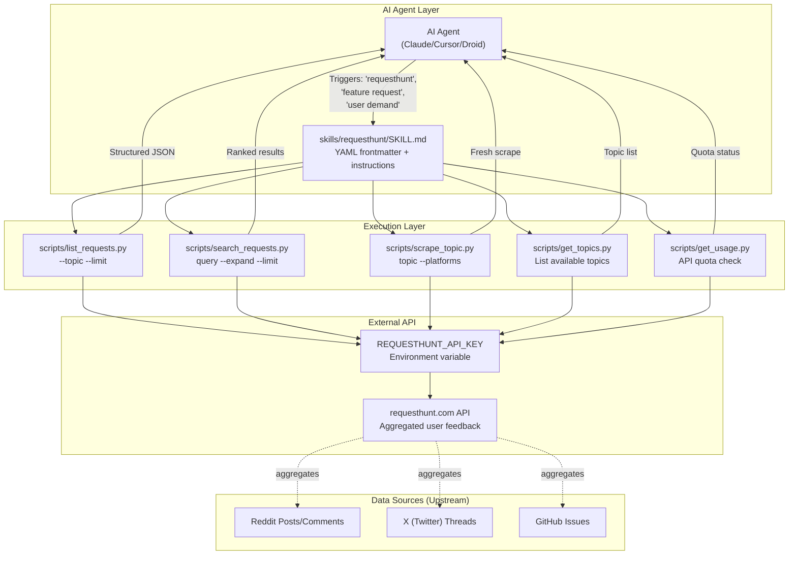
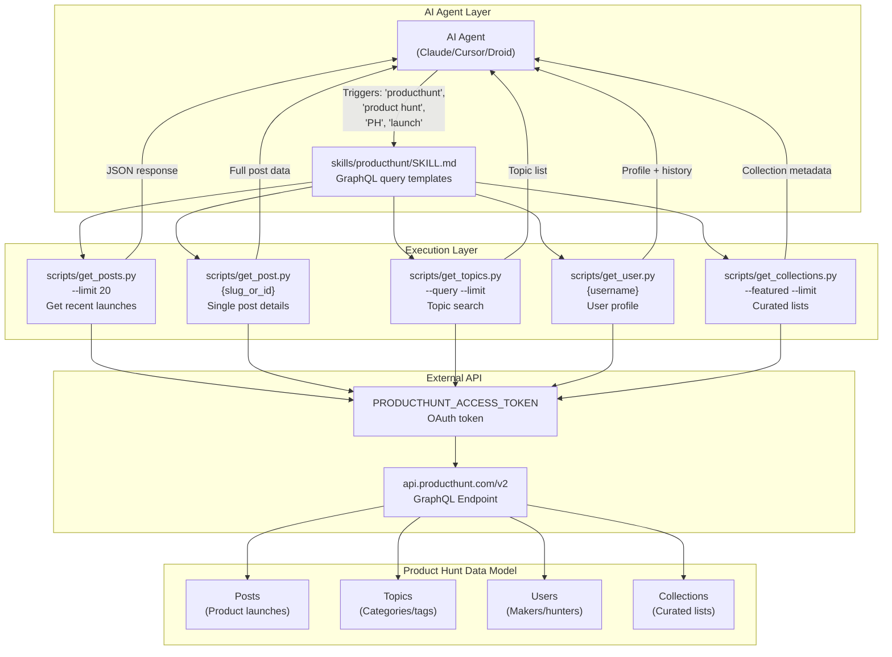
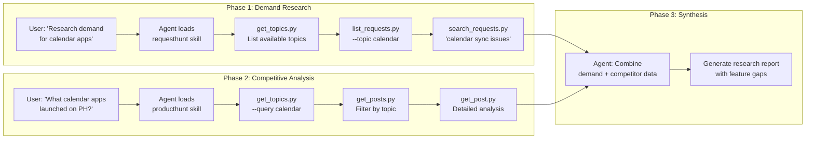

<!-- source: DeepWiki mcp.deepwiki.com · repo ReScienceLab/opc-skills · extra page Research & Validation Skills · fetched 2026-10-26 -->

# Research & Validation Skills

<details>
<summary>Relevant source files</summary>

The following files were used as context for generating this wiki page:

- [README.md](README.md)
- [skill-logos/archive.svg](skill-logos/archive.svg)
- [skills.json](skills.json)
- [skills/archive/SKILL.md](skills/archive/SKILL.md)
- [skills/archive/references/TEMPLATE.md](skills/archive/references/TEMPLATE.md)
- [website/opc-banner.png](website/opc-banner.png)

</details>


This document covers the research and validation skills in the OPC Skills system: **requesthunt** and **producthunt**. These skills enable AI agents to gather market intelligence, validate product ideas, and analyze user demand through automated scraping and API integration. For social media research capabilities, see [Social Media & Domain Skills](#2.4.5). For foundational API client skills, see [Foundation Skills](#2.4.1).

## Overview

The research and validation category contains two standalone skills with distinct data sources:

| Skill | Purpose | Data Source | API Required |
|-------|---------|-------------|--------------|
| `requesthunt` | User demand research from feature requests and complaints | requesthunt.com aggregation service | Yes (REQUESTHUNT_API_KEY) |
| `producthunt` | Product discovery and competitive analysis | Product Hunt GraphQL API | Yes (PRODUCTHUNT_ACCESS_TOKEN) |

Both skills operate independently with no dependencies on other OPC skills, making them suitable for lightweight installations.

**Sources:** [skills.json:76-127](), [skills.json:444-493]()

---

## Requesthunt Skill

### Purpose & Capabilities

The `requesthunt` skill provides automated demand research by aggregating and analyzing user feedback from multiple platforms. It generates structured research reports containing feature requests, pain points, and user questions extracted from Reddit, X (Twitter), and GitHub.

**Primary Use Cases:**
- Pre-launch market validation
- Feature prioritization based on user demand
- Competitor gap analysis
- Community sentiment analysis

**Skill Metadata:**
- Version: 1.0.0
- Dependencies: None
- Auth Required: Yes (API key from requesthunt.com)
- Installation: `npx skills add ReScienceLab/opc-skills --skill requesthunt`

**Sources:** [skills.json:76-99](), [README.md:47]()

### System Architecture



**Diagram: Requesthunt Skill Data Flow**

This diagram shows how the AI agent invokes Python scripts that authenticate using an environment variable and query the requesthunt.com API, which aggregates data from Reddit, X, and GitHub.

**Sources:** [skills.json:115-121](), [skills.json:90-99]()

### Script Commands

The skill provides five executable Python scripts for different research workflows:

#### 1. list_requests.py
```bash
python3 scripts/list_requests.py --topic "{topic}" --limit 20
```
Retrieves pre-categorized feature requests for a specific topic (e.g., "calendar apps", "project management tools").

#### 2. search_requests.py
```bash
python3 scripts/search_requests.py "{query}" --expand --limit 20
```
Performs full-text search across all indexed requests. The `--expand` flag includes related requests and variations.

#### 3. scrape_topic.py
```bash
python3 scripts/scrape_topic.py "{topic}" --platforms reddit,x,github
```
Triggers a fresh scrape of platforms for a given topic. Useful for real-time data when pre-indexed results are insufficient.

#### 4. get_topics.py
```bash
python3 scripts/get_topics.py
```
Lists all available pre-indexed topics in the requesthunt database.

#### 5. get_usage.py
```bash
python3 scripts/get_usage.py
```
Checks current API quota usage and limits for the authenticated key.

**Sources:** [skills.json:115-121]()

### Authentication Configuration

```yaml
auth:
  required: true
  type: api_key
  keys:
    - env: REQUESTHUNT_API_KEY
      url: https://requesthunt.com/dashboard
```

The skill requires a `REQUESTHUNT_API_KEY` obtained from the requesthunt.com dashboard. The AI agent will prompt the user to set this environment variable before executing scripts.

**Sources:** [skills.json:90-99]()

### Example Workflow Reference

The skill includes a case study demonstrating demand research for calendar applications:

- **Path:** [skills/requesthunt/examples/calendar-app-research.md]()
- **Reference:** [skills.json:125]()

---

## Producthunt Skill

### Purpose & Capabilities

The `producthunt` skill enables AI agents to query Product Hunt's product database for competitive intelligence and trend analysis. It provides access to posts (product launches), topics, users, and curated collections via Product Hunt's GraphQL API.

**Primary Use Cases:**
- Competitor product analysis
- Launch day research (what launched on specific dates)
- Topic trend identification
- User/maker profile research
- Collection discovery (curated product lists)

**Skill Metadata:**
- Version: 1.0.0
- Dependencies: None
- Auth Required: Yes (OAuth access token)
- Installation: `npx skills add ReScienceLab/opc-skills --skill producthunt`

**Sources:** [skills.json:444-466](), [README.md:54]()

### System Architecture



**Diagram: Producthunt Skill GraphQL Integration**

This diagram illustrates the skill's interaction with Product Hunt's GraphQL API, showing how different scripts query different data models (posts, topics, users, collections).

**Sources:** [skills.json:482-488](), [skills.json:457-465]()

### Script Commands

The skill provides five scripts corresponding to Product Hunt's primary data models:

#### 1. get_posts.py
```bash
python3 scripts/get_posts.py --limit 20
```
Retrieves recent product launches, ordered by featured date. Default limit is 20.

#### 2. get_post.py
```bash
python3 scripts/get_post.py {slug_or_id}
```
Fetches detailed information for a specific product using either its slug (URL-friendly name) or numeric ID.

#### 3. get_topics.py
```bash
python3 scripts/get_topics.py --query "{query}" --limit 20
```
Searches Product Hunt topics (categories/tags). Useful for discovering trending categories.

#### 4. get_user.py
```bash
python3 scripts/get_user.py {username}
```
Retrieves user profile including products they've made or hunted, follower count, and activity history.

#### 5. get_collections.py
```bash
python3 scripts/get_collections.py --featured --limit 20
```
Fetches curated product collections. The `--featured` flag returns staff-picked collections.

**Sources:** [skills.json:482-488]()

### Authentication Configuration

```yaml
auth:
  required: true
  type: api_key
  keys:
    - env: PRODUCTHUNT_ACCESS_TOKEN
      url: https://producthunt.com/v2/oauth/applications
```

The skill requires a `PRODUCTHUNT_ACCESS_TOKEN` obtained by creating an OAuth application on Product Hunt. The token provides read-only access to public data.

**Sources:** [skills.json:457-465]()

### API Documentation Reference

Product Hunt's GraphQL API documentation is linked in the skill metadata:
- **API Docs:** `https://api.producthunt.com/v2/docs`
- **Reference:** [skills.json:491]()

---

## Skill Comparison Matrix

| Feature | requesthunt | producthunt |
|---------|-------------|-------------|
| **Data Source** | Aggregated user feedback (Reddit, X, GitHub) | Product Hunt GraphQL API |
| **API Type** | REST | GraphQL |
| **Auth Complexity** | Simple API key | OAuth application token |
| **Cost** | Varies by plan | Free for public data |
| **Primary Output** | Feature requests, complaints, questions | Product launches, trends, makers |
| **Filtering Options** | Topic, platform, query | Date, topics, featured status |
| **Freshness** | Real-time scraping available | Real-time via API |
| **Use Case Focus** | Pre-launch validation | Post-launch competitive analysis |

**Sources:** [skills.json:76-127](), [skills.json:444-493]()

---

## Installation & Platform Support

Both skills support universal installation across 16+ AI platforms:

### Universal Installation
```bash
# Install requesthunt
npx skills add ReScienceLab/opc-skills --skill requesthunt

# Install producthunt
npx skills add ReScienceLab/opc-skills --skill producthunt

# Install both
npx skills add ReScienceLab/opc-skills --skill requesthunt --skill producthunt

# Install to specific agent
npx skills add ReScienceLab/opc-skills --skill requesthunt -a droid
```

### Claude Code Marketplace
```bash
# Add marketplace
/plugin marketplace add ReScienceLab/opc-skills

# Install skills
/plugin install requesthunt@opc-skills
/plugin install producthunt@opc-skills
```

### Platform-Specific Directories

After installation, skills are placed in agent-specific directories:

| Platform | Directory Path |
|----------|---------------|
| Claude Code/Desktop | `.claude/skills/` |
| Cursor | `.cursor/skills/` |
| Factory Droid | `.factory/skills/` |
| Windsurf | `.windsurf/skills/` |

**Sources:** [skills.json:100-114](), [skills.json:467-481](), [README.md:63-89]()

---

## Typical Research Workflow



**Diagram: Multi-Skill Research Workflow**

This workflow demonstrates how `requesthunt` and `producthunt` complement each other in a typical market research task. The AI agent first gathers user demand signals via requesthunt, then analyzes existing solutions via producthunt, and finally synthesizes insights.

**Sources:** [skills.json:82-88](), [skills.json:450-455]()

---

## Trigger Keywords

The AI agent automatically activates these skills when detecting relevant keywords in user prompts:

### Requesthunt Triggers
- `"requesthunt"`
- `"request hunt"`
- `"feature request"`
- `"user demand"`
- `"demand research"`

### Producthunt Triggers
- `"producthunt"`
- `"product hunt"`
- `"PH"`
- `"launch"`

**Sources:** [skills.json:82-88](), [skills.json:450-455]()

---

## Example Use Cases

### Use Case 1: Feature Prioritization
**Goal:** Determine which features to build first for a new SaaS product.

**Workflow:**
1. Run `get_topics.py` to identify relevant category
2. Execute `list_requests.py --topic "{category}"` to retrieve top feature requests
3. Use `search_requests.py` to find specific pain points mentioned by users
4. Analyze frequency and sentiment to prioritize roadmap

### Use Case 2: Launch Day Reconnaissance
**Goal:** Understand what launched on Product Hunt on a specific date.

**Workflow:**
1. Run `get_posts.py --limit 50` to retrieve recent launches
2. Filter results by launch date
3. For interesting products, run `get_post.py {slug}` for details
4. Use `get_user.py {maker}` to research product creators

### Use Case 3: Gap Analysis
**Goal:** Find underserved niches by comparing user demand vs existing products.

**Workflow:**
1. Use `requesthunt` to identify frequently requested features in a category
2. Use `producthunt` to see what solutions currently exist
3. Calculate gap = (demand - existing solutions)
4. Prioritize gaps with high demand and low competition

**Sources:** [skills.json:122-126]()

---

## Dependency Status

Both skills are **standalone** with no internal dependencies on other OPC skills:

```json
"dependencies": {}
```

This makes them suitable for:
- Minimal installations where only research capabilities are needed
- Testing/validation of the skills system
- Isolated use cases without image generation or social media integration

**Sources:** [skills.json:89](), [skills.json:456]()

---

## Links & Resources

### Requesthunt
- **GitHub:** [skills/requesthunt]()
- **API Docs:** `https://requesthunt.com/docs`
- **Example:** [skills/requesthunt/examples/calendar-app-research.md]()
- **Skill Registry:** [skills.json:76-127]()

### Producthunt
- **GitHub:** [skills/producthunt]()
- **API Docs:** `https://api.producthunt.com/v2/docs`
- **Skill Registry:** [skills.json:444-493]()

**Sources:** [skills.json:122-126](), [skills.json:489-492]()

---

