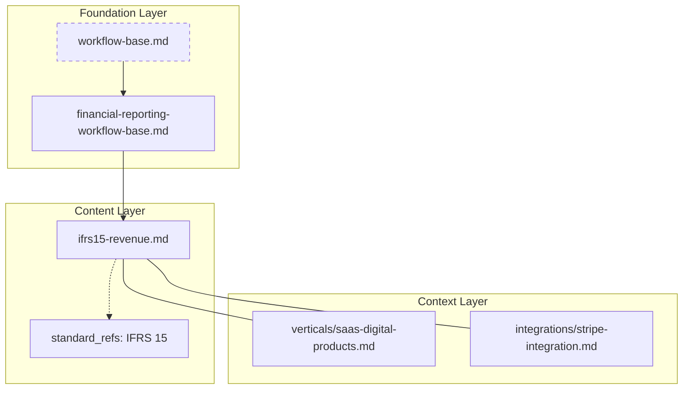
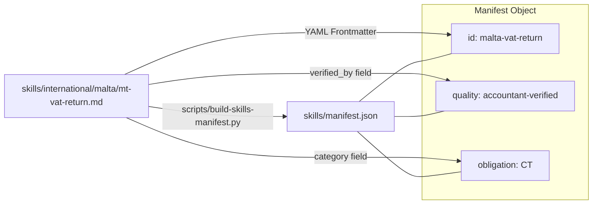

<!-- source: DeepWiki mcp.deepwiki.com · repo openaccountants/openaccountants · page 2.1 Skills Source Layer · fetched 2026-10-26 -->

# Skills Source Layer

<details>
<summary>Relevant source files</summary>

The following files were used as context for generating this wiki page:

- [CHANGELOG.md](CHANGELOG.md)
- [CLA.md](CLA.md)
- [COMMERCIAL_LICENSE.md](COMMERCIAL_LICENSE.md)
- [CONTRIBUTING.md](CONTRIBUTING.md)
- [LICENSE](LICENSE)
- [START-HERE.md](START-HERE.md)
- [docs/INTELLIGENCE-ROADMAP.md](docs/INTELLIGENCE-ROADMAP.md)
- [docs/PROMOTION-PLAYBOOK.md](docs/PROMOTION-PLAYBOOK.md)
- [docs/QUALITY-TIERS.md](docs/QUALITY-TIERS.md)
- [docs/USER-JOURNEY-ANALYSIS.md](docs/USER-JOURNEY-ANALYSIS.md)
- [docs/growth-drafts.md](docs/growth-drafts.md)
- [skills/cross-border/eu-oss-digital.md](skills/cross-border/eu-oss-digital.md)
- [skills/cross-border/eu-reverse-charge.md](skills/cross-border/eu-reverse-charge.md)
- [skills/cross-border/non-eu-export-services.md](skills/cross-border/non-eu-export-services.md)
- [skills/cross-border/permanent-establishment-risk.md](skills/cross-border/permanent-establishment-risk.md)
- [skills/cross-border/withholding-tax-matrix.md](skills/cross-border/withholding-tax-matrix.md)
- [skills/financial-reporting/business-combinations/ifrs3-business-combinations.md](skills/financial-reporting/business-combinations/ifrs3-business-combinations.md)
- [skills/financial-reporting/business-combinations/us-gaap-asc805-business-combinations.md](skills/financial-reporting/business-combinations/us-gaap-asc805-business-combinations.md)
- [skills/financial-reporting/debt-vs-equity/ias32-debt-vs-equity.md](skills/financial-reporting/debt-vs-equity/ias32-debt-vs-equity.md)
- [skills/financial-reporting/debt-vs-equity/us-gaap-debt-vs-equity.md](skills/financial-reporting/debt-vs-equity/us-gaap-debt-vs-equity.md)
- [skills/financial-reporting/financial-reporting-workflow-base.md](skills/financial-reporting/financial-reporting-workflow-base.md)
- [skills/financial-reporting/leases/ifrs16-leases.md](skills/financial-reporting/leases/ifrs16-leases.md)
- [skills/financial-reporting/leases/us-gaap-asc842-leases.md](skills/financial-reporting/leases/us-gaap-asc842-leases.md)
- [skills/financial-reporting/revenue-recognition/ifrs15-revenue.md](skills/financial-reporting/revenue-recognition/ifrs15-revenue.md)
- [skills/financial-reporting/revenue-recognition/us-gaap-asc606-revenue.md](skills/financial-reporting/revenue-recognition/us-gaap-asc606-revenue.md)
- [skills/foundation/workflow-base.md](skills/foundation/workflow-base.md)
- [skills/intelligence/deadline-engine.md](skills/intelligence/deadline-engine.md)
- [skills/intelligence/optimisation-advisor.md](skills/intelligence/optimisation-advisor.md)
- [skills/intelligence/threshold-alerts.md](skills/intelligence/threshold-alerts.md)
- [skills/international/kazakhstan/kz-simplified-regime.md](skills/international/kazakhstan/kz-simplified-regime.md)
- [skills/manifest.json](skills/manifest.json)
- [skills/patterns/global-home-office.md](skills/patterns/global-home-office.md)
- [skills/patterns/global-payment-processors.md](skills/patterns/global-payment-processors.md)
- [skills/patterns/global-saas-vendors.md](skills/patterns/global-saas-vendors.md)

</details>


The **Skills Source Layer** is the foundation of the OpenAccountants ecosystem. It consists of a library of machine-executable tax and accounting logic stored as Markdown files in the `skills/` directory. These files are designed to be consumed by Large Language Models (LLMs) to transform raw financial data into structured accounting working papers.

## Directory Structure and Organization

The `skills/` directory is organized by jurisdiction and domain to allow for modular loading and targeted updates.

| Directory | Content Type | Example Entity |
|-----------|--------------|----------------|
| `skills/foundation/` | Domain-specific workflow bases | `payroll-workflow-base.md` |
| `skills/international/` | Non-US country-specific skills | `skills/international/malta/mt-vat-return.md` |
| `skills/federal/` | US Federal tax skills | `skills/federal/us-crypto-tax.md` |
| `skills/us-states/` | US State-specific tax skills | `skills/us-states/ny/ny-income-tax.md` |
| `skills/cross-border/` | Multi-jurisdiction logic | `pillar-two-globe-minimum-tax.md` |
| `skills/verticals/` | Industry-specific patterns | `freelance-developer.md` |
| `skills/integrations/` | Platform export mappings | `stripe-integration.md` |
| `skills/intelligence/` | Advisory and engine logic | `deadline-engine.md` |

**Sources:** [CONTRIBUTING.md:109-125](), [CHANGELOG.md:9-30]()

## Skill Composition Pattern

OpenAccountants uses a **composition pattern** where specific content skills are layered on top of a foundation. This ensures consistent behavior (Step 0 onboarding, conservative defaults) across all domains.

### Workflow Bases
Every domain has a `workflow-base.md` that defines the "contract" between the AI and the user. It enforces the three-state classification outcome:
1.  **Classified**: Sufficient data exists.
2.  **Assumed**: A conservative default was applied (flagged for review).
3.  **Needs Input**: A specific question is required from the user.

For details on the universal and domain-specific bases, see **[Workflow Bases and Foundation Skills](#2.1.1)**.

### Content Skills
Content skills (e.g., `at-income-tax.md`) provide the specific rates, thresholds, and statutory citations. They do not repeat the workflow logic but focus on the "Reference Layer" (Layer A) and "Computation Layer" (Layer B).

**Sources:** [docs/QUALITY-TIERS.md:39-61](), [START-HERE.md:44-55](), [CONTRIBUTING.md:74-90]()

## YAML Frontmatter Standard

Every skill file must contain a YAML frontmatter block. This metadata is used by the build pipeline to generate the `manifest.json` and by the MCP server to index capabilities.

```yaml
---
id: malta-vat-return
jurisdiction: MT
obligation: CT
quality: accountant-verified
category: international
tax_year: 2025
verified_by: "Michael Cutajar, CPA"
depends_on:
  - foundation.md
  - intake.md
---
```

For a full reference of categories and the manifest schema, see **[Skill Taxonomy and Categories](#2.1.2)**.

**Sources:** [skills/manifest.json:47-58](), [CONTRIBUTING.md:41-70]()

## Intelligence and Platform Layers

Beyond standard tax computation, the source layer includes specialized skills for advisory and data ingestion:

*   **Intelligence Skills**: Engines like the `deadline-engine.md` or `optimisation-advisor.md` that provide cross-domain insights.
*   **Pattern Libraries**: Global libraries for SaaS vendors or home office deductions that provide instant classification for common transactions.
*   **Integrations**: Mappings for platform exports (Xero, Stripe, Shopify) to translate raw CSV columns into the OpenAccountants classification standard.

For details on these advanced layers, see **[Intelligence Skills, Patterns, and Integrations](#2.1.3)**.

**Sources:** [CHANGELOG.md:28-30](), [CHANGELOG.md:68-68](), [CONTRIBUTING.md:69-69]()

## Relationship Diagram: Skill Layering

The following diagram illustrates how different entities in the `skills/` directory interact to form a complete "Package" for the AI.


**Sources:** [skills/financial-reporting/revenue-recognition/ifrs15-revenue.md:1-23](), [CONTRIBUTING.md:74-90]()

## Code Entity Mapping: From Source to Manifest

This diagram shows how the build script `build-skills-manifest.py` processes source files into the system's central index.


**Sources:** [skills/manifest.json:1-46](), [docs/QUALITY-TIERS.md:94-94](), [CONTRIBUTING.md:23-23]()

---

