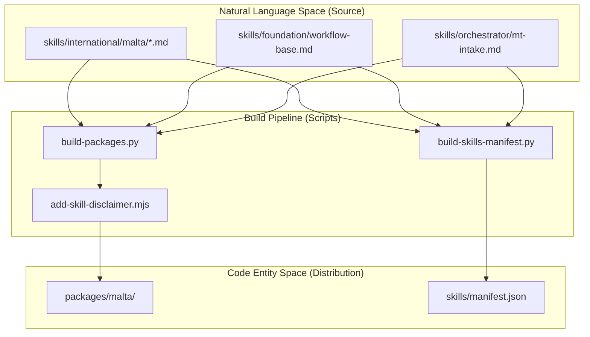
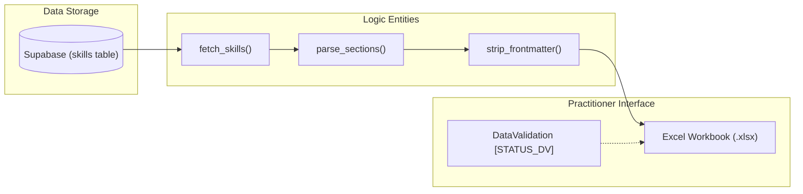

<!-- source: DeepWiki mcp.deepwiki.com · repo openaccountants/openaccountants · page 2.3 Build Pipeline and Scripts · fetched 2026-10-26 -->

# Build Pipeline and Scripts

Relevant source files

The following files were used as context for generating this wiki page:

- [.github/workflows/sync-mcp.yml](.github/workflows/sync-mcp.yml)
- [CHANGELOG.md](CHANGELOG.md)
- [START-HERE.md](START-HERE.md)
- [docs/INTELLIGENCE-ROADMAP.md](docs/INTELLIGENCE-ROADMAP.md)
- [docs/PROMOTION-PLAYBOOK.md](docs/PROMOTION-PLAYBOOK.md)
- [docs/QUALITY-TIERS.md](docs/QUALITY-TIERS.md)
- [docs/USER-JOURNEY-ANALYSIS.md](docs/USER-JOURNEY-ANALYSIS.md)
- [docs/growth-drafts.md](docs/growth-drafts.md)
- [scripts/build-verification-workbook.py](scripts/build-verification-workbook.py)

The OpenAccountants build pipeline is a collection of Python and Node.js scripts located in the `scripts/` directory. These scripts transform raw, modular tax skills into distributable packages, generate the system manifest, and facilitate the practitioner verification process.

## Pipeline Overview

The build pipeline serves as the bridge between the **Skills Source Layer** (where contributors edit individual markdown files) and the **Packages Distribution Layer** (where end-users consume bundled skills) [START-HERE.md:44-46](). The pipeline ensures that dependencies are resolved, metadata is indexed, and quality tiers are accurately reflected across the ecosystem [CHANGELOG.md:34-36]().

### Build Order and Logic

1.  **`build-packages.py`**: Compiles individual skills into jurisdiction-specific bundles in the `packages/` directory.
2.  **`build-skills-manifest.py`**: Scans the repository to generate `skills/manifest.json`, which acts as the central registry for all skills.
3.  **`add-skill-disclaimer.mjs`**: Injects mandatory legal notices and attribution into generated packages.
4.  **`patch-global-sync.mjs`**: Ensures consistency between local files and the web-based distribution platforms.

### Data Flow: Source to Distribution

The following diagram illustrates how raw skill data flows through the build scripts to become a final package used by an LLM.

**Build Pipeline Data Flow**

Sources: [START-HERE.md:21-35](), [docs/USER-JOURNEY-ANALYSIS.md:49-53](), [CHANGELOG.md:74-80]()

---

## Key Scripts Reference

### build-packages.py
This script is the primary compiler for the repository. It identifies dependencies defined in skill frontmatter and aggregates them into the `packages/` directory. For example, it handles the complex bundling of Canadian federal skills with provincial-specific skills [CHANGELOG.md:31-33]().

*   **Input**: `skills/` directory.
*   **Output**: `packages/` directory, organized by jurisdiction (e.g., `packages/ca-on/` for Ontario, Canada).
*   **When to run**: After adding a new country, state, or province skill, or after modifying the `workflow-base.md`.

### build-skills-manifest.py
Generates the `skills/manifest.json` file. This script is responsible for auto-deriving the quality tier of a skill (Accountant-verified vs Research-verified) by parsing the `verified_by` field in the YAML frontmatter [docs/QUALITY-TIERS.md:94-96]().

*   **Implementation**: It iterates through all 700+ skills, extracts metadata, and builds a JSON index used by the MCP server and the website [CHANGELOG.md:34-36]().
*   **Key Logic**: If `verified_by` contains a name and license, the skill is promoted to `accountant-verified` in the manifest [docs/QUALITY-TIERS.md:13-14]().

### build-verification-workbook.py
A utility for the "Promotion Playbook" that converts markdown skills into Excel workbooks for offline review by licensed practitioners [scripts/build-verification-workbook.py:2-8]().

*   **Key Functions**:
    *   `fetch_skills()`: Retrieves skill content from the Supabase backend [scripts/build-verification-workbook.py:74-82]().
    *   `parse_sections()`: Splits markdown into logical chunks (headings and body) to create a structured review experience [scripts/build-verification-workbook.py:108-113]().
*   **Data Validation**: Injects Excel data validation (drop-downs) for statuses like `correct`, `wrong`, or `needs-correction` [scripts/build-verification-workbook.py:146-151]().

**Verification Workflow Mapping**

Sources: [scripts/build-verification-workbook.py:68-71](), [scripts/build-verification-workbook.py:103-105](), [scripts/build-verification-workbook.py:147-151]()

---

## Automation and Syncing

### GitHub Actions: sync-mcp.yml
The build pipeline is integrated into GitHub Actions to keep the `openaccountants-mcp` package in sync with the main repository.

*   **Trigger**: Every push to the `main` branch that modifies the `packages/` directory [ .github/workflows/sync-mcp.yml:13-17]().
*   **Mechanism**: Uses `rsync --delete` to mirror the `packages/` directory from the core repo to the MCP repo, ensuring `pip install openaccountants-mcp` always contains the latest verified skills [ .github/workflows/sync-mcp.yml:44-46]().

### Disclaimer Injection
The `add-skill-disclaimer.mjs` script ensures that every generated output includes the mandatory legal notice: *"This is for informational purposes only and does not constitute tax advice"* [docs/growth-drafts.md:52-54](). This script runs as a post-processing step after `build-packages.py`.

## Summary Table of Scripts

| Script | Language | Purpose | Frequency |
| :--- | :--- | :--- | :--- |
| `build-packages.py` | Python | Bundles skills into jurisdiction packages | Every new skill/update |
| `build-skills-manifest.py` | Python | Updates `manifest.json` and quality tiers | Every change to frontmatter |
| `build-verification-workbook.py` | Python | Generates Excel for accountant review | When initiating a new audit |
| `add-skill-disclaimer.mjs` | Node.js | Injects legal notices into packages | Automated in build pipeline |
| `patch-global-sync.mjs` | Node.js | Syncs local state with web distribution | Post-build |

Sources: [CHANGELOG.md:34-36](), [scripts/build-verification-workbook.py:1-8](), [docs/QUALITY-TIERS.md:94-96](), [ .github/workflows/sync-mcp.yml:1-6]()

---

