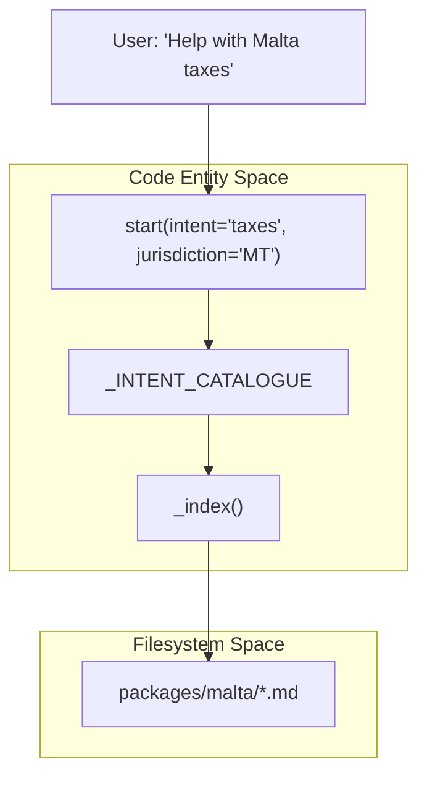
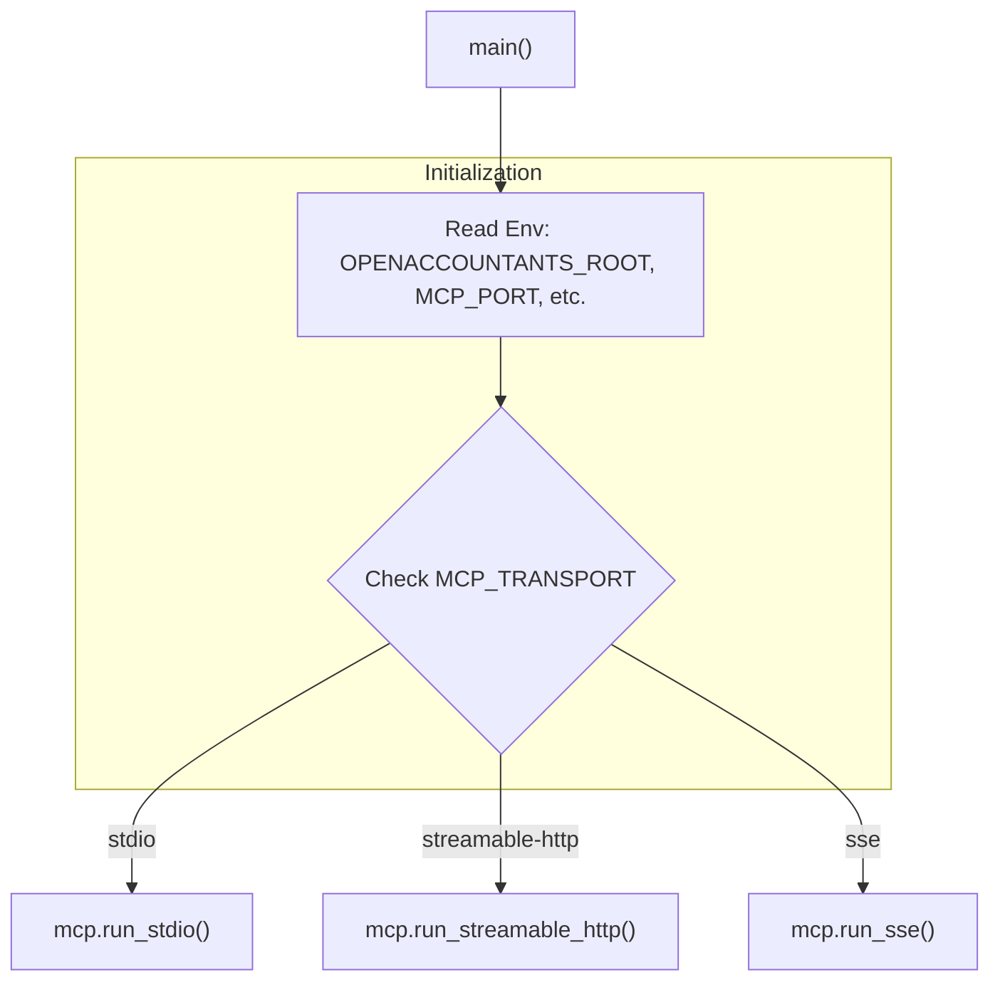

<!-- source: DeepWiki mcp.deepwiki.com · repo openaccountants/openaccountants · page 3.2 MCP Server Internals · fetched 2026-10-26 -->

# MCP Server Internals

Relevant source files

The following files were used as context for generating this wiki page:

- [.dockerignore](.dockerignore)
- [Dockerfile](Dockerfile)
- [mcp/.gitignore](mcp/.gitignore)
- [mcp/README.md](mcp/README.md)
- [mcp/openaccountants_mcp/__init__.py](mcp/openaccountants_mcp/__init__.py)
- [mcp/openaccountants_mcp/__main__.py](mcp/openaccountants_mcp/__main__.py)
- [mcp/openaccountants_mcp/server.py](mcp/openaccountants_mcp/server.py)
- [mcp/pyproject.toml](mcp/pyproject.toml)
- [mcp/server.json](mcp/server.json)
- [mcp/smoke_test.py](mcp/smoke_test.py)

The OpenAccountants MCP server is a Python-based implementation of the Model Context Protocol that provides a read-only interface to the repository's library of accounting skills. It acts as a bridge between the static Markdown content in the `packages/` directory and AI assistants like Claude or Cursor.

### Purpose and Scope
The server's primary responsibility is to index local skill files, resolve user intent into executable plans, and provide secure access to content through standardized tools and prompts [mcp/openaccountants_mcp/server.py:1-34](). It uses the `FastMCP` framework to handle the transport layer and tool registration [mcp/openaccountants_mcp/server.py:48]().

---

### Core Components and Data Flow

The server operates by indexing the filesystem at startup and then serving requests through a set of registered tools.

#### Natural Language to Code Entity Mapping
The following diagram illustrates how natural language requests from a user are translated into specific code entities and filesystem operations within the server.

**Intent to Entity Resolution**

**Sources:** [mcp/openaccountants_mcp/server.py:180-210](), [mcp/openaccountants_mcp/server.py:534-560]()

---

### Skill Indexer (`_index`)

The `_index()` function is the heart of the server's discovery mechanism. It is lazily initialized and cached using `@lru_cache(maxsize=1)` [mcp/openaccountants_mcp/server.py:179-180]().

- **Discovery:** It recursively scans the `packages/` directory for `.md` files [mcp/openaccountants_mcp/server.py:192-195]().
- **Validation:** A file is only indexed if its YAML frontmatter contains a `name` field [mcp/openaccountants_mcp/server.py:183-184]().
- **Jurisdiction Inheritance:** Since many skill files lack an explicit `jurisdiction` field, the indexer uses `_dir_jurisdiction()` to infer it from the parent directory name (e.g., `us-ca`) or the most frequent code declared by sibling files [mcp/openaccountants_mcp/server.py:165-177]().
- **Quality Tiering:** The indexer determines the `quality_tier` by checking for a valid `verified_by` name. If the field is missing or set to "pending", it defaults to "research-verified" [mcp/openaccountants_mcp/server.py:116-130]().

**Sources:** [mcp/openaccountants_mcp/server.py:156-235]()

---

### Intent Orchestrator (`_INTENT_CATALOGUE`)

The `start()` tool implements a state machine logic to guide the LLM through the "front door" of the library [mcp/README.md:59-80](). It relies on the `_INTENT_CATALOGUE`, which maps high-level goals (like "taxes" or "formation") to specific skill categories and templates [mcp/openaccountants_mcp/server.py:534-560]().

| State | Condition | Return Data |
| :--- | :--- | :--- |
| `needs_input` | Missing `intent` or `jurisdiction` | List of `available_intents` or `available_jurisdictions` [mcp/openaccountants_mcp/server.py:643-660]() |
| `needs_clarification` | Unrecognized `intent` | Guidance for the user to select a valid intent [mcp/openaccountants_mcp/server.py:633-640]() |
| `ready` | Both valid `intent` and `jurisdiction` provided | A structured plan including `skills_to_load`, `expectations`, and `guardrails` [mcp/openaccountants_mcp/server.py:612-631]() |

**Sources:** [mcp/openaccountants_mcp/server.py:534-663](), [mcp/README.md:48-55]()

---

### Path Safety and Provenance

#### Path Safety (`_safe_resolve`)
To prevent directory traversal attacks, the server uses `_safe_resolve()`. This function joins segments to the `packages/` root and calls `.resolve()`, then verifies that the resulting path is still a child of the root [mcp/openaccountants_mcp/server.py:76-83]().

#### Provenance Engine
When a skill is fetched via `get_skill`, the server appends a "Provenance & attribution" footer. This footer includes:
- The skill's quality tier [mcp/openaccountants_mcp/server.py:339]().
- The named verifier (if any) [mcp/openaccountants_mcp/server.py:340]().
- A timestamp of the last update [mcp/openaccountants_mcp/server.py:341]().
- A permanent link to the source on the OpenAccountants website [mcp/openaccountants_mcp/server.py:342]().

**Sources:** [mcp/openaccountants_mcp/server.py:71-84](), [mcp/openaccountants_mcp/server.py:328-350]()

---

### Feedback Builder

The `submit_feedback` tool does not perform server-side writes. Instead, it constructs a GitHub "New Issue" URL with pre-filled parameters [mcp/openaccountants_mcp/server.py:488-531]().

- **URL Construction:** It uses `urlencode` to package the title, body, and labels [mcp/openaccountants_mcp/server.py:521-527]().
- **Safety Caps:** The body is capped at 6,000 bytes to ensure the final URL does not exceed browser limits (approx. 8 KB) [mcp/openaccountants_mcp/server.py:65-69]().

**Sources:** [mcp/openaccountants_mcp/server.py:488-531]()

---

### Transport Layer and Lifecycle

The server supports three transport modes, configurable via the `MCP_TRANSPORT` environment variable [mcp/openaccountants_mcp/server.py:24-34]().

1.  **stdio:** Default. Communication occurs over standard input/output, typically used for local IDE integrations like Claude Desktop [mcp/openaccountants_mcp/server.py:843]().
2.  **streamable-http:** Used for remote connections, often fronted by a reverse proxy. This is the default in the provided `Dockerfile` [Dockerfile:33-35]().
3.  **sse:** Server-Sent Events transport.

#### Server Startup Sequence
The `main()` function serves as the entry point [mcp/openaccountants_mcp/server.py:829]().

**Start Machine Logic**

**Sources:** [mcp/openaccountants_mcp/server.py:829-860](), [Dockerfile:32-39]()

---

