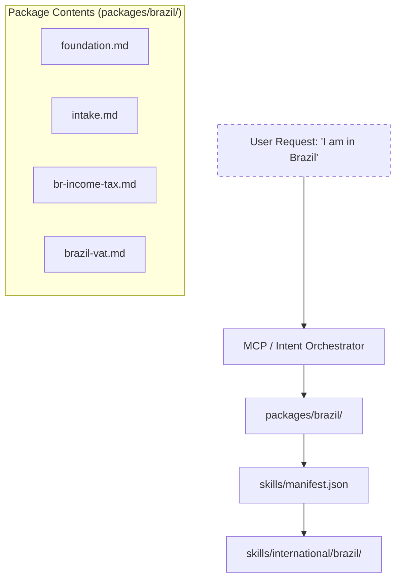
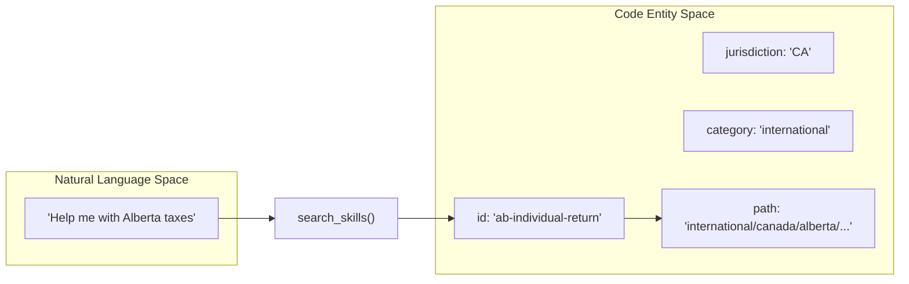

<!-- source: DeepWiki mcp.deepwiki.com · repo openaccountants/openaccountants · page 4 Jurisdiction Coverage · fetched 2026-10-26 -->

# Jurisdiction Coverage

Relevant source files

The following files were used as context for generating this wiki page:

- [README.md](README.md)
- [llms.txt](llms.txt)
- [packages/australia/README.md](packages/australia/README.md)
- [packages/brazil/README.md](packages/brazil/README.md)
- [packages/canada/README.md](packages/canada/README.md)
- [packages/germany/README.md](packages/germany/README.md)
- [packages/india/README.md](packages/india/README.md)
- [packages/indonesia/README.md](packages/indonesia/README.md)
- [packages/malta/README.md](packages/malta/README.md)
- [packages/nepal/README.md](packages/nepal/README.md)
- [packages/portugal/README.md](packages/portugal/README.md)
- [packages/saudi-arabia/README.md](packages/saudi-arabia/README.md)
- [packages/south-africa/README.md](packages/south-africa/README.md)
- [packages/uk/README.md](packages/uk/README.md)
- [skills/financial-reporting/business-combinations/ifrs3-business-combinations.md](skills/financial-reporting/business-combinations/ifrs3-business-combinations.md)
- [skills/financial-reporting/business-combinations/us-gaap-asc805-business-combinations.md](skills/financial-reporting/business-combinations/us-gaap-asc805-business-combinations.md)
- [skills/financial-reporting/debt-vs-equity/ias32-debt-vs-equity.md](skills/financial-reporting/debt-vs-equity/ias32-debt-vs-equity.md)
- [skills/financial-reporting/debt-vs-equity/us-gaap-debt-vs-equity.md](skills/financial-reporting/debt-vs-equity/us-gaap-debt-vs-equity.md)
- [skills/financial-reporting/financial-reporting-workflow-base.md](skills/financial-reporting/financial-reporting-workflow-base.md)
- [skills/financial-reporting/leases/ifrs16-leases.md](skills/financial-reporting/leases/ifrs16-leases.md)
- [skills/financial-reporting/leases/us-gaap-asc842-leases.md](skills/financial-reporting/leases/us-gaap-asc842-leases.md)
- [skills/financial-reporting/revenue-recognition/ifrs15-revenue.md](skills/financial-reporting/revenue-recognition/ifrs15-revenue.md)
- [skills/financial-reporting/revenue-recognition/us-gaap-asc606-revenue.md](skills/financial-reporting/revenue-recognition/us-gaap-asc606-revenue.md)
- [skills/international/kazakhstan/kz-simplified-regime.md](skills/international/kazakhstan/kz-simplified-regime.md)
- [skills/manifest.json](skills/manifest.json)
- [workflows/README.md](workflows/README.md)

OpenAccountants provides a comprehensive library of tax and accounting "skills" covering **134+ countries**, **51 US states/territories**, and **13 Canadian provinces/territories** [README.md:87-93](). These skills are distributed as pre-compiled bundles in the `packages/` directory, allowing AI agents to load the relevant legal and financial context for a specific region [README.md:81-94]().

### Global Coverage Overview

The repository tracks 781 total skills as of the latest manifest [skills/manifest.json:4](). Coverage is categorized by the type of tax obligation (e.g., IT for Income Tax, CT for Consumption/VAT, PAY for Payroll) and the quality of the content (Accountant-verified vs. Research-verified) [skills/manifest.json:9-46]().

| Region | Coverage Type | Key Entities |
| :--- | :--- | :--- |
| **International** | 134+ Countries | `packages/[country]/` |
| **United States** | Federal + 51 States | `packages/us-[state]/` |
| **Canada** | Federal + 13 Provinces | `packages/ca-[province]/` |

### Coverage Tiers

Jurisdictions are classified into three functional tiers based on the depth of the available skill files:

1.  **Full Guided Experience (Tier 1):** Jurisdictions like Malta, UK, and Brazil include specialized `guided-intake.md` and `return-assembly.md` files [packages/malta/README.md:36-37](), [packages/uk/README.md:40-41](). These provide a structured end-to-end workflow from data collection to final working paper.
2.  **Multi-Skill Packages:** Most major economies include a suite of skills covering Income Tax, VAT/GST, Payroll, and Social Contributions (e.g., South Africa [packages/south-africa/README.md:15-21]()).
3.  **VAT/Single-Obligation:** Developing or smaller jurisdictions may currently only feature a VAT or simplified regime skill (e.g., Nepal [packages/nepal/README.md:17](), Kazakhstan [skills/international/kazakhstan/kz-simplified-regime.md]()).

### Mapping Jurisdictions to Code Entities

The following diagram illustrates how user requests for specific jurisdictions are mapped to the physical file structure in the `packages/` and `skills/` directories.

**Jurisdiction Resolution Diagram**

**Sources:** [README.md:18-27](), [packages/brazil/README.md:13-34](), [skills/manifest.json:1-8]()

---

## Regional Coverage Details

### International Jurisdictions
This covers all non-US and non-Canadian countries. The repository distinguishes between **Accountant-verified** packages (signed off by named practitioners like Werner Britz CA(SA) or James Power) and **Research-verified** drafts [llms.txt:13-17](), [README.md:58-60]().

For details on specific countries and verification status, see [International Jurisdictions](#4.1).

### US Federal and State Coverage
The US architecture uses a "Bundle" approach where state-specific packages (e.g., `us-ca`) include both the Federal `us-tax-workflow-base` and state-specific income/sales tax skills [README.md:88-90](). Coverage includes Form 1040, Schedule C, and state-level nexus rules [llms.txt:85-88]().

For details on the federal+state architecture, see [US Federal and State Coverage](#4.2).

### Canadian Federal and Provincial Coverage
Similar to the US model, Canadian packages (e.g., `ca-on` for Ontario) bundle Federal T1/T2125 skills with provincial-specific tax credits and forms [README.md:91-93](). These are generated via the build pipeline [README.md:98]().

For details on provincial tax logic, see [Canadian Federal and Provincial Coverage](#4.3).

---

### Code-to-Jurisdiction Mapping

The system uses ISO 3166-1 alpha-2 codes (for countries) and ISO 3166-2 codes (for states/provinces) to index skills within the `manifest.json`.

**Code Entity Association**

**Sources:** [skills/manifest.json:48-58](), [llms.txt:54-56]()

**Sources:**
- [README.md:1-140]()
- [skills/manifest.json:1-102]()
- [llms.txt:1-110]()
- [packages/brazil/README.md:1-87]()
- [packages/south-africa/README.md:1-76]()
- [packages/uk/README.md:1-95]()

---

