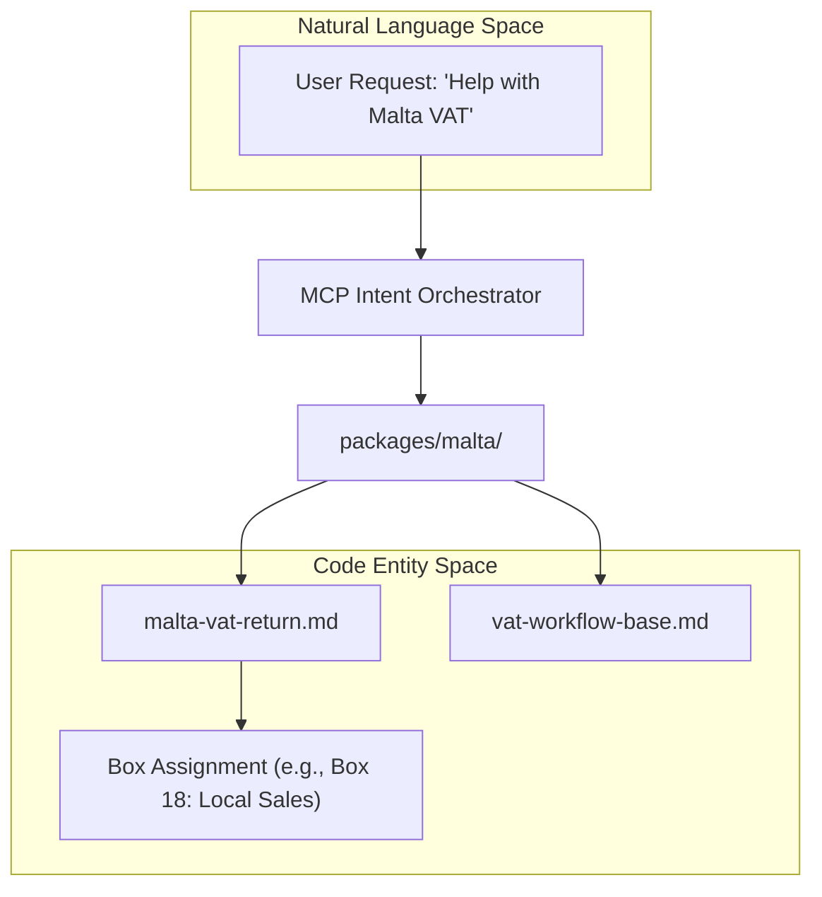
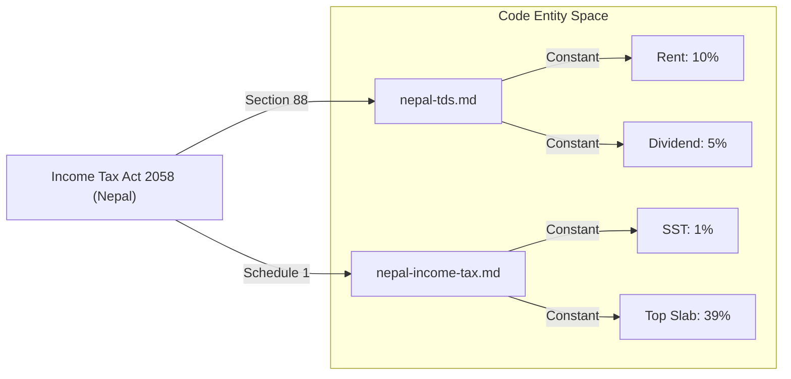

<!-- source: DeepWiki mcp.deepwiki.com · repo openaccountants/openaccountants · page 4.1 International Jurisdictions · fetched 2026-10-26 -->

# International Jurisdictions

Relevant source files

The following files were used as context for generating this wiki page:

- [cookbook-contribution/notebook_cells.json](cookbook-contribution/notebook_cells.json)
- [packages/australia/README.md](packages/australia/README.md)
- [packages/brazil/README.md](packages/brazil/README.md)
- [packages/brazil/br-estimated-tax.md](packages/brazil/br-estimated-tax.md)
- [packages/brazil/br-income-tax.md](packages/brazil/br-income-tax.md)
- [packages/brazil/br-inss.md](packages/brazil/br-inss.md)
- [packages/brazil/br-simples-nacional.md](packages/brazil/br-simples-nacional.md)
- [packages/brazil/brazil-crypto-tax.md](packages/brazil/brazil-crypto-tax.md)
- [packages/brazil/brazil-einvoice.md](packages/brazil/brazil-einvoice.md)
- [packages/brazil/brazil-payroll.md](packages/brazil/brazil-payroll.md)
- [packages/brazil/brazil-transfer-pricing.md](packages/brazil/brazil-transfer-pricing.md)
- [packages/brazil/brazil-vat.md](packages/brazil/brazil-vat.md)
- [packages/canada/README.md](packages/canada/README.md)
- [packages/china/cn-corporate-tax.md](packages/china/cn-corporate-tax.md)
- [packages/china/cn-fapiao-einvoice.md](packages/china/cn-fapiao-einvoice.md)
- [packages/china/cn-formation.md](packages/china/cn-formation.md)
- [packages/china/cn-freelance-intake.md](packages/china/cn-freelance-intake.md)
- [packages/china/cn-iit.md](packages/china/cn-iit.md)
- [packages/china/cn-return-assembly.md](packages/china/cn-return-assembly.md)
- [packages/china/cn-social-insurance.md](packages/china/cn-social-insurance.md)
- [packages/china/cn-stamp-tax.md](packages/china/cn-stamp-tax.md)
- [packages/china/cn-vat.md](packages/china/cn-vat.md)
- [packages/cyprus/cyprus-vat-return.md](packages/cyprus/cyprus-vat-return.md)
- [packages/germany/README.md](packages/germany/README.md)
- [packages/india/README.md](packages/india/README.md)
- [packages/indonesia/id-bookkeeping.md](packages/indonesia/id-bookkeeping.md)
- [packages/indonesia/id-corporate-tax.md](packages/indonesia/id-corporate-tax.md)
- [packages/indonesia/id-einvoice-coretax.md](packages/indonesia/id-einvoice-coretax.md)
- [packages/indonesia/id-formation.md](packages/indonesia/id-formation.md)
- [packages/indonesia/id-payroll-pph21.md](packages/indonesia/id-payroll-pph21.md)
- [packages/indonesia/id-pph-final-umkm.md](packages/indonesia/id-pph-final-umkm.md)
- [packages/indonesia/id-tax-optimization.md](packages/indonesia/id-tax-optimization.md)
- [packages/indonesia/id-withholding.md](packages/indonesia/id-withholding.md)
- [packages/indonesia/indonesia-vat.md](packages/indonesia/indonesia-vat.md)
- [packages/malta/README.md](packages/malta/README.md)
- [packages/malta/malta-income-tax.md](packages/malta/malta-income-tax.md)
- [packages/malta/malta-ssc.md](packages/malta/malta-ssc.md)
- [packages/malta/malta-tax-optimization.md](packages/malta/malta-tax-optimization.md)
- [packages/malta/malta-vat-return.md](packages/malta/malta-vat-return.md)
- [packages/malta/mt-estimated-tax.md](packages/malta/mt-estimated-tax.md)
- [packages/nepal/nepal-corporate-tax.md](packages/nepal/nepal-corporate-tax.md)
- [packages/nepal/nepal-income-tax.md](packages/nepal/nepal-income-tax.md)
- [packages/nepal/nepal-payroll.md](packages/nepal/nepal-payroll.md)
- [packages/nepal/nepal-tds.md](packages/nepal/nepal-tds.md)
- [packages/nepal/nepal-vat.md](packages/nepal/nepal-vat.md)
- [packages/nigeria/ng-cgt.md](packages/nigeria/ng-cgt.md)
- [packages/nigeria/ng-cit.md](packages/nigeria/ng-cit.md)
- [packages/nigeria/ng-formation.md](packages/nigeria/ng-formation.md)
- [packages/nigeria/ng-freelance-intake.md](packages/nigeria/ng-freelance-intake.md)
- [packages/nigeria/ng-paye.md](packages/nigeria/ng-paye.md)
- [packages/nigeria/ng-payroll.md](packages/nigeria/ng-payroll.md)
- [packages/nigeria/ng-personal-income-tax.md](packages/nigeria/ng-personal-income-tax.md)
- [packages/nigeria/ng-return-assembly.md](packages/nigeria/ng-return-assembly.md)
- [packages/nigeria/ng-statutory-deductions.md](packages/nigeria/ng-statutory-deductions.md)
- [packages/nigeria/ng-vat.md](packages/nigeria/ng-vat.md)
- [packages/portugal/portugal-crypto-tax.md](packages/portugal/portugal-crypto-tax.md)
- [packages/portugal/portugal-einvoice.md](packages/portugal/portugal-einvoice.md)
- [packages/portugal/portugal-financial-statements.md](packages/portugal/portugal-financial-statements.md)
- [packages/portugal/portugal-formation.md](packages/portugal/portugal-formation.md)
- [packages/portugal/portugal-payroll.md](packages/portugal/portugal-payroll.md)
- [packages/portugal/portugal-tax-optimization.md](packages/portugal/portugal-tax-optimization.md)
- [packages/portugal/portugal-vat-return.md](packages/portugal/portugal-vat-return.md)
- [packages/portugal/pt-income-tax.md](packages/portugal/pt-income-tax.md)
- [packages/portugal/pt-social-contributions.md](packages/portugal/pt-social-contributions.md)
- [packages/saudi-arabia/sa-corporate-tax.md](packages/saudi-arabia/sa-corporate-tax.md)
- [packages/saudi-arabia/sa-excise-tax.md](packages/saudi-arabia/sa-excise-tax.md)
- [packages/saudi-arabia/sa-formation.md](packages/saudi-arabia/sa-formation.md)
- [packages/saudi-arabia/sa-gosi-saudization.md](packages/saudi-arabia/sa-gosi-saudization.md)
- [packages/saudi-arabia/sa-rett.md](packages/saudi-arabia/sa-rett.md)
- [packages/saudi-arabia/sa-withholding-tax.md](packages/saudi-arabia/sa-withholding-tax.md)
- [packages/saudi-arabia/sa-zakat.md](packages/saudi-arabia/sa-zakat.md)
- [packages/saudi-arabia/saudi-arabia-vat.md](packages/saudi-arabia/saudi-arabia-vat.md)
- [packages/saudi-arabia/saudi-einvoice.md](packages/saudi-arabia/saudi-einvoice.md)
- [packages/south-africa/README.md](packages/south-africa/README.md)
- [packages/south-africa/south-africa-vat.md](packages/south-africa/south-africa-vat.md)
- [packages/south-africa/za-income-tax.md](packages/south-africa/za-income-tax.md)
- [packages/south-africa/za-provisional-tax.md](packages/south-africa/za-provisional-tax.md)
- [packages/south-africa/za-vat-return.md](packages/south-africa/za-vat-return.md)
- [packages/sri-lanka/sri-lanka-corporate-tax.md](packages/sri-lanka/sri-lanka-corporate-tax.md)
- [packages/sri-lanka/sri-lanka-income-tax.md](packages/sri-lanka/sri-lanka-income-tax.md)
- [packages/sri-lanka/sri-lanka-payroll.md](packages/sri-lanka/sri-lanka-payroll.md)
- [packages/sri-lanka/sri-lanka-sscl.md](packages/sri-lanka/sri-lanka-sscl.md)
- [packages/sri-lanka/sri-lanka-vat.md](packages/sri-lanka/sri-lanka-vat.md)
- [packages/sri-lanka/sri-lanka-withholding-tax.md](packages/sri-lanka/sri-lanka-withholding-tax.md)
- [packages/uk/README.md](packages/uk/README.md)
- [skills/international/brazil/br-income-tax.md](skills/international/brazil/br-income-tax.md)
- [skills/international/france/fr-income-tax.md](skills/international/france/fr-income-tax.md)
- [skills/international/india/in-income-tax.md](skills/international/india/in-income-tax.md)
- [skills/international/italy/it-income-tax.md](skills/international/italy/it-income-tax.md)
- [skills/international/japan/jp-income-tax.md](skills/international/japan/jp-income-tax.md)
- [skills/international/malta/malta-income-tax.md](skills/international/malta/malta-income-tax.md)
- [skills/international/malta/malta-ssc.md](skills/international/malta/malta-ssc.md)
- [skills/international/malta/malta-vat-return.md](skills/international/malta/malta-vat-return.md)
- [skills/international/malta/mt-estimated-tax.md](skills/international/malta/mt-estimated-tax.md)
- [skills/international/mexico/mx-income-tax.md](skills/international/mexico/mx-income-tax.md)
- [skills/international/netherlands/nl-income-tax.md](skills/international/netherlands/nl-income-tax.md)
- [skills/international/new-zealand/nz-income-tax-ir3.md](skills/international/new-zealand/nz-income-tax-ir3.md)
- [skills/international/portugal/pt-income-tax.md](skills/international/portugal/pt-income-tax.md)
- [skills/international/singapore/sg-income-tax.md](skills/international/singapore/sg-income-tax.md)
- [skills/international/south-africa/south-africa-vat.md](skills/international/south-africa/south-africa-vat.md)
- [skills/international/south-africa/za-income-tax.md](skills/international/south-africa/za-income-tax.md)
- [skills/international/south-africa/za-provisional-tax.md](skills/international/south-africa/za-provisional-tax.md)
- [skills/international/south-africa/za-vat-return.md](skills/international/south-africa/za-vat-return.md)
- [skills/international/south-korea/kr-income-tax.md](skills/international/south-korea/kr-income-tax.md)
- [tools/workbooks/data/lk.json](tools/workbooks/data/lk.json)
- [tools/workbooks/data/np.json](tools/workbooks/data/np.json)
- [tools/workbooks/data/pk.json](tools/workbooks/data/pk.json)
- [tools/workbooks/data/us-fl.json](tools/workbooks/data/us-fl.json)
- [tools/workbooks/generate_workbook.py](tools/workbooks/generate_workbook.py)
- [tools/workbooks/out/LK_Tax_Skills_Verification.xlsx](tools/workbooks/out/LK_Tax_Skills_Verification.xlsx)
- [tools/workbooks/out/NP_Tax_Skills_Verification.xlsx](tools/workbooks/out/NP_Tax_Skills_Verification.xlsx)
- [workflows/README.md](workflows/README.md)

OpenAccountants provides coverage for over 134 countries, structured into distinct quality tiers based on the level of professional verification. This page serves as a high-level index for international (non-US/Canada) jurisdictions, detailing the available skill types and the verification status of major packages.

## Verification Tiers

The codebase distinguishes between two primary levels of reliability:
1.  **Accountant-Verified:** These packages have undergone rigorous review by local qualified professionals (CPAs, CAs, or Warranted Accountants). Every rate, threshold, and form reference is validated [packages/malta/README.md:8-11]().
2.  **Research-Verified:** These packages are "tier 2" or "research-grade." They are based on primary statutes and reputable firm publications but have not yet been signed off by a lead verifier in the OpenAccountants network [packages/nepal/nepal-income-tax.md:16-16]().

## Accountant-Verified Jurisdictions

The following jurisdictions are fully accountant-verified. They include a comprehensive suite of skills covering the full business lifecycle from formation to annual return assembly.

| Jurisdiction | Lead Verifier | Key Skill Types |
| :--- | :--- | :--- |
| **Malta** | Michael Cutajar, CPA | VAT (Art. 10/11), Income Tax (TA24/22), SSC (Class 2), Estimated Tax, Optimization [packages/malta/README.md:8-37]() |
| **United Kingdom** | James Power | SA100, SA103, VAT, Payroll, National Insurance, Formation, Corporation Tax [packages/uk/README.md:8-41]() |
| **South Africa** | Werner Britz, CA(SA) | VAT201, ITR12, IRP6 (Provisional Tax), Transfer Pricing [packages/south-africa/README.md:8-22]() |
| **Brazil** | Ariane Marrocos, CRC/SP | Simples Nacional, IRPF/IRPJ, INSS, e-Invoice (Nota Fiscal), Carnê-Leão [packages/brazil/README.md:8-33]() |
| **India** | Mayur Deokar | GST, TDS, Income Tax (ITR-3/4), Advance Tax, PF/ESI [packages/india/README.md:8-38]() |
| **Portugal** | *Pending* | IVA, IRS, Social Contributions, e-Invoice, Financial Statements |

For deep technical details on these specific implementations, see [Accountant-Verified Jurisdiction Deep Dives](#4.1.1).

### Mapping: Natural Language to Code Entities (Verified)

This diagram illustrates how user requests are mapped to specific code entities within the accountant-verified packages.

Sources: [skills/international/malta/malta-vat-return.md:2-3](), [packages/malta/README.md:13-37]()

## Research-Verified Jurisdictions

Research-verified packages provide a baseline of computational logic and statutory references. These are often used as the foundation for future promotion to the Accountant-Verified tier.

*   **Europe:** Germany, France, Netherlands [skills/international/netherlands/nl-income-tax.md](), etc.
*   **Asia-Pacific:** Australia [packages/australia/README.md](), Nepal [packages/nepal/nepal-vat.md](), etc.
*   **Middle East:** Saudi Arabia (VAT, Zakat, RETT, e-Invoice) [packages/saudi-arabia/saudi-arabia-vat.md]().

### Example: Nepal (Tier 2)
The Nepal package exemplifies the Research-Verified tier, citing specific statutes like the `Income Tax Act 2058` and `Finance Act 2082` [packages/nepal/nepal-income-tax.md:4-4](). It includes:
*   **VAT:** 13% standard rate logic [packages/nepal/nepal-vat.md:23-23]().
*   **TDS:** Withholding rates for rent (10%) and dividends (5%) [packages/nepal/nepal-tds.md:28-29]().
*   **Income Tax:** Progressive slabs (1% to 39%) [packages/nepal/nepal-income-tax.md:70-75]().

### Mapping: Statutory References to Code Constants

Sources: [packages/nepal/nepal-tds.md:28-33](), [packages/nepal/nepal-income-tax.md:68-75]()

## Skill Types per Country

While coverage varies by jurisdiction, the system aims for a standard "Full Stack" of accounting skills for every major country:

1.  **Indirect Tax (VAT/GST/IVA):** Transaction classification, box assignment, and return preparation [skills/international/malta/malta-vat-return.md:36-80]().
2.  **Income Tax:** Personal (Self-Employed) and Corporate tax calculations, including progressive bands and allowable deductions [skills/international/malta/malta-income-tax.md:39-68]().
3.  **Social Contributions:** Calculation of social security, insurance, or pension levies (e.g., Malta Class 2 SSC or Brazil INSS) [skills/international/malta/malta-ssc.md:42-47]().
4.  **Payroll:** Calculation of gross-to-net, employer burdens, and statutory filings [packages/india/README.md:27-27]().
5.  **Formation & Compliance:** Guidance on company setup, e-invoicing (Nota Fiscal/Factura), and annual financial statements [packages/brazil/README.md:23-30]().

Sources: [packages/malta/README.md:13-37](), [packages/brazil/README.md:13-33](), [packages/india/README.md:13-38](), [packages/uk/README.md:13-41]()

---

