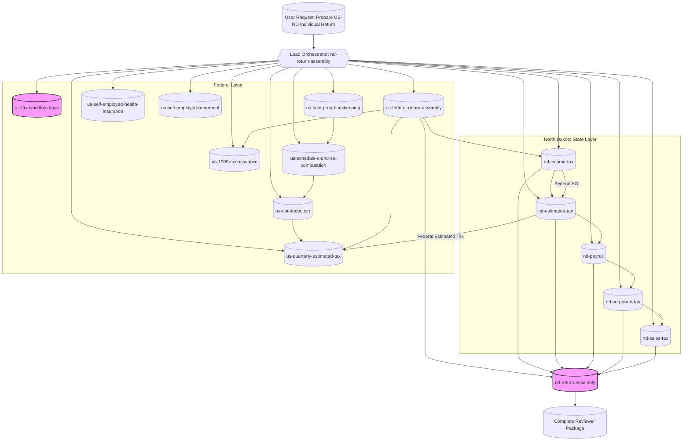

<!-- source: DeepWiki mcp.deepwiki.com · repo openaccountants/openaccountants · page 4.2 US Federal and State Coverage · fetched 2026-10-26 -->

# US Federal and State Coverage

Relevant source files

The following files were used as context for generating this wiki page:

- [packages/us-az/az-transaction-privilege-tax.md](packages/us-az/az-transaction-privilege-tax.md)
- [packages/us-ca/ca-llc-fee-and-tax.md](packages/us-ca/ca-llc-fee-and-tax.md)
- [packages/us-ca/ca-pte-elective-tax.md](packages/us-ca/ca-pte-elective-tax.md)
- [packages/us-co/co-retail-delivery-and-suts.md](packages/us-co/co-retail-delivery-and-suts.md)
- [packages/us-de/de-franchise-tax-and-llc.md](packages/us-de/de-franchise-tax-and-llc.md)
- [packages/us-federal/ANNUAL-UPDATE-RUNBOOK.md](packages/us-federal/ANNUAL-UPDATE-RUNBOOK.md)
- [packages/us-federal/rates.2025.json](packages/us-federal/rates.2025.json)
- [packages/us-federal/rates.2026.json](packages/us-federal/rates.2026.json)
- [packages/us-federal/us-1099-k-and-payment-processors.md](packages/us-federal/us-1099-k-and-payment-processors.md)
- [packages/us-federal/us-education-credits-8863.md](packages/us-federal/us-education-credits-8863.md)
- [packages/us-federal/us-estate-gift-706-709.md](packages/us-federal/us-estate-gift-706-709.md)
- [packages/us-federal/us-fbar-and-fatca-8938.md](packages/us-federal/us-fbar-and-fatca-8938.md)
- [packages/us-federal/us-foreign-earned-income-2555.md](packages/us-federal/us-foreign-earned-income-2555.md)
- [packages/us-federal/us-foreign-tax-credit-1116.md](packages/us-federal/us-foreign-tax-credit-1116.md)
- [packages/us-federal/us-form-1040-individual-return.md](packages/us-federal/us-form-1040-individual-return.md)
- [packages/us-federal/us-form-1041-trust-and-estate-income.md](packages/us-federal/us-form-1041-trust-and-estate-income.md)
- [packages/us-federal/us-form-1065-partnership.md](packages/us-federal/us-form-1065-partnership.md)
- [packages/us-federal/us-form-1120-c-corp.md](packages/us-federal/us-form-1120-c-corp.md)
- [packages/us-federal/us-form-5471-cfc-information.md](packages/us-federal/us-form-5471-cfc-information.md)
- [packages/us-federal/us-form-5472-foreign-owned-us.md](packages/us-federal/us-form-5472-foreign-owned-us.md)
- [packages/us-federal/us-form-941-940-payroll.md](packages/us-federal/us-form-941-940-payroll.md)
- [packages/us-federal/us-gilti-fdii-beat.md](packages/us-federal/us-gilti-fdii-beat.md)
- [packages/us-federal/us-irs-collections-and-controversy.md](packages/us-federal/us-irs-collections-and-controversy.md)
- [packages/us-federal/us-pte-state-matrix.md](packages/us-federal/us-pte-state-matrix.md)
- [packages/us-federal/us-r-and-d-section-174-and-41.md](packages/us-federal/us-r-and-d-section-174-and-41.md)
- [packages/us-fl/fl-corporate-income-tax.md](packages/us-fl/fl-corporate-income-tax.md)
- [packages/us-ga/ga-estimated-tax-depth.md](packages/us-ga/ga-estimated-tax-depth.md)
- [packages/us-ga/ga-income-tax.md](packages/us-ga/ga-income-tax.md)
- [packages/us-ga/ga-net-worth-tax.md](packages/us-ga/ga-net-worth-tax.md)
- [packages/us-ga/ga-payroll.md](packages/us-ga/ga-payroll.md)
- [packages/us-id/id-income-tax.md](packages/us-id/id-income-tax.md)
- [packages/us-il/il-estimated-tax.md](packages/us-il/il-estimated-tax.md)
- [packages/us-il/il-income-tax.md](packages/us-il/il-income-tax.md)
- [packages/us-il/il-payroll.md](packages/us-il/il-payroll.md)
- [packages/us-il/il-personal-property-replacement-tax.md](packages/us-il/il-personal-property-replacement-tax.md)
- [packages/us-il/il-sales-tax.md](packages/us-il/il-sales-tax.md)
- [packages/us-mi/mi-corporate-income-tax.md](packages/us-mi/mi-corporate-income-tax.md)
- [packages/us-mi/mi-detroit-individual-return.md](packages/us-mi/mi-detroit-individual-return.md)
- [packages/us-mi/mi-estimated-tax.md](packages/us-mi/mi-estimated-tax.md)
- [packages/us-mi/mi-homestead-credit.md](packages/us-mi/mi-homestead-credit.md)
- [packages/us-mi/mi-pension-retirement-subtraction.md](packages/us-mi/mi-pension-retirement-subtraction.md)
- [packages/us-mi/mi-return-assembly.md](packages/us-mi/mi-return-assembly.md)
- [packages/us-nc/nc-bailey-settlement-retirement.md](packages/us-nc/nc-bailey-settlement-retirement.md)
- [packages/us-nc/nc-corporate-tax.md](packages/us-nc/nc-corporate-tax.md)
- [packages/us-nc/nc-estimated-tax.md](packages/us-nc/nc-estimated-tax.md)
- [packages/us-nc/nc-return-assembly.md](packages/us-nc/nc-return-assembly.md)
- [packages/us-nd/nd-corporate-tax.md](packages/us-nd/nd-corporate-tax.md)
- [packages/us-nd/nd-estimated-tax.md](packages/us-nd/nd-estimated-tax.md)
- [packages/us-nd/nd-payroll.md](packages/us-nd/nd-payroll.md)
- [packages/us-nd/nd-return-assembly.md](packages/us-nd/nd-return-assembly.md)
- [packages/us-nh/nh-bpt-bet.md](packages/us-nh/nh-bpt-bet.md)
- [packages/us-ny/ny-corporate-franchise-article-9a.md](packages/us-ny/ny-corporate-franchise-article-9a.md)
- [packages/us-ny/ny-mctmt.md](packages/us-ny/ny-mctmt.md)
- [packages/us-ny/ny-pte-tax-ptet.md](packages/us-ny/ny-pte-tax-ptet.md)
- [packages/us-wy/no-sales-tax-states.md](packages/us-wy/no-sales-tax-states.md)
- [packages/us-wy/us-crypto-tax.md](packages/us-wy/us-crypto-tax.md)
- [skills/cross-border/eu-social-security-coordination.md](skills/cross-border/eu-social-security-coordination.md)
- [skills/federal/us-1099-nec-issuance.md](skills/federal/us-1099-nec-issuance.md)
- [skills/federal/us-qbi-deduction.md](skills/federal/us-qbi-deduction.md)
- [skills/federal/us-quarterly-estimated-tax.md](skills/federal/us-quarterly-estimated-tax.md)
- [skills/federal/us-s-corp-election-decision.md](skills/federal/us-s-corp-election-decision.md)
- [skills/federal/us-self-employed-health-insurance.md](skills/federal/us-self-employed-health-insurance.md)
- [skills/federal/us-self-employed-retirement.md](skills/federal/us-self-employed-retirement.md)
- [skills/us-states/ga/ga-income-tax.md](skills/us-states/ga/ga-income-tax.md)
- [skills/us-states/ny/nyc-ubt.md](skills/us-states/ny/nyc-ubt.md)

This page provides an overview of the OpenAccountants' coverage for US federal and state taxation. It details the federal tax skills available, the architecture supporting all 51 state tax packages, and the role of the `us-tax-workflow-base`. The goal is to provide a comprehensive, technically detailed explanation of how OpenAccountants handles the complexities of US tax compliance.

## Federal Tax Skills

OpenAccountants offers a robust set of federal tax skills designed to cover common individual and business tax scenarios. These skills are modular and can be orchestrated to build complete federal tax returns or provide specific tax advice.

### Core Federal Skills

The following table summarizes key federal tax skills:

| Skill Name | Description | File Path Example |
|---|---|---|
| Form 1040 Individual Return | Covers the primary individual income tax return, including income, deductions, and credits. | [packages/us-federal/us-form-1040-individual-return.md]() |
| Schedule C (Profit or Loss from Business) | Handles self-employment income and expenses for sole proprietors and single-member LLCs. | [skills/federal/us-schedule-c-and-se-computation.md]() |
| Form 941/940 Payroll | Addresses federal employer payroll taxes, including quarterly Form 941 and annual Form 940. | [packages/us-federal/us-form-941-940-payroll.md]() |
| FBAR/FATCA | Covers foreign bank account reporting (FBAR) and Foreign Account Tax Compliance Act (FATCA) requirements. | [packages/us-federal/us-fbar-and-fatca-8938.md]() |
| CFC/GILTI | Deals with Controlled Foreign Corporations (CFC) and Global Intangible Low-Taxed Income (GILTI) reporting. | [packages/us-federal/us-form-5471-cfc-information.md]() |
| Qualified Business Income (QBI) | Computes the Section 199A deduction for qualified business income. | [skills/federal/us-qbi-deduction.md]() |
| S-Corp Election Decision | Provides analysis and guidance for S-corporation elections. | [packages/us-il/il-personal-property-replacement-tax.md:77-79]() |
| Estimated Tax | Computes federal quarterly estimated tax payments. | [skills/federal/us-quarterly-estimated-tax.md]() |
| Foreign Earned Income Exclusion | Handles the exclusion for foreign earned income (Form 2555). | [packages/us-federal/us-foreign-earned-income-2555.md]() |
| Foreign Tax Credit | Computes the foreign tax credit (Form 1116). | [packages/us-federal/us-foreign-tax-credit-1116.md]() |
| Partnership (Form 1065) | Covers federal partnership income tax returns. | [packages/us-federal/us-form-1065-partnership.md]() |
| C-Corp (Form 1120) | Covers federal C-corporation income tax returns. | [packages/us-federal/us-form-1120-c-corp.md]() |
| Trust and Estate (Form 1041) | Handles federal income tax for trusts and estates. | [packages/us-federal/us-form-1041-trust-and-estate-income.md]() |

Sources:
- [packages/us-federal/us-form-1040-individual-return.md]()
- [skills/federal/us-schedule-c-and-se-computation.md]()
- [packages/us-federal/us-form-941-940-payroll.md]()
- [packages/us-federal/us-fbar-and-fatca-8938.md]()
- [packages/us-federal/us-form-5471-cfc-information.md]()
- [skills/federal/us-qbi-deduction.md]()
- [packages/us-il/il-personal-property-replacement-tax.md:77-79]()
- [skills/federal/us-quarterly-estimated-tax.md]()
- [packages/us-federal/us-foreign-earned-income-2555.md]()
- [packages/us-federal/us-foreign-tax-credit-1116.md]()
- [packages/us-federal/us-form-1065-partnership.md]()
- [packages/us-federal/us-form-1120-c-corp.md]()
- [packages/us-federal/us-form-1041-trust-and-estate-income.md]()

## State Tax Coverage

OpenAccountants aims to provide coverage for all 51 US states (including Washington D.C.). Each state's tax package is designed to integrate seamlessly with the federal skills, leveraging the `us-tax-workflow-base` for foundational logic.

### State Package Architecture

Each state package resides in its own directory under `packages/us-<state_code>/`. For example, Georgia's tax skills are found in `packages/us-ga/` and Illinois's in `packages/us-il/`.

A typical state package includes:
*   **Income Tax Skill**: Handles individual income tax returns (e.g., `ga-income-tax.md`, `il-income-tax.md`). These skills often start with federal AGI and apply state-specific modifications, deductions, and credits.
*   **Payroll Skill**: Covers state-specific employer payroll compliance, including withholding, unemployment insurance, and new-hire reporting (e.g., `ga-payroll.md`, `il-payroll.md`).
*   **Estimated Tax Skill**: Computes state quarterly estimated tax payments (e.g., `ga-estimated-tax-depth.md`, `il-estimated-tax.md`).
*   **Sales Tax Skill**: Addresses state sales and use tax obligations (e.g., `il-sales-tax.md`).
*   **Return Assembly Skill**: An orchestrator skill that combines outputs from various federal and state content skills to produce a complete filing package (e.g., `nd-return-assembly.md`). This skill runs last and ensures consistency across all generated forms and worksheets.

Each skill within a state package includes:
*   **Metadata**: `name`, `description`, `jurisdiction`, `category`, `tier`, `verified_by`, `last_updated`, `version`, and `depends_on` fields. The `depends_on` field is crucial for defining the skill loading order and ensuring the `us-tax-workflow-base` is loaded first.
*   **Scope Statement**: Clearly defines what is in scope and explicitly out of scope for the skill.
*   **Verified Rates & Thresholds**: A section, often accountant-reviewed, listing key tax rates, deductions, exemptions, and thresholds for the specified tax year.
*   **Computation Rules**: Detailed steps for calculating tax liabilities, often referencing specific state statutes or forms.
*   **Form Mapping**: Links state-specific forms to their federal equivalents or related forms.

Sources:
- [packages/us-ga/ga-income-tax.md]()
- [packages/us-il/il-income-tax.md]()
- [packages/us-ga/ga-payroll.md]()
- [packages/us-il/il-payroll.md]()
- [packages/us-ga/ga-estimated-tax-depth.md]()
- [packages/us-il/il-estimated-tax.md]()
- [packages/us-il/il-sales-tax.md]()
- [packages/us-nd/nd-return-assembly.md]()

### Example: Georgia (US-GA)

The Georgia package (`packages/us-ga/`) includes skills like:
*   `ga-income-tax.md`: Covers individual income tax (Form 500) for sole proprietors, starting from federal AGI and applying Georgia's flat 5.19% rate (for 2025), standard deduction, and dependent exemption. It also details additions and subtractions like bonus depreciation add-back and Social Security exclusion. [packages/us-ga/ga-income-tax.md:1-14]()
*   `ga-payroll.md`: Addresses employer payroll compliance for 2025, including PIT withholding at 5.19%, Form G-4, G-7, GA-V, G-1003, and Georgia Unemployment Insurance (UI) rules. [packages/us-ga/ga-payroll.md:1-10]()
*   `ga-estimated-tax-depth.md`: Provides detailed computation for estimated tax payments.

Sources:
- [packages/us-ga/ga-income-tax.md:1-14]()
- [packages/us-ga/ga-payroll.md:1-10]()
- [packages/us-ga/ga-estimated-tax-depth.md]()

### Example: Illinois (US-IL)

The Illinois package (`packages/us-il/`) includes skills like:
*   `il-income-tax.md`: Covers individual income tax (Form IL-1040) for sole proprietors, with a flat 4.95% rate, starting from federal AGI, and detailing Schedule M modifications, property tax credit, and earned income credit. [packages/us-il/il-income-tax.md:1-14]()
*   `il-payroll.md`: Covers employer payroll compliance for 2025, including the 4.95% flat PIT, IL-941, IL UI, Secure Choice Savings Program, and local ordinances like Cook County paid sick leave. [packages/us-il/il-payroll.md:1-10]()
*   `il-estimated-tax.md`: Computes quarterly estimated income tax payments for self-employed individuals, including safe harbor rules and underpayment penalties. [packages/us-il/il-estimated-tax.md:1-14]()
*   `il-sales-tax.md`: Details Illinois Sales Tax (Form ST-1), covering the four occupation and use taxes, state and local rates, and vendor discounts. [packages/us-il/il-sales-tax.md:1-14]()
*   `il-personal-property-replacement-tax.md`: Explains the Illinois Personal Property Replacement Tax (PPRT) for corporations, partnerships, and S-corporations, including rates and interaction with the PTE tax election. [packages/us-il/il-personal-property-replacement-tax.md:1-14]()

Sources:
- [packages/us-il/il-income-tax.md:1-14]()
- [packages/us-il/il-payroll.md:1-10]()
- [packages/us-il/il-estimated-tax.md:1-14]()
- [packages/us-il/il-sales-tax.md:1-14]()
- [packages/us-il/il-personal-property-replacement-tax.md:1-14]()

### Example: North Dakota (US-ND)

The North Dakota package (`packages/us-nd/`) includes skills like:
*   `nd-payroll.md`: Covers employer payroll compliance, including state income tax withholding, Form 306, SUTA, new-hire reporting, and Workforce Safety & Insurance (WSI). [packages/us-nd/nd-payroll.md:1-10]()
*   `nd-estimated-tax.md`: Details individual quarterly estimated income tax, Form ND-1ES, and Schedule ND-1UT. [packages/us-nd/nd-estimated-tax.md:1-10]()
*   `nd-corporate-tax.md`: Covers corporate income tax, apportionment, and estimated payment rules. [packages/us-nd/nd-corporate-tax.md:1-12]()
*   `nd-return-assembly.md`: A capstone orchestrator that assembles the complete federal + North Dakota filing package, consuming outputs from all upstream federal and state content skills. [packages/us-nd/nd-return-assembly.md:1-22]()

Sources:
- [packages/us-nd/nd-payroll.md:1-10]()
- [packages/us-nd/nd-estimated-tax.md:1-10]()
- [packages/us-nd/nd-corporate-tax.md:1-12]()
- [packages/us-nd/nd-return-assembly.md:1-22]()

## The `us-tax-workflow-base`

The `us-tax-workflow-base` is a foundational skill that provides common logic, data structures, and orchestration patterns for all US federal and state tax skills. It acts as a central hub, ensuring consistency and interoperability across the diverse US tax landscape. All federal and state skills `depends_on` this workflow base.

The `us-tax-workflow-base` defines:
*   **Standardized Data Models**: Common representations for income, deductions, credits, taxpayer information, and entity types.
*   **Workflow Stages**: A sequence of operations that tax preparation typically follows, from intake to final review.
*   **Error Handling and Validation**: Mechanisms for identifying and reporting inconsistencies or missing data.
*   **Integration Points**: How federal and state calculations interact, especially concerning federal AGI as a starting point for many state returns.

### `us-tax-workflow-base` Integration Diagram

```mermaid
graph TD
    subgraph "Federal Skills"
        F1[("us-form-1040-individual-return")]
        F2[("us-schedule-c-and-se-computation")]
        F3[("us-form-941-940-payroll")]
        F4[("us-fbar-and-fatca-8938")]
        F5[("us-quarterly-estimated-tax")]
    end

    subgraph "State Skills (Example: US-GA)"
        GA1[("ga-income-tax")]
        GA2[("ga-payroll")]
        GA3[("ga-estimated-tax-depth")]
    end

    subgraph "State Skills (Example: US-IL)"
        IL1[("il-income-tax")]
        IL2[("il-payroll")]
        IL3[("il-estimated-tax")]
        IL4[("il-sales-tax")]
        IL5[("il-personal-property-replacement-tax")]
    end

    subgraph "State Skills (Example: US-ND)"
        ND1[("nd-payroll")]
        ND2[("nd-estimated-tax")]
        ND3[("nd-corporate-tax")]
        ND4[("nd-return-assembly")]
    end

    WB[("us-tax-workflow-base")]

    F1 --> WB
    F2 --> WB
    F3 --> WB
    F4 --> WB
    F5 --> WB

    GA1 --> WB
    GA2 --> WB
    GA3 --> WB

    IL1 --> WB
    IL2 --> WB
    IL3 --> WB
    IL4 --> WB
    IL5 --> WB

    ND1 --> WB
    ND2 --> WB
    ND3 --> WB
    ND4 --> WB

    style WB fill:#f9f,stroke:#333,stroke-width:2px
```

Title: `us-tax-workflow-base` as the Central Hub for US Tax Skills

This diagram illustrates how all federal and state-specific tax skills depend on the `us-tax-workflow-base`. This central dependency ensures that all US tax computations adhere to a common framework, facilitating data exchange and consistent processing. For instance, state income tax skills like `ga-income-tax` and `il-income-tax` typically begin their calculations using the federal Adjusted Gross Income (AGI) provided by federal skills, which is mediated through the `us-tax-workflow-base`.

Sources:
- [packages/us-ga/ga-income-tax.md]()
- [packages/us-il/il-income-tax.md]()
- [packages/us-nd/nd-return-assembly.md:28]()

## Federal + State Bundle Architecture

The federal and state skills are designed to work together in a "bundle" architecture. When a user requests a tax return for a specific state, the system loads the relevant federal skills along with the requested state's package. The `us-tax-workflow-base` orchestrates the data flow and computation order.

For example, to prepare a North Dakota individual income tax return, the `nd-return-assembly` skill is invoked. This orchestrator explicitly `depends_on` a comprehensive set of federal and North Dakota-specific skills:
*   `us-tax-workflow-base`
*   `us-sole-prop-bookkeeping`
*   `us-schedule-c-and-se-computation`
*   `us-qbi-deduction`
*   `us-self-employed-health-insurance`
*   `us-self-employed-retirement`
*   `us-quarterly-estimated-tax`
*   `us-federal-return-assembly`
*   `us-1099-nec-issuance`
*   `nd-income-tax`
*   `nd-estimated-tax`
*   `nd-payroll`
*   `nd-corporate-tax` (for routing checks)
*   `nd-sales-tax` (for closing out indirect tax year)

This dependency chain ensures that all necessary federal calculations are performed first, and their outputs are then fed into the state-specific calculations. The `nd-return-assembly` skill then consolidates all results into a unified reviewer package. [packages/us-nd/nd-return-assembly.md:28-41]()

### Federal and State Workflow Diagram

Title: Federal and State Tax Return Assembly Workflow

This diagram illustrates the orchestration of federal and state skills for a North Dakota individual tax return. The `nd-return-assembly` skill acts as the capstone orchestrator, loading and coordinating all necessary federal and state content skills. Data flows from federal computations (e.g., Schedule C, QBI) into state-specific calculations (e.g., ND income tax, estimated tax), ultimately culminating in a comprehensive reviewer package. The `us-tax-workflow-base` underpins this entire process, providing the common framework.

Sources:
- [packages/us-nd/nd-return-assembly.md:28-41]()
- [skills/federal/us-sole-prop-bookkeeping.md]()
- [skills/federal/us-schedule-c-and-se-computation.md]()
- [skills/federal/us-qbi-deduction.md]()
- [skills/federal/us-self-employed-health-insurance.md]()
- [skills/federal/us-self-employed-retirement.md]()
- [skills/federal/us-quarterly-estimated-tax.md]()
- [packages/us-federal/us-federal-return-assembly.md]()
- [packages/us-federal/us-1099-nec-issuance.md]()
- [packages/us-nd/nd-income-tax.md]()
- [packages/us-nd/nd-estimated-tax.md]()
- [packages/us-nd/nd-payroll.md]()
- [packages/us-nd/nd-corporate-tax.md]()
- [packages/us-nd/nd-sales-tax.md]()

---

