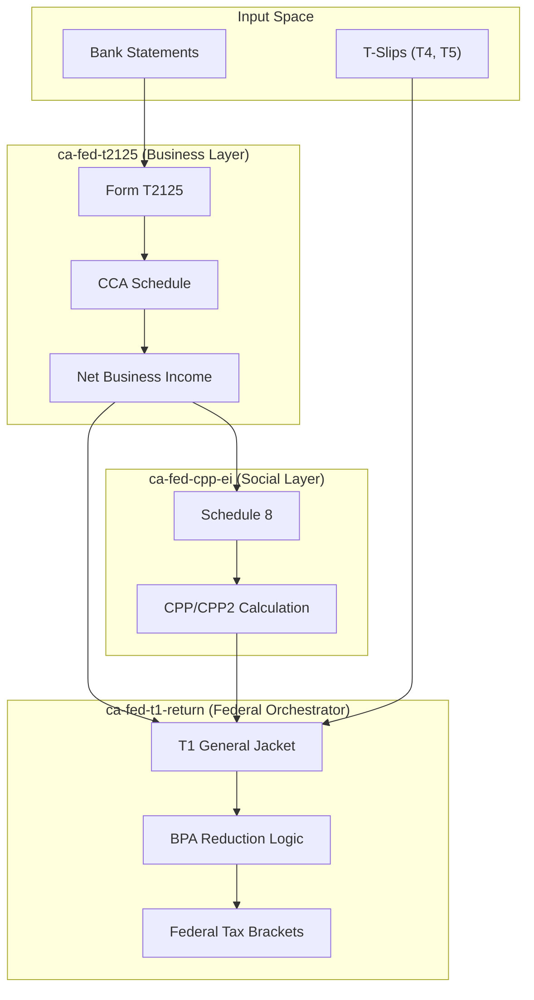
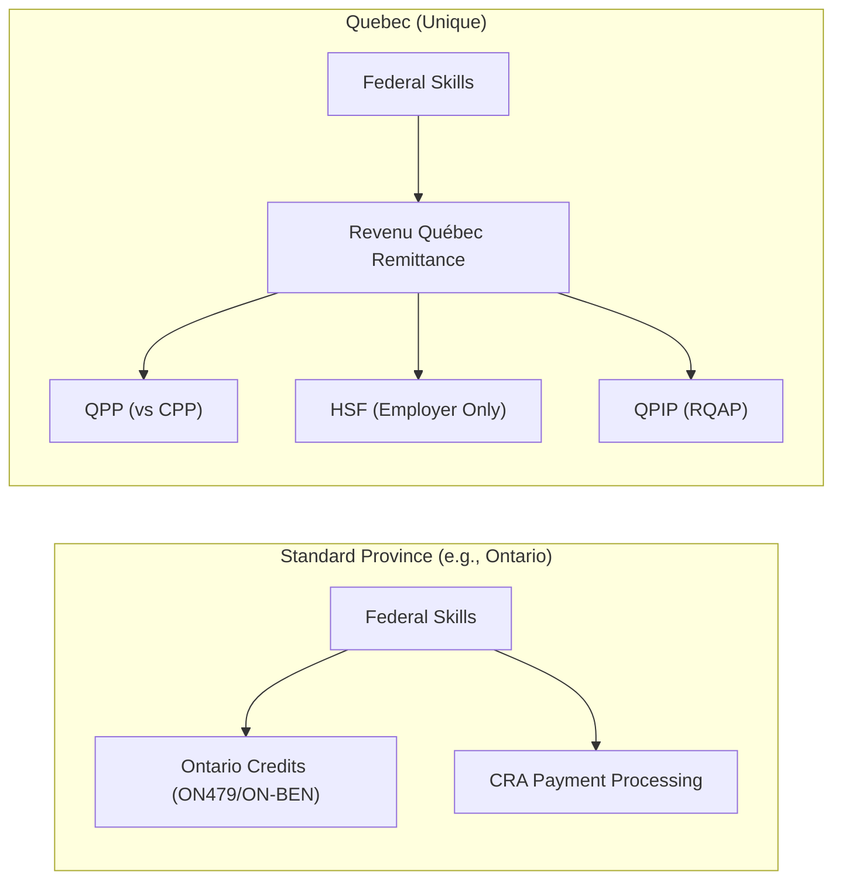

<!-- source: DeepWiki mcp.deepwiki.com · repo openaccountants/openaccountants · page 4.3 Canadian Federal and Provincial Coverage · fetched 2026-10-26 -->

# Canadian Federal and Provincial Coverage

Relevant source files

The following files were used as context for generating this wiki page:

- [packages/canada/alberta/ab-corporate-tax.md](packages/canada/alberta/ab-corporate-tax.md)
- [packages/canada/british-columbia/bc-eht.md](packages/canada/british-columbia/bc-eht.md)
- [packages/canada/british-columbia/bc-pst.md](packages/canada/british-columbia/bc-pst.md)
- [packages/canada/british-columbia/bc-speculation-vacancy-tax.md](packages/canada/british-columbia/bc-speculation-vacancy-tax.md)
- [packages/canada/manitoba/mb-rst.md](packages/canada/manitoba/mb-rst.md)
- [packages/canada/new-brunswick/nb-tax-credits.md](packages/canada/new-brunswick/nb-tax-credits.md)
- [packages/canada/newfoundland/nl-tax-credits.md](packages/canada/newfoundland/nl-tax-credits.md)
- [packages/canada/northwest-territories/nt-payroll-tax.md](packages/canada/northwest-territories/nt-payroll-tax.md)
- [packages/canada/nova-scotia/ns-tax-credits.md](packages/canada/nova-scotia/ns-tax-credits.md)
- [packages/canada/nunavut/nu-tax-credits.md](packages/canada/nunavut/nu-tax-credits.md)
- [packages/canada/ontario/on-eht.md](packages/canada/ontario/on-eht.md)
- [packages/canada/ontario/on-tax-credits.md](packages/canada/ontario/on-tax-credits.md)
- [packages/canada/pei/pe-tax-credits.md](packages/canada/pei/pe-tax-credits.md)
- [packages/canada/quebec/qc-corporate-tax-co17.md](packages/canada/quebec/qc-corporate-tax-co17.md)
- [packages/canada/quebec/qc-employer-contributions.md](packages/canada/quebec/qc-employer-contributions.md)
- [packages/canada/saskatchewan/sk-pst.md](packages/canada/saskatchewan/sk-pst.md)
- [packages/canada/yukon/yt-tax-credits.md](packages/canada/yukon/yt-tax-credits.md)
- [skills/international/australia/au-capital-gains.md](skills/international/australia/au-capital-gains.md)
- [skills/international/australia/au-individual-return.md](skills/international/australia/au-individual-return.md)
- [skills/international/australia/au-medicare-levy.md](skills/international/australia/au-medicare-levy.md)
- [skills/international/australia/au-nonresident-cgt.md](skills/international/australia/au-nonresident-cgt.md)
- [skills/international/australia/au-super-guarantee.md](skills/international/australia/au-super-guarantee.md)
- [skills/international/australia/au-tax-residency.md](skills/international/australia/au-tax-residency.md)
- [skills/international/belgium/be-capital-gains.md](skills/international/belgium/be-capital-gains.md)
- [skills/international/canada/ca-capital-gains.md](skills/international/canada/ca-capital-gains.md)
- [skills/international/canada/ca-fed-cpp-ei.md](skills/international/canada/ca-fed-cpp-ei.md)
- [skills/international/canada/ca-fed-instalments.md](skills/international/canada/ca-fed-instalments.md)
- [skills/international/canada/ca-fed-t1-return.md](skills/international/canada/ca-fed-t1-return.md)
- [skills/international/canada/ca-fed-t1135.md](skills/international/canada/ca-fed-t1135.md)
- [skills/international/canada/ca-fed-t2125.md](skills/international/canada/ca-fed-t2125.md)
- [skills/international/canada/ca-nonresident-cgt.md](skills/international/canada/ca-nonresident-cgt.md)
- [skills/international/canada/ca-tax-residency.md](skills/international/canada/ca-tax-residency.md)
- [skills/international/cyprus/cy-non-dom.md](skills/international/cyprus/cy-non-dom.md)
- [skills/international/denmark/dk-capital-gains.md](skills/international/denmark/dk-capital-gains.md)
- [skills/international/france/fr-social-contributions.md](skills/international/france/fr-social-contributions.md)
- [skills/international/germany/de-capital-gains.md](skills/international/germany/de-capital-gains.md)
- [skills/international/germany/de-income-tax.md](skills/international/germany/de-income-tax.md)
- [skills/international/germany/de-social-contributions.md](skills/international/germany/de-social-contributions.md)
- [skills/international/india/in-advance-tax.md](skills/international/india/in-advance-tax.md)
- [skills/international/india/in-tax-residency.md](skills/international/india/in-tax-residency.md)
- [skills/international/italy/it-inps-contributions.md](skills/international/italy/it-inps-contributions.md)
- [skills/international/netherlands/nl-zzp-deductions.md](skills/international/netherlands/nl-zzp-deductions.md)
- [skills/international/portugal/portugal-vat-return.md](skills/international/portugal/portugal-vat-return.md)
- [skills/international/singapore/sg-cpf-medisave.md](skills/international/singapore/sg-cpf-medisave.md)
- [skills/international/south-korea/kr-social-insurance.md](skills/international/south-korea/kr-social-insurance.md)
- [skills/international/spain/es-income-tax.md](skills/international/spain/es-income-tax.md)
- [skills/international/spain/es-social-contributions.md](skills/international/spain/es-social-contributions.md)
- [skills/international/uk/uk-income-tax-sa100.md](skills/international/uk/uk-income-tax-sa100.md)
- [skills/international/uk/uk-national-insurance.md](skills/international/uk/uk-national-insurance.md)
- [skills/international/uk/uk-self-employment-sa103.md](skills/international/uk/uk-self-employment-sa103.md)
- [skills/international/uk/uk-student-loan-repayment.md](skills/international/uk/uk-student-loan-repayment.md)
- [skills/us-states/ak/README.md](skills/us-states/ak/README.md)
- [skills/us-states/ak/ak-sales-tax.md](skills/us-states/ak/ak-sales-tax.md)

This page provides a technical overview of the Canadian tax coverage within OpenAccountants. The Canadian architecture follows a **Federal + Provincial/Territorial** bundle model, where federal skills handle the core income tax, business activity, and social contribution logic, while 13 sub-national packages provide the specific tax brackets, credits, and indirect tax overlays (PST/RST/QST).

## Federal Architecture and Core Skills

The Canadian federal layer is built on the `income-tax-workflow-base` and `social-contributions-workflow-base` [skills/international/canada/ca-fed-t1-return.md:9-10](). It handles the deterministic logic for the T1 General return, self-employment (T2125), and foreign asset reporting (T1135).

### Key Federal Components

| Skill Name | Purpose | Key Logic |
|---|---|---|
| `ca-fed-t1-return` | Main T1 General orchestrator | Federal brackets (15% to 33%), Basic Personal Amount (BPA) clawbacks, and tax instalment requirements [skills/international/canada/ca-fed-t1-return.md:38-56](). |
| `ca-fed-t2125` | Business & Professional Activities | CCA classes, home office, motor vehicle logs, and GST/HST registration thresholds ($30k) [skills/international/canada/ca-fed-t2125:57-75](). |
| `ca-fed-cpp-ei` | Social Contributions | CPP1 (5.95%), CPP2 (4% on YAMPE), and voluntary EI opt-in for self-employed [skills/international/canada/ca-fed-cpp-ei:37-64](). |
| `ca-fed-t1135` | Foreign Asset Reporting | Cost-basis threshold testing ($100k CAD) and Simplified vs. Detailed reporting boundaries ($250k) [skills/international/canada/ca-fed-t1135:52-59](). |
| `ca-tax-residency` | Residency Determination | Factual vs. Deemed residency, 183-day rule, and "sojourner" status. |
| `ca-capital-gains` | Capital Gains & Losses | 50% inclusion rate logic and Principal Residence Exemption (PRE). |

**Sources:** [skills/international/canada/ca-fed-t1-return.md](), [skills/international/canada/ca-fed-t2125.md](), [skills/international/canada/ca-fed-cpp-ei.md](), [skills/international/canada/ca-fed-t1135.md]()

### Data Flow: T1 Computation
The system uses a sequential data flow where business-level outputs from `ca-fed-t2125` feed into the broader T1 return.

**Sources:** [skills/international/canada/ca-fed-t1-return.md:105-107](), [skills/international/canada/ca-fed-t2125.md:117-120](), [skills/international/canada/ca-fed-cpp-ei.md:131-139]()

---

## Provincial and Territorial Packages

OpenAccountants provides coverage for all 13 provinces and territories. These are distributed as packages that layer on top of the federal skills to calculate total tax liability.

### Provincial Credit & Indirect Tax Matrix

| Jurisdiction | Key Skill/Package | Notable Coverage |
|---|---|---|
| **Ontario** | `on-tax-credits` | Ontario Trillium Benefit (OTB), CARE credit, and LIFT credit [packages/canada/ontario/on-tax-credits.md:24-32](). |
| **Quebec** | `qc-employer-contributions` | QPP (replaces CPP), QPIP (RQAP), and HSF (Health Services Fund) [packages/canada/quebec/qc-employer-contributions.md:22-30](). |
| **BC / SK / MB** | `bc-pst`, `sk-pst`, `mb-rst` | Provincial sales tax and retail sales tax logic. |
| **Atlantic** | `nb-tax-credits`, `ns-tax-credits`, `pe-tax-credits`, `nl-tax-credits` | Angel investor credits (e.g., NB SBITC 50%, PEI ETC 35%) and NL's 15% Insurance Premium Tax [packages/canada/newfoundland/nl-tax-credits.md:47](). |
| **Territories** | `nu-tax-credits`, `yt-tax-credits`, `nt-payroll-tax` | Nunavut Risk Capital (45%) and Yukon First Nations Tax Credit (FNTC) [packages/canada/yukon/yt-tax-credits.md:26](). |

**Sources:** [packages/canada/ontario/on-tax-credits.md](), [packages/canada/quebec/qc-employer-contributions.md](), [packages/canada/newfoundland/nl-tax-credits.md](), [packages/canada/yukon/yt-tax-credits.md]()

---

## Implementation Detail: Quebec Specifics

Quebec is handled as a unique architectural exception because it does not participate in the federal-provincial tax collection agreement for many items.

*   **QPP vs. CPP:** Quebec employees and employers remit to the Quebec Pension Plan (QPP) instead of CPP [packages/canada/quebec/qc-employer-contributions.md:77]().
*   **Employer Contributions:** Includes the Health Services Fund (HSF) with rates sliding from 1.65% to 4.26% based on total payroll [packages/canada/quebec/qc-employer-contributions.md:28]().
*   **QPIP:** The Quebec Parental Insurance Plan (RQAP) is a separate premium from Employment Insurance (EI) [packages/canada/quebec/qc-employer-contributions.md:27]().

**Sources:** [packages/canada/quebec/qc-employer-contributions.md:14-16](), [packages/canada/quebec/qc-employer-contributions.md:22-30]()

---

## Technical Logic: Thresholds and Prohibitions

The Canadian skills enforce strict "Conservative Defaults" and "Refusal Catalogues" to prevent incorrect tax filings in complex scenarios.

### Threshold Enforcement
*   **T1135:** Threshold testing is strictly based on **Cost Amount**, not Fair Market Value (FMV). If cost basis is unavailable, the skill triggers `R-CA-T1135-4` and stops [skills/international/canada/ca-fed-t1135:57, 129]().
*   **CPP/EI:** Mandatory age range is 18-70. Outside this range, the skill defaults to exempt status [skills/international/canada/ca-fed-cpp-ei:139-141]().

### Prohibitions (Hard Stops)
*   **Non-Residents:** The `ca-fed-t1-return` skill triggers `R-CA-T1-1` for non-resident returns, as they require a different legal framework [skills/international/canada/ca-fed-t1-return.md:95]().
*   **Ambiguous Residency:** If immigration or emigration dates are unclear, `ca-fed-t1135` triggers `R-CA-T1135-2` [skills/international/canada/ca-fed-t1135:125]().
*   **Corporations:** The `ca-fed-t2125` skill triggers `R-CA-1` if a corporation is detected, as corporations must file T2 returns instead of T1 [skills/international/canada/ca-fed-t2125:105]().

**Sources:** [skills/international/canada/ca-fed-t1-return.md](), [skills/international/canada/ca-fed-t2125.md](), [skills/international/canada/ca-fed-t1135.md]()

---

