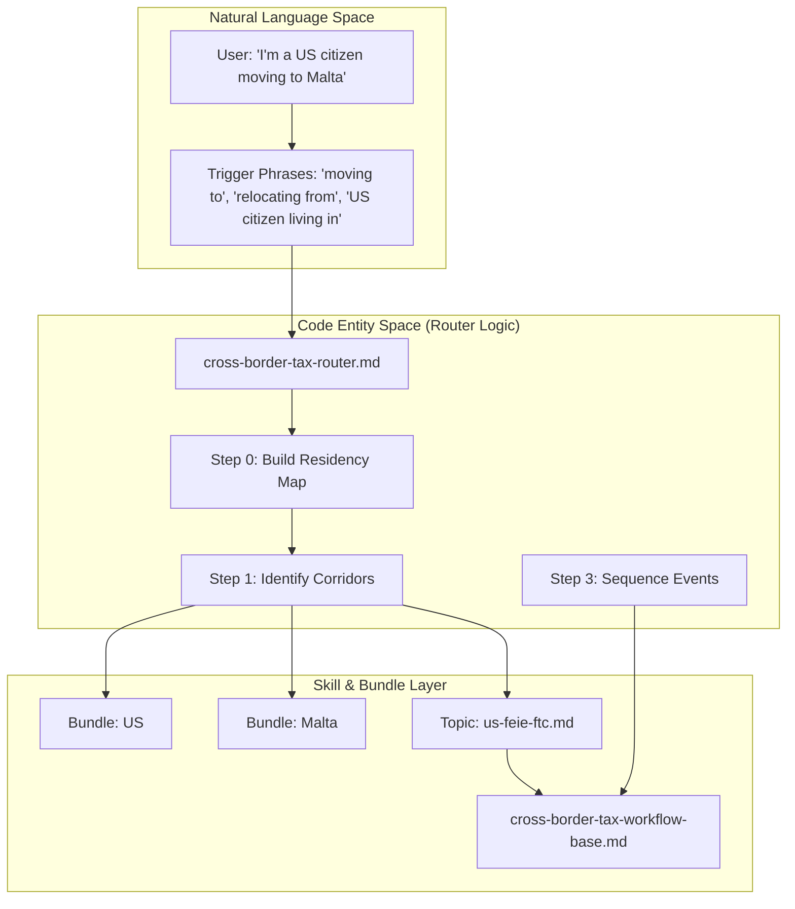
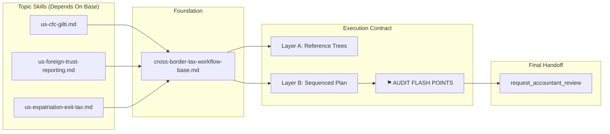

<!-- source: DeepWiki mcp.deepwiki.com · repo openaccountants/openaccountants · page 5.1 Cross-Border Tax Router and Workflow Base · fetched 2026-10-26 -->

# Cross-Border Tax Router and Workflow Base

Relevant source files

The following files were used as context for generating this wiki page:

- [skills/cross-border/cross-border-tax-router.md](skills/cross-border/cross-border-tax-router.md)
- [skills/cross-border/cross-border-tax-workflow-base.md](skills/cross-border/cross-border-tax-workflow-base.md)
- [skills/cross-border/us-expat/us-cfc-gilti.md](skills/cross-border/us-expat/us-cfc-gilti.md)
- [skills/cross-border/us-expat/us-expatriation-exit-tax.md](skills/cross-border/us-expat/us-expatriation-exit-tax.md)
- [skills/cross-border/us-expat/us-fbar-fatca-reporting.md](skills/cross-border/us-expat/us-fbar-fatca-reporting.md)
- [skills/cross-border/us-expat/us-feie-ftc.md](skills/cross-border/us-expat/us-feie-ftc.md)
- [skills/cross-border/us-expat/us-foreign-trust-reporting.md](skills/cross-border/us-expat/us-foreign-trust-reporting.md)
- [workflows/cross-border-intake.md](workflows/cross-border-intake.md)

This page documents the technical architecture and logic of the OpenAccountants cross-border tax system. It focuses on the entry point for multi-jurisdiction scenarios, the residency/citizenship mapping logic, and the foundational workflow base that coordinates international topic skills.

## Purpose and Scope

The cross-border system is designed to handle tax scenarios involving more than one country (e.g., relocation, US expats, foreign trust ownership). It operates on a "Router-Base-Topic" pattern:
1.  **The Router (`cross-border-tax-router.md`)**: Silently performs triage, maps residency, and identifies the correct skills to load [skills/cross-border/cross-border-tax-router.md:9-16]().
2.  **The Workflow Base (`cross-border-tax-workflow-base.md`)**: Provides the shared contract for output structure, conservative defaults, and the "sequenced-plan" requirement [skills/cross-border/cross-border-tax-workflow-base.md:3-9]().
3.  **The Topic Skills**: Specialized logic for specific international regimes like `us-cfc-gilti` or `us-feie-ftc` [skills/cross-border/cross-border-tax-router.md:91-98]().

---

## 1. The Cross-Border Tax Router

The router is the mandatory entry point for any fact pattern touching multiple countries [skills/cross-border/cross-border-tax-router.md:4-8](). It does not perform tax calculations; its role is purely orchestration and sequencing [skills/cross-border/cross-border-tax-router.md:40-43]().

### Logic Flow: Natural Language to Code Entity Mapping
This diagram shows how user input triggers the router and how the router selects internal code entities (skills and bundles).

**Router Orchestration Flow**

**Sources:** [skills/cross-border/cross-border-tax-router.md:30-38](), [workflows/cross-border-intake.md:8-14](), [skills/cross-border/us-expat/us-feie-ftc.md:25-34]().

### Key Router Steps
1.  **Step 0: The Map**: Captures citizenship, tax residence, domicile, and the specific event timing [skills/cross-border/cross-border-tax-router.md:55-78]().
2.  **Step 1: Topic Identification**: Matches facts to specific international skills (e.g., `us-cfc-gilti` for foreign company owners) [skills/cross-border/cross-border-tax-router.md:85-98]().
3.  **Step 2: Scope Gating**: Explicitly identifies items not covered, such as PFIC (Form 8621) or specific social security totalization [skills/cross-border/cross-border-tax-router.md:110-123]().
4.  **Step 3: Sequencing**: Determines the order of operations (e.g., "sever residency *before* selling asset") [skills/cross-border/cross-border-tax-router.md:125-132]().

---

## 2. Cross-Border Tax Workflow Base

The `cross-border-tax-workflow-base.md` defines the structural requirements for all international outputs. It ensures that regardless of the country, the AI provides a "Sequenced Plan" rather than a disconnected list of rules [skills/cross-border/cross-border-tax-workflow-base.md:48-52]().

### The Output Contract
Every cross-border response must adhere to a two-layer structure:
*   **Layer A (Reference Layer)**: Citation-anchored decision trees explaining the rules [skills/cross-border/cross-border-tax-workflow-base.md:53-59]().
*   **Layer B (Executable Layer)**: A step-by-step ordered procedure detailing what happens, which country taxes it, and how double tax is relieved [skills/cross-border/cross-border-tax-workflow-base.md:61-75]().

### Data Flow and Dependency Structure
The following diagram illustrates how the base workflow interacts with specific topic skills and the mandatory human review step.

**Cross-Border Dependency and Data Flow**

**Sources:** [skills/cross-border/cross-border-tax-workflow-base.md:1-19](), [skills/cross-border/us-expat/us-cfc-gilti.md:14-16](), [skills/cross-border/us-expat/us-foreign-trust-reporting.md:7-9](), [skills/cross-border/cross-border-tax-workflow-base.md:106-115]().

---

## 3. Core Principles and Conventions

### Conservative Defaults
In cross-border scenarios, the system follows a specific "Cross-Border Edition" of the conservative-default principle:
*   **Broader Taxing Right**: If residence is unclear, assume the system with the broader reach (e.g., US worldwide taxation) [skills/cross-border/cross-border-tax-workflow-base.md:133-134]().
*   **Reporting Obligation**: Always default to filing (FBAR, Form 8938, etc.) because the cost of a missed information return is significantly higher than an unnecessary one [skills/cross-border/cross-border-tax-workflow-base.md:135-137]().

### The Treaty Bridge
A critical requirement of the base is the "Treaty Bridge." The system must explicitly state:
*   Which country has the **primary** taxing right [skills/cross-border/cross-border-tax-workflow-base.md:90-93]().
*   The **mechanism** for relief (e.g., §901 Foreign Tax Credit) [skills/cross-border/cross-border-tax-workflow-base.md:91-93]().
*   The **saving clause caveat**: Checking if the US-person status overrides the treaty benefit [skills/cross-border/cross-border-tax-workflow-base.md:99-102]().

### Audit Flash Points
Common flash points tracked in cross-border workflows include:
*   **Residency Tie-Breakers**: Fact-specific treaty interpretations [skills/cross-border/cross-border-tax-workflow-base.md:118-120]().
*   **Constructive Ownership**: §958 attribution chains for CFC status [skills/cross-border/us-cfc-gilti.md:49-50]().
*   **Bona-Fide Residence**: Facts-and-circumstances for §911 FEIE [skills/cross-border/us-expat/us-feie-ftc.md:80-88]().

---

## 4. Implementation Example: US-Expat Workflow
When a user triggers the `cross-border-intake` prompt, the following logic is executed:

| Phase | Action | Code Reference |
| :--- | :--- | :--- |
| **1. Scope** | Ask the 5 key questions (Countries, Trigger, Timing, Entities, Concern) | [workflows/cross-border-intake.md:38-47]() |
| **2. Issue Map** | Run country-specific residency and exit rules | [workflows/cross-border-intake.md:48-50]() |
| **3. Scenarios** | Model event-ordering (e.g., "sell before move" vs "sell after move") | [workflows/cross-border-intake.md:51-53]() |
| **4. Briefing** | Generate a structured brief for the practitioner | [workflows/cross-border-intake.md:54-56]() |
| **5. Handoff** | Route to professional review via `openaccountants.com` | [workflows/cross-border-intake.md:60-62]() |

**Sources:**
* `skills/cross-border/cross-border-tax-router.md`
* `skills/cross-border/cross-border-tax-workflow-base.md`
* `workflows/cross-border-intake.md`
* `skills/cross-border/us-expat/us-cfc-gilti.md`
* `skills/cross-border/us-expat/us-feie-ftc.md`
* `skills/cross-border/us-expat/us-foreign-trust-reporting.md`
* `skills/cross-border/us-expat/us-expatriation-exit-tax.md`
* `skills/cross-border/us-expat/us-fbar-fatca-reporting.md`

---

