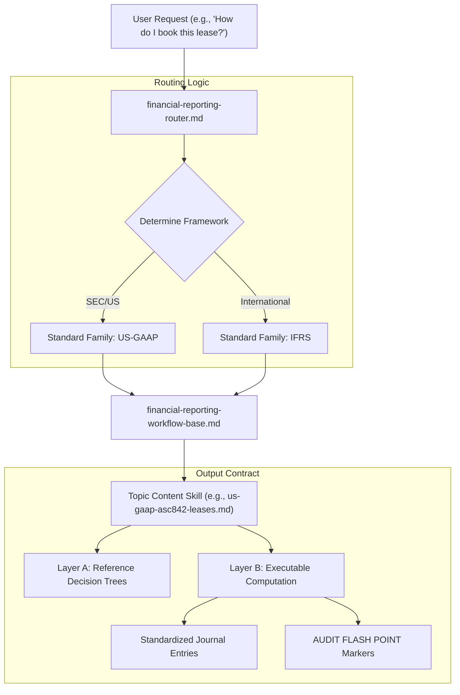
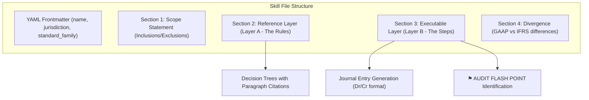

<!-- source: DeepWiki mcp.deepwiki.com · repo openaccountants/openaccountants · page 6 Financial Reporting Skills · fetched 2026-10-26 -->

# Financial Reporting Skills

Relevant source files

The following files were used as context for generating this wiki page:

- [skills/financial-reporting/business-combinations/ifrs3-business-combinations.md](skills/financial-reporting/business-combinations/ifrs3-business-combinations.md)
- [skills/financial-reporting/business-combinations/us-gaap-asc805-business-combinations.md](skills/financial-reporting/business-combinations/us-gaap-asc805-business-combinations.md)
- [skills/financial-reporting/debt-vs-equity/ias32-debt-vs-equity.md](skills/financial-reporting/debt-vs-equity/ias32-debt-vs-equity.md)
- [skills/financial-reporting/debt-vs-equity/us-gaap-debt-vs-equity.md](skills/financial-reporting/debt-vs-equity/us-gaap-debt-vs-equity.md)
- [skills/financial-reporting/financial-reporting-router.md](skills/financial-reporting/financial-reporting-router.md)
- [skills/financial-reporting/financial-reporting-workflow-base.md](skills/financial-reporting/financial-reporting-workflow-base.md)
- [skills/financial-reporting/leases/ifrs16-leases.md](skills/financial-reporting/leases/ifrs16-leases.md)
- [skills/financial-reporting/leases/us-gaap-asc842-leases.md](skills/financial-reporting/leases/us-gaap-asc842-leases.md)
- [skills/financial-reporting/revenue-recognition/ifrs15-revenue.md](skills/financial-reporting/revenue-recognition/ifrs15-revenue.md)
- [skills/financial-reporting/revenue-recognition/us-gaap-asc606-revenue.md](skills/financial-reporting/revenue-recognition/us-gaap-asc606-revenue.md)
- [skills/international/kazakhstan/kz-simplified-regime.md](skills/international/kazakhstan/kz-simplified-regime.md)
- [skills/manifest.json](skills/manifest.json)

This page provides an overview of the `financial-reporting/` skill domain within the OpenAccountants framework. This domain provides a dual-standard library covering **US GAAP (ASC)** and **IFRS**, enabling automated accounting research, transaction measurement, and journal entry generation for complex financial reporting topics.

## Domain Architecture

The financial reporting library is structured around a central router and a shared workflow base that standardizes how accounting conclusions are reached and presented.

### The Router and Workflow Base
- **`financial-reporting-router.md`**: The mandatory entry point for all financial reporting queries. It establishes the reporting framework (US GAAP vs. IFRS), identifies the applicable standards, and sequences topic skills [skills/financial-reporting/financial-reporting-router.md:1-21]().
- **`financial-reporting-workflow-base.md`**: The foundation for all content skills. It enforces a **Two-Layer Output Contract**:
    - **Layer A (Reference Layer)**: Citation-anchored rules and decision trees [skills/financial-reporting/financial-reporting-workflow-base.md:41-43]().
    - **Layer B (Executable Layer)**: Step-by-step computation resulting in journal entries and reviewer briefs [skills/financial-reporting/financial-reporting-workflow-base.md:45-56]().

### Dual-Standard Coverage
Every reporting topic is implemented in two distinct files—one for US GAAP and one for IFRS—to account for divergence in citations and treatments [skills/financial-reporting/financial-reporting-workflow-base.md:60-68]().

| Feature | US GAAP (ASC) | IFRS |
| :--- | :--- | :--- |
| **Revenue** | `us-gaap-asc606-revenue` | `ifrs15-revenue` |
| **Leases** | `us-gaap-asc842-leases` | `ifrs16-leases` |
| **Business Combinations** | `us-gaap-asc805-business-combinations` | `ifrs3-business-combinations` |
| **Debt vs. Equity** | `us-gaap-debt-vs-equity` | `ias32-debt-vs-equity` |

**Sources:**
- [skills/financial-reporting/financial-reporting-router.md:1-40]()
- [skills/financial-reporting/financial-reporting-workflow-base.md:1-112]()

## Code Entity Mapping: Routing and Workflow

The following diagram illustrates how the system transitions from a natural language request to specific code entities within the financial reporting domain.

### Financial Reporting Execution Flow

**Sources:**
- [skills/financial-reporting/financial-reporting-router.md:44-89]()
- [skills/financial-reporting/financial-reporting-workflow-base.md:37-101]()

## Core Reporting Topics

### Revenue Recognition (ASC 606 / IFRS 15)
Covers the five-step revenue model for contracts with customers. The library handles variable consideration, principal-vs-agent (gross vs. net) assessments, and contract modifications.
- **Key Difference**: US GAAP and IFRS have different "probable" thresholds for contract existence in Step 1 [skills/financial-reporting/revenue-recognition/ifrs15-revenue.md:58-71]().
- For details, see **[Revenue Recognition (ASC 606 / IFRS 15)](#6.1)**.

### Leases (ASC 842 / IFRS 16)
Covers the identification and measurement of Right-of-Use (ROU) assets and lease liabilities.
- **Key Difference**: US GAAP uses a **dual model** (Finance vs. Operating) for lessees [skills/financial-reporting/leases/us-gaap-asc842-leases:4-12](), whereas IFRS uses a **single model** where all leases are effectively treated as finance leases [skills/financial-reporting/leases/ifrs16-leases:4-15]().
- For details, see **[Leases, Business Combinations, and Debt vs. Equity](#6.2)**.

### Business Combinations (ASC 805 / IFRS 3)
Guides the acquisition method, including identifying the accounting acquirer (addressing reverse acquisitions), measuring fair value of assets/liabilities, and calculating goodwill.
- **Key Difference**: IFRS 3 allows a per-transaction choice between "Full Goodwill" and "Partial Goodwill" (NCI's proportionate share) [skills/financial-reporting/business-combinations/ifrs3-business-combinations:86-89]().
- For details, see **[Leases, Business Combinations, and Debt vs. Equity](#6.2)**.

### Debt vs. Equity (ASC 480 / IAS 32)
Determines whether a financial instrument should be classified as a liability, equity, or a compound (split) instrument.
- **Key Concept**: IFRS utilizes the **"Fixed-for-Fixed" test** for equity classification [skills/financial-reporting/debt-vs-equity/ias32-debt-vs-equity:79-89]().
- For details, see **[Leases, Business Combinations, and Debt vs. Equity](#6.2)**.

**Sources:**
- [skills/financial-reporting/revenue-recognition/us-gaap-asc606-revenue.md:1-97]()
- [skills/financial-reporting/leases/us-gaap-asc842-leases.md:1-87]()
- [skills/financial-reporting/business-combinations/us-gaap-asc805-business-combinations.md:1-85]()
- [skills/financial-reporting/debt-vs-equity/us-gaap-debt-vs-equity.md:1-85]()

## Standard Implementation Logic

The content skills follow a strict internal structure to ensure the AI applies standards consistently.

### Content Skill Structure

**Sources:**
- [skills/financial-reporting/financial-reporting-workflow-base.md:37-97]()
- [skills/financial-reporting/revenue-recognition/ifrs15-revenue.md:1-54]()

## Scope Gating
The library explicitly identifies standards not yet covered (e.g., Impairment, Income Taxes, Share-based Payments) and provides a template for communicating these limitations to the user [skills/financial-reporting/financial-reporting-router.md:93-118]().

**Sources:**
- [skills/financial-reporting/financial-reporting-router.md:93-122]()

---

