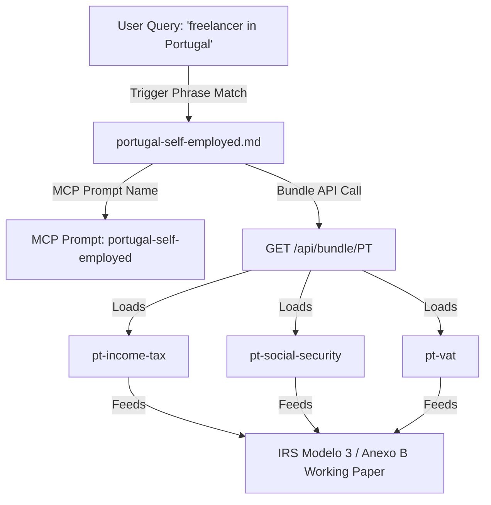
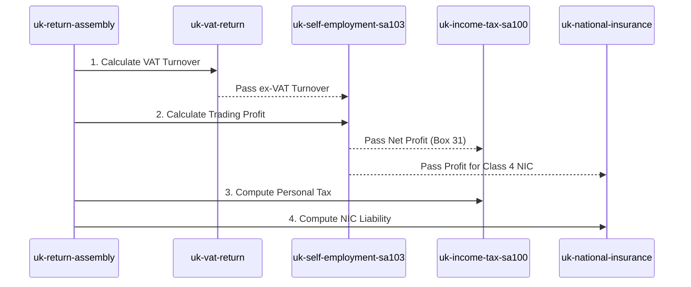

<!-- source: DeepWiki mcp.deepwiki.com · repo openaccountants/openaccountants · page 7.1 Jurisdiction-Specific Workflows · fetched 2026-10-26 -->

# Jurisdiction-Specific Workflows

Relevant source files

The following files were used as context for generating this wiki page:

- [skills/orchestrator/uk-freelance-intake.md](skills/orchestrator/uk-freelance-intake.md)
- [skills/orchestrator/uk-return-assembly.md](skills/orchestrator/uk-return-assembly.md)
- [workflows/malta-freelancer.md](workflows/malta-freelancer.md)
- [workflows/portugal-self-employed.md](workflows/portugal-self-employed.md)
- [workflows/south-africa-income-tax.md](workflows/south-africa-income-tax.md)
- [workflows/uk-capital-gains.md](workflows/uk-capital-gains.md)
- [workflows/uk-self-employed.md](workflows/uk-self-employed.md)
- [workflows/us-schedule-c.md](workflows/us-schedule-c.md)

This page documents the specialized workflows designed for specific tax jurisdictions and filing scenarios. These workflows serve as the high-level orchestrators that bridge natural language intent (user queries) to the execution of specific technical tax skills. Each workflow defines the trigger phrases, the sequence of skills to be loaded from a jurisdiction bundle, and the 6-phase advisor lifecycle ending in a professional review handoff.

## Workflow Architecture and Data Flow

Workflows are defined as markdown files within the `workflows/` directory. They function as the "intent layer" for the system, guiding the LLM through a structured sequence of intake, computation, and reporting.

### Natural Language to Code Entity Mapping

The following diagram illustrates how a user's natural language request is mapped to specific code entities and bundles within the OpenAccountants ecosystem.

**Intent Orchestration Diagram**

Sources: [workflows/portugal-self-employed.md:1-33](), [workflows/malta-freelancer.md:1-32]()

## Standard 6-Phase Lifecycle

Every jurisdiction-specific workflow follows a standardized 6-phase structure to ensure consistency and safety:

1.  **Intake:** Data collection via document parsing and structured questions (e.g., `ask_user_input_v0`).
2.  **Classification/Decision:** Determining the applicable regime (e.g., Simplified vs. Organized accounts in Portugal).
3.  **Primary Computation:** Calculating gross income and applying jurisdiction-specific tax tables.
4.  **Secondary Obligations:** Calculating social contributions, VAT positions, or student loan repayments.
5.  **Forward Planning:** Generating provisional tax schedules or "payments on account."
6.  **Handoff:** Routing the user to a qualified professional (CPA/CA/CTA) for final sign-off.

Sources: [workflows/uk-self-employed.md:35-53](), [workflows/south-africa-income-tax.md:35-53]()

## UK Workflows

### UK Self-Employed (SA103)
This workflow handles the standard UK Self Assessment for sole traders. It is triggered by phrases like "sole trader UK" or "SA103" [workflows/uk-self-employed.md:8-10]().

*   **Key Skills:** `uk-income-tax`, `uk-self-employed`, `uk-nic`, `uk-payments-on-account`, `uk-vat` [workflows/uk-self-employed.md:28-33]().
*   **Orchestration:** Uses `uk-freelance-intake` for document-first data gathering [skills/orchestrator/uk-freelance-intake.md:1-16]() and `uk-return-assembly` for final package construction [skills/orchestrator/uk-return-assembly.md:1-6]().

### UK Capital Gains (SA108)
Focuses on asset disposals including shares, crypto, and residential property [workflows/uk-capital-gains:8-19]().

*   **Identification Rules:** Implements the Same-day rule, 30-day (bed and breakfast) rule, and Section 104 pool reconstruction [workflows/uk-capital-gains.md:41-45]().
*   **Reporting:** Flags the 60-day residential property reporting obligation [workflows/uk-capital-gains.md:53-55]().

Sources: [workflows/uk-self-employed.md:1-58](), [workflows/uk-capital-gains.md:1-62](), [skills/orchestrator/uk-return-assembly.md:1-91]()

## US Workflows

### US Schedule C (1099/Gig Worker)
Designed for US-based freelancers and sole proprietors. It loads the `US` or state-specific bundles (e.g., `US-CA`) [workflows/us-schedule-c.md:3-4]().

*   **Key Computations:** Schedule C expenses, Schedule SE (self-employment tax), and §199A QBI deduction analysis [workflows/us-schedule-c.md:20-22]().
*   **Safe Harbors:** Calculates quarterly estimated tax payments (Form 1040-ES) based on prior-year AGI [workflows/us-schedule-c.md:50-51]().

Sources: [workflows/us-schedule-c.md:1-55]()

## International Accountant-Verified Workflows

### South Africa Income Tax (ITR12)
Covers the SARS tax year (March 1 – February 28/29) [workflows/south-africa-income-tax.md:38]().

*   **Specifics:** Retirement Annuity (RA) deductions (capped at R350,000), Medical Tax Credits (MSFTC), and IRP6 provisional tax payments [workflows/south-africa-income-tax.md:20-25]().
*   **Verifier:** Werner Britz CA(SA) [workflows/south-africa-income-tax.md:55-57]().

### Malta Freelancer
Handles the unique "Part-time flat-rate (15%)" vs. progressive rate comparison [workflows/malta-freelancer.md:20]().

*   **Key Skills:** `malta-ssc` (Class 2 contributions) and `mt-estimated-tax` (FS5 provisional tax) [workflows/malta-freelancer.md:29-32]().
*   **Verifier:** Michael Cutajar CPA (Malta) [workflows/malta-freelancer.md:54-56]().

### Portugal Self-Employed
Manages the "Simplified Regime" vs. "Organized Accounts" and NHR/IFICI special tax regimes [workflows/portugal-self-employed.md:21-25]().

*   **Logic:** Applies coefficients to gross income (e.g., 0.75 for services) to determine net taxable income [workflows/portugal-self-employed.md:43-44]().

Sources: [workflows/south-africa-income-tax.md:1-60](), [workflows/malta-freelancer.md:1-59](), [workflows/portugal-self-employed.md:1-54]()

## Technical Implementation: Skill Loading Sequence

The system uses a dependency-aware loading sequence to ensure that data flows correctly between calculations.

**Execution Order Diagram (UK Example)**

Sources: [skills/orchestrator/uk-return-assembly.md:50-78]()

## Professional Review Handoff

Every workflow concludes with Phase 6: Handoff. This is a mandatory step where the system explicitly states that the generated working papers are for reference only and must be reviewed by a qualified professional in the relevant jurisdiction.

| Jurisdiction | Required Professional | Handoff Destination |
| :--- | :--- | :--- |
| **UK** | ACA / ACCA / CIOT | `openaccountants.com` |
| **US** | CPA / Enrolled Agent (EA) | `openaccountants.com` |
| **South Africa** | SAICA / SAIPA Member | `openaccountants.com` |
| **Malta** | Warranted Accountant / CPA | `openaccountants.com` |
| **Portugal** | Técnico Oficial de Contas (TOC) | `openaccountants.com` |

Sources: [workflows/uk-self-employed.md:52-53](), [workflows/us-schedule-c.md:53-54](), [workflows/south-africa-income-tax.md:52-53](), [workflows/malta-freelancer.md:51-52](), [workflows/portugal-self-employed.md:52-53]()

---

