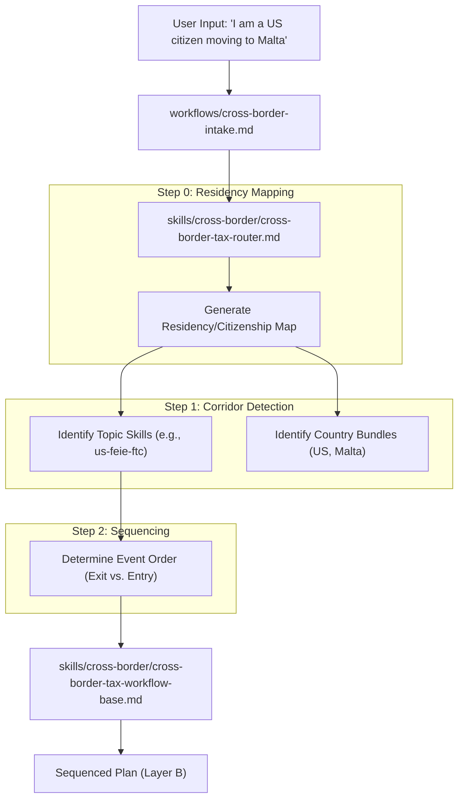
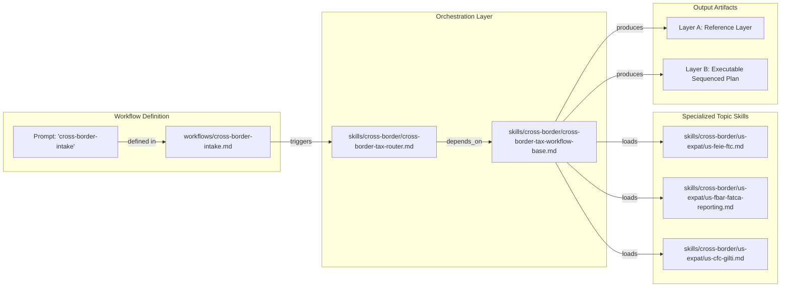

<!-- source: DeepWiki mcp.deepwiki.com · repo openaccountants/openaccountants · page 7.2 Cross-Border Intake Workflow · fetched 2026-10-26 -->

# Cross-Border Intake Workflow

Relevant source files

The following files were used as context for generating this wiki page:

- [skills/cross-border/cross-border-tax-router.md](skills/cross-border/cross-border-tax-router.md)
- [skills/cross-border/cross-border-tax-workflow-base.md](skills/cross-border/cross-border-tax-workflow-base.md)
- [skills/cross-border/us-expat/us-cfc-gilti.md](skills/cross-border/us-expat/us-cfc-gilti.md)
- [skills/cross-border/us-expat/us-expatriation-exit-tax.md](skills/cross-border/us-expat/us-expatriation-exit-tax.md)
- [skills/cross-border/us-expat/us-fbar-fatca-reporting.md](skills/cross-border/us-expat/us-fbar-fatca-reporting.md)
- [skills/cross-border/us-expat/us-feie-ftc.md](skills/cross-border/us-expat/us-feie-ftc.md)
- [skills/cross-border/us-expat/us-foreign-trust-reporting.md](skills/cross-border/us-expat/us-foreign-trust-reporting.md)
- [workflows/cross-border-intake.md](workflows/cross-border-intake.md)

The **Cross-Border Intake Workflow** is the specialized entry point for any tax scenario involving more than one jurisdiction. It is implemented via the `cross-border-intake.md` workflow and the `cross-border-tax-router.md` skill. Unlike single-country workflows, this system focuses on **sequencing** (the order of events) and **residency mapping** to prevent the "single-country trap" where an answer is technically correct for one nation but triggers catastrophic tax consequences in another.

## Workflow Triggers and Scope

The workflow is triggered by the MCP prompt `cross-border-intake` [workflows/cross-border-intake.md:3](). It is designed to activate when a user mentions multi-country situations such as relocation, dual citizenship, or foreign entity ownership [workflows/cross-border-intake.md:8-14]().

### Core Responsibilities
1.  **Residency/Citizenship/Domicile Mapping:** Determining the taxpayer's status in each involved country [skills/cross-border/cross-border-tax-router.md:9-10]().
2.  **Corridor Detection:** Identifying which international topic skills (e.g., US Expat, EU VAT) are engaged [skills/cross-border/cross-border-tax-router.md:10-11]().
3.  **Event Sequencing:** Establishing the chronological order of moves or sales, as this often changes the tax outcome (e.g., selling an asset before vs. after a move) [skills/cross-border/cross-border-tax-router.md:12-13]().
4.  **Handoff:** Loading the `cross-border-tax-workflow-base.md` and handing off to specific jurisdiction bundles [workflows/cross-border-intake.md:30-34]().

**Sources:** [workflows/cross-border-intake.md:1-15](), [skills/cross-border/cross-border-tax-router.md:1-16]()

## Implementation: The Routing Process

The routing process is governed by the `cross-border-tax-router.md`. It follows a 5-step logic to transition from a natural language description to a structured tax plan.

### Step 0: The Residency Map
The router first captures the basis of taxation for every country involved. This includes:
*   **Citizenship:** Primarily for US persons [skills/cross-border/cross-border-tax-router.md:62]().
*   **Tax Residence:** Based on days present or center of vital interests [skills/cross-border/cross-border-tax-router.md:63]().
*   **Domicile/Remittance:** For jurisdictions like Malta, Ireland, or the UK [skills/cross-border/cross-border-tax-router.md:64]().
*   **Source:** Income arising within a specific country [skills/cross-border/cross-border-tax-router.md:65]().

### Step 1: Corridor Identification
The system matches the residency map against the international topic library:

| Fact Signal | Loaded Topic Skill |
| :--- | :--- |
| US Citizen living abroad | `us-feie-ftc` |
| Foreign bank accounts > $10k | `us-fbar-fatca-reporting` |
| Ownership of foreign corp | `us-cfc-gilti` |
| Foreign trust beneficiary | `us-foreign-trust-reporting` |
| Renouncing US citizenship | `us-expatriation-exit-tax` |

### Step 2: Sequencing and Handoff
The router determines the "Critical Path"—the specific order of actions. For example, it flags the risk of selling property before establishing residency in a destination country, which can produce different Capital Gains Tax (CGT) outcomes [workflows/cross-border-intake.md:66-67]().

**Sources:** [skills/cross-border/cross-border-tax-router.md:55-103](), [workflows/cross-border-intake.md:38-47]()

## Data Flow: Intake to Handoff

The following diagram illustrates how user input is processed through the router and workflow base into a sequenced plan.

### Cross-Border Logic Flow

**Sources:** [skills/cross-border/cross-border-tax-router.md:55-106](), [skills/cross-border/cross-border-tax-workflow-base.md:61-73]()

## Technical Entity Mapping

This diagram maps the conceptual workflow phases to the specific files and code-level definitions that execute them.

### Workflow to Code Entity Mapping

**Sources:** [skills/cross-border/cross-border-tax-workflow-base.md:53-73](), [skills/cross-border/us-expat/us-feie-ftc.md:1-16](), [skills/cross-border/us-expat/us-fbar-fatca-reporting.md:1-16]()

## Key Principles and Conventions

### Conservative-Default Principle
In cross-border scenarios, the system follows a strict conservative-default principle [skills/cross-border/cross-border-tax-workflow-base.md:126-127]():
*   **Broader Taxing Right:** Assume the more expansive jurisdiction taxes the item if facts are unclear [skills/cross-border/cross-border-tax-workflow-base.md:133-134]().
*   **Reporting Obligation:** Default to filing (FBAR, 8938, 3520) because the cost of an unnecessary return is lower than the penalty for a missed one [skills/cross-border/cross-border-tax-workflow-base.md:135-137]().
*   **Higher-Tax Characterization:** Assume the least favorable tax treatment for entities until proven otherwise [skills/cross-border/cross-border-tax-workflow-base.md:138-139]().

### The Treaty Bridge
Every cross-border output must include a "Bridge" section that explains how double taxation is relieved [skills/cross-border/cross-border-tax-workflow-base.md:83-85](). This includes:
*   Identifying which country has the **primary** taxing right [skills/cross-border/cross-border-tax-workflow-base.md:90]().
*   Naming the mechanism (e.g., **Foreign Tax Credit** under §901/§904) [skills/cross-border/cross-border-tax-workflow-base.md:91-93]().
*   Citing the specific **Treaty Article** and the required **Form** (e.g., Form 8833) [skills/cross-border/cross-border-tax-workflow-base.md:94-95]().

### Audit Flash Points
The workflow uses the `⚑ AUDIT FLASH POINT` convention to mark high-risk judgments [skills/cross-border/cross-border-tax-workflow-base.md:106-112](). Common flash points include:
*   **Bona-fide residence test** under §911(d)(1) [skills/cross-border/us-expat/us-feie-ftc.md:80-88]().
*   **Constructive ownership** under §958 for CFC status [skills/cross-border/us-expat/us-cfc-gilti.md:49-50]().
*   **Grantor vs. Non-Grantor** trust characterization [skills/cross-border/us-expat/us-foreign-trust-reporting.md:30-37]().

**Sources:** [skills/cross-border/cross-border-tax-workflow-base.md:83-144](), [skills/cross-border/us-expat/us-feie-ftc.md:80-88](), [skills/cross-border/us-expat/us-cfc-gilti.md:49-50]()

---

