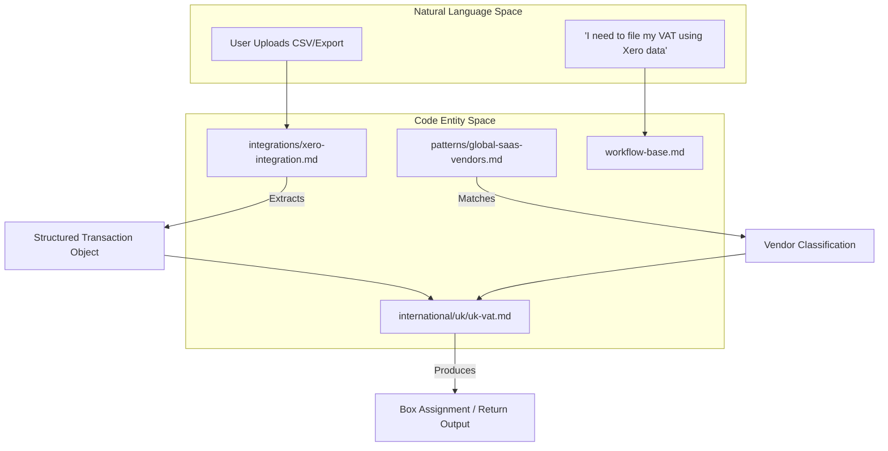
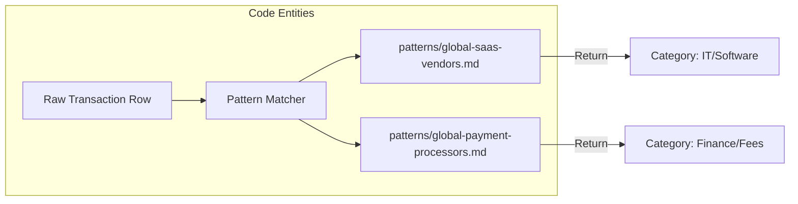

<!-- source: DeepWiki mcp.deepwiki.com · repo openaccountants/openaccountants · page 8.2 Platform Integration Skills · fetched 2026-10-26 -->

# Platform Integration Skills

Relevant source files

The following files were used as context for generating this wiki page:

- [skills/cross-border/eu-oss-digital.md](skills/cross-border/eu-oss-digital.md)
- [skills/cross-border/eu-reverse-charge.md](skills/cross-border/eu-reverse-charge.md)
- [skills/cross-border/non-eu-export-services.md](skills/cross-border/non-eu-export-services.md)
- [skills/cross-border/permanent-establishment-risk.md](skills/cross-border/permanent-establishment-risk.md)
- [skills/cross-border/withholding-tax-matrix.md](skills/cross-border/withholding-tax-matrix.md)
- [skills/financial-reporting/business-combinations/ifrs3-business-combinations.md](skills/financial-reporting/business-combinations/ifrs3-business-combinations.md)
- [skills/financial-reporting/business-combinations/us-gaap-asc805-business-combinations.md](skills/financial-reporting/business-combinations/us-gaap-asc805-business-combinations.md)
- [skills/financial-reporting/debt-vs-equity/ias32-debt-vs-equity.md](skills/financial-reporting/debt-vs-equity/ias32-debt-vs-equity.md)
- [skills/financial-reporting/debt-vs-equity/us-gaap-debt-vs-equity.md](skills/financial-reporting/debt-vs-equity/us-gaap-debt-vs-equity.md)
- [skills/financial-reporting/financial-reporting-workflow-base.md](skills/financial-reporting/financial-reporting-workflow-base.md)
- [skills/financial-reporting/leases/ifrs16-leases.md](skills/financial-reporting/leases/ifrs16-leases.md)
- [skills/financial-reporting/leases/us-gaap-asc842-leases.md](skills/financial-reporting/leases/us-gaap-asc842-leases.md)
- [skills/financial-reporting/revenue-recognition/ifrs15-revenue.md](skills/financial-reporting/revenue-recognition/ifrs15-revenue.md)
- [skills/financial-reporting/revenue-recognition/us-gaap-asc606-revenue.md](skills/financial-reporting/revenue-recognition/us-gaap-asc606-revenue.md)
- [skills/intelligence/deadline-engine.md](skills/intelligence/deadline-engine.md)
- [skills/intelligence/optimisation-advisor.md](skills/intelligence/optimisation-advisor.md)
- [skills/intelligence/threshold-alerts.md](skills/intelligence/threshold-alerts.md)
- [skills/international/kazakhstan/kz-simplified-regime.md](skills/international/kazakhstan/kz-simplified-regime.md)
- [skills/manifest.json](skills/manifest.json)
- [skills/patterns/global-home-office.md](skills/patterns/global-home-office.md)
- [skills/patterns/global-payment-processors.md](skills/patterns/global-payment-processors.md)
- [skills/patterns/global-saas-vendors.md](skills/patterns/global-saas-vendors.md)

Platform Integration Skills represent the ingestion layer of the OpenAccountants system. These skills provide the logic required to parse, classify, and map raw data exports from major financial platforms (Xero, QuickBooks, Stripe, PayPal, Wise, Revolut Business, Sage, FreeAgent, Amazon Seller, and Shopify) into the structured formats required by jurisdiction-specific tax and financial reporting skills.

## Overview of Integration Architecture

Integration skills function as "translation layers" that bridge the gap between platform-specific data schemas and the universal data structures used by the OpenAccountants intelligence and content layers. They utilize the **Supplier Pattern Library** to automate the classification of recurring transactions based on vendor metadata.

### Data Flow: Platform to Tax Return

The following diagram illustrates how raw platform data is transformed into a tax-ready state.

**Platform Data Transformation Pipeline**

Sources: [skills/manifest.json:126-135](), [skills/intelligence/deadline-engine.md:55-67]()

---

## Supported Platform Integrations

The system includes dedicated integration logic for the following platforms, identified in the manifest as the `INT` (Integration) obligation category.

| Platform | Manifest ID | Primary Function |
| :--- | :--- | :--- |
| **Amazon Seller** | `amazon-seller-integration` | Parses settlement reports, distinguishes between sales, FBA fees, and refunds. |
| **Xero / QuickBooks** | `xero-integration` | Maps Chart of Accounts and bank reconciliation data. |
| **Stripe / PayPal** | `stripe-integration` | Extracts gross sales, processing fees, and dispute reserves. |
| **Wise / Revolut** | `wise-integration` | Handles multi-currency conversion and inter-account transfers (FX). |
| **Shopify** | `shopify-integration` | Syncs order data with tax collection settings (e.g., VAT/GST). |

Sources: [skills/manifest.json:126-135](), [skills/manifest.json:46-47]()

---

## The Supplier Pattern Library

The Supplier Pattern Library is a global utility used by integration skills to automatically classify transactions. It reduces the need for manual user input by identifying common SaaS vendors, payment processors, and utilities.

### Key Pattern Components

1.  **Vendor Identification**: Matching transaction strings (e.g., "AWS *12345") to known entities.
2.  **Tax Treatment**: Defaulting the VAT/GST treatment (e.g., "Reverse Charge" for cross-border B2B SaaS).
3.  **Deductibility**: Assigning default business expense categories (e.g., "Software & Subscriptions").

**Pattern Matching Logic**

Sources: [skills/cross-border/eu-reverse-charge.md:1-10](), [skills/manifest.json:33-33]()

---

## Integration with Financial Reporting

Integration skills feed directly into the **Financial Reporting Workflow Base**. This allows platform data to be converted into compliant journal entries under either US GAAP or IFRS standards.

### Data Mapping to Standards

When an integration skill parses an export, it tags data for the `Layer B` (Executable Layer) of financial reporting skills.

*   **Revenue Recognition**: Data from Shopify or Amazon Seller is mapped to `ifrs15-revenue` or `us-gaap-asc606-revenue` to determine if revenue is recognized at the point of sale or upon delivery.
*   **Lease Data**: Payments to equipment providers identified via patterns are flagged for review under `ifrs16-leases` or `us-gaap-asc842-leases`.
*   **Debt vs. Equity**: Interest payments found in bank exports (Wise/Revolut) are screened against `ias32-debt-vs-equity` to distinguish between interest expense and equity distributions.

Sources: [skills/financial-reporting/financial-reporting-workflow-base.md:37-57](), [skills/financial-reporting/revenue-recognition/ifrs15-revenue.md:54-107](), [skills/financial-reporting/leases/ifrs16-leases.md:73-82]()

---

## Technical Implementation: The Integration Workflow

All integration skills follow a standard parsing and classification lifecycle:

1.  **Schema Alignment**: Normalizing platform-specific headers (e.g., "Net Amount" vs "Amount") into the system's `universal-transaction-schema`.
2.  **Currency Normalization**: Utilizing FX rates for multi-currency platforms (Wise/Stripe) to convert transactions to the reporting currency of the target jurisdiction.
3.  **Cross-Border Routing**: If a transaction involves a non-resident vendor, the integration skill triggers the `cross-border-tax-router.md` to check for withholding tax or reverse charge obligations.
4.  **Tax Box Assignment**: The final step where structured data is passed to a jurisdiction skill (e.g., `uk-vat.md`) for assignment to specific tax return boxes.

Sources: [skills/intelligence/deadline-engine.md:55-67](), [skills/cross-border/eu-reverse-charge.md:1-15]()

---

