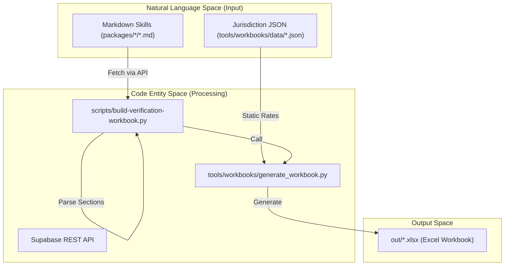
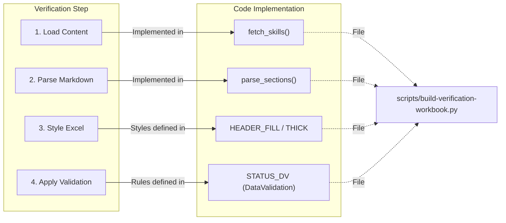

<!-- source: DeepWiki mcp.deepwiki.com · repo openaccountants/openaccountants · page 9.2 Verification Workbooks and Tooling · fetched 2026-10-26 -->

# Verification Workbooks and Tooling

Relevant source files

The following files were used as context for generating this wiki page:

- [packages/nepal/nepal-corporate-tax.md](packages/nepal/nepal-corporate-tax.md)
- [packages/nepal/nepal-income-tax.md](packages/nepal/nepal-income-tax.md)
- [packages/nepal/nepal-payroll.md](packages/nepal/nepal-payroll.md)
- [packages/nepal/nepal-tds.md](packages/nepal/nepal-tds.md)
- [packages/nepal/nepal-vat.md](packages/nepal/nepal-vat.md)
- [packages/sri-lanka/sri-lanka-corporate-tax.md](packages/sri-lanka/sri-lanka-corporate-tax.md)
- [packages/sri-lanka/sri-lanka-income-tax.md](packages/sri-lanka/sri-lanka-income-tax.md)
- [packages/sri-lanka/sri-lanka-payroll.md](packages/sri-lanka/sri-lanka-payroll.md)
- [packages/sri-lanka/sri-lanka-sscl.md](packages/sri-lanka/sri-lanka-sscl.md)
- [packages/sri-lanka/sri-lanka-vat.md](packages/sri-lanka/sri-lanka-vat.md)
- [packages/sri-lanka/sri-lanka-withholding-tax.md](packages/sri-lanka/sri-lanka-withholding-tax.md)
- [scripts/build-verification-workbook.py](scripts/build-verification-workbook.py)
- [tools/workbooks/data/lk.json](tools/workbooks/data/lk.json)
- [tools/workbooks/data/np.json](tools/workbooks/data/np.json)
- [tools/workbooks/data/pk.json](tools/workbooks/data/pk.json)
- [tools/workbooks/data/us-fl.json](tools/workbooks/data/us-fl.json)
- [tools/workbooks/generate_workbook.py](tools/workbooks/generate_workbook.py)
- [tools/workbooks/out/LK_Tax_Skills_Verification.xlsx](tools/workbooks/out/LK_Tax_Skills_Verification.xlsx)
- [tools/workbooks/out/NP_Tax_Skills_Verification.xlsx](tools/workbooks/out/NP_Tax_Skills_Verification.xlsx)
- [tools/workbooks/out/PK_Tax_Skills_Verification.xlsx](tools/workbooks/out/PK_Tax_Skills_Verification.xlsx)
- [tools/workbooks/out/US-FL_Tax_Skills_Verification.xlsx](tools/workbooks/out/US-FL_Tax_Skills_Verification.xlsx)

The `tools/` directory contains the infrastructure required to bridge the gap between automated tax skills and human professional review. This is primarily achieved through the generation of Excel-based **Verification Workbooks**, which allow credentialed accountants to perform offline audits of skill logic, rates, and thresholds.

### Overview and Data Flow

The verification process follows a "flag-only-what's-wrong" philosophy. Instead of requiring accountants to rewrite entire skills, the tooling presents the skill content in a structured format where they can validate individual sections and provide targeted corrections.

#### Data Flow Diagram: Workbook Generation
The following diagram illustrates how the system converts Markdown skills and JSON rate databases into a verifier-friendly Excel file.

**Sources:** [scripts/build-verification-workbook.py:1-26](), [tools/workbooks/generate_workbook.py:1-10]()

---

### Key Components

#### 1. Jurisdiction Rate Databases (`data/*.json`)
These files act as the "source of truth" for structured data that is difficult to parse reliably from raw Markdown. They contain jurisdiction-specific codes, labels, and hierarchical rate tables.

*   **Structure**: Each file defines a `jurisdiction_code`, `tax_year`, and a list of `skills` mapped to `tabs`.
*   **Sections**: Each skill is broken into `sections`, which contain `rows` with an `item`, `value`, and a `ref` (legal reference).

**Example: Nepal Rate Database**
| File Path | Purpose |
| :--- | :--- |
| `tools/workbooks/data/np.json` | Contains income tax slabs (1% to 39%), corporate rates (25%/30%), and SSF contributions (31%). |
| `tools/workbooks/data/lk.json` | Contains Sri Lanka APIT tables and VAT standard rates (18%). |

**Sources:** [tools/workbooks/data/np.json:1-40](), [tools/workbooks/data/lk.json:1-20]()

#### 2. Workbook Builder (`scripts/build-verification-workbook.py`)
This script is the primary entry point for generating workbooks from the central database. It fetches the latest published versions of skills from Supabase and converts them into a structured format.

*   **`fetch_skills()`**: Retrieves skill metadata and the current `markdown_content` from the `skills` and `skill_versions` tables [scripts/build-verification-workbook.py:74-96]().
*   **`parse_sections(md)`**: Uses regex to split Markdown content on ATX headings (`##` or `###`). Content before the first heading is categorized as a "Preamble" [scripts/build-verification-workbook.py:108-127]().
*   **`sheet_name(slug)`**: Sanitizes skill slugs to fit Excel's 31-character sheet name limit, often stripping prefixes like `us-gaap-` or `financial-reporting-` [scripts/build-verification-workbook.py:153-167]().

**Sources:** [scripts/build-verification-workbook.py:74-167]()

#### 3. Excel Generator Logic
The tooling utilizes `openpyxl` to create interactive workbooks. Key features include:
*   **Data Validation**: Cells in the "Status" column are restricted to a dropdown: `correct`, `needs-correction`, `wrong`, `needs-context`, or `skip` [scripts/build-verification-workbook.py:146-151]().
*   **Sign-off Rows**: Every skill sheet includes a dedicated row for the verifier to provide their name and credentials, acting as a digital audit trail [scripts/build-verification-workbook.py:50-51]().

---

### Review Format: "Flag-Only-What's-Wrong"

The output workbooks (`out/*.xlsx`) are designed for speed. Accountants are instructed to:
1.  **Open** the workbook and navigate to the relevant jurisdiction tab (e.g., `nepal-vat`).
2.  **Review** the "Proposed Logic/Rate" column.
3.  **Status**: Select a status from the dropdown.
4.  **Corrections**: If `needs-correction` or `wrong` is selected, the accountant writes the correct value or legal citation in the adjacent "Accountant Correction" column.

#### System Entity Mapping
The following diagram maps the logical verification steps to the code functions and files that handle them.

**Sources:** [scripts/build-verification-workbook.py:74-151]()

---

### Output Files (`out/*.xlsx`)
The generated workbooks are stored in the `out/` directory. These are the artifacts sent to professional partners.

| File | Jurisdiction | Coverage |
| :--- | :--- | :--- |
| `NP_Tax_Skills_Verification.xlsx` | Nepal | VAT, Income Tax, Corporate Tax, TDS, Payroll [tools/workbooks/out/NP_Tax_Skills_Verification.xlsx]() |
| `LK_Tax_Skills_Verification.xlsx` | Sri Lanka | VAT, APIT, EPF/ETF, WHT, SSCL [tools/workbooks/out/LK_Tax_Skills_Verification.xlsx]() |
| `US-FL_Tax_Skills_Verification.xlsx`| US-Florida | Sales Tax, Corporate Tax, Reemployment Tax |

**Sources:** [tools/workbooks/out/NP_Tax_Skills_Verification.xlsx:1-10](), [tools/workbooks/out/LK_Tax_Skills_Verification.xlsx:1-10]()

---

