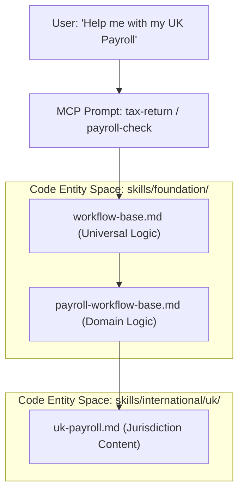
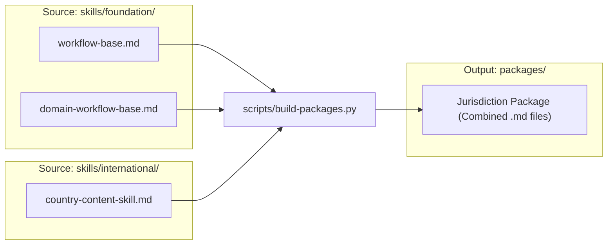

<!-- source: DeepWiki mcp.deepwiki.com · repo openaccountants/openaccountants · extra page Workflow Bases and Foundation Skills · fetched 2026-10-26 -->

# Workflow Bases and Foundation Skills

Relevant source files

The following files were used as context for generating this wiki page:

- [CHANGELOG.md](CHANGELOG.md)
- [CLA.md](CLA.md)
- [COMMERCIAL_LICENSE.md](COMMERCIAL_LICENSE.md)
- [CONTRIBUTING.md](CONTRIBUTING.md)
- [LICENSE](LICENSE)
- [START-HERE.md](START-HERE.md)
- [docs/INTELLIGENCE-ROADMAP.md](docs/INTELLIGENCE-ROADMAP.md)
- [docs/PROMOTION-PLAYBOOK.md](docs/PROMOTION-PLAYBOOK.md)
- [docs/QUALITY-TIERS.md](docs/QUALITY-TIERS.md)
- [docs/USER-JOURNEY-ANALYSIS.md](docs/USER-JOURNEY-ANALYSIS.md)
- [docs/growth-drafts.md](docs/growth-drafts.md)
- [skills/financial-reporting/business-combinations/ifrs3-business-combinations.md](skills/financial-reporting/business-combinations/ifrs3-business-combinations.md)
- [skills/financial-reporting/business-combinations/us-gaap-asc805-business-combinations.md](skills/financial-reporting/business-combinations/us-gaap-asc805-business-combinations.md)
- [skills/financial-reporting/debt-vs-equity/ias32-debt-vs-equity.md](skills/financial-reporting/debt-vs-equity/ias32-debt-vs-equity.md)
- [skills/financial-reporting/debt-vs-equity/us-gaap-debt-vs-equity.md](skills/financial-reporting/debt-vs-equity/us-gaap-debt-vs-equity.md)
- [skills/financial-reporting/financial-reporting-workflow-base.md](skills/financial-reporting/financial-reporting-workflow-base.md)
- [skills/financial-reporting/leases/ifrs16-leases.md](skills/financial-reporting/leases/ifrs16-leases.md)
- [skills/financial-reporting/leases/us-gaap-asc842-leases.md](skills/financial-reporting/leases/us-gaap-asc842-leases.md)
- [skills/financial-reporting/revenue-recognition/ifrs15-revenue.md](skills/financial-reporting/revenue-recognition/ifrs15-revenue.md)
- [skills/financial-reporting/revenue-recognition/us-gaap-asc606-revenue.md](skills/financial-reporting/revenue-recognition/us-gaap-asc606-revenue.md)
- [skills/foundation/workflow-base.md](skills/foundation/workflow-base.md)
- [skills/international/kazakhstan/kz-simplified-regime.md](skills/international/kazakhstan/kz-simplified-regime.md)
- [skills/manifest.json](skills/manifest.json)

This page documents the structural foundation of the OpenAccountants skill library. It explains the universal `workflow-base.md`, the domain-specific foundation skills (VAT, payroll, bookkeeping, etc.), and the standardized "three-state contract" that governs all AI-driven tax classifications.

## The Universal Workflow Base

The `workflow-base.md` file serves as the root configuration for the entire system. It defines the operational logic that every LLM must follow regardless of the specific tax jurisdiction or domain. This base establishes the "Conservative Defaults Principle": when data is ambiguous, the AI must assume the position that results in **more tax liability**, never less [START-HERE.md:55-56]().

### The Three-State Contract
Every transaction processed by an OpenAccountants skill must be assigned exactly one of three states [START-HERE.md:49-53]():

1.  **Classified**: Sufficient information exists in the provided documents (e.g., bank statements, invoices) to determine the tax treatment with high confidence.
2.  **Assumed**: Information is missing or ambiguous. A conservative default is applied (e.g., assuming a supply is standard-rated rather than exempt), and the position is explicitly flagged for the human reviewer.
3.  **Needs Input**: The AI identifies a specific missing piece of data that cannot be safely assumed and asks the user a targeted question.

### Output Specification
The universal base mandates that every session produces four standardized artifacts [START-HERE.md:77-82]():
*   **Working Paper**: Detailed transaction-by-transaction classification.
*   **Reviewer Brief**: High-level summary of key positions, assumptions, and risk registers for the accountant.
*   **Action List**: Clear next steps for the taxpayer (e.g., "Pay €400 by June 15th").
*   **Review Checklist**: A targeted list of items for the professional to verify before signing.

**Sources:** [START-HERE.md:44-56](), [START-HERE.md:75-84](), [skills/foundation/workflow-base.md]()

---

## Domain-Specific Foundation Skills

While the universal base handles the "how," domain-specific foundation skills (found in `skills/foundation/`) provide the "what" for different accounting disciplines. These files are automatically bundled into packages by the build pipeline [CONTRIBUTING.md:79-90]().

| Foundation Skill | Purpose |
| :--- | :--- |
| `us-tax-workflow-base.md` | Root for all US Federal and State tax logic [CONTRIBUTING.md:79-79](). |
| `bookkeeping-workflow-base.md` | Handles Chart of Accounts, P&L, and Balance Sheet logic [CONTRIBUTING.md:81-81](). |
| `payroll-workflow-base.md` | Manages withholding, social security, and payslip logic [CONTRIBUTING.md:83-83](). |
| `financial-statements-workflow-base.md` | Governs annual accounts and statutory audit reporting [CONTRIBUTING.md:85-85](). |
| `cross-border-workflow-base.md` | Coordinates multi-jurisdiction treaties and withholding tax [CONTRIBUTING.md:89-89](). |

### Implementation Flow: Natural Language to Code Entity
The following diagram illustrates how a user's natural language request is routed through the foundation skills to the specific code entities in the repository.

**Diagram: Request Routing to Foundation Entities**

**Sources:** [CONTRIBUTING.md:52-72](), [CONTRIBUTING.md:79-90](), [CHANGELOG.md:22-23]()

---

## The Prohibition Framework

A critical component of the foundation layer is the **Prohibition Framework**. This is a hard-coded set of "No-Go" zones defined in the `PROHIBITIONS` section of every skill [docs/QUALITY-TIERS.md:55-55]().

### Logic Gates and Hard Stops
1.  **Scope Gating**: Before processing numbers, the AI executes "Step 0: Client Onboarding" [docs/QUALITY-TIERS.md:46-46](). If the user's scenario falls under a prohibited category (e.g., "This skill does not support public companies"), the AI must stop and refer the user to a specialist.
2.  **Hallucination Prevention**: Skills include a `Edge Case Registry` (numbered EC1, EC2, etc.) [docs/QUALITY-TIERS.md:56-56](). The AI is prohibited from inventing new tax treatments; it must map to an existing registry item or flag as `Needs Input`.
3.  **Deterministic Lookups**: Box and line assignments must use deterministic tables rather than narrative text to prevent the LLM from "guessing" where a value belongs on a tax form [docs/QUALITY-TIERS.md:66-67]().

**Sources:** [docs/QUALITY-TIERS.md:39-61](), [docs/QUALITY-TIERS.md:63-71]()

---

## Data Flow: From Source to Package

The foundation skills are the "glue" used by the build pipeline to create the distribution-ready packages.

**Diagram: Build Pipeline Data Flow**

### Build Pipeline Logic
The `build-packages.py` script identifies the `category` in the YAML frontmatter of a content skill (e.g., `category: payroll`) and automatically prepends the corresponding `payroll-workflow-base.md` to the output package [CONTRIBUTING.md:72-73](). This ensures that the AI always has the necessary operational instructions alongside the tax rates.

**Sources:** [CONTRIBUTING.md:26-26](), [CONTRIBUTING.md:52-73](), [CONTRIBUTING.md:79-90]()

---

