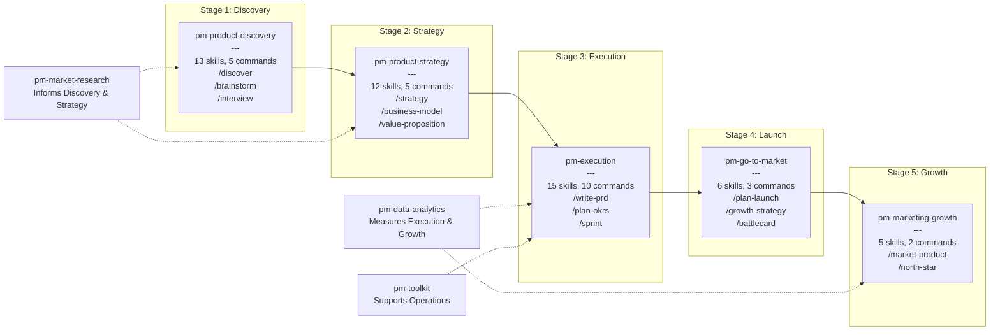
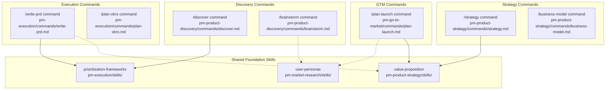
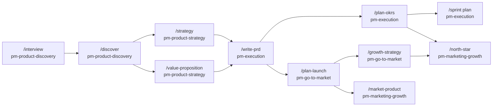
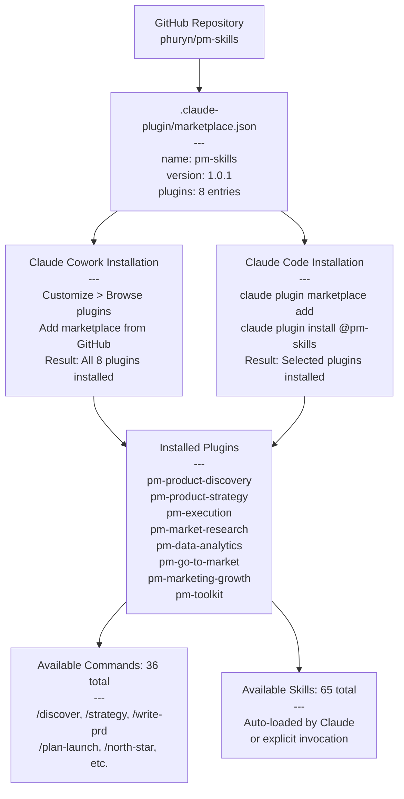

<!-- source: DeepWiki mcp.deepwiki.com · repo phuryn/pm-skills · page 3.2 Plugin Ecosystem · fetched 2026-10-26 -->

# Plugin Ecosystem

<details>
<summary>Relevant source files</summary>

The following files were used as context for generating this wiki page:

- [.claude-plugin/marketplace.json](.claude-plugin/marketplace.json)
- [README.md](README.md)

</details>


This document describes how the 8 plugins in the PM Skills Marketplace are organized, how they map to product lifecycle stages, and how they work together as a cohesive system. For details on the three-tier abstraction model (Skills, Commands, Plugins), see [Three-Tier Abstraction Model](#3.1). For information on how PM frameworks are encoded into these plugins, see [Framework Knowledge Base](#3.3).

## Overview

The marketplace organizes 65 skills and 36 commands into 8 domain-specific plugins. These plugins are divided into two categories: **core lifecycle plugins** that map sequentially to product development stages, and **supporting plugins** that provide cross-cutting capabilities across all stages.

All 8 plugins are distributed as a single marketplace via `.claude-plugin/marketplace.json` and installed together, ensuring users have comprehensive coverage of PM workflows without manual plugin selection.

**Sources:** [README.md:97-413](), [.claude-plugin/marketplace.json:11-60]()

## Plugin Taxonomy

### Core Lifecycle Plugins (5 plugins)

These plugins map to sequential stages of product development:

| Plugin | Directory | Lifecycle Stage | Skills | Commands |
|--------|-----------|-----------------|--------|----------|
| `pm-product-discovery` | `pm-product-discovery/` | Discovery (Find Problems) | 13 | 5 |
| `pm-product-strategy` | `pm-product-strategy/` | Strategy (Define Direction) | 12 | 5 |
| `pm-execution` | `pm-execution/` | Execution (Build & Deliver) | 15 | 10 |
| `pm-go-to-market` | `pm-go-to-market/` | Launch (Go To Market) | 6 | 3 |
| `pm-marketing-growth` | `pm-marketing-growth/` | Growth (Scale & Optimize) | 5 | 2 |

### Supporting Plugins (3 plugins)

These plugins provide specialized capabilities that inform or support multiple lifecycle stages:

| Plugin | Directory | Purpose | Skills | Commands |
|--------|-----------|---------|--------|----------|
| `pm-market-research` | `pm-market-research/` | Customer insights & competitive intelligence | 7 | 3 |
| `pm-data-analytics` | `pm-data-analytics/` | Measurement & analytics | 3 | 3 |
| `pm-toolkit` | `pm-toolkit/` | Operational utilities | 4 | 5 |

**Sources:** [README.md:97-393](), [.claude-plugin/marketplace.json:11-60]()

## Product Lifecycle Mapping

### Lifecycle Flow Diagram



**Description:** The five core lifecycle plugins form a sequential workflow matching natural product development. Supporting plugins connect via dotted lines to indicate which stages they inform or measure.

**Sources:** [README.md:98-393](), [.claude-plugin/marketplace.json:11-60]()

## Filesystem Structure

Each plugin follows a standardized directory structure defined by the Claude plugin specification:

```mermaid
graph TD
    ROOT["pm-skills repository root"]
    
    ROOT --> PD["pm-product-discovery/"]
    ROOT --> PS["pm-product-strategy/"]
    ROOT --> PE["pm-execution/"]
    ROOT --> PMR["pm-market-research/"]
    ROOT --> PDA["pm-data-analytics/"]
    ROOT --> PG["pm-go-to-market/"]
    ROOT --> PMG["pm-marketing-growth/"]
    ROOT --> PT["pm-toolkit/"]
    
    PD --> PD_PLUGIN["plugin.json"]
    PD --> PD_README["README.md"]
    PD --> PD_SKILLS["skills/"]
    PD --> PD_COMMANDS["commands/"]
    
    PD_SKILLS --> PD_S1["brainstorm-ideas-existing/"]
    PD_SKILLS --> PD_S2["opportunity-solution-tree/"]
    PD_SKILLS --> PD_S3["interview-script/"]
    
    PD_COMMANDS --> PD_C1["discover.md"]
    PD_COMMANDS --> PD_C2["brainstorm.md"]
    PD_COMMANDS --> PD_C3["interview.md"]
    
    PS --> PS_FILES["plugin.json, README.md, skills/, commands/"]
    PE --> PE_FILES["plugin.json, README.md, skills/, commands/"]
    PMR --> PMR_FILES["plugin.json, README.md, skills/, commands/"]
    PDA --> PDA_FILES["plugin.json, README.md, skills/, commands/"]
    PG --> PG_FILES["plugin.json, README.md, skills/, commands/"]
    PMG --> PMG_FILES["plugin.json, README.md, skills/, commands/"]
    PT --> PT_FILES["plugin.json, README.md, skills/, commands/"]
```



**Description:** Each plugin directory contains `plugin.json` (manifest), `README.md` (documentation), `skills/` (skill definitions), and `commands/` (command definitions). The marketplace file at `.claude-plugin/marketplace.json` references all 8 plugin directories.

**Sources:** [.claude-plugin/marketplace.json:11-60](), [README.md:55-94]()

## Plugin Relationships and Dependencies

### Cross-Plugin Skill Usage

While the contribution guidelines prohibit direct cross-plugin references in command definitions (to maintain plugin independence), skills can be loaded across plugin boundaries through Claude's automatic skill loading mechanism. The following diagram shows common skill sharing patterns:



**Description:** Commands remain within their plugin boundaries, but Claude automatically loads relevant skills from other plugins when contextually appropriate. Solid lines indicate explicit internal usage; dotted lines indicate common automatic loading patterns.

**Sources:** [README.md:31-45](), [CONTRIBUTING.md:1-28]()

### Command Chaining Across Plugins

Commands are designed to flow naturally from one lifecycle stage to the next. Each command completion suggests logical next steps:



**Description:** This diagram shows suggested command progressions across plugin boundaries. Users can follow natural workflows (Discovery → Strategy → Execution → Launch → Growth) with explicit command-to-command suggestions.

**Sources:** [README.md:15-19](), [README.md:41-45]()

## Plugin Distribution Model

### Marketplace Installation

The marketplace uses a single-unit distribution model where all 8 plugins install together:



**Description:** The marketplace.json file defines all 8 plugins as a cohesive unit. Claude Cowork installs all plugins automatically; Claude Code CLI allows selective installation but references the same marketplace definition.

**Sources:** [.claude-plugin/marketplace.json:1-61](), [README.md:47-75]()

## Supporting Plugin Architecture

### pm-market-research: Early-Stage Informant

The `pm-market-research` plugin provides customer insights that inform both Discovery and Strategy stages:

| Skill | Used By | Purpose |
|-------|---------|---------|
| `user-personas` | `/discover`, `/strategy` | Define target users |
| `market-segments` | `/strategy`, `/plan-launch` | Identify addressable segments |
| `customer-journey-map` | `/discover`, `/write-prd` | Understand user flows |
| `competitor-analysis` | `/strategy`, `/battlecard` | Competitive positioning |

**Sources:** [README.md:233-264](), [.claude-plugin/marketplace.json:31-34]()

### pm-data-analytics: Measurement Layer

The `pm-data-analytics` plugin provides measurement capabilities for Execution and Growth stages:

| Skill | Used By | Purpose |
|-------|---------|---------|
| `sql-queries` | `/analyze-cohorts`, `/analyze-test` | Data extraction |
| `cohort-analysis` | `/north-star`, `/analyze-cohorts` | Retention tracking |
| `ab-test-analysis` | `/analyze-test` | Statistical validation |

**Sources:** [README.md:267-294](), [.claude-plugin/marketplace.json:37-40]()

### pm-toolkit: Operational Support

The `pm-toolkit` plugin provides utility functions used throughout the product lifecycle:

| Skill | Used By | Purpose |
|-------|---------|---------|
| `grammar-check` | `/write-prd`, `/sprint release` | Document quality |
| `review-resume` | `/review-resume`, `/tailor-resume` | Career support |
| `draft-nda` | `/draft-nda` | Legal documentation |
| `privacy-policy` | `/privacy-policy` | Compliance documentation |

**Sources:** [README.md:362-393](), [.claude-plugin/marketplace.json:55-59]()

## Plugin Cohesion Mechanisms

### Shared Frontmatter Schema

All skills across all 8 plugins follow the same frontmatter schema, enabling consistent skill loading and invocation:

```markdown
---
name: skill-name
description: Brief description (minimum 30 characters)
version: 1.0
tags: [tag1, tag2, tag3]
---
```

This consistency allows Claude to treat skills uniformly regardless of which plugin they originate from.

**Sources:** [validate_plugins.py:1-309](), [CONTRIBUTING.md:1-28]()

### Command Naming Conventions

Commands follow verb-based naming (`/write-prd`, `/plan-launch`, `/analyze-test`) while skills follow noun-based naming (`create-prd`, `gtm-strategy`, `ab-test-analysis`). This linguistic distinction helps users understand when they're triggering workflows (commands) vs. accessing reference knowledge (skills).

**Sources:** [CONTRIBUTING.md:1-28](), [README.md:31-45]()

### Validation Enforcement

The `validate_plugins.py` script enforces structural consistency across all 8 plugins, including:

- Manifest file presence and structure (`plugin.json`)
- README documentation completeness
- Skill frontmatter validation
- Command argument hints
- No cross-plugin skill references in command definitions

This validation ensures that all plugins maintain the same quality bar and structural integrity.

**Sources:** [validate_plugins.py:1-309](), [CONTRIBUTING.md:1-28]()

## Plugin Coverage Statistics

| Category | Total | Discovery | Strategy | Execution | Market Research | Data Analytics | GTM | Marketing/Growth | Toolkit |
|----------|-------|-----------|----------|-----------|-----------------|----------------|-----|------------------|---------|
| Skills | 65 | 13 | 12 | 15 | 7 | 3 | 6 | 5 | 4 |
| Commands | 36 | 5 | 5 | 10 | 3 | 3 | 3 | 2 | 5 |
| Total Capabilities | 101 | 18 | 17 | 25 | 10 | 6 | 9 | 7 | 9 |

The `pm-execution` plugin is the largest (25 total capabilities) because it covers day-to-day product management operations: PRDs, OKRs, roadmaps, sprints, retrospectives, stakeholder management, and user story creation.

**Sources:** [README.md:97-393](), [.claude-plugin/marketplace.json:11-60]()

---

