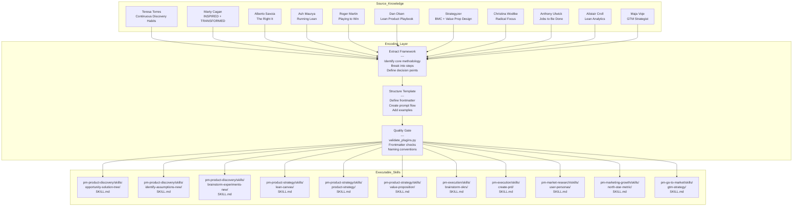
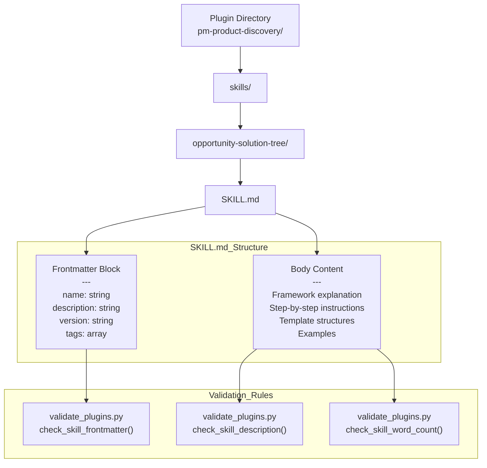
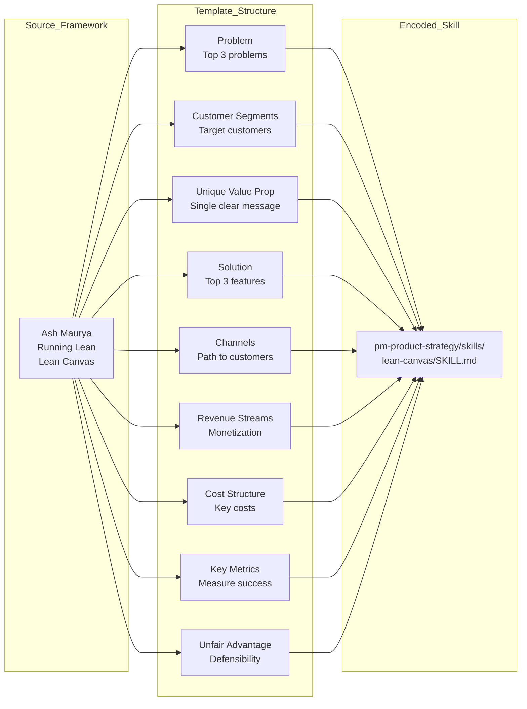
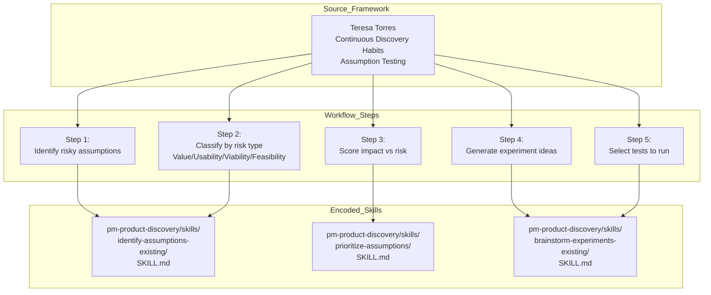
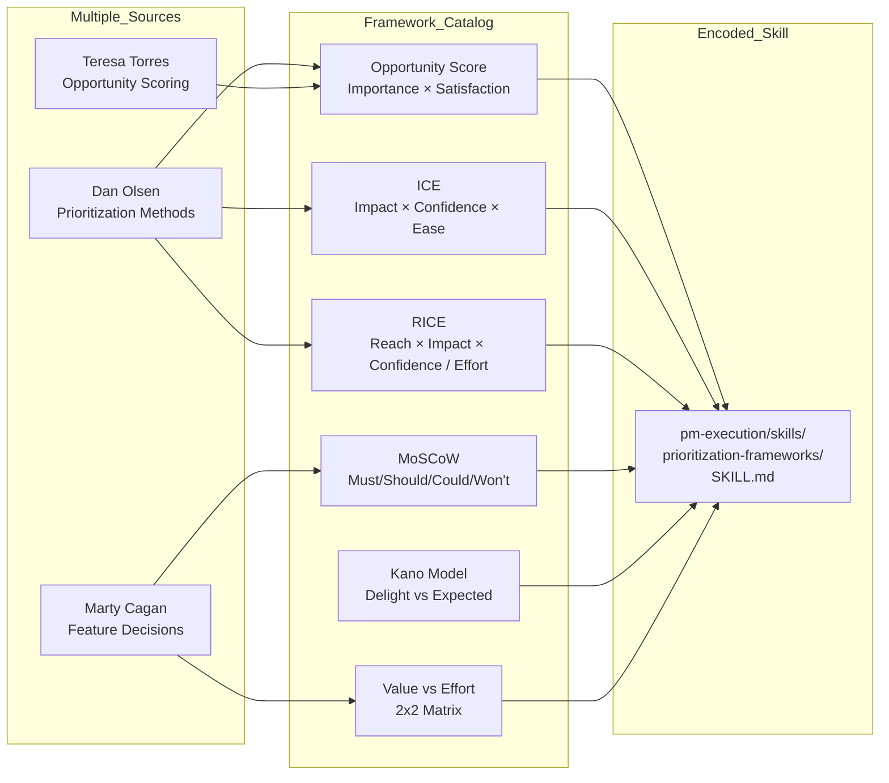
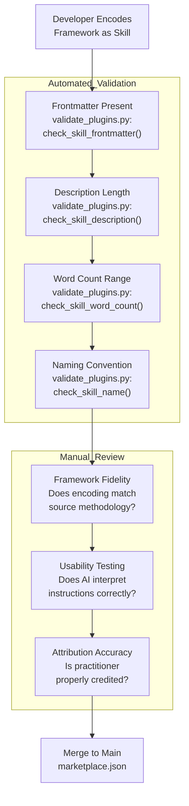

<!-- source: DeepWiki mcp.deepwiki.com · repo phuryn/pm-skills · page 3.3 Framework Knowledge Base · fetched 2026-10-26 -->

# Framework Knowledge Base

<details>
<summary>Relevant source files</summary>

The following files were used as context for generating this wiki page:

- [README.md](README.md)

</details>


## Purpose and Scope

This document explains how product management methodologies from published practitioners are codified into executable skills within the PM Skills Marketplace. It covers the encoding process, practitioner-to-skill attribution, skill file structure, metadata schema, and template patterns used to transform PM frameworks into AI-guided workflows.

For information about the three-tier abstraction model (Skills, Commands, Plugins), see [Three-Tier Abstraction Model](#3.1). For the broader plugin ecosystem architecture, see [Plugin Ecosystem](#3.2).

---

## Framework Codification Architecture

The marketplace functions as a knowledge translation engine that converts PM methodologies from books and published frameworks into structured, executable skill files. Each skill encodes a specific framework with step-by-step instructions, templates, and domain knowledge.

### Knowledge Pipeline: Literature to Executable Skills



**Sources**: [README.md:401-414](), [README.md:25-27]()

---

## Practitioner Attribution Matrix

The following table maps the 11 primary PM practitioners to their influential works and the corresponding skills in the marketplace:

| Practitioner | Published Work | Core Methodology | Encoded Skills | Plugin Location |
|--------------|----------------|------------------|----------------|-----------------|
| **Teresa Torres** | *Continuous Discovery Habits* | Opportunity Solution Trees, Assumption Testing | `opportunity-solution-tree`, `identify-assumptions-*`, `interview-script`, `summarize-interview` | `pm-product-discovery/skills/` |
| **Marty Cagan** | *INSPIRED*, *TRANSFORMED* | PRDs, Product Strategy, Empowered Teams | `create-prd`, `product-vision`, `stakeholder-map` | `pm-execution/skills/`, `pm-product-strategy/skills/` |
| **Alberto Savoia** | *The Right It* | Pretotyping, Experiment Design | `brainstorm-experiments-new`, `prioritize-assumptions` | `pm-product-discovery/skills/` |
| **Ash Maurya** | *Running Lean* | Lean Canvas | `lean-canvas` | `pm-product-strategy/skills/` |
| **Roger L. Martin** | *Playing to Win* | Strategy Frameworks | `product-strategy`, `swot-analysis` | `pm-product-strategy/skills/` |
| **Dan Olsen** | *The Lean Product Playbook* | Product-Market Fit, Prioritization | `prioritize-features`, `value-proposition` | `pm-product-discovery/skills/`, `pm-product-strategy/skills/` |
| **Strategyzer** | *Business Model Generation*, *Value Proposition Design* | Business Model Canvas, Value Prop Canvas | `business-model`, `value-proposition`, `startup-canvas` | `pm-product-strategy/skills/` |
| **Christina Wodtke** | *Radical Focus* | OKRs | `brainstorm-okrs`, `outcome-roadmap` | `pm-execution/skills/` |
| **Anthony W. Ulwick** | *Jobs to Be Done* | JTBD, Outcome-Driven Innovation | `value-proposition`, `user-personas`, `interview-script` | `pm-product-strategy/skills/`, `pm-market-research/skills/`, `pm-product-discovery/skills/` |
| **Alistair Croll & Benjamin Yoskovitz** | *Lean Analytics* | North Star Metrics, Analytics | `north-star-metric`, `metrics-dashboard`, `cohort-analysis` | `pm-marketing-growth/skills/`, `pm-product-discovery/skills/`, `pm-data-analytics/skills/` |
| **Maja Voje** | GTM Strategist | Beachhead Segments, GTM Strategy | `beachhead-segment`, `gtm-strategy`, `ideal-customer-profile` | `pm-go-to-market/skills/` |

**Sources**: [README.md:401-414]()

---

## Skill File Structure

Every skill in the marketplace follows a standardized file structure that enables both AI interpretation and human readability.

### Anatomy of a Skill: File System Layout



### Skill Frontmatter Schema

Each `SKILL.md` file begins with a YAML frontmatter block containing metadata:

```yaml
---
name: "opportunity-solution-tree"
description: "Build an Opportunity Solution Tree (Teresa Torres) — outcome → opportunities → solutions → experiments"
version: "1.0.0"
tags: ["discovery", "continuous-discovery", "teresa-torres", "framework"]
---
```

**Frontmatter Fields**:

| Field | Type | Required | Validation Rule | Purpose |
|-------|------|----------|----------------|---------|
| `name` | String | Yes | Must match directory name | Unique identifier for skill invocation |
| `description` | String | Yes | ≥30 characters | Concise summary for AI and user understanding |
| `version` | String | Yes | Semantic versioning format | Tracks skill evolution |
| `tags` | Array | No | - | Categorization for discovery and filtering |

**Sources**: [validate_plugins.py]() (validation logic for frontmatter structure)

---

## Knowledge Encoding Patterns

Skills translate PM frameworks into executable workflows through three primary pattern types:

### Pattern 1: Framework-as-Template

Frameworks with defined canvases or structured outputs (e.g., Lean Canvas, Business Model Canvas, Product Strategy Canvas) are encoded as:

1. **Frontmatter**: Metadata identifying the framework
2. **Framework Overview**: Brief explanation of the methodology's purpose
3. **Section-by-Section Template**: Structured prompts for each canvas section
4. **Instructions**: Step-by-step guidance for completing each section
5. **Examples**: Sample outputs or questions to guide thinking

**Example Mapping**:



**Sources**: [README.md:151](), [pm-product-strategy/skills/lean-canvas/]()

### Pattern 2: Process-as-Workflow

Methodologies that describe multi-step processes (e.g., Continuous Discovery, Pretotyping) are encoded as:

1. **Frontmatter**: Process identifier and practitioner attribution
2. **Process Context**: When to use this workflow
3. **Prerequisites**: Required inputs or prior knowledge
4. **Step-by-Step Instructions**: Sequential guidance with decision points
5. **Output Definition**: What the completed workflow produces
6. **Next Steps**: Suggested follow-on skills or commands

**Example Mapping**:



**Sources**: [README.md:108-110](), [README.md:403]()

### Pattern 3: Knowledge-as-Reference

Analytical frameworks or decision-making tools (e.g., Prioritization Frameworks, SWOT Analysis) are encoded as:

1. **Frontmatter**: Framework name and application domain
2. **Concept Explanation**: Core principles and theory
3. **When to Use**: Situational guidance for framework selection
4. **Application Template**: How to apply the framework to user's context
5. **Interpretation Guidance**: How to read and act on results
6. **Framework Comparison**: Tradeoffs vs alternative approaches

**Example Mapping**:



**Sources**: [README.md:203](), [README.md:406]()

---

## Skill Body Content Structure

The body content of each `SKILL.md` file follows a consistent narrative structure optimized for AI interpretation:

### Typical Skill Body Template

```markdown
# [Framework Name]

## Overview
Brief explanation of the framework's purpose, origin, and when to use it.

## Framework Attribution
Credit to the practitioner who developed or popularized this methodology.

## When to Use This Skill
Specific scenarios or product stages where this framework applies.

## Prerequisites
Required inputs, data, or prior knowledge needed to complete this skill.

## Step-by-Step Instructions

### Step 1: [Action]
Detailed guidance for the first step, including questions to ask and considerations.

### Step 2: [Action]
...

### Step N: [Action]
...

## Output Format
Description of what the completed framework produces (canvas, document, matrix, etc.).

## Example [Optional]
Sample output or walkthrough using a hypothetical product.

## Next Steps
Suggested follow-on skills, commands, or actions after completing this framework.
```

**Word Count Requirements**:
- Minimum: 50 words (enforced by validation)
- Maximum: 3000 words (enforced by validation)
- Optimal range: 200-800 words for balanced depth and readability

**Sources**: [validate_plugins.py]() (word count validation logic)

---

## Cross-Skill Knowledge References

Skills can reference domain knowledge from other skills without creating hard dependencies. This enables:

1. **Contextual Loading**: Claude automatically loads referenced skills when relevant
2. **Knowledge Reuse**: Foundational concepts defined once, reused across multiple workflows
3. **No Cross-Plugin Dependencies**: Skills within a plugin may reference each other, but not skills in other plugins (enforced by validation)

### Reference Skill Pattern

Some skills serve purely as knowledge repositories that other skills and commands draw upon:

| Reference Skill | Purpose | Referenced By |
|-----------------|---------|---------------|
| `prioritization-frameworks` | Catalog of 9 prioritization methods | `prioritize-features`, `prioritize-assumptions`, `/discover` command |
| `opportunity-solution-tree` | Teresa Torres' OST framework | `identify-assumptions-*`, `brainstorm-experiments-*` |
| Product strategy frameworks | SWOT, PESTLE, Porter's, Ansoff | `/market-scan` command, strategic planning workflows |

**Sources**: [README.md:43](), [CONTRIBUTING.md]() (cross-plugin reference rules)

---

## Framework Evolution and Versioning

Skills include semantic versioning in their frontmatter to track framework evolution:

```yaml
version: "1.2.0"
```

**Version Increment Rules**:
- **Major (X.0.0)**: Breaking changes to framework structure or output format
- **Minor (1.X.0)**: New sections, steps, or guidance added
- **Patch (1.0.X)**: Clarifications, typo fixes, example improvements

This versioning enables:
- Backward compatibility tracking
- Change documentation in git history
- User awareness of skill maturity

**Sources**: [validate_plugins.py]() (version format validation)

---

## Quality Assurance for Knowledge Accuracy

The validation system enforces structural consistency but not methodological accuracy. Framework accuracy is ensured through:

1. **Source Attribution**: Each skill credits the original practitioner in its documentation
2. **Community Review**: Pull requests undergo maintainer review for framework fidelity
3. **Documentation Requirements**: Skills must include "Framework Attribution" sections
4. **Version Control**: Git history provides audit trail of framework interpretation changes

### Validation Checkpoints



**Sources**: [validate_plugins.py](), [CONTRIBUTING.md]()

---

## Framework Coverage Gaps

The current knowledge base prioritizes breadth across the product lifecycle over depth in specialized domains. Notable framework areas **not yet encoded**:

| Domain | Missing Frameworks | Potential Skills |
|--------|-------------------|------------------|
| **User Research** | Ethnographic methods, diary studies | `ethnography-study`, `diary-study-design` |
| **Technical Strategy** | Technology radar, build vs buy decisions | `tech-radar`, `build-vs-buy-analysis` |
| **Platform Strategy** | Multi-sided platform design | `platform-business-model`, `network-effects` |
| **Pricing** | Van Westendorp, Conjoint analysis | `price-sensitivity-meter`, `conjoint-analysis` |
| **Organizational Design** | Team topologies, Conway's Law | `team-topology`, `conways-law-audit` |

These gaps represent opportunities for community contributions following the encoding patterns documented above.

**Sources**: [README.md:98-413]() (current plugin coverage), [CONTRIBUTING.md]()

---

## Summary: Knowledge Translation Pipeline

The PM Skills Marketplace translates PM literature into executable workflows through:

1. **Practitioner Attribution**: 11 named practitioners inform 65 skills across 8 plugins
2. **Three Encoding Patterns**: Framework-as-Template, Process-as-Workflow, Knowledge-as-Reference
3. **Standardized Structure**: Frontmatter + Body content with consistent narrative flow
4. **Validation Enforcement**: Automated checks for structure, naming, word count
5. **Version Control**: Semantic versioning tracks framework evolution
6. **Quality Gates**: Community review ensures framework fidelity

This architecture transforms "knowledge on bookshelves" into "knowledge in AI workflows," democratizing PM expertise through conversational interfaces.

**Sources**: [README.md:25-27](), [README.md:401-414](), [validate_plugins.py]()

---

