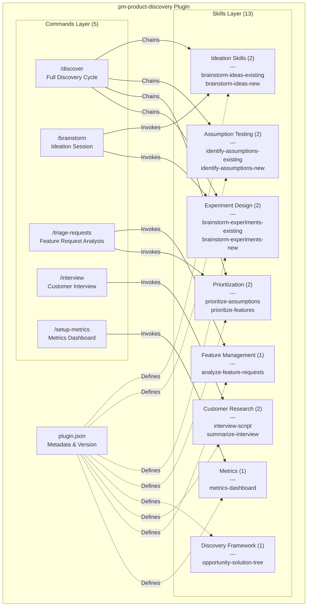
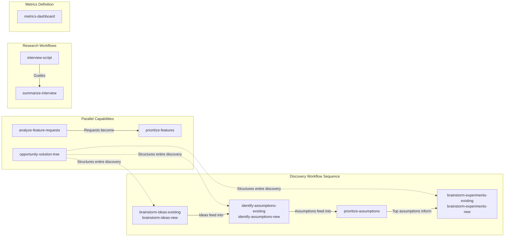

<!-- source: DeepWiki mcp.deepwiki.com · repo phuryn/pm-skills · page 4.1 pm-product-discovery · fetched 2026-10-26 -->

# pm-product-discovery

<details>
<summary>Relevant source files</summary>

The following files were used as context for generating this wiki page:

- [README.md](README.md)
- [pm-product-discovery/README.md](pm-product-discovery/README.md)

</details>


## Purpose and Scope

The **pm-product-discovery** plugin provides AI-guided workflows for the product discovery phase of the product lifecycle. It contains 13 skills and 5 commands that help product managers identify problems worth solving, test risky assumptions, design lightweight experiments, prioritize feature backlogs, and conduct structured customer research.

This plugin focuses on the **pre-strategy** phase of product development—finding problems before defining solutions. For strategic planning (vision, business models, competitive analysis), see [pm-product-strategy](#4.2). For execution workflows (PRDs, roadmaps, OKRs), see [pm-execution](#4.3). For customer research methodologies (personas, segmentation, journey maps), see [pm-market-research](#4.4).

**Sources:** [README.md:99-137](), [pm-product-discovery/README.md:1-36]()

---

## Plugin Architecture

The `pm-product-discovery` plugin follows the standard three-tier architecture of the PM Skills Marketplace: **Skills** (atomic capabilities) → **Commands** (orchestrated workflows) → **Plugin** (domain container).

### Directory Structure

```
pm-product-discovery/
├── plugin.json                          # Manifest with metadata
├── README.md                            # Plugin documentation
├── skills/                              # 13 skill directories
│   ├── analyze-feature-requests/
│   │   └── SKILL.md
│   ├── brainstorm-experiments-existing/
│   │   └── SKILL.md
│   ├── brainstorm-experiments-new/
│   │   └── SKILL.md
│   ├── brainstorm-ideas-existing/
│   │   └── SKILL.md
│   ├── brainstorm-ideas-new/
│   │   └── SKILL.md
│   ├── identify-assumptions-existing/
│   │   └── SKILL.md
│   ├── identify-assumptions-new/
│   │   └── SKILL.md
│   ├── interview-script/
│   │   └── SKILL.md
│   ├── metrics-dashboard/
│   │   └── SKILL.md
│   ├── opportunity-solution-tree/
│   │   └── SKILL.md
│   ├── prioritize-assumptions/
│   │   └── SKILL.md
│   ├── prioritize-features/
│   │   └── SKILL.md
│   └── summarize-interview/
│       └── SKILL.md
└── commands/                            # 5 command files
    ├── brainstorm.md
    ├── discover.md
    ├── interview.md
    ├── setup-metrics.md
    └── triage-requests.md
```

Each skill directory contains a `SKILL.md` file with frontmatter metadata (name, description, tags) and structured instructions. Commands are single `.md` files that chain multiple skills into end-to-end workflows.

**Sources:** [README.md:31-40](), [pm-product-discovery/README.md:1-36]()

---

## Plugin Component Diagram



**Sources:** [pm-product-discovery/README.md:5-28](), [README.md:99-137]()

---

## Skills Catalog

The plugin provides 13 skills organized into 8 functional categories. Each skill can be invoked explicitly via `/pm-product-discovery:skill-name` or loaded automatically by Claude when contextually relevant.

### Ideation Skills (2)

| Skill Name | File Path | Purpose |
|------------|-----------|---------|
| `brainstorm-ideas-existing` | `skills/brainstorm-ideas-existing/SKILL.md` | Multi-perspective ideation (PM, Designer, Engineer) for existing products |
| `brainstorm-ideas-new` | `skills/brainstorm-ideas-new/SKILL.md` | Feature brainstorming for new products in initial discovery phase |

**Context Differentiation:** The "existing" variant focuses on incremental improvements within established product constraints. The "new" variant emphasizes greenfield exploration without legacy constraints.

### Assumption Testing Skills (2)

| Skill Name | File Path | Risk Framework |
|------------|-----------|----------------|
| `identify-assumptions-existing` | `skills/identify-assumptions-existing/SKILL.md` | VUVF (Value, Usability, Viability, Feasibility) |
| `identify-assumptions-new` | `skills/identify-assumptions-new/SKILL.md` | 8-category extended framework (+ Go-to-Market, Strategy, Team, Legal) |

**Framework Expansion:** New products require broader risk assessment beyond VUVF. The 8-category framework adds strategic, market, team, and regulatory dimensions.

### Experiment Design Skills (2)

| Skill Name | File Path | Methodology |
|------------|-----------|-------------|
| `brainstorm-experiments-existing` | `skills/brainstorm-experiments-existing/SKILL.md` | Lean Startup validation experiments |
| `brainstorm-experiments-new` | `skills/brainstorm-experiments-new/SKILL.md` | Pretotyping (Alberto Savoia) |

**Methodological Foundation:** The "existing" skill applies traditional A/B tests, feature flags, and prototype testing. The "new" skill uses Alberto Savoia's pretotyping techniques to test demand before building.

### Prioritization Skills (2)

| Skill Name | File Path | Output Format |
|------------|-----------|---------------|
| `prioritize-assumptions` | `skills/prioritize-assumptions/SKILL.md` | Impact × Risk matrix with experiment suggestions |
| `prioritize-features` | `skills/prioritize-features/SKILL.md` | Backlog ranking by impact, effort, risk, strategic alignment |

Both skills produce structured prioritization matrices but operate on different inputs: `prioritize-assumptions` ranks hypotheses to test, while `prioritize-features` ranks solutions to build.

### Discovery Framework Skill (1)

| Skill Name | File Path | Framework Source |
|------------|-----------|------------------|
| `opportunity-solution-tree` | `skills/opportunity-solution-tree/SKILL.md` | Teresa Torres - *Continuous Discovery Habits* |

This skill implements Teresa Torres' OST methodology: Outcome → Opportunities → Solutions → Experiments. It structures discovery as a hierarchical decomposition from business goals to testable experiments.

### Customer Research Skills (2)

| Skill Name | File Path | Stage |
|------------|-----------|-------|
| `interview-script` | `skills/interview-script/SKILL.md` | Pre-interview (preparation) |
| `summarize-interview` | `skills/summarize-interview/SKILL.md` | Post-interview (synthesis) |

**Interview Workflow:** `interview-script` generates structured guides with JTBD probing questions. `summarize-interview` extracts insights from transcripts into satisfaction signals and action items.

### Feature Management Skill (1)

| Skill Name | File Path | Input |
|------------|-----------|-------|
| `analyze-feature-requests` | `skills/analyze-feature-requests/SKILL.md` | Customer/stakeholder feature requests (CSV, list, or free text) |

This skill categorizes requests by theme, assesses strategic alignment, and produces a prioritized recommendation list.

### Metrics Skill (1)

| Skill Name | File Path | Output |
|------------|-----------|--------|
| `metrics-dashboard` | `skills/metrics-dashboard/SKILL.md` | Dashboard specification with North Star, input metrics, health metrics, alert thresholds |

Defines what to measure, how to visualize it, and when to trigger alerts. Links to [pm-data-analytics](#4.5) for implementation (SQL queries, cohort analysis).

**Sources:** [pm-product-discovery/README.md:5-19](), [README.md:102-131]()

---

## Skills Dependency Map



**Sources:** [README.md:120-121](), [pm-product-discovery/README.md:23-24]()

---

## Commands

Commands orchestrate multiple skills into guided workflows. Each command is defined in a `.md` file in the `commands/` directory.

### `/discover` — Full Discovery Cycle

**File:** `commands/discover.md`

**Purpose:** End-to-end product discovery from problem identification to experiment design.

**Skill Chain:**
1. `brainstorm-ideas-existing` OR `brainstorm-ideas-new` (user specifies context)
2. `identify-assumptions-existing` OR `identify-assumptions-new` (matches ideation context)
3. `prioritize-assumptions` (ranks by impact × risk)
4. `brainstorm-experiments-existing` OR `brainstorm-experiments-new` (designs tests for top assumptions)

**Invocation Example:**
```
/discover AI-powered meeting summarizer for remote teams
```

**Output:** A structured discovery package containing: (1) 10-15 feature ideas, (2) mapped assumptions across risk categories, (3) prioritized assumption matrix, (4) 3-5 experiment designs for highest-priority assumptions.

**Sources:** [README.md:120](), [pm-product-discovery/README.md:24]()

---

### `/brainstorm` — Ideation Session

**File:** `commands/brainstorm.md`

**Purpose:** Focused brainstorming for ideas or experiments with context switching.

**Argument Format:** `ideas|experiments` × `existing|new`

**Skill Routing:**
- `ideas existing` → `brainstorm-ideas-existing`
- `ideas new` → `brainstorm-ideas-new`
- `experiments existing` → `brainstorm-experiments-existing`
- `experiments new` → `brainstorm-experiments-new`

**Invocation Examples:**
```
/brainstorm ideas existing — Reduce churn in our onboarding flow
/brainstorm experiments new — Test demand for an AI writing assistant
```

**Sources:** [README.md:121](), [pm-product-discovery/README.md:23]()

---

### `/triage-requests` — Feature Request Analysis

**File:** `commands/triage-requests.md`

**Purpose:** Batch process customer or stakeholder feature requests.

**Skill Chain:**
1. `analyze-feature-requests` (categorizes by theme and strategic fit)
2. `prioritize-features` (ranks by impact, effort, risk, alignment)

**Invocation Example:**
```
/triage-requests [attach CSV of enterprise feature requests]
```

**Output:** Categorized themes, prioritized backlog with recommendations, and strategic fit analysis.

**Sources:** [README.md:122](), [pm-product-discovery/README.md:27]()

---

### `/interview` — Customer Interview Workflow

**File:** `commands/interview.md`

**Purpose:** Prepare for or synthesize customer interviews.

**Argument Format:** `prep|summarize`

**Skill Routing:**
- `prep` → `interview-script` (generates interview guide)
- `summarize` → `summarize-interview` (extracts insights from transcript)

**Invocation Examples:**
```
/interview prep — Interviewing enterprise buyers about procurement workflow
/interview summarize — [attach transcript]
```

**Sources:** [README.md:123](), [pm-product-discovery/README.md:25]()

---

### `/setup-metrics` — Metrics Dashboard Design

**File:** `commands/setup-metrics.md`

**Purpose:** Define what to measure for product success.

**Skill Invoked:** `metrics-dashboard`

**Invocation Example:**
```
/setup-metrics Subscription-based fitness app
```

**Output:** Dashboard specification with North Star Metric, input metrics (leading indicators), health metrics (engagement, retention), visualization types, and alert thresholds.

**Sources:** [README.md:124](), [pm-product-discovery/README.md:26]()

---

## Command Orchestration Diagram

```mermaid
graph TD
    USER["User Invocation"]
    
    subgraph "Command Router"
        DISCOVER_CMD["/discover<br/>commands/discover.md"]
        BRAINSTORM_CMD["/brainstorm<br/>commands/brainstorm.md"]
        TRIAGE_CMD["/triage-requests<br/>commands/triage-requests.md"]
        INTERVIEW_CMD["/interview<br/>commands/interview.md"]
        METRICS_CMD["/setup-metrics<br/>commands/setup-metrics.md"]
    end
    
    subgraph "Skill Execution Layer"
        IDEATE["brainstorm-ideas-*<br/>skills/brainstorm-ideas-*/SKILL.md"]
        ASSUME["identify-assumptions-*<br/>skills/identify-assumptions-*/SKILL.md"]
        PRIOR_A["prioritize-assumptions<br/>skills/prioritize-assumptions/SKILL.md"]
        EXPERIMENT["brainstorm-experiments-*<br/>skills/brainstorm-experiments-*/SKILL.md"]
        ANALYZE["analyze-feature-requests<br/>skills/analyze-feature-requests/SKILL.md"]
        PRIOR_F["prioritize-features<br/>skills/prioritize-features/SKILL.md"]
        SCRIPT["interview-script<br/>skills/interview-script/SKILL.md"]
        SUMMARIZE["summarize-interview<br/>skills/summarize-interview/SKILL.md"]
        DASHBOARD["metrics-dashboard<br/>skills/metrics-dashboard/SKILL.md"]
    end
    
    USER --> DISCOVER_CMD
    USER --> BRAINSTORM_CMD
    USER --> TRIAGE_CMD
    USER --> INTERVIEW_CMD
    USER --> METRICS_CMD
    
    DISCOVER_CMD --> IDEATE
    DISCOVER_CMD --> ASSUME
    DISCOVER_CMD --> PRIOR_A
    DISCOVER_CMD --> EXPERIMENT
    
    BRAINSTORM_CMD --> IDEATE
    BRAINSTORM_CMD --> EXPERIMENT
    
    TRIAGE_CMD --> ANALYZE
    TRIAGE_CMD --> PRIOR_F
    
    INTERVIEW_CMD --> SCRIPT
    INTERVIEW_CMD --> SUMMARIZE
    
    METRICS_CMD --> DASHBOARD
```



**Sources:** [pm-product-discovery/README.md:21-28](), [README.md:120-124]()

---

## Framework Foundations

The plugin codifies methodologies from three primary sources:

### Teresa Torres — Continuous Discovery Habits

**Skills Informed:**
- `opportunity-solution-tree`: Direct implementation of OST framework (outcome → opportunities → solutions → experiments)
- `interview-script`: Structures interviews around continuous discovery principles
- `summarize-interview`: Extracts JTBD insights aligned with Torres' research synthesis approach

**Core Concept:** Discovery is continuous, not a phase. Weekly customer touchpoints inform weekly product decisions.

### Alberto Savoia — The Right It (Pretotyping)

**Skills Informed:**
- `brainstorm-experiments-new`: Implements pretotyping techniques (Mechanical Turk, Pinocchio, Fake Door)
- `identify-assumptions-new`: Includes "Will they want it?" as primary risk category

**Core Concept:** Test the right "it" before building "it right." Lightweight experiments validate demand with minimal investment.

### VUVF Risk Framework

**Skills Informed:**
- `identify-assumptions-existing`: Value, Usability, Viability, Feasibility
- `identify-assumptions-new`: Extended 8-category framework

**Risk Categories:**
- **Value:** Will customers pay for it?
- **Usability:** Can customers use it?
- **Viability:** Can we sustain it?
- **Feasibility:** Can we build it?
- **Go-to-Market** (new products): Can we reach customers?
- **Strategy** (new products): Does it fit our positioning?
- **Team** (new products): Do we have the right people?
- **Legal** (new products): Are there regulatory barriers?

**Sources:** [README.md:403-414](), [pm-product-discovery/README.md:1-36]()

---

## Integration Points with Other Plugins

The `pm-product-discovery` plugin serves as the **entry point** for the product development workflow and feeds into downstream plugins:

### → pm-product-strategy (#4.2)

**Transition Point:** After validating assumptions through experiments, discovery insights inform strategic decisions.

**Data Flow:**
- `opportunity-solution-tree` outcomes → `product-strategy` (vision and goals)
- `analyze-feature-requests` themes → `market-segments` (customer needs clustering)
- Validated experiments → `lean-canvas` (problem/solution fit evidence)

### → pm-execution (#4.3)

**Transition Point:** Prioritized features become execution artifacts.

**Data Flow:**
- `prioritize-features` output → `create-prd` input
- `metrics-dashboard` specification → `plan-okrs` (OKR metric definitions)
- Discovery insights → `user-stories` (user context and JTBD)

### → pm-market-research (#4.4)

**Bidirectional Integration:**
- `interview-script` + `summarize-interview` ↔ `user-personas` (research synthesis)
- `analyze-feature-requests` ↔ `user-segmentation` (behavioral clustering)

### → pm-data-analytics (#4.5)

**Transition Point:** Metrics definition → implementation.

**Data Flow:**
- `metrics-dashboard` specification → `sql-queries` (metric calculation)
- Experiment designs → `ab-test-analysis` (statistical validation)

**No Cross-Plugin References:** Per [CONTRIBUTING.md](), skills within `pm-product-discovery` do not directly reference skills in other plugins. Integration occurs through user workflow, not hardcoded dependencies.

**Sources:** [README.md:98-393](), Diagram 2 from high-level architecture

---

## Installation and Invocation

### Installation via Claude Cowork

The entire `pm-product-discovery` plugin installs as part of the marketplace:

1. **Customize** → **Browse plugins** → **Personal** → **+**
2. **Add marketplace from GitHub:** `phuryn/pm-skills`
3. All 13 skills and 5 commands available immediately

### Installation via Claude Code CLI

```bash
# Add marketplace
claude plugin marketplace add phuryn/pm-skills

# Install plugin
claude plugin install pm-product-discovery@pm-skills
```

### Invocation Patterns

**Explicit Command:**
```
/discover AI code review tool for startups
```

**Direct Skill Invocation:**
```
/pm-product-discovery:opportunity-solution-tree Improve user activation rate
```

**Automatic Loading:**
```
What are the riskiest assumptions for our marketplace idea?
```
Claude automatically loads `identify-assumptions-new` without explicit invocation.

**Sources:** [README.md:47-94]()

---

## File Structure Summary

| File/Directory | Purpose |
|----------------|---------|
| `plugin.json` | Manifest with plugin metadata (name, version, description) |
| `README.md` | Plugin overview and skill/command listings |
| `skills/` | Directory containing 13 skill subdirectories |
| `skills/*/SKILL.md` | Individual skill definitions with frontmatter and instructions |
| `commands/` | Directory containing 5 command definitions |
| `commands/*.md` | Command orchestration logic and argument parsing |

**Validation:** The `validate_plugins.py` script in the repository root enforces structural consistency across all files. See [Plugin Validation System](#7.2) for validation rules.

**Sources:** [pm-product-discovery/README.md:1-36](), [README.md:99-137]()

---

