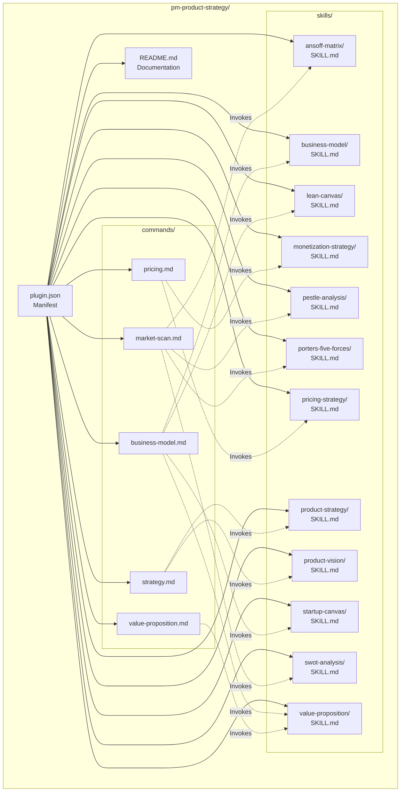
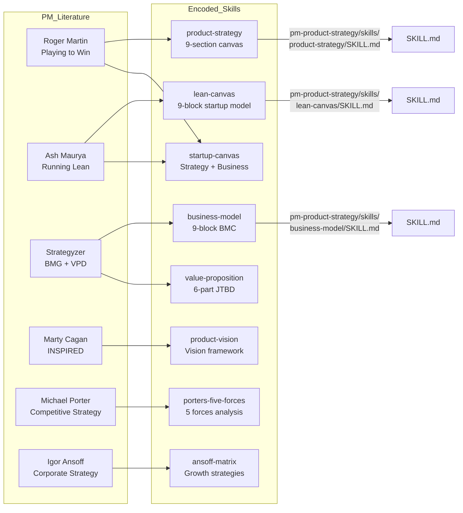
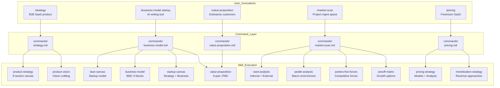

<!-- source: DeepWiki mcp.deepwiki.com · repo phuryn/pm-skills · page 4.2 pm-product-strategy · fetched 2026-10-26 -->

# pm-product-strategy

<details>
<summary>Relevant source files</summary>

The following files were used as context for generating this wiki page:

- [README.md](README.md)
- [pm-product-strategy/README.md](pm-product-strategy/README.md)

</details>


## Purpose and Scope

The `pm-product-strategy` plugin provides 12 skills and 5 commands for defining product direction, analyzing competitive landscapes, and designing business models. It encodes strategic frameworks from Roger Martin, Ash Maurya, Strategyzer, and other practitioners into executable workflows for vision crafting, business model design, pricing strategy, and macro environment analysis.

This plugin covers the **Strategy** stage of the product lifecycle. For problem discovery and ideation, see [pm-product-discovery](#4.1). For execution artifacts like PRDs and roadmaps, see [pm-execution](#4.3). For detailed canvas comparisons and value proposition design patterns, see [Business Model Canvases](#5.1) and [Value Proposition Design](#5.3).

**Sources:** [README.md:140-180](), [pm-product-strategy/README.md:1-35]()

---

## Plugin Directory Structure



**Plugin Structure:** The plugin follows the standard three-file architecture. [plugin.json]() defines metadata and skill/command references. The [skills/]() directory contains 12 subdirectories, each with a [SKILL.md]() file encoding a strategic framework. The [commands/]() directory contains 5 `.md` files, each orchestrating one or more skills into end-to-end workflows.

**Sources:** [pm-product-strategy/README.md:1-35](), [README.md:31-43]()

---

## Skills Catalog

The plugin exposes 12 skills organized into four functional categories:

| Skill Name | Category | Framework Source | Description |
|------------|----------|------------------|-------------|
| `product-strategy` | Strategy Canvas | Roger Martin (Playing to Win) | 9-section canvas: vision → segments → costs → value props → trade-offs → metrics → growth → capabilities → defensibility |
| `startup-canvas` | Strategy Canvas | Hybrid (Strategy + Business Model) | Combined Product Strategy (9 sections) + Business Model (costs + revenue). Alternative to BMC/Lean Canvas for new products |
| `product-vision` | Vision Crafting | Marty Cagan (INSPIRED) | Inspiring, achievable, emotional vision that motivates teams |
| `value-proposition` | Value Design | Strategyzer + JTBD | 6-part template: Who, Why, What before, How, What after, Alternatives |
| `lean-canvas` | Business Model | Ash Maurya (Running Lean) | 9-section startup canvas: problem, solution, metrics, cost, UVP, unfair advantage, channels, segments, revenue |
| `business-model` | Business Model | Strategyzer (BMG) | Business Model Canvas with 9 building blocks |
| `monetization-strategy` | Pricing/Revenue | General PM Practice | 3-5 monetization approaches with audience fit, risks, validation experiments |
| `pricing-strategy` | Pricing/Revenue | General PM Practice | Pricing models, competitive analysis, willingness-to-pay, price elasticity |
| `swot-analysis` | Environment Scan | Classic Strategic Planning | Strengths, Weaknesses, Opportunities, Threats with actionable recommendations |
| `pestle-analysis` | Environment Scan | Macro Analysis Framework | Political, Economic, Social, Technological, Legal, Environmental factors |
| `porters-five-forces` | Environment Scan | Michael Porter | Competitive rivalry, supplier power, buyer power, substitutes, new entrants |
| `ansoff-matrix` | Growth Strategy | H. Igor Ansoff | Market penetration, market development, product development, diversification |

**Skill Loading:** Skills load automatically when relevant to conversation context (Claude's inference engine). Users can force-load specific skills via `/pm-product-strategy:skill-name` or `/skill-name`.

**Sources:** [pm-product-strategy/README.md:5-19](), [README.md:146-159]()

---

## Commands Reference

The plugin provides 5 commands that orchestrate skills into structured workflows:

| Command | Invocation | Orchestrated Skills | Workflow Description |
|---------|-----------|---------------------|----------------------|
| `/strategy` | `/pm-product-strategy:strategy`<br/>or `/strategy` | `product-strategy`, `product-vision` | Generates 9-section Product Strategy Canvas covering vision, target segments, cost structure, value propositions, strategic trade-offs, success metrics, growth strategy, core capabilities, and defensibility |
| `/business-model` | `/pm-product-strategy:business-model`<br/>or `/business-model` | `lean-canvas`, `business-model`, `startup-canvas`, `value-proposition` | Explores business models with argument-based selection: `lean\|full\|startup\|value-prop\|all` |
| `/value-proposition` | `/pm-product-strategy:value-proposition`<br/>or `/value-proposition` | `value-proposition` | Designs value proposition using 6-part JTBD template |
| `/market-scan` | `/pm-product-strategy:market-scan`<br/>or `/market-scan` | `swot-analysis`, `pestle-analysis`, `porters-five-forces`, `ansoff-matrix` | Comprehensive macro environment analysis combining 4 strategic frameworks in one scan |
| `/pricing` | `/pm-product-strategy:pricing`<br/>or `/pricing` | `pricing-strategy`, `monetization-strategy` | Designs pricing strategy including models, competitive analysis, willingness-to-pay estimation, and validation experiments |

**Command Chaining:** Commands suggest follow-up actions upon completion. For example, `/strategy` → `/business-model` → `/value-proposition` → `/pricing` represents a natural strategic planning sequence.

**Sources:** [pm-product-strategy/README.md:20-27](), [README.md:160-179]()

---

## Framework Knowledge Codification



**Knowledge Translation Pipeline:** Each skill encodes a published PM methodology into an executable format. The [SKILL.md]() files contain frontmatter metadata (name, description, guidelines), structured templates, and step-by-step instructions derived from source frameworks. This transforms "knowledge in books" into "knowledge in AI workflows."

**Attribution:** The plugin explicitly credits 6 primary framework sources:
- Roger Martin's strategy cascade (Playing to Win) → `product-strategy`, `startup-canvas`
- Ash Maurya's lean methodology (Running Lean) → `lean-canvas`, `startup-canvas`
- Strategyzer's visual tools → `business-model`, `value-proposition`
- Marty Cagan's vision principles → `product-vision`
- Michael Porter's competitive analysis → `porters-five-forces`
- Igor Ansoff's growth matrix → `ansoff-matrix`

**Sources:** [README.md:401-415](), [README.md:25-27]()

---

## Command-Skill Orchestration



**Orchestration Pattern:** Commands chain skills in predefined sequences optimized for common PM workflows. The `/market-scan` command demonstrates multi-skill orchestration: it executes 4 complementary analyses (SWOT → PESTLE → Porter's → Ansoff) in sequence to provide comprehensive environmental assessment.

**Argument-Based Branching:** The `/business-model` command implements conditional skill selection based on user arguments:
- `lean` → loads `lean-canvas` only
- `full` → loads `business-model` only  
- `startup` → loads `startup-canvas` only
- `value-prop` → loads `value-proposition` only
- `all` → loads all 4 skills sequentially

**Sources:** [pm-product-strategy/README.md:20-27](), [README.md:160-167]()

---

## Strategic Workflow Patterns

### Pattern 1: Full Strategic Planning Sequence

```
/strategy → /business-model startup → /value-proposition → /pricing
```

**Use Case:** New product launch requiring complete strategic foundation.

**Outputs:**
1. 9-section Product Strategy Canvas (vision, segments, value props, defensibility)
2. Startup Canvas (strategy + business model combined)
3. 6-part JTBD Value Proposition
4. Pricing strategy with validation experiments

### Pattern 2: Competitive Positioning Analysis

```
/market-scan → /strategy → /value-proposition
```

**Use Case:** Entering competitive market requiring differentiation strategy.

**Outputs:**
1. SWOT + PESTLE + Porter's + Ansoff macro analysis
2. Product Strategy Canvas with competitive trade-offs
3. Differentiated value proposition

### Pattern 3: Business Model Exploration

```
/business-model all → /pricing
```

**Use Case:** Early-stage startup exploring monetization approaches.

**Outputs:**
1. Lean Canvas comparison
2. Business Model Canvas comparison
3. Startup Canvas comparison
4. Value Proposition Canvas
5. Monetization strategy with validation experiments

**Sources:** [README.md:160-179](), [README.md:41-46]()

---

## Integration with Other Plugins

The `pm-product-strategy` plugin integrates with other lifecycle plugins:

| Integration Point | Target Plugin | Relationship |
|-------------------|---------------|--------------|
| **Upstream:** Market insights inform strategy | [pm-market-research](#4.4) | `market-segments` → `product-strategy` (target segments)<br/>`competitor-analysis` → `swot-analysis` (competitive intel) |
| **Upstream:** Discovery insights shape vision | [pm-product-discovery](#4.1) | `opportunity-solution-tree` → `product-strategy` (outcome definition)<br/>`interview-script` → `value-proposition` (JTBD insights) |
| **Downstream:** Strategy drives execution | [pm-execution](#4.3) | `product-strategy` → `create-prd` (strategic context)<br/>`product-strategy` → `brainstorm-okrs` (metrics definition) |
| **Downstream:** Strategy informs GTM | [pm-go-to-market](#4.6) | `product-strategy` → `gtm-strategy` (positioning)<br/>`value-proposition` → `beachhead-segment` (ICP definition) |
| **Parallel:** Pricing informs marketing | [pm-marketing-growth](#4.7) | `pricing-strategy` → `positioning-ideas` (value communication)<br/>`value-proposition` → `value-prop-statements` (messaging) |

**Cross-Plugin Pattern:** The recommended workflow spans multiple plugins:

```
/research-users → /strategy → /write-prd → /plan-launch → /north-star
[research]      [strategy]   [execution]   [GTM]         [growth]
```

**Sources:** [README.md:98-413](), Diagram 2 from high-level architecture

---

## Skill Metadata Structure

Each skill in [pm-product-strategy/skills/]() follows the standardized frontmatter format:

```markdown
---
name: product-strategy
description: Generate a comprehensive product strategy using the 9-section Product Strategy Canvas covering vision, segments, costs, value propositions, trade-offs, metrics, growth, capabilities, and defensibility.
version: 1.0.0
author: Paweł Huryn
plugin: pm-product-strategy
guidelines:
  - Establish clear product vision as foundation
  - Identify specific target segments with evidence
  - Define measurable success metrics
  - Articulate strategic trade-offs explicitly
  - Document defensibility mechanisms
---

[Skill content follows...]
```

**Validation Requirements:** The [validate_plugins.py]() script enforces:
- `name` matches directory name
- `description` length ≥ 30 characters
- `plugin` matches parent plugin name
- Word count between 50-3000
- Frontmatter structure integrity

**Sources:** [pm-product-strategy/README.md:5-19](), [CONTRIBUTING.md]() (referenced in high-level diagrams)

---

## Usage Examples

### Example 1: Direct Skill Invocation

**User:** `Compare Lean Canvas vs Business Model Canvas for a two-sided marketplace`

**Claude Behavior:**
1. Automatically loads `lean-canvas` and `business-model` skills
2. Presents both frameworks side-by-side
3. Highlights differences in Problem/Solution focus vs. Resource focus
4. Recommends Lean Canvas for early validation, BMC for scaling stage

### Example 2: Command-Driven Workflow

**User:** `/strategy B2B project management tool for creative agencies`

**Execution Flow:**
1. Command [commands/strategy.md]() loads `product-strategy` skill
2. Guides user through 9 sections sequentially
3. Uses `product-vision` for section 1 (vision)
4. Outputs structured markdown with all sections populated
5. Suggests: "Next: `/business-model startup` to define revenue model"

### Example 3: Multi-Command Sequence

**User:** `/market-scan` → `/strategy` → `/pricing`

**Sequential Outputs:**
1. **Market Scan:** SWOT, PESTLE, Porter's, Ansoff analyses
2. **Strategy Canvas:** 9-section strategy incorporating competitive insights from scan
3. **Pricing Strategy:** Pricing models informed by competitive analysis + willingness-to-pay estimation

**Sources:** [README.md:168-179](), [README.md:41-46]()

---

## File Path Reference

**Core Plugin Files:**
- [pm-product-strategy/plugin.json]() — Plugin manifest with metadata
- [pm-product-strategy/README.md:1-35]() — Plugin documentation

**Skill Definitions (12):**
- [pm-product-strategy/skills/ansoff-matrix/SKILL.md]()
- [pm-product-strategy/skills/business-model/SKILL.md]()
- [pm-product-strategy/skills/lean-canvas/SKILL.md]()
- [pm-product-strategy/skills/monetization-strategy/SKILL.md]()
- [pm-product-strategy/skills/pestle-analysis/SKILL.md]()
- [pm-product-strategy/skills/porters-five-forces/SKILL.md]()
- [pm-product-strategy/skills/pricing-strategy/SKILL.md]()
- [pm-product-strategy/skills/product-strategy/SKILL.md]()
- [pm-product-strategy/skills/product-vision/SKILL.md]()
- [pm-product-strategy/skills/startup-canvas/SKILL.md]()
- [pm-product-strategy/skills/swot-analysis/SKILL.md]()
- [pm-product-strategy/skills/value-proposition/SKILL.md]()

**Command Definitions (5):**
- [pm-product-strategy/commands/business-model.md]()
- [pm-product-strategy/commands/market-scan.md]()
- [pm-product-strategy/commands/pricing.md]()
- [pm-product-strategy/commands/strategy.md]()
- [pm-product-strategy/commands/value-proposition.md]()

**Sources:** [pm-product-strategy/README.md:1-35](), [README.md:140-180]()

---

