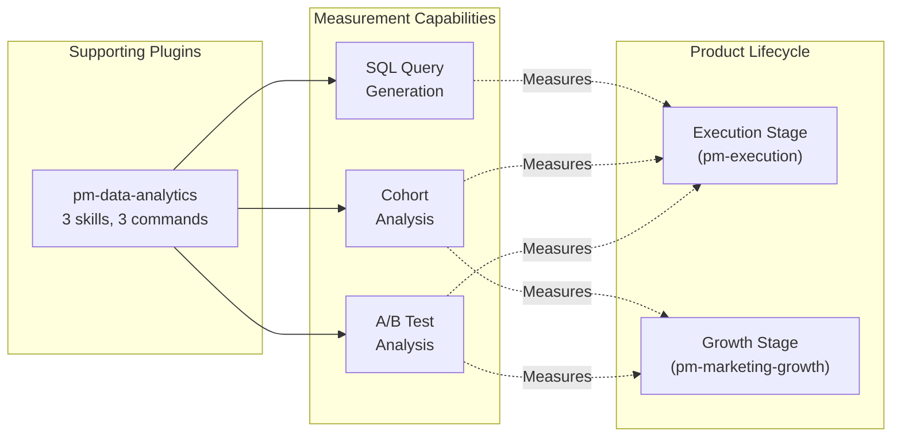
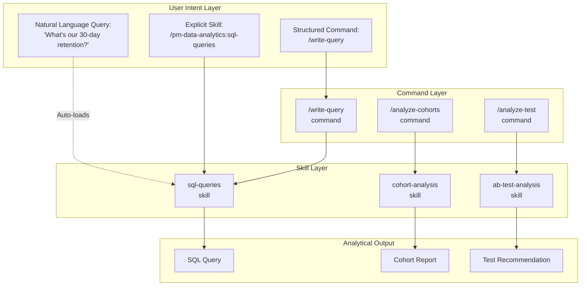
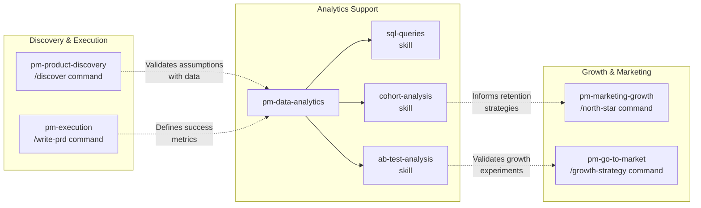

<!-- source: DeepWiki mcp.deepwiki.com · repo phuryn/pm-skills · page 4.5 pm-data-analytics · fetched 2026-10-26 -->

# pm-data-analytics

<details>
<summary>Relevant source files</summary>

The following files were used as context for generating this wiki page:

- [README.md](README.md)
- [pm-data-analytics/.claude-plugin/plugin.json](pm-data-analytics/.claude-plugin/plugin.json)
- [pm-data-analytics/README.md](pm-data-analytics/README.md)

</details>


## Purpose and Scope

The `pm-data-analytics` plugin provides data analysis capabilities for product managers who need to query user data, analyze retention patterns, and evaluate A/B test results. This plugin contains 3 skills and 3 commands that translate natural language analytical questions into SQL queries, cohort reports, and statistical test evaluations.

This page documents the plugin's structure, skills, and commands. For detailed documentation of the analytical methodologies and frameworks encoded in these skills, see [Data Analytics Skills](#5.4).

**Sources:** [pm-data-analytics/README.md:1-24](), [README.md:267-295]()

---

## Plugin Role in the Marketplace

The `pm-data-analytics` plugin functions as a **supporting plugin** in the marketplace architecture. Unlike core lifecycle plugins (discovery, strategy, execution, launch, growth), it provides cross-cutting measurement capabilities that inform decision-making across multiple product stages.



**Measurement Focus:** This plugin enables PMs to extract insights from user behavior data without requiring deep SQL expertise or statistical training. It bridges the gap between analytical questions ("What's our 30-day retention?") and technical execution (SQL queries, cohort calculations, significance tests).

**Sources:** [README.md:267-295](), High-level Diagram 2

---

## Skills Reference

The plugin exposes three skills, each addressing a distinct analytical capability. Skills are automatically loaded when Claude detects analytical intent in the conversation, or can be explicitly invoked with `/pm-data-analytics:skill-name`.

### sql-queries

**File:** `pm-data-analytics/skills/sql-queries/SKILL.md`

Generates SQL queries from natural language descriptions. Supports multiple SQL dialects including BigQuery, PostgreSQL, MySQL, and others.

**Key Capabilities:**
- Natural language → SQL translation
- Dialect-specific syntax generation
- Query optimization suggestions
- Schema inference from context

**Example Use Cases:**
- "Show me monthly active users by country for Q4 2025"
- "Calculate 7-day rolling average of daily signups"
- "Find users who completed onboarding but never returned"

**Sources:** [pm-data-analytics/README.md:9](), [README.md:274]()

---

### cohort-analysis

**File:** `pm-data-analytics/skills/cohort-analysis/SKILL.md`

Performs cohort analysis on user engagement data, producing retention curves, feature adoption rates, and engagement trends segmented by signup cohort.

**Key Capabilities:**
- Retention curve generation (Day 0, 7, 14, 30, 60, 90)
- Feature adoption by cohort
- Engagement metric trending
- Cohort comparison recommendations

**Example Use Cases:**
- "Compare retention for January 2025 vs February 2025 signups"
- "Show feature adoption rates for enterprise vs SMB cohorts"
- "Identify retention drop-off points in our onboarding flow"

**Sources:** [pm-data-analytics/README.md:8](), [README.md:275]()

---

### ab-test-analysis

**File:** `pm-data-analytics/skills/ab-test-analysis/SKILL.md`

Analyzes A/B test results with statistical significance calculations, sample size validation, confidence intervals, and ship/extend/stop recommendations.

**Key Capabilities:**
- Statistical significance testing (p-values, confidence intervals)
- Sample size validation against required power
- Minimum Detectable Effect (MDE) calculations
- Actionable recommendations (ship, extend test, stop)

**Example Use Cases:**
- "Analyze this checkout flow test: Control 3.2% conversion, Variant 3.5%, 10K users per variant"
- "How large a sample do I need for 95% confidence with a 2% MDE?"
- "Should we ship this variant or run the test longer?"

**Sources:** [pm-data-analytics/README.md:7](), [README.md:276]()

---

## Commands Reference

Each skill has a corresponding command that provides a structured workflow for the analytical task. Commands are invoked with `/command-name` and guide users through the analysis process.

### /write-query

**Command Path:** `pm-data-analytics/commands/write-query.md`

Generates SQL queries from natural language descriptions. Prompts for database dialect, schema context, and query requirements.

**Workflow:**
1. Collect query requirements (what data to retrieve)
2. Identify database dialect (BigQuery, PostgreSQL, MySQL, etc.)
3. Request schema information if needed
4. Generate optimized SQL query
5. Provide query explanation and optimization suggestions

**Invocation:**
```
/write-query Show me monthly active users by country for Q4 2025 (BigQuery)
```

**Sources:** [pm-data-analytics/README.md:15](), [README.md:280-281]()

---

### /analyze-cohorts

**Command Path:** `pm-data-analytics/commands/analyze-cohorts.md`

Performs cohort analysis on user engagement data. Prompts for data format, cohort definition, and metrics to analyze.

**Workflow:**
1. Request user engagement data (CSV, JSON, or query results)
2. Define cohort criteria (signup date, acquisition channel, etc.)
3. Specify metrics to analyze (retention, feature usage, engagement)
4. Generate retention curves and cohort comparison
5. Provide actionable insights and recommendations

**Invocation:**
```
/analyze-cohorts Weekly retention for users who signed up in January vs February
```

**Sources:** [pm-data-analytics/README.md:13](), [README.md:293]()

---

### /analyze-test

**Command Path:** `pm-data-analytics/commands/analyze-test.md`

Analyzes A/B test results with statistical rigor. Prompts for test data, success metrics, and analysis requirements.

**Workflow:**
1. Collect test data (control vs variant metrics)
2. Identify success metric and conversion rates
3. Calculate statistical significance and confidence intervals
4. Validate sample size against required statistical power
5. Provide ship/extend/stop recommendation with rationale

**Invocation:**
```
/analyze-test Here are the results from our checkout flow A/B test [attach CSV]
```

**Sources:** [pm-data-analytics/README.md:14](), [README.md:292]()

---

## Skill-Command Architecture

The plugin implements a **1:1 skill-to-command mapping**. Each skill provides the analytical capability, while each command wraps it in a conversational workflow.



**Design Rationale:** The 1:1 mapping keeps the plugin focused and simple. Unlike discovery or execution plugins that orchestrate multiple skills into complex workflows, data analytics tasks are atomic—each command invokes a single skill to produce a single analytical output.

**Sources:** [pm-data-analytics/README.md:6-15](), [README.md:272-283]()

---

## Plugin Metadata

The plugin manifest defines identification, versioning, and metadata for marketplace distribution.

**Manifest Location:** [pm-data-analytics/.claude-plugin/plugin.json:1-19]()

| Field | Value |
|-------|-------|
| **Name** | `pm-data-analytics` |
| **Version** | `1.0.1` |
| **Description** | Data analytics skills for PMs: SQL query generation and cohort analysis |
| **Author** | Paweł Huryn (pawel@productcompass.pm) |
| **Keywords** | product-management, data-analytics, sql, cohort-analysis, retention |
| **License** | MIT |

**Sources:** [pm-data-analytics/.claude-plugin/plugin.json:1-19]()

---

## Integration with Other Plugins

The `pm-data-analytics` plugin provides measurement capabilities consumed by other plugins in analytical workflows.



**Example Integration Patterns:**

| Source Plugin | Integration Point | Analytics Skill Used |
|--------------|-------------------|---------------------|
| `pm-product-discovery` | Validating assumption tests | `ab-test-analysis` |
| `pm-execution` | PRD success metrics | `cohort-analysis`, `sql-queries` |
| `pm-marketing-growth` | North Star metric tracking | `cohort-analysis` |
| `pm-go-to-market` | Growth loop measurement | `cohort-analysis`, `ab-test-analysis` |

**Sources:** High-level Diagram 2, [README.md:98-413]()

---

## Use Cases and Examples

### Use Case 1: SQL Query Generation

**Scenario:** PM needs to extract monthly active user counts segmented by acquisition channel for the past quarter.

**Interaction:**
```
PM: "Show me MAU by acquisition channel for Q4 2024, grouped by month"

/write-query
→ Prompts for database dialect (BigQuery)
→ Requests schema information
→ Generates SQL query with proper grouping and filters
```

**Output:** Optimized SQL query with explanatory comments and optimization suggestions.

**Sources:** [README.md:291]()

---

### Use Case 2: Cohort Retention Analysis

**Scenario:** PM wants to compare retention rates between users who signed up in January vs February to evaluate onboarding changes.

**Interaction:**
```
PM: "Compare 30-day retention for January 2025 vs February 2025 signups"

/analyze-cohorts
→ Requests user engagement data
→ Defines cohort boundaries (signup month)
→ Calculates retention curves
→ Identifies retention drop-off points
```

**Output:** Retention curves with day-by-day comparison and actionable insights about cohort differences.

**Sources:** [README.md:293]()

---

### Use Case 3: A/B Test Evaluation

**Scenario:** PM ran a checkout flow test and needs to determine if the 0.3% conversion lift is statistically significant.

**Interaction:**
```
PM: "Analyze this test: Control 3.2% conversion (10K users), Variant 3.5% (10K users)"

/analyze-test
→ Calculates p-value and confidence intervals
→ Validates sample size for 80% power
→ Checks MDE against observed lift
→ Recommends: "Ship variant - 95% confidence, sufficient power"
```

**Output:** Statistical analysis with ship/extend/stop recommendation and supporting calculations.

**Sources:** [README.md:292]()

---

## Sample Size and Statistical Rigor

The `ab-test-analysis` skill includes built-in sample size calculators and statistical validation to prevent premature decisions.

| Metric | Typical Threshold |
|--------|------------------|
| **Confidence Level** | 95% (p < 0.05) |
| **Statistical Power** | 80% (1 - β) |
| **Minimum Detectable Effect** | Defined per test |
| **Sample Size Validation** | Required for ship recommendation |

**Example Questions Answered:**
- "How large a sample do I need for 95% confidence with a 2% MDE?" → Sample size calculation
- "Is 5,000 users per variant enough to detect a 5% relative lift?" → Power analysis
- "Should we ship with p=0.08?" → Recommendation: extend test, insufficient confidence

**Sources:** [README.md:276](), [README.md:287-288]()

---

## Installation

The plugin is installed as part of the full marketplace or individually via Claude Code CLI.

**Claude Cowork (GUI):**
- All 8 plugins install automatically when adding the marketplace
- Commands and skills immediately available

**Claude Code (CLI):**
```bash
claude plugin marketplace add phuryn/pm-skills
claude plugin install pm-data-analytics@pm-skills
```

**Other AI Assistants (Skills Only):**
```bash
# Copy skills to Gemini/Cursor/Codex/Kiro
cp -r pm-data-analytics/skills/* ~/.gemini/skills/
```

**Note:** Commands (`/write-query`, `/analyze-cohorts`, `/analyze-test`) are Claude-specific. Other AI tools only support skills.

**Sources:** [README.md:47-94]()

---

## Validation and Quality Assurance

The plugin passes automated validation checks enforced by `validate_plugins.py` before marketplace distribution.

**Validation Checks Applied:**

| Check Type | Requirement |
|-----------|-------------|
| **Manifest** | `plugin.json` exists with valid name, version, description |
| **Skills** | Each skill has `SKILL.md` with complete frontmatter |
| **Commands** | Each command has complete frontmatter and argument-hint |
| **README** | Plugin README exists with required sections |
| **Naming** | Plugin name matches directory, skill names match folders |

**Sources:** High-level Diagram 6, validate_plugins.py system overview

---

## Related Pages

- [Data Analytics Skills](#5.4) — Detailed methodology documentation for SQL generation, cohort analysis, and A/B testing frameworks
- [pm-execution](#4.3) — Execution plugin that consumes analytics for PRD success metrics and OKR tracking
- [pm-marketing-growth](#4.7) — Growth plugin that uses cohort analysis for retention strategies

**Sources:** Table of Contents structure

---

