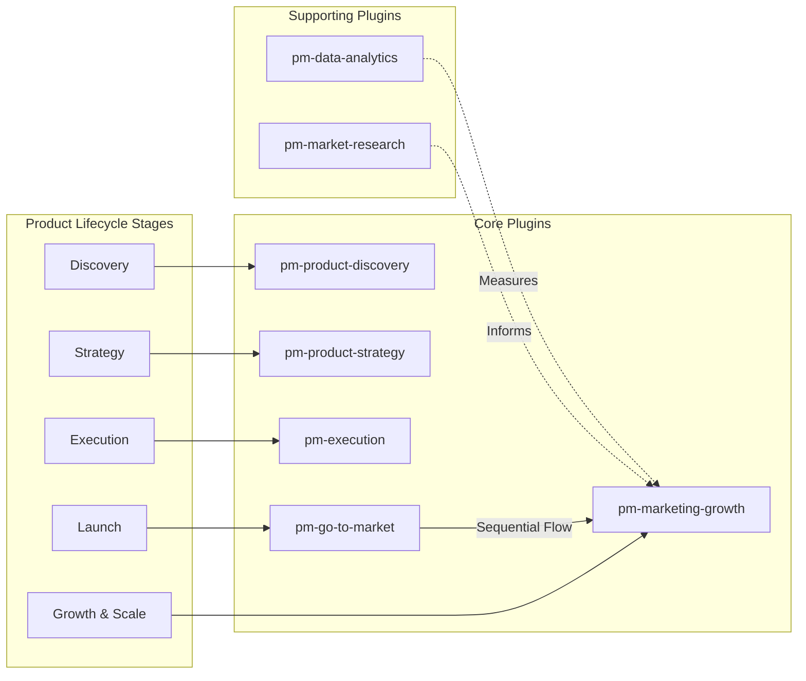
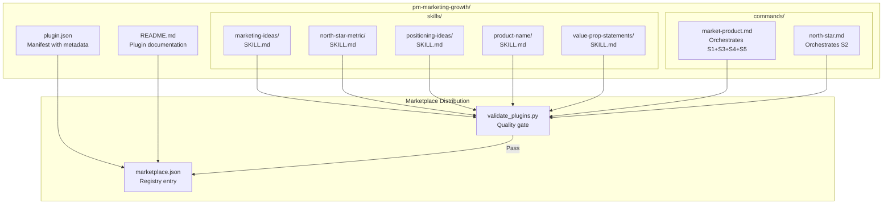
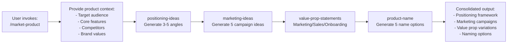
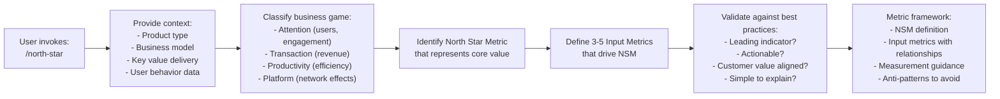
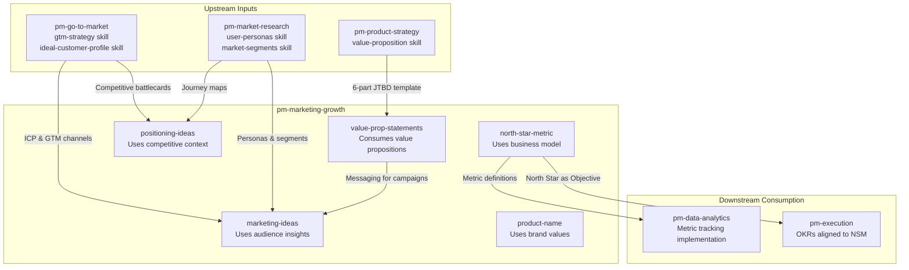

<!-- source: DeepWiki mcp.deepwiki.com · repo phuryn/pm-skills · page 4.7 pm-marketing-growth · fetched 2026-10-26 -->

# pm-marketing-growth

<details>
<summary>Relevant source files</summary>

The following files were used as context for generating this wiki page:

- [README.md](README.md)
- [pm-marketing-growth/README.md](pm-marketing-growth/README.md)

</details>


## Purpose and Scope

The `pm-marketing-growth` plugin provides AI-guided workflows for product marketing and growth optimization tasks. It covers the post-launch lifecycle stage where products need positioning, messaging, metrics definition, and marketing strategy. This plugin focuses on **marketing execution and growth measurement**, not market research or go-to-market planning.

For market research and customer segmentation, see [pm-market-research](#4.4). For go-to-market strategy, beachhead segments, and launch planning, see [pm-go-to-market](#4.6). For broader product strategy and value propositions based on Jobs-to-be-Done frameworks, see [pm-product-strategy](#4.2).

This plugin contains **5 skills** and **2 commands** that help product managers define metrics, craft positioning, generate marketing ideas, and create value proposition statements for various contexts.

**Sources:** [pm-marketing-growth/README.md:1-24](), [README.md:331-360]()

---

## Plugin Architecture

### Position in the Marketplace Ecosystem

The `pm-marketing-growth` plugin occupies the **Growth & Scale stage** (stage 5) of the product lifecycle. It operates after go-to-market execution when products need ongoing marketing, metric refinement, and growth optimization.



**Diagram: Plugin Position in Product Lifecycle**

The plugin receives inputs from `pm-go-to-market` (launch execution) and `pm-market-research` (customer insights), while integrating with `pm-data-analytics` for metric validation.

**Sources:** [README.md:98-360](), Diagram 2 from high-level architecture

---

### File Structure Mapping



**Diagram: pm-marketing-growth File Structure**

Each skill is a directory containing `SKILL.md` with frontmatter metadata and structured instructions. Commands are individual `.md` files that reference skills via the orchestration layer.

**Sources:** [pm-marketing-growth/README.md:1-24](), [README.md:31-46]()

---

## Skills Reference

The plugin contains 5 skills that serve as both standalone capabilities (automatically loaded when relevant) and building blocks for commands.

### Skill Inventory

| Skill Name | Purpose | Typical Use Case | Referenced By |
|------------|---------|------------------|---------------|
| `marketing-ideas` | Generate 5 creative, cost-effective marketing ideas | Brainstorming marketing campaigns | `/market-product` |
| `north-star-metric` | Define North Star Metric + input metrics | Aligning teams on growth measurement | `/north-star` |
| `positioning-ideas` | Brainstorm differentiated positioning angles | Competitive positioning workshops | `/market-product` |
| `product-name` | Generate 5 unique product names with rationale | Naming new features or products | `/market-product` |
| `value-prop-statements` | Create marketing/sales/onboarding statements | Crafting pitch decks, landing pages | `/market-product` |

**Sources:** [pm-marketing-growth/README.md:5-11](), [README.md:336-343]()

---

### marketing-ideas

**Location:** `pm-marketing-growth/skills/marketing-ideas/SKILL.md`

Generates 5 creative, cost-effective marketing ideas with specific channels, messaging suggestions, and engagement rationale. Each idea includes tactical implementation guidance.

**Typical Output Structure:**
- Marketing channel (e.g., content marketing, community, partnerships)
- Target audience segment
- Core messaging angle
- Engagement rationale (why it will work)
- Estimated cost and effort

**Example Invocation:**
```
Brainstorm 5 positioning angles that differentiate us from Notion
```

**Sources:** [pm-marketing-growth/README.md:7](), [README.md:338](), [README.md:352]()

---

### north-star-metric

**Location:** `pm-marketing-growth/skills/north-star-metric/SKILL.md`

Identifies a single North Star Metric (NSM) that represents core product value delivery, plus 3-5 input metrics that drive the NSM. Classifies the business game type (attention, transaction, productivity, platform) and validates metric selection against best practices.

**Typical Output Structure:**
- Business game classification
- North Star Metric with rationale
- 3-5 input metrics with causal relationships
- Measurement implementation guidance
- Anti-patterns to avoid

**Framework Attribution:** Based on Alistair Croll & Benjamin Yoskovitz (*Lean Analytics*) and Sean Ellis (*Hacking Growth*) methodologies for metric selection.

**Example Invocation:**
```
What's a good North Star Metric for a two-sided marketplace?
```

**Sources:** [pm-marketing-growth/README.md:8](), [README.md:342](), [README.md:353](), [README.md:413-414]()

---

### positioning-ideas

**Location:** `pm-marketing-growth/skills/positioning-ideas/SKILL.md`

Brainstorms product positioning ideas that differentiate from competitors. Generates multiple positioning angles based on target audience, unique capabilities, emotional resonance, and competitive gaps.

**Typical Output Structure:**
- 3-5 positioning angles
- Differentiation rationale for each
- Target audience alignment
- Competitive contrast
- Messaging implications

**Example Invocation:**
```
Brainstorm 5 positioning angles that differentiate us from Notion
```

**Sources:** [pm-marketing-growth/README.md:9](), [README.md:339](), [README.md:352]()

---

### product-name

**Location:** `pm-marketing-growth/skills/product-name/SKILL.md`

Generates 5 unique, memorable product names with rationale aligned to brand values and target audience. Each name includes linguistic analysis, domain availability considerations, and trademark risk assessment.

**Typical Output Structure:**
- Name suggestion
- Linguistic breakdown (etymology, pronunciation)
- Alignment to brand values
- Audience resonance rationale
- Potential concerns (trademark, cultural)

**Sources:** [pm-marketing-growth/README.md:10](), [README.md:341]()

---

### value-prop-statements

**Location:** `pm-marketing-growth/skills/value-prop-statements/SKILL.md`

Transforms existing value propositions (typically from `pm-product-strategy:value-proposition`) into concise statements tailored for marketing materials, sales pitches, and onboarding flows. Generates 3 variations optimized for different contexts.

**Context-Specific Outputs:**
- **Marketing:** One-sentence hook for landing pages, ads
- **Sales:** Elevator pitch for sales conversations
- **Onboarding:** Welcome message explaining core value

**Relationship to Other Skills:** This skill **consumes** outputs from `pm-product-strategy:value-proposition` (the 6-part JTBD template). It does not replace that skill but distills it into tactical copy.

**Example Invocation:**
```
Generate value prop statements for our sales team's pitch deck
```

**Sources:** [pm-marketing-growth/README.md:11](), [README.md:340](), [README.md:354]()

---

## Commands Reference

The plugin provides 2 commands that orchestrate skills into end-to-end workflows.

### Command Catalog

| Command | Invocation | Skills Orchestrated | Purpose |
|---------|------------|---------------------|---------|
| `/market-product` | `/pm-marketing-growth:market-product` | `marketing-ideas`, `positioning-ideas`, `value-prop-statements`, `product-name` | Full marketing toolkit workflow |
| `/north-star` | `/pm-marketing-growth:north-star` | `north-star-metric` | Metric definition and validation |

**Sources:** [pm-marketing-growth/README.md:13-16](), [README.md:344-348]()

---

### /market-product Command

**Location:** `pm-marketing-growth/commands/market-product.md`

**Description:** Brainstorm marketing ideas, positioning, value prop statements, and product names in a single creative marketing session.

**Workflow:**


**Diagram: /market-product Command Orchestration**

**Example Usage:**
```
/market-product B2B analytics dashboard for e-commerce managers
```

**Output Sections:**
1. Differentiated positioning angles
2. Marketing campaign ideas with channels
3. Value proposition statements (3 contexts)
4. Product naming options with rationale

**Sources:** [pm-marketing-growth/README.md:15](), [README.md:346](), [README.md:357]()

---

### /north-star Command

**Location:** `pm-marketing-growth/commands/north-star.md`

**Description:** Define your North Star Metric and supporting input metrics with business game classification and validation against best practices.

**Workflow:**


**Diagram: /north-star Command Workflow**

**Example Usage:**
```
/north-star Two-sided marketplace connecting freelancers with clients
```

**Output Components:**
- Business game classification (likely "Platform")
- North Star Metric (e.g., "Successful project completions per month")
- Input metrics (e.g., "Active freelancers", "Job postings", "Match rate", "Repeat hire rate")
- Causal relationship diagram showing how inputs drive NSM
- Implementation guidance for tracking

**Framework Validation Criteria:**
1. **Leading indicator:** Predicts future revenue/retention
2. **Customer value alignment:** Measures delivered value, not vanity metrics
3. **Actionable:** Teams can take actions to move the metric
4. **Simplicity:** Entire organization can understand it
5. **Rate-based:** Captures velocity, not cumulative totals

**Sources:** [pm-marketing-growth/README.md:16](), [README.md:347](), [README.md:358]()

---

## Integration with Other Plugins

### Cross-Plugin Dependencies



**Diagram: Cross-Plugin Integration Points**

**Key Dependencies:**

1. **Consumes from pm-product-strategy:** The `value-prop-statements` skill transforms outputs from the `value-proposition` skill (6-part JTBD template) into tactical marketing copy.

2. **Consumes from pm-go-to-market:** Positioning and marketing ideas leverage ICP definitions and competitive battlecards from the GTM plugin.

3. **Consumes from pm-market-research:** User personas and market segments inform marketing channel selection and messaging angles.

4. **Feeds into pm-data-analytics:** North Star Metrics become the foundation for SQL queries, cohort analysis, and A/B test design.

5. **Feeds into pm-execution:** The North Star Metric often becomes the top-level Objective in OKR planning.

**Sources:** [README.md:140-360](), Diagram 2 from high-level architecture

---

## Usage Patterns

### Automatic Skill Loading

Skills load automatically when Claude detects relevant context in the conversation. Users do not need to explicitly invoke skill names.

**Example:**
```
User: "What's a good metric for measuring success in our subscription app?"

Claude automatically loads: north-star-metric skill
Output: Business game classification + NSM recommendation + input metrics
```

**Sources:** [README.md:33-36]()

---

### Explicit Skill Invocation

Power users can force-load specific skills to override general AI knowledge:

**Syntax:**
```
/pm-marketing-growth:skill-name [context]
```

or

```
/skill-name [context]
```

**Example:**
```
/positioning-ideas Our AI writing assistant vs Grammarly, Jasper, and Copy.ai
```

This forces Claude to use the `positioning-ideas` skill framework rather than general competitive analysis knowledge.

**Sources:** [README.md:35-36]()

---

### Command-Driven Workflows

Commands provide structured, multi-step workflows for complex tasks:

**Sequential Command Flow Example:**

```
1. /pm-go-to-market:plan-launch [initial GTM strategy]
   ↓
2. /pm-marketing-growth:market-product [positioning & campaigns]
   ↓
3. /pm-marketing-growth:north-star [define success metrics]
   ↓
4. /pm-execution:plan-okrs [align team goals to NSM]
```

This represents a typical **Launch → Growth → Execution** progression across plugins.

**Sources:** [README.md:37-46](), [README.md:44-45]()

---

## Validation and Quality Assurance

All skills and commands in `pm-marketing-growth` pass validation via `validate_plugins.py` before distribution.

**Validation Checks:**

| Check Type | Requirement | Validated Elements |
|------------|-------------|-------------------|
| Manifest | `plugin.json` exists with required fields | Name, version, description, skills, commands |
| Skill Frontmatter | Complete metadata in each `SKILL.md` | Name, description (≥30 chars), tags |
| Skill Content | Word count 50-3000 words | All 5 skill files |
| Command Frontmatter | Complete metadata in each command `.md` | Name, description, argument-hint |
| Cross-References | No references to skills in other plugins | Internal consistency |

**Sources:** [README.md:446-461](), Diagram 6 from high-level architecture

---

## Framework Attribution

The skills in `pm-marketing-growth` encode methodologies from:

- **Alistair Croll & Benjamin Yoskovitz** — *Lean Analytics* (North Star Metric framework, business game classification)
- **Sean Ellis** — *Hacking Growth* (Input metrics, growth measurement)

**Sources:** [README.md:401-414]()

---

## Example Workflows

### Workflow 1: Post-Launch Metric Definition

**Scenario:** Product has launched, team needs to align on success metrics.

```
1. /pm-marketing-growth:north-star
   Input: "B2B SaaS project management tool"
   Output: NSM = "Weekly active teams" + input metrics

2. /pm-execution:plan-okrs
   Input: "Align Q2 OKRs to the North Star Metric"
   Output: Team-level OKRs with key results tied to input metrics

3. /pm-data-analytics:write-query
   Input: "Track weekly active teams and input metrics in BigQuery"
   Output: SQL queries for dashboard implementation
```

**Sources:** [README.md:344-359]()

---

### Workflow 2: Rebranding and Positioning

**Scenario:** Product needs new positioning to differentiate from competitors.

```
1. /pm-market-research:competitive-analysis
   Input: Identify top 3 competitors and their positioning

2. /pm-marketing-growth:market-product
   Input: Generate new positioning angles, value props, and naming options
   Output: 5 positioning angles + 3 value prop variations + 5 name ideas

3. /pm-go-to-market:battlecard
   Input: Create competitive battlecard with new positioning
   Output: Sales-ready battlecard with objection handling
```

**Sources:** [README.md:346-358]()

---

## Installation and Access

The `pm-marketing-growth` plugin installs as part of the full marketplace or individually via Claude Code CLI.

**Claude Cowork Installation:**
All 8 plugins (including `pm-marketing-growth`) install automatically when adding the marketplace from GitHub.

**Claude Code CLI Installation:**
```bash
claude plugin marketplace add phuryn/pm-skills
claude plugin install pm-marketing-growth@pm-skills
```

**Other AI Tools (Skills Only):**
Copy `pm-marketing-growth/skills/*/SKILL.md` files to the tool's skill directory. Commands are not available outside Claude environments.

**Sources:** [README.md:47-94]()

---

