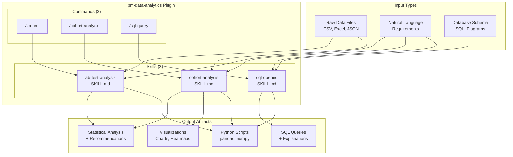
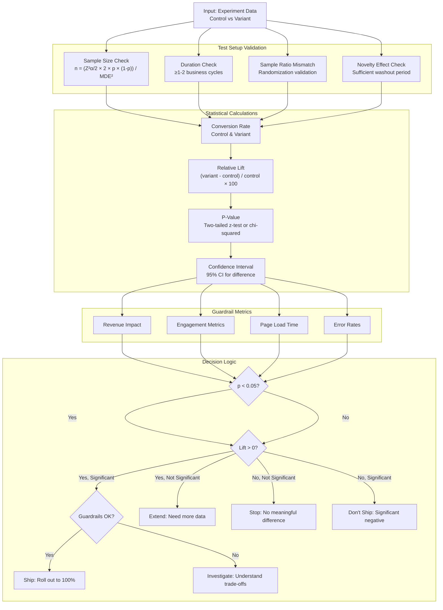
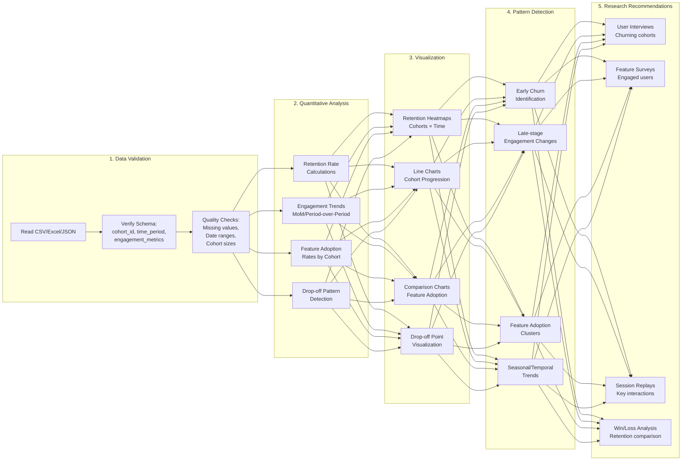
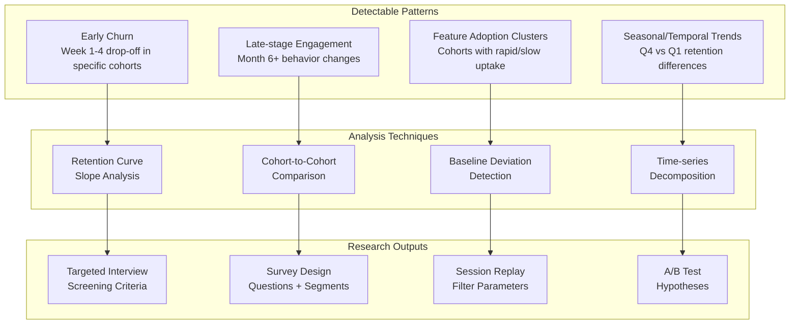
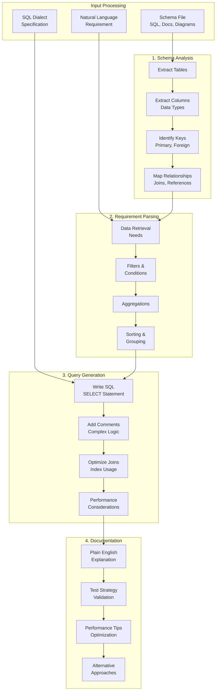

<!-- source: DeepWiki mcp.deepwiki.com · repo phuryn/pm-skills · page 5.4 Data Analytics Skills · fetched 2026-10-26 -->

# Data Analytics Skills

<details>
<summary>Relevant source files</summary>

The following files were used as context for generating this wiki page:

- [pm-data-analytics/skills/ab-test-analysis/SKILL.md](pm-data-analytics/skills/ab-test-analysis/SKILL.md)
- [pm-data-analytics/skills/cohort-analysis/SKILL.md](pm-data-analytics/skills/cohort-analysis/SKILL.md)
- [pm-data-analytics/skills/sql-queries/SKILL.md](pm-data-analytics/skills/sql-queries/SKILL.md)

</details>


## Purpose and Scope

This page documents the three analytical skills in the `pm-data-analytics` plugin: A/B test analysis, cohort retention analysis, and SQL query generation. These skills provide product managers with data-driven decision-making capabilities that measure product execution and growth outcomes.

For information about broader market research capabilities (personas, segmentation, competitive analysis), see [pm-market-research](#4.4). For information about growth metrics and positioning, see [pm-marketing-growth](#4.7).

**Sources:** High-level system diagrams (Diagram 2: Product Lifecycle Coverage Map), [pm-data-analytics/skills/ab-test-analysis/SKILL.md:1-83](), [pm-data-analytics/skills/cohort-analysis/SKILL.md:1-115](), [pm-data-analytics/skills/sql-queries/SKILL.md:1-88]()

---

## Skills-to-Commands Architecture

The `pm-data-analytics` plugin contains 3 skills, each paired with a corresponding command for direct invocation. This creates a one-to-one mapping between atomic skills and orchestrated workflows.

### System Structure Diagram



**Sources:** [pm-data-analytics/skills/ab-test-analysis/SKILL.md:1-83](), [pm-data-analytics/skills/cohort-analysis/SKILL.md:1-115](), [pm-data-analytics/skills/sql-queries/SKILL.md:1-88]()

---

## Plugin Capability Matrix

| Skill | Primary Use Case | Input Formats | Output Artifacts | Statistical Methods |
|-------|-----------------|---------------|------------------|---------------------|
| `ab-test-analysis` | Experiment evaluation with ship/extend/stop recommendations | CSV, Excel, analytics exports, or summary statistics | Statistical report, confidence intervals, Python calculation scripts | Two-tailed z-test, chi-squared test, power analysis, sample ratio mismatch detection |
| `cohort-analysis` | Retention pattern analysis and user engagement tracking | CSV, Excel, JSON with cohort identifiers and time-series metrics | Retention heatmaps, line charts, anomaly reports, follow-up research recommendations | Retention rate calculations, month-over-month trends, cohort comparison |
| `sql-queries` | Natural language to SQL translation for data retrieval | Database schema files (SQL, docs, diagrams), business requirements | Optimized SQL queries with comments, performance notes, test scripts | N/A (query generation, not statistical analysis) |

**Sources:** [pm-data-analytics/skills/ab-test-analysis/SKILL.md:1-10](), [pm-data-analytics/skills/cohort-analysis/SKILL.md:1-10](), [pm-data-analytics/skills/sql-queries/SKILL.md:1-10]()

---

## A/B Test Analysis: `ab-test-analysis`

### Purpose

The `ab-test-analysis` skill evaluates experiment results with statistical rigor and translates findings into product decisions: **ship**, **extend**, **stop**, or **investigate**.

**Skill Definition Location:** [pm-data-analytics/skills/ab-test-analysis/SKILL.md:1-83]()

### Statistical Validation Workflow



**Sources:** [pm-data-analytics/skills/ab-test-analysis/SKILL.md:25-55]()

### Validation Checks

The skill performs four critical validation checks before analyzing results:

1. **Sample Size Validation** [pm-data-analytics/skills/ab-test-analysis/SKILL.md:26-28]()
   - Formula: `n = (Z²α/2 × 2 × p × (1-p)) / MDE²`
   - Flags tests with <80% statistical power
   - Prevents false negatives from underpowered experiments

2. **Duration Validation** [pm-data-analytics/skills/ab-test-analysis/SKILL.md:29]()
   - Minimum 1-2 full business cycles
   - Accounts for weekly patterns and day-of-week effects

3. **Sample Ratio Mismatch (SRM)** [pm-data-analytics/skills/ab-test-analysis/SKILL.md:30]()
   - Validates randomization integrity
   - Detects biased traffic allocation

4. **Novelty/Primacy Effects** [pm-data-analytics/skills/ab-test-analysis/SKILL.md:31]()
   - Ensures sufficient time to wash out initial behavior changes
   - Prevents shipping false winners driven by curiosity

### Statistical Calculations

The skill computes five key metrics [pm-data-analytics/skills/ab-test-analysis/SKILL.md:33-40]():

| Metric | Formula | Purpose |
|--------|---------|---------|
| Conversion Rate | `conversions / total_users` | Baseline metric for control and variant |
| Relative Lift | `(variant - control) / control × 100` | Percentage change (e.g., +15%) |
| P-Value | Two-tailed z-test or chi-squared | Probability results occurred by chance |
| Confidence Interval | 95% CI for difference | Range of plausible true effect sizes |
| Practical Significance | Business context evaluation | Is the lift meaningful? |

**Sources:** [pm-data-analytics/skills/ab-test-analysis/SKILL.md:33-42]()

### Decision Matrix

The skill provides structured recommendations based on outcome patterns:

| Outcome | Recommendation | Rationale |
|---------|---------------|-----------|
| Significant positive lift, no guardrail issues | **Ship it** — roll out to 100% | Clear winner, safe to deploy |
| Significant positive lift, guardrail concerns | **Investigate** — understand trade-offs | May have hidden costs |
| Not significant, positive trend | **Extend the test** — need more data | Potentially underpowered |
| Not significant, flat | **Stop the test** — no meaningful difference | No value in continuing |
| Significant negative lift | **Don't ship** — revert, analyze why | Variant harms metrics |

**Sources:** [pm-data-analytics/skills/ab-test-analysis/SKILL.md:48-55]()

### Output Format

The skill generates a markdown report [pm-data-analytics/skills/ab-test-analysis/SKILL.md:57-72]():

```markdown
## A/B Test Results: [Test Name]

**Hypothesis**: [What we expected]
**Duration**: [X days] | **Sample**: [N control / M variant]

| Metric | Control | Variant | Lift | p-value | Significant? |
|---|---|---|---|---|---|
| [Primary] | X% | Y% | +Z% | 0.0X | Yes/No |
| [Guardrail] | ... | ... | ... | ... | ... |

**Recommendation**: [Ship / Extend / Stop / Investigate]
**Reasoning**: [Why]
**Next steps**: [What to do]
```

For raw data inputs, the skill generates Python scripts using statistical libraries to perform calculations [pm-data-analytics/skills/ab-test-analysis/SKILL.md:41-42]().

**Sources:** [pm-data-analytics/skills/ab-test-analysis/SKILL.md:57-74]()

---

## Cohort Analysis: `cohort-analysis`

### Purpose

The `cohort-analysis` skill analyzes user engagement and retention patterns by cohort to identify trends in behavior, feature adoption, and long-term engagement. It combines quantitative insights with qualitative research recommendations.

**Skill Definition Location:** [pm-data-analytics/skills/cohort-analysis/SKILL.md:1-115]()

### Five-Step Analysis Pipeline



**Sources:** [pm-data-analytics/skills/cohort-analysis/SKILL.md:13-49]()

### Data Requirements

The skill accepts multiple data formats and validates structure:

| Requirement | Description | Validation |
|------------|-------------|-----------|
| Cohort Identifier | Grouping dimension (signup month, feature launch date) | Must be present in each row |
| Time Periods | Multiple measurement points (weeks, months) | At least 3-4 periods for pattern detection |
| Engagement Metrics | Retention, usage, revenue, feature adoption | Numeric values, no missing critical data |
| Sample Size | Number of users per cohort | Flagged if cohorts are too small for significance |

**Sources:** [pm-data-analytics/skills/cohort-analysis/SKILL.md:13-17](), [pm-data-analytics/skills/cohort-analysis/SKILL.md:89-95]()

### Key Capabilities

The skill provides seven analytical capabilities [pm-data-analytics/skills/cohort-analysis/SKILL.md:77-87]():

1. **Data Reading**: Import CSV, Excel, JSON, SQL query results
2. **Retention Analysis**: Calculate and visualize retention rates over time
3. **Cohort Comparison**: Compare metrics across cohort groups
4. **Anomaly Detection**: Flag unusual patterns or drop-offs
5. **Python Scripts**: Generate reusable analysis code with pandas/numpy
6. **Visualizations**: Create heatmaps, charts, interactive dashboards
7. **Research Design**: Suggest targeted follow-up studies and interview approaches

### Pattern Identification

The skill identifies four primary pattern types [pm-data-analytics/skills/cohort-analysis/SKILL.md:34-40]():



**Sources:** [pm-data-analytics/skills/cohort-analysis/SKILL.md:34-49]()

### Output Deliverables

The skill generates a structured output package [pm-data-analytics/skills/cohort-analysis/SKILL.md:99-107]():

1. **Data Summary**: Cohort overview, data quality assessment
2. **Quantitative Findings**: Key metrics, retention rates, trend analysis
3. **Visualizations**: Retention curves, adoption patterns
4. **Pattern Identification**: 2-3 significant insights
5. **Research Recommendations**: Specific qualitative and quantitative follow-ups
6. **Analysis Scripts** (optional): Python code for reproducible analysis
7. **Next Steps**: Prioritized actions based on findings

**Sources:** [pm-data-analytics/skills/cohort-analysis/SKILL.md:99-107]()

---

## SQL Query Generation: `sql-queries`

### Purpose

The `sql-queries` skill transforms natural language requirements into optimized SQL queries across multiple database platforms. It reads database schemas and generates production-ready queries with explanations and performance notes.

**Skill Definition Location:** [pm-data-analytics/skills/sql-queries/SKILL.md:1-88]()

### Four-Step Query Generation Process



**Sources:** [pm-data-analytics/skills/sql-queries/SKILL.md:13-33]()

### Supported SQL Dialects

The skill supports multiple database platforms [pm-data-analytics/skills/sql-queries/SKILL.md:59]():

| Database | Dialect Features | Common Use Cases |
|----------|-----------------|------------------|
| BigQuery | Standard SQL, `WITH` clauses, window functions | Large-scale analytics, data warehousing |
| PostgreSQL | Advanced SQL features, CTEs, JSON operators | Transactional databases, complex queries |
| MySQL | Traditional SQL, limited window functions (8.0+) | Web applications, OLTP systems |
| Snowflake | Cloud data warehouse syntax | Enterprise analytics |
| SQL Server | T-SQL extensions | Microsoft stack integrations |

**Sources:** [pm-data-analytics/skills/sql-queries/SKILL.md:59-64]()

### Schema Input Methods

The skill accepts three schema input formats [pm-data-analytics/skills/sql-queries/SKILL.md:14-16]():

1. **SQL Files**: Database schema dumps, `CREATE TABLE` statements
2. **Documentation**: Markdown or text descriptions of table structures
3. **Diagrams**: Entity-relationship diagrams described in natural language

**Example Schema Parsing:**

```
Input: "Users table (id, email, created_at), 
        Sessions table (id, user_id, timestamp, duration)"

Parsed Structure:
- Table: users
  - id (PRIMARY KEY)
  - email (VARCHAR)
  - created_at (TIMESTAMP)
  
- Table: sessions
  - id (PRIMARY KEY)
  - user_id (FOREIGN KEY → users.id)
  - timestamp (TIMESTAMP)
  - duration (INTEGER)
```

**Sources:** [pm-data-analytics/skills/sql-queries/SKILL.md:14-16](), [pm-data-analytics/skills/sql-queries/SKILL.md:44-49]()

### Query Optimization Techniques

The skill applies performance optimization strategies [pm-data-analytics/skills/sql-queries/SKILL.md:24-27]():

1. **Index Utilization**: Suggests indexes on frequently filtered columns
2. **Join Optimization**: Chooses appropriate join types (INNER, LEFT, etc.)
3. **Query Refactoring**: Uses subqueries vs. CTEs based on dialect
4. **Partitioning Strategies**: Recommends partitioning for large datasets

**Output Structure** [pm-data-analytics/skills/sql-queries/SKILL.md:76-80]():

```
1. SQL Query: Production-ready code with inline comments
2. Explanation: Plain English breakdown of logic
3. Performance Notes: Optimization tips, index recommendations
4. Test Script (optional): Sample data and validation queries
```

**Sources:** [pm-data-analytics/skills/sql-queries/SKILL.md:24-27](), [pm-data-analytics/skills/sql-queries/SKILL.md:76-80]()

---

## Cross-Skill Integration Patterns

The three analytics skills often work in sequence to support data-driven product decisions:

### End-to-End Analytics Workflow

```mermaid
graph LR
    subgraph Discovery["Data Discovery"]
        SQL1["sql-queries:<br/>Generate exploratory queries"]
        SQL2["Identify available<br/>metrics and dimensions"]
    end
    
    subgraph Monitoring["Retention Monitoring"]
        COH1["cohort-analysis:<br/>Upload user cohort data"]
        COH2["Detect retention<br/>drop-offs"]
        COH3["Generate research<br/>hypotheses"]
    end
    
    subgraph Experimentation["Hypothesis Testing"]
        AB1["Design A/B test<br/>based on insights"]
        AB2["ab-test-analysis:<br/>Evaluate experiment"]
        AB3["Ship/extend/stop<br/>decision"]
    end
    
    subgraph Iteration["Continuous Improvement"]
        SQL3["sql-queries:<br/>Track post-launch metrics"]
        COH4["cohort-analysis:<br/>Monitor new cohorts"]
    end
    
    SQL1 --> SQL2
    SQL2 --> COH1
    COH1 --> COH2 --> COH3
    COH3 --> AB1 --> AB2 --> AB3
    AB3 --> SQL3 --> COH4
    COH4 --> COH1
```



**Sources:** [pm-data-analytics/skills/sql-queries/SKILL.md:1-88](), [pm-data-analytics/skills/cohort-analysis/SKILL.md:1-115](), [pm-data-analytics/skills/ab-test-analysis/SKILL.md:1-83]()

### Common Usage Scenarios

| Scenario | Skill Sequence | Rationale |
|----------|---------------|-----------|
| Feature launch analysis | `sql-queries` → `cohort-analysis` → `ab-test-analysis` | Query baseline data, monitor adoption by cohort, test variants |
| Churn investigation | `sql-queries` → `cohort-analysis` | Identify churning segments, analyze retention patterns |
| Metric deep-dive | `sql-queries` → `ab-test-analysis` | Extract raw data, validate statistical significance of changes |
| Retention improvement | `cohort-analysis` → `ab-test-analysis` | Detect retention issues, test interventions |

**Sources:** High-level system diagrams (Diagram 2: Product Lifecycle Coverage Map), [pm-data-analytics/skills/cohort-analysis/SKILL.md:42-49]()

---

## File Structure and Metadata

Each skill follows the standardized `SKILL.md` format with frontmatter metadata:

### Frontmatter Schema

```yaml
name: <skill-name>
description: "<50-300 char description> Use when <usage contexts>"
```

**Validation Rules** (enforced by `validate_plugins.py`):

- `name` must match directory name [validate_plugins.py:172-175]()
- `description` must be ≥30 characters [validate_plugins.py:182-185]()
- Word count must be 50-3000 words [validate_plugins.py:191-196]()

**File Locations:**
- `pm-data-analytics/skills/ab-test-analysis/SKILL.md`
- `pm-data-analytics/skills/cohort-analysis/SKILL.md`
- `pm-data-analytics/skills/sql-queries/SKILL.md`

**Sources:** [pm-data-analytics/skills/ab-test-analysis/SKILL.md:1-4](), [pm-data-analytics/skills/cohort-analysis/SKILL.md:1-4](), [pm-data-analytics/skills/sql-queries/SKILL.md:1-4]()

---

## Further Reading References

All three skills link to external resources for deeper learning:

### A/B Test Analysis
- [A/B Testing 101 + Examples](https://www.productcompass.pm/p/ab-testing-101-for-pms) [pm-data-analytics/skills/ab-test-analysis/SKILL.md:80]()
- [Testing Product Ideas: The Ultimate Validation Experiments Library](https://www.productcompass.pm/p/the-ultimate-experiments-library) [pm-data-analytics/skills/ab-test-analysis/SKILL.md:81]()
- [Are You Tracking the Right Metrics?](https://www.productcompass.pm/p/are-you-tracking-the-right-metrics) [pm-data-analytics/skills/ab-test-analysis/SKILL.md:82]()

### Cohort Analysis
- [Cohort Analysis 101: How to Reduce Churn and Make Better Product Decisions](https://www.productcompass.pm/p/cohort-analysis) [pm-data-analytics/skills/cohort-analysis/SKILL.md:112]()
- [The Product Analytics Playbook: AARRR, HEART, Cohorts & Funnels for PMs](https://www.productcompass.pm/p/the-product-analytics-playbook-aarrr) [pm-data-analytics/skills/cohort-analysis/SKILL.md:113]()
- [Are You Tracking the Right Metrics?](https://www.productcompass.pm/p/are-you-tracking-the-right-metrics) [pm-data-analytics/skills/cohort-analysis/SKILL.md:114]()

### SQL Queries
- [The Product Analytics Playbook: AARRR, HEART, Cohorts & Funnels for PMs](https://www.productcompass.pm/p/the-product-analytics-playbook-aarrr) [pm-data-analytics/skills/sql-queries/SKILL.md:86]()
- [How to Become a Technology-Literate PM](https://www.productcompass.pm/p/how-to-become-a-technology-literate) [pm-data-analytics/skills/sql-queries/SKILL.md:87]()

**Sources:** [pm-data-analytics/skills/ab-test-analysis/SKILL.md:78-82](), [pm-data-analytics/skills/cohort-analysis/SKILL.md:110-114](), [pm-data-analytics/skills/sql-queries/SKILL.md:84-87]()

---

